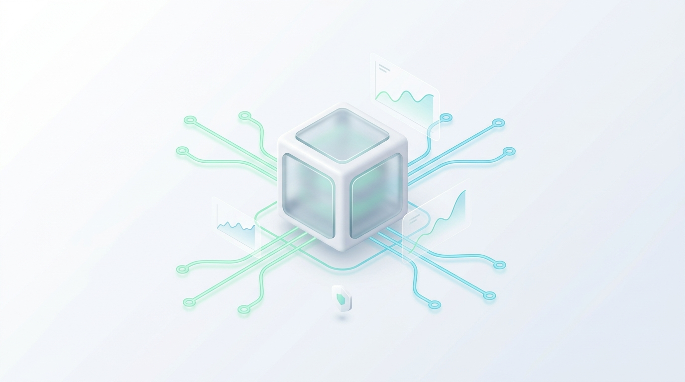
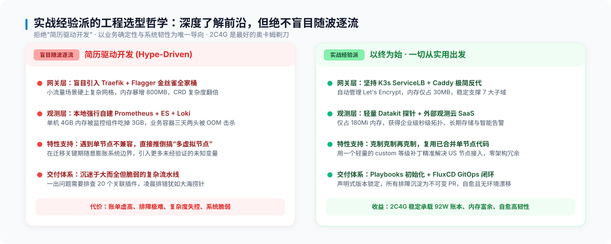
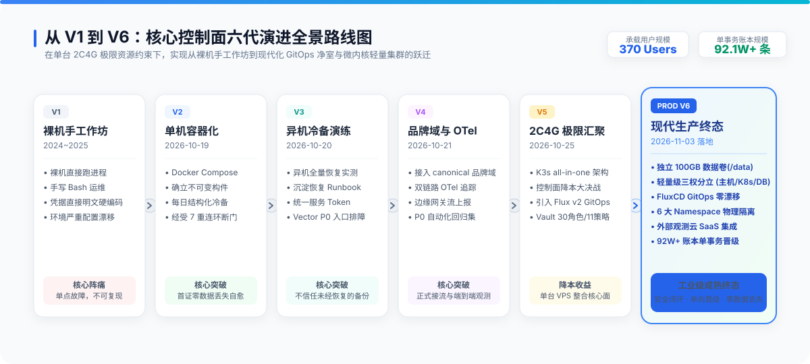

# 笔记-01：选型哲学与荒蛮起步——V1/V2 从手工作坊到容器化自愈

> **作者**：海涛 (Haitao Pan) / 平台架构与 DevSecOps 实践小组
> **专栏定位**：公众号【一路从 V1 狂奔到 V6】系列实战笔记（第一篇，共七篇）
> **核心指标**：Linode 2C4G (24$/mo)、实战经验派技术心法、V1 裸机到 V2 容器化



---

### 一、实战经验派的第一心法：2C4G 是最好的“奥卡姆剃刀”



在 AI 业务爆发期，工程师最容易陷入**“简历驱动开发”（Hype-Driven Development）**：
- 哪怕只有几个核心微服务，也强行引入复杂的 Istio 服务网格；
- 哪怕只有几百个边缘 Agent，也要在单机上塞入动辄占用 3GB 内存的自建监控全家桶；
- 架构看似繁荣，一旦线上出事，凌晨两点根本查不出请求被哪一层 Envoy 拦截。

**实战经验派的选择是相反的：**
我们对所有前沿技术保持敏锐嗅觉，会去深入调研、吃透原理；**但我们绝不随波逐流**。我们坚持把硬件限制在单台 2C4G（2核CPU / 4GB内存）虚机内。

为什么是 2C4G？
因为资源越紧凑，过度设计的代价就越惨烈。**在 2C4G 上，每一兆内存的开销、每一次网络跨跳的延迟，都必须直接转化为业务确定性。**
如无必要，勿增实体！这把“奥卡姆剃刀”，逼迫我们做出了整个六代演进中最具性价比的工程取舍。

---

### 二、V1 荒蛮时代（2024~2025）：手工作坊的惨痛代价



每个伟大系统的起点往往是混乱的。在 V1 阶段，控制面跑在单台裸机 VPS 上：
- **架构拓扑**：Node.js、Python 后台、PostgreSQL 与原生 Nginx 全塞在同一台宿主操作系统里；
- **运维习惯**：手动 SSH 登录，敲 `curl | bash` 安装环境，API 密钥和数据库 DSN 明文写在 `.env` 中；
- **核心阵痛**：
  1. **配置漂移严重**：改一个配置全凭运维在 `/etc/` 目录下手改，没有任何 Git 追踪；
  2. **硬编码灾难**：密钥散落在线上各个角落，一旦泄露只能靠人肉搜寻更换；
  3. **单点脆弱性**：一旦系统盘损坏或内存跑满，由于缺乏可重现的代码化基准，必须花上整整两天人工拼装调试。

> 💡 **V1 的血泪启示**：
> 没有代码化、声明式管理的基础设施，本质上都是一次性玩具。只要一次非预期宕机，团队就会为“不可重现的环境”买单。

---

### 三、V2 容器化觉醒：首个 DevSecOps 基线与七重断门自愈

为了彻底摆脱 V1 的脆弱，团队在 **PROD V2（2026-10-19）** 确立了首个 DevSecOps 基线：**拥抱容器化生命周期解耦与不可变交付**。

```
┌────────────────────────────────────────────────────────┐
│             Linode 2C4G VPS · PROD V2 控制面           │
│                                                        │
│   公网 HTTPS ──► [ Caddy 边缘反代 (自动 TLS 证书) ]     │
│                         │                              │
│       ┌─────────────────┼──────────────────┐           │
│       ▼                 ▼                  ▼           │
│  [ Console 前端 ]   [ Accounts 鉴权 ]   [ Billing 计费 ] │
│       └─────────────────┬──────────────────┘           │
│                         ▼                              │
│              [ PostgreSQL 业务数据库 ]                 │
│                         ▲                              │
│              [ 定期冷备脚本 (capture.py) ]             │
└────────────────────────────────────────────────────────┘
```

#### 1. 架构突破点
- **Docker Compose 解耦**：通过轻量容器拆解 Next.js Console、Accounts 鉴权、Billing 计费与 PostgreSQL，配合 Caddy 自动申请维护 Let's Encrypt TLS 证书；
- **不可变构件原则**：严禁生产使用 `latest`、`dev` 等浮动标签，镜像必须严格对齐 Git Commit SHA；
- **结构化离线冷备**：编写结构化脚本（`capture.py`, `capture_vault.py`），每天对核心数据库与配置进行加密存证。

#### 2. 经典战役：7 重连环故障下的“零数据丢失”
在一次生产例行维护中，系统突发镜像 Digest 错误、挂载路径漂移、初始化脚本权限阻断等 **7 重连环异常**。整个控制面短暂失联。
但正是因为 V2 严格坚持了**“存储与容器分离、数据单向抽取、全量离线冷备”**的工程护栏，团队依靠脱敏冷备和修复脚本，在不停机破坏现有磁盘的前提下实现了无缝回滚与数据零丢失。

这次实战沉淀出知名案例《PROD V2 升级零数据丢失实战复盘》，也让团队深刻确信：**单机不是原罪，缺乏备份规范与回滚机制才是原罪。**

---

### 导航与互动
- **下一篇**：[笔记-02：跨主机容灾与 V3-V4 探索](./02-cross-host-dr-and-v3-v4.zh.md)
- **系列索引**：[返回目录 README.md](./README.md)
