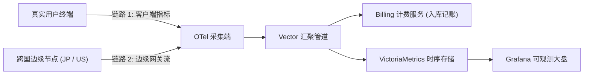

# 笔记-02：跨机容灾与品牌接流——V3/V4 异机恢复演练与双链路 OTel 防线

> **作者**：海涛 (Haitao Pan) / 平台架构与 DevSecOps 实践小组
> **专栏定位**：公众号【一路从 V1 狂奔到 V6】系列实战笔记（第二篇，共七篇）
> **核心指标**：跨机恢复演练验证、Vector P0 流量阻断排障、品牌双域名平滑接入

---

### 一、V3 跨机冷备演练：不信任未经还原的备份

有了 V2 的容器化经验，团队在 **PROD V3（2026-10-20）** 提出了一个极其刻薄的问题：**如果你手里的备份从来没在另一台空机上解密跑起来过，凭什么认定它是备份？**

很多企业的容灾方案最终沦为形式主义，正是因为“只管定期备份，从未实机演练”。
一旦源主机宿主故障，运维往往会发现：快照损坏、解密密钥丢失、缺少关键环境变量、或是 PostgreSQL 序列号未对齐。


#### 实机恢复演练与 Runbook 标准化
1. **实战模拟**：模拟源主机瞬间销毁，仅凭受限备份目录中的加密 Snapshot 与 YAML 声明，在全新的空机上从零恢复全部数据和配置；
2. **沉淀标准 Runbook**：输出《新代际主机快照恢复演练指南》（New Generation Recovery Runbook），将环境变量映射、序列号对齐固化为标准化操作流程，杜绝人工经验依赖。

---

### 二、排雷实录：Vector 流量阻断 P0 事件

V3 期间遭遇了一次诡异的线上故障：
- **症状**：边缘 Agent 的健康探针全部返回 HTTP 200，但中心控制台的用量大盘与记账流水完全静止；
- **根因**：网关更新规则时，配置只放通了 GET 方法的 `/healthz` 探针，而边缘 Vector 汇聚端推送业务计量数据采用的是 POST 方法，被 Caddy 反向代理直接判定为非法路径抹杀；
- **破局**：精细化修复 Caddy 转发匹配规则，同时将散落在各个组件的内部鉴权凭据，统一收敛为 **Canonical Service Token** 规范。

```
[边缘节点 Vector 汇聚端] ──(POST /v1/ingest)──► [ Caddy 边缘网关 ]
                                                        │
                      历史缺陷：仅放通 GET /healthz ────┴──► 403 / 404 (静默阻断!)
                      V3 纠偏：收敛 Canonical Token ────► 正常入库记账
```

---

### 三、V4 走向商业化：品牌接流与双链路 OTel 方案

2026 年 10 月 21 日，系统升级至 **PROD V4**，正式接入全球商业化流量：



#### 1. 品牌双域名平滑交接
- 正式接入 canonical 品牌域名（`xworktech.com`）与控制台平台域（`*.svc.plus`）；
- 梳理 DNS 解析策略，使用 Cloudflare API 实现 DNS-only 精准路由，保留 Google Workspace MX 与 SPF 防伪记录，确立了 DNS 变更的标准交接回执规范。

#### 2. 双链路 OTel 方案落地
- 针对跨国边缘代理（如东京 JP、美西 US 节点）网络波动频繁的特点，设计了**客户端端到端与边缘网关双链路 OpenTelemetry 追踪体系**；
- 建立 P0 回归测试套件（`test_web_saas_brand_route.py`、`test_snapshot_credential_repair.py`），把域名路由校验、密码登录、Token 轮换全部固化为 CI 自动化脚本。

---

### 导航与互动
- **上一篇**：[笔记-01：选型哲学与荒蛮起步——V1/V2 从手工作坊到容器化自愈](./01-selection-philosophy-and-v1-v2.zh.md)
- **下一篇**：[笔记-03：极限降本与架构孤注一掷——V5 踩坑实录](./03-extreme-cost-reduction-v5.zh.md)
- **系列索引**：[返回目录 README.md](./README.md)
