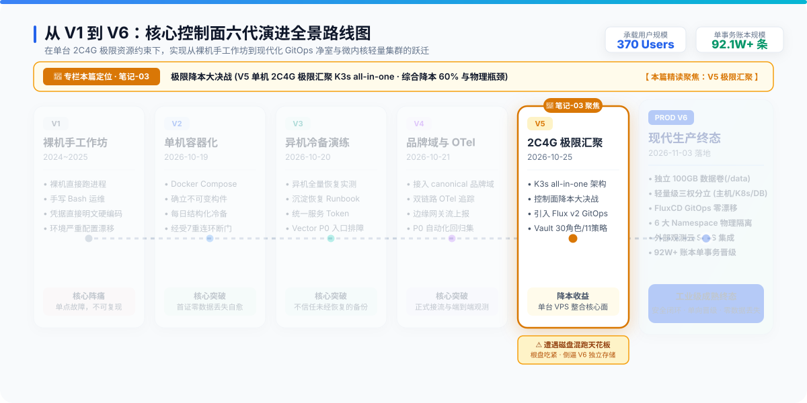
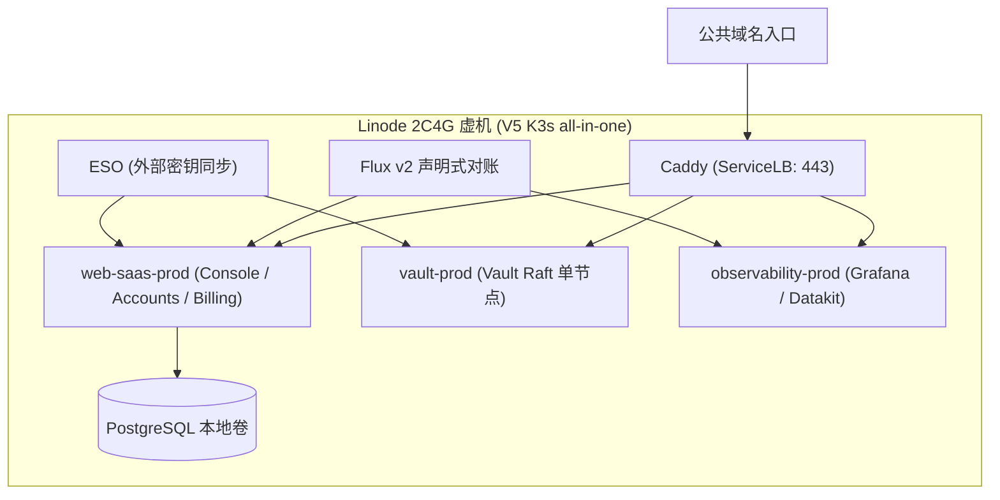

# 笔记-03：极限降本大决战——V5 在 2C4G 上实现 K3s all-in-one

> **作者**：海涛 (Haitao Pan) / 平台架构与 DevSecOps 实践小组
> **专栏定位**：公众号【一路从 V1 狂奔到 V6】系列实战笔记（第三篇，共七篇）
> **核心指标**：Linode 2C4G (24$/mo) 降本 60%、单机 K3s all-in-one、净室三轮对账法

---



---

### 一、降本大决战：单机 K3s all-in-one 架构

2026 年 10 月 25 日，面对云成本优化压力，团队启动 **PROD V5** 架构重构：**将 Web-SaaS、Vault 密钥服务器、Grafana/可观测栈汇聚到一台 Linode 2C4G VPS 上！**



很多工程师问：单机上 K8s 是不是多此一举？
**实战派的答案是：利用 K3s 的轻量抽象，获得企业级标准化红利。**
- **极小算力底噪**：内存仅需几百兆的 K3s 替代笨重的原生 K8s；
- **严格逻辑分界**：利用 Namespace 隔离业务、密钥与观测；
- **声明式控制循环**：引入 **Flux v2** 实现 GitOps 声明式对账；
- **消灭明文凭据**：引入 **External Secrets Operator (ESO)**，构建 GitHub ↔ Vault 的 30 角色 / 11 策略严格鉴权矩阵，**综合成本直降 60%**。

---

### 二、净室三轮对账法

在迁移过程中，为确保迁移工具不会造成数据脏写，团队在净室环境中运用 `migratectl` 工具，实施了严密的**三轮幂等对账**：
1. **第一轮（首跑）**：导入目标端，比对行数、字段哈希与 Sequence 序列；
2. **第二轮与第三轮（重放）**：在完全相同的输入下，重复执行两次迁移命令；
3. **严格判定**：验证两次重跑是否均为 `no-op`（无多余写入、无主键冲突、无字段漂移）；
4. **路由修复**：修复前端因 Caddy host matcher 遗漏造成的页面白屏。

---

### 三、V5 的天花板：为什么必须迈向 V6？

V5 虽然为团队省下了 60% 的账单，但随着业务数据增长，系统撞上了三大物理瓶颈：

```
┌────────────────────────────────────────────────────────┐
│             PROD V5 核心瓶颈与安全隐患                 │
├────────────────────────────────────────────────────────┤
│ 1. 存储混跑致命隐患                                    │
│    PostgreSQL 数据卷、Vault Raft 日志与宿主机根盘混跑，│
│    50GB 根盘打满将直接触发 Kubelet 灾难性驱逐 Pod！    │
│                                                        │
│ 2. 底层操作系统老旧                                    │
│    Debian 12 内核缺少现代安全隔离与先进 eBPF 特性支持。 │
│                                                        │
│ 3. 网络网段冲突风险                                    │
│    Pod CIDR 默认占用 10.42.0.0/16，与混合云网段重叠。  │
└────────────────────────────────────────────────────────┘
```

**这三大隐患，直接倒逼出了终极代际——PROD-K3S-V6。**

---

### 导航与互动
- **上一篇**：[笔记-02：跨主机容灾与 V3-V4 探索](./02-cross-host-dr-and-v3-v4.zh.md)
- **下一篇**：[笔记-04：生产终局——V6 四大核心支柱与轻量三权分立](./04-v6-production-finality-four-pillars.zh.md)
- **系列索引**：[返回目录 README.md](./README.md)
