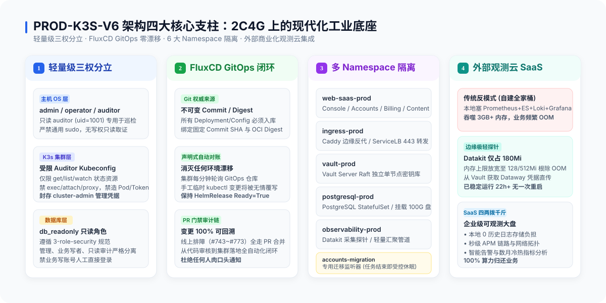
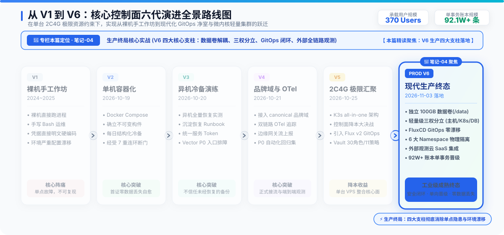
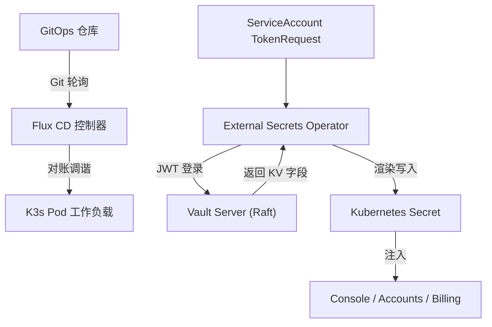
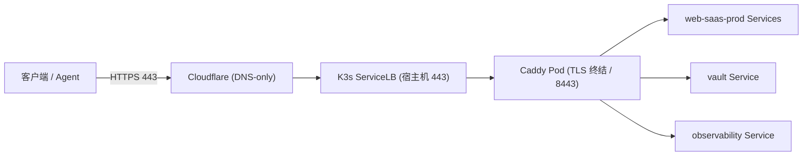

# 笔记-04：生产终局——V6 四大核心支柱与轻量三权分立

> **作者**：海涛 (Haitao Pan) / 平台架构与 DevSecOps 实践小组
> **专栏定位**：公众号【一路从 V1 狂奔到 V6】系列实战笔记（第四篇，共七篇）
> **核心指标**：Debian 13 Linux 6.12、100GB 独立存储挂载 `/data`、轻量三权分立、GitOps 零漂移



---



---

### 一、PROD-K3S-V6 的物理重构

2026 年 11 月 1 日，团队在全新独立实例上拉起 V6：
- **算力与系统**：Linode `g6-standard-2`（2C4G），全面装载 **Debian 13（Linux 6.12 内核）** 与 **K3s v1.37.1+k3s1**；
- **存储物理隔离**：独立挂载 **100GB 独立云块存储（`/data`）**，local-path 根目录绑定为 `/data/k3s-storage`，与操作系统根盘彻底物理隔离；
- **网络彻底解耦**：声明全新集群 Pod CIDR `10.52.0.0/16`（节点分配 `/24`）、Service CIDR `10.53.0.0/16`，搭建 WireGuard P2P 隧道（`v5v6`，`10.254.250.0/30`）支撑跨代平滑迁移。

---

### 二、支撑 V6 的四大工业级支柱

#### 1. 轻量级“三权分立”（主机 · 集群 · 数据库）
告别“root / cluster-admin 一把梭”的粗放模式：
- **主机 OS 层**：初始化 `admin`（系统内核维护）、`operator`（日常运维）、`auditor`（只读审计，`uid=1001`）。线上排查一律使用 auditor，无通用 sudo；
- **K3s 集群层**：日常彻底封存管理员 kubeconfig，为巡检下发受限 auditor 凭据。RBAC 限制只读 get/list，**严格禁止 exec/proxy，禁止建 Pod，禁止造 Token**；
- **数据库层**：落实 `system-db-three-role-security`，巡检使用专有 `db_readonly` 角色及授权视图，严禁人工直连业务写账号。

#### 2. FluxCD GitOps 声明式自动对账
- **消灭环境漂移**：整个控制面的 HelmRelease、Kustomize 清单全部固化在 Git 仓库中；
- **状态单向闭环**：Flux 定时轮询 Git 仓库，并在集群内执行自动对账。**一旦有人在集群里敲命令临时改配置，Flux 会在几分钟内无情覆写还原**，倒逼所有线上排障（如 #743 到 #773）必须先提 PR，经 Code Review 合并后，由集群自主拉取生效！

#### 3. 清晰严密的六大 Namespace 隔离
```
┌────────────────────────────────────────────────────────────────────────┐
│                        PROD-K3S-V6 多 Namespace 矩阵                   │
├────────────────────────────────────────────────────────────────────────┤
│ • ingress-prod        : Caddy 边缘反向代理、TLS 证书自动维护            │
│ • web-saas-prod       : Console 前端、Accounts 认证、Billing 计费、Content│
│ • vault-prod          : Vault Server Raft 单节点、安全密钥中枢         │
│ • postgresql-prod     : PostgreSQL 业务数据库、挂载独立 100GB 数据卷   │
│ • observability-prod  : Datakit 采集探针、轻量时序汇聚管道              │
│ • accounts-migration  : 专用迁移监听器 (任务结束即刻处于受控休眠)       │
└────────────────────────────────────────────────────────────────────────┘
```
配合 Kubernetes NetworkPolicy，跨 Namespace 流量必须受控穿透，消除了单容器被攻陷导致整个集群裸奔的横向提权风险。

#### 4. 四两拨千斤：外部商业化观测云 SaaS 集成
**这是实战经验派最自豪的降本设计：**
- 坚决不在 2C4G 虚机里自建笨重的监控全家桶（吃掉 3GB 内存）；
- 本地只运行轻量级 **Datakit DaemonSet**（内存配额放宽至 128/512Mi，稳居 180Mi）；
- Datakit 经 Vault 凭据将指标、日志、跨国延迟**直推外部商业化观测云 SaaS**，用 180Mi 内存换回企业级秒级拓扑大盘与数月冷热指标分析，把算力 100% 留给核心业务！

---

### 三、三幅核心拓扑与身份流向

#### 1. 交付管理与工作负载身份链


#### 2. 公网入口流量穿透链


---

### 导航与互动
- **上一篇**：[笔记-03：极限降本与架构孤注一掷——V5 踩坑实录](./03-extreme-cost-reduction-v5.zh.md)
- **下一篇**：[笔记-05：零秘密外泄与 92 万数据大迁移](./05-vault-restore-and-92w-data-migration.zh.md)
- **系列索引**：[返回目录 README.md](./README.md)
