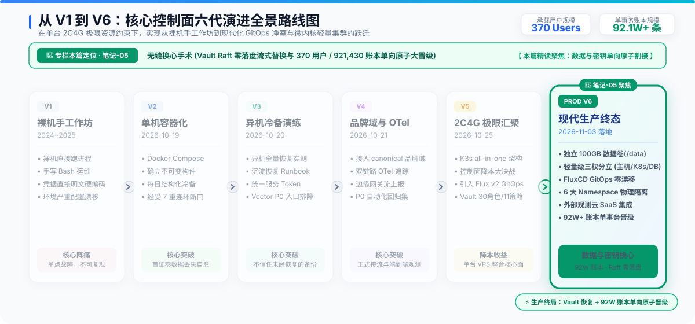
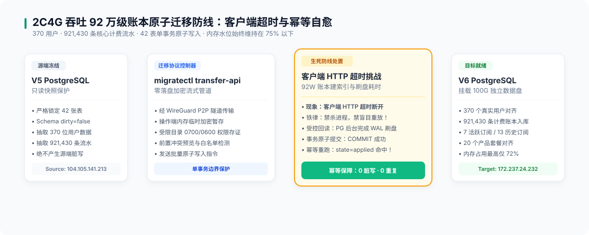

# 笔记-05：无缝换心手术——Vault 流式恢复与 92 万级账本原子晋级

> **作者**：海涛 (Haitao Pan) / 平台架构与 DevSecOps 实践小组
> **专栏定位**：公众号【一路从 V1 狂奔到 V6】系列实战笔记（第五篇，共七篇）
> **核心指标**：370 位用户、**921,430 笔账本流水**、42 张业务表、Vault Raft 零落盘恢复

---

---

### 一、手术一：Vault Raft 状态全量流式替换

在代际迁移中，密钥中枢的平滑替换是最大难点。跨外网 Join 容易脑裂，我们采用稳健的 **全量 Raft 快照 HTTPS 内存流替换方案**：

1. **严格存证**：源端导出 `v5-source.snap`（SHA-256 `df27a644...`，Index 315185），目标端生成回退快照 `v6-before.snap`（SHA-256 `a2271c96...`）；
2. **零落盘内存流传输**：CLI 进程内存直发 V6 `POST /v1/sys/storage/raft/snapshot`，API 返回 HTTP 204 Accepted；
3. **异步解封与核验**：日志确认 `post-unseal setup complete`，集群处于 Unsealed 状态，Pod 0 重启；8 个关键 KV 版本与摘要完全一致，9 个应用 SecretStore 的 JWT 换发 100% 成功。

---

### 二、手术二：PostgreSQL 42 表单向原子晋级（92 万级流水实战）

放弃容易泄露端口的公网直连，采用专用 `accounts-migration-listener` 与客户端 `migratectl`：

#### 1. 契约锁定与停写防线
- **数据范围**：严格锁定 `identity-billing-v1` 契约包含的 **42 张核心业务表**；
- **防脏写保护**：迁移前通过指令**完全挂起目标端所有后台写者**，杜绝并发脏写；
- **前置冷备**：取得 V6 前置加密备份（`v6-pre-import-...`），在独立临时沙箱演练恢复。

#### 2. 百万级数据写入：遭遇 HTTP 客户端超时危机
当执行 `migratectl transfer-api --apply` 时，因账本数据庞大（累计 **921,430 条流水记录**），在 2C4G 机器的有限 I/O 和内存缓冲区下，单事务批量写入、外键约束校验与 B-Tree 索引构建耗时数分钟，导致客户端 HTTP 连接因超时主动断开！

**在很多团队中，这通常是灾难的开始——运维往往会盲目强杀进程或立刻二次重放，导致数据库产生严重死锁或数据翻倍重复！**

#### 3. 幂等回读自愈
团队严格执行规约：
- **静默回读**：受控通道回读显示，PostgreSQL 后台一直在安全执行 WAL 刷盘，最终顺利完成原子 `COMMIT`；
- **幂等重跑**：紧接着发起二次重跑，系统精准命中事务幂等锁，秒级返回 `state=applied`！

#### 4. 时点入库事实存证
- **370 个真实用户**
- **7 个活跃订阅 / 13 条历史记录**
- **921,430 条记账明细（92 万级）**
- **20 个产品套餐**
- 整个导入期间，虚机内存维持在 72% 以下，**0 次 OOMKilled**。

> 💡 **架构手记：为什么我们不畏惧在 2C4G 机器上写入 92 万条流水？**
> 很多开发者以为 2C4G 只能跑跑 Demo。但只要遵循 **“流式管道解耦 + 停写单事务 + 独立数据盘 `/data` I/O 隔离 + 客户端超时状态回读机制”**，单台 4GB 虚机完全能够稳健吞吐 **921,430 条高频金融计费流水**，且整个导入过程内存水位始终被压制在 75% 以下，没有触发任何一次 OOMKilled。
>
> **架构的高级，从来不是看你用了多少台服务器，而是看你对每一兆内存、每一条事务边界的掌控精度。**

---

### 导航与互动
- **上一篇**：[笔记-04：生产终局——V6 四大核心支柱与轻量三权分立](./04-v6-production-finality-four-pillars.zh.md)
- **下一篇**：[笔记-06：72 小时拆弹实录——新集群落地 9 场排障暗战与根因复盘](./06-72h-nine-battles-postmortem.zh.md)
- **系列索引**：[返回目录 README.md](./README.md)
