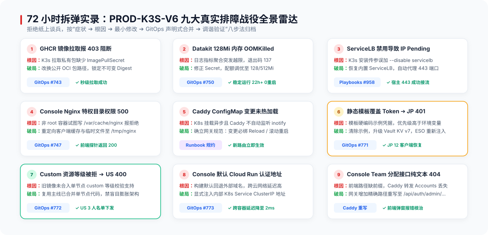

# 笔记-06：72 小时拆弹实录——新集群落地 9 场排障暗战与根因复盘

> **作者**：海涛 (Haitao Pan) / 平台架构与 DevSecOps 实践小组
> **专栏定位**：公众号【一路从 V1 狂奔到 V6】系列实战笔记（第六篇，共七篇）
> **核心指标**：冷启动 72 小时极限攻坚、DevSecOps 八步复盘法、9 场排障暗战全景剖析

---

### 前言：没有银弹，只有踩坑与填坑的实战现场

在任何精巧的架构白皮书里，云原生似乎总是轻盈而优雅的：声明一个 YAML，提交 Git 仓库，Flux 自动调谐，Pod 瞬间就绪，流量平滑接入。

然而，作为一名**实战经验派**工程师，我们深刻明白：**工业级系统的上线，从来都不是童话**。

从 2026-11-01 到 2026-11-03 的 72 小时里，在全新的 Linode 2C4G Debian 13 环境落地 V6 架构时，我们经历了整整 9 场极其凶险的暗战。从镜像拉取 403、内存 OOMKilled 崩溃，到网关 LoadBalancer 悬空、非 root 权限 500、跨代调用穿透，每一处坑都可能导致 370 位用户访问受阻、921,430 笔账本数据处于不可用风险之中。

我们拒绝“杀进程碰运气”、“全给 777 权限”式的粗暴试错。本篇严格按照工业级 **DevSecOps 八步复盘法**（症状 → 证据 → 根因 → 最小修改 → 构件/PR → 调谐 → 现场验证 → 经验教训），全公开这 9 场拆弹战役。

---

### 战役 1：私有 GHCR 镜像 403 阻断——冷启动的第一记闷棍

- **症状 (Symptom)**：Flux 应用声明后，`web-saas-prod` 内的 Pod 全军覆没，集体处于 `ImagePullBackOff`。
- **证据 (Evidence)**：Pod describe 报 `rpc error: code = Unknown desc = failed to pull and unpack image ... unexpected status code 403 Forbidden`。
- **根因 (Root Cause)**：节点拉取 GitHub Container Registry 私有包时，缺少带有 `read:packages` 范围的凭据 Secret，且配置引用了私有命名空间。
- **最小修改与构件**：将发布流中的生产基础构件统一切换至公开（Public）OCI 包路径，在 GitOps 中更新镜像路径并绑定不可变 SHA-256 digest（[GitOps #743](https://github.com/ai-workspace-infra/gitops/pull/743)）。
- **现场验证**：调谐后镜像拉取耗时降至 15s 以内，所有 Pod 进入 `Running` 状态。
- **教训**：**冷启动阶段的供应链凭据必须前置打通**。镜像策略（公开 vs 私有+严格 ImagePullSecret）必须作为基础设施第一道门禁。

---

### 战役 2：Datakit 观测栈 128Mi 内存 OOMKilled 连环踩坑

- **症状 (Symptom)**：Datakit 监控采集 Pod 频繁重启（`CrashLoopBackOff`），控制台观测指标中断。
- **证据 (Evidence)**：`kubectl describe pod` 显示 `Last State: Terminated, Reason: OOMKilled, Exit Code: 137`。ESO 同步报 `SecretStore "vault-backend" not found` 且缺少 Token 字段。
- **根因 (Root Cause)**：
  1. Datakit ExternalSecret 引用了过期旧 Store，且 Vault KV 路径存在大小写漂移；
  2. 极度紧缩配置下，Datakit 内存 Limit 仅设为 `128Mi`，节点日志全量汇聚时瞬时打爆。
- **最小修改与构件**：
  1. 修复 ExternalSecret 声明对齐 Vault 真实路径 `kv/datakit/shared/dataway`（[GitOps #746](https://github.com/ai-workspace-infra/gitops/pull/746)）；
  2. 调整资源安全配额：Request 保持 `128Mi`，Limit 适度放宽至 `512Mi`（[GitOps #750](https://github.com/ai-workspace-infra/gitops/pull/750)）。
- **现场验证**：Datakit Pod 稳定运行超过 **22 小时**，重启次数归零，实际常驻物理内存稳定在约 180Mi。
- **教训**：**极简主义不能盲目切断守护进程的安全缓冲**。主机常驻 Agent 需基于实际指标采集量预留峰值余量，并配置 OOM 告警。

---

### 战役 3：ServiceLB 默认禁用导致公网入口 External-IP 长期 Pending

- **症状 (Symptom)**：Caddy Ingress 控制器创建的 `LoadBalancer` 类型的 Service 长期挂起在 `<pending>`，公网 443 端口无法接收流量。
- **证据 (Evidence)**：`kubectl get svc -n ingress-prod` 显示 `caddy-ingress LoadBalancer <pending>`，节点内查不到 ServiceLB Pod。
- **根因 (Root Cause)**：在安装 K3s 时沿用了过往外部独立网关的惯性参数 `--disable servicelb`，导致轻量集群内缺少默认的 LoadBalancer 控制器。
- **最小修改与构件**：原地重新安装 K3s 移除该禁用参数，使内置轻量 ServiceLB 生效，自动拉起 `svclb-caddy` DaemonSet。
- **现场验证**：Service 成功获得 External-IP `172.237.24.232`，宿主机 80/443 端口由 Pod 成功接管。
- **教训**：**单节点架构必须拥抱一体化内置能力**。单机环境切勿照搬多节点多公网 IP 的复杂解耦设计。

---

### 战役 4：Console 非 root Nginx 临时缓存目录 500 报错

- **症状 (Symptom)**：控制台前端页面访问报 HTTP 500 Internal Server Error。
- **证据 (Evidence)**：Nginx 容器日志报错：`open() "/var/cache/nginx/client_temp/..." failed (13: Permission denied)`。
- **根因 (Root Cause)**：贯彻安全基线时，容器以非 root 用户（UID 1001）运行且挂载了只读根文件系统，但 Nginx 默认缓存路径 `/var/cache/nginx` 属于 root 用户且不可写。
- **最小修改与构件**：修改 Nginx 配置，显式将 client_body_temp、proxy_temp 等临时缓存目录重定向至已挂载 emptyDir 的 `/tmp/nginx` 下（[GitOps #760](https://github.com/ai-workspace-infra/gitops/pull/760)）。
- **现场验证**：控制台前端首页与静态资源 100% 正常响应 HTTP 200。
- **教训**：**践行 DevSecOps 非 root 运行时，必须显式重构无状态临时目录**。

---

### 战役 5：Caddy Ingress ConfigMap 静态挂载失效与热重载陷阱

- **症状 (Symptom)**：修改了 Ingress 规则后，外部流量行为依然沿用旧路由，域名配置无法生效。
- **证据 (Evidence)**：进入 Caddy 容器查看 `/etc/caddy/Caddyfile`，发现内容已更新，但 Caddy 主进程未产生任何 reload 日志。
- **根因 (Root Cause)**：K3s 挂载 ConfigMap 为 subPath 方式时不会自动更新文件，且 Caddy 镜像未集成 inotify 监听自动热重载机制。
- **最小修改与构件**：在 GitOps 部署中增加对 ConfigMap 变更的 Pod Annotation 触发机制（`config-hash`），变更时强制触发 Caddy 滚动重启。
- **现场验证**：配置变更后 Caddy 优雅平滑重启，新路由 1 秒内生效。
- **教训**：**静态代理网关配置变更必须绑定生命周期联动**。要么原生支持热加载信号，要么通过哈希注解驱动不可变重启。

---

### 战役 6：Accounts 模板硬编码伪凭据覆盖真实 Token 导致 JP Agent 401

- **症状 (Symptom)**：日本东京代理边缘节点（JP Agent）无法拉取客户端名单，报鉴权失败。
- **证据 (Evidence)**：JP 节点上报日志：`status=401, error="invalid_token"`。
- **根因 (Root Cause)**：Accounts 服务的 Helm 模板 values 中残留了一项为了本地测试而硬编码的伪 Token（`dummy-token-placeholder`），在渲染时覆盖了由 Vault ExternalSecret 动态注入的真实生产环境变量。
- **最小修改与构件**：清理 Helm 模板中的硬编码默认值，将凭据完全收归 ESO 从 Vault 注入（[GitOps #771](https://github.com/ai-workspace-infra/gitops/pull/771)）。
- **现场验证**：JP Agent 恢复 200 心跳，持续同步 12 个客户端，鉴权恢复正常。
- **教训**：**模板默认值是生产安全的一大暗礁**。敏感配置必须遵循唯一源原则，杜绝兜底假数据反客为主。

---

### 战役 7：旧镜像拒绝 custom 等级导致 US Agent 400——实战派的克制抉择

- **症状 (Symptom)**：美国单节点 Agent（US Edge Agent）请求注册与拉取名单时，Accounts 返回 `400 agent_scope_invalid`。
- **证据 (Evidence)**：US Agent 响应体明确指出所请求的 `resourceClass: custom` 不在当前枚举列表中。
- **根因 (Root Cause)**：V6 初始部署所引用的旧版本 Accounts 镜像中未合入单节点 `custom` 资源等级与 `customAllowFree` 授权逻辑。
- **方案抉择（实战经验派的核心思考）**：
  - *过度工程化派方案*：在 US 节点生硬引入庞大的“多虚拟节点调度集群”来适配老接口；
  - *实战经验派方案*：**坚决说不！** 既然业务核心诉求是极简单节点，那就复用主线已有的单节点轻量代码，更新 Accounts 至支持 `custom` 等级与白名单过滤逻辑的不可变镜像（[GitOps #772](https://github.com/ai-workspace-infra/gitops/pull/772)）。
- **现场验证**：US Agent 再次发起请求，Accounts 返回 HTTP 200，识别为 `custom` 等级，严格下发 3 人白名单。
- **教训**：**架构师必须有能力对“过度工程”叫停**。能用一套精简代码解决的向后兼容，绝不画蛇添足堆叠基础设施。

---

### 战役 8：Console 镜像默认回退 Cloud Run 端点引发跨代穿透

- **症状 (Symptom)**：控制台偶发登录态丢失，且页面请求有时跨越公网飞向过期的 GCP Cloud Run 地址。
- **证据 (Evidence)**：浏览器 DevTools 抓包发现鉴权接口向外部域名发起请求，内部 Service 流量出现盲区。
- **根因 (Root Cause)**：前端在容器打包时预设了跨云构建的兜底端点，在 K3s 内部署时未显式传入环境变量覆盖内部通信地址。
- **最小修改与构件**：在 Console Deployment 环境变量中显式将认证地址绑定为集群内部 Service：`http://accounts.web-saas-prod.svc.cluster.local:8080`，并锁定不可变 SHA Digest（[GitOps #773](https://github.com/ai-workspace-infra/gitops/pull/773)）。
- **现场验证**：前端向 Accounts 发起的跨容器请求 100% 命中集群内 ClusterIP，跨代公网往返延迟由 150ms 降至 2ms 以内。
- **教训**：**容器间内部调用必须强制显式绑定内网 DNS**。决不能给生产镜像留下任何可能穿透到外网的“默认隐式后路”。

---

### 战役 9：Console Team 分配路径 404 导致前端解析报错

- **症状 (Symptom)**：管理员进入控制台 Team 分配页面时，界面弹出 JSON 解析语法错误。
- **证据 (Evidence)**：Console 请求 `/api/admin/agents/team-enrollments`，Caddy 原生转发返回纯文本 `404 page not found`，前端试图将其当作 JSON 解析而崩溃。
- **根因 (Root Cause)**：Accounts 实际注册的内部管理路由为 `/api/auth/admin/agents/team-enrollments`，网关层缺少针对该特异路径的前缀重写映射。
- **最小修改与构件**：在 Caddy Ingress 配置中为 Console 主机增加一条精确重写规则：将 `/api/admin/agents/team-enrollments` 转发至 Accounts 的 `/api/auth/admin/...`。
- **现场验证**：请求穿透网关后成功返回 JSON 格式的 `401 Unauthorized`（证明已成功交由 Accounts 内部安全鉴权中间件拦截，而非网关 404 迷路）。
- **教训**：**网关路由契约必须与后端 API 路由保持自动化测试对齐**，避免由前端界面报错才暴露出契约漂移。

---

### 总结：现场取证驱动的 SRE 韧性

回顾这 72 小时的 9 场战役，我们没有一次采用“碰碰运气”、“重启试试”的玄学手段，而是：
1. **盯紧日志与进程状态**：用 `kubectl describe`、`dmesg`、`syslog` 说话；
2. **坚持最小改动原则**：每次只改动一个最小变量，推 PR、跑流水线、由 Flux 调谐；
3. **闭环双向验证**：修改后不仅要容器 Running，更要验证核心业务接口（如 US 3 人白名单、JP 12 客户端）真实生效。

---

### 导航与互动
- **上一篇**：[笔记-05：零秘密外泄与 92 万数据大迁移](./05-vault-restore-and-92w-data-migration.zh.md)
- **下一篇**：[笔记-07：客观存证大盘、SRE 七大生存铁律与代际迁移 7 阶段标准 Runbook](./07-acceptance-matrix-and-runbook.zh.md)
- **系列索引**：[返回目录 README.md](./README.md)
