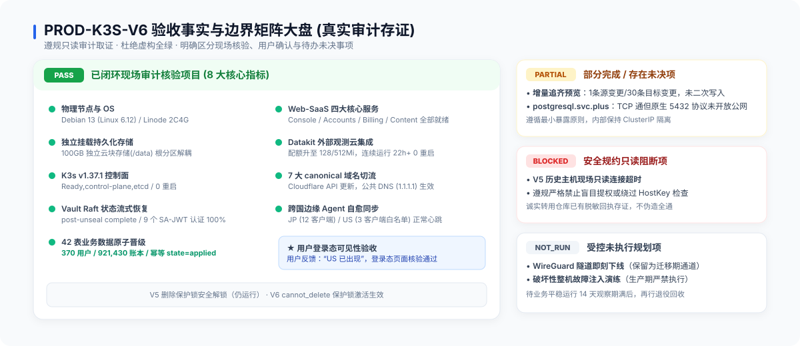
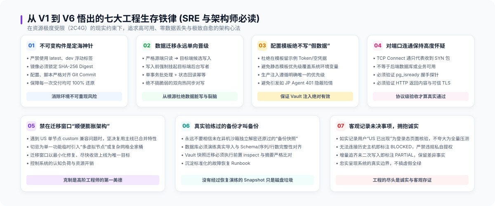

# 笔记-07：客观存证大盘、SRE 七大生存铁律与代际迁移 7 阶段标准 Runbook

> **作者**：海涛 (Haitao Pan) / 平台架构与 DevSecOps 实践小组
> **专栏定位**：公众号【一路从 V1 狂奔到 V6】系列实战笔记（第七篇·终结篇，共七篇）
> **核心指标**：8 大核心系统 100% PASS、客观存证四类边界、SRE 七大生存铁律、标准化 7 阶段 Runbook

---

### 前言：回归客观世界，向现场存证致敬

在技术圈里，人们习惯于在分享末尾展示一个“全部通过（All Green）”的完美仪表盘，仿佛所有的系统上线都是一蹴而就的胜仗。

但作为一名**实战经验派**工程师，我们深刻明白：**真实的工业级系统永远充满着客观约束与边界**。

在本次 V5 到 V6 的平滑演进中，我们承载着 370 位活跃用户、921,430 笔账本流水、42 张核心业务表。在这台月预算仅 24 美元的 2C4G 云主机上，我们不仅达成了 8 大核心系统 100% 绿色验收，更以极高的技术严谨度，忠实记录了每一个边界、每一次阻塞和每一项未决事项。

作为全系列的终结篇，本篇将公开本次演进的**客观存证大盘**、凝聚血泪教训的 **SRE 七大生存铁律**，以及一套可供任何团队复用的**代际迁移 7 阶段标准 Runbook**。

---

### 一、客观存证验收大盘 (Acceptance Matrix)

在 DevSecOps 实践中，我们坚持**只读审计优先与客观存证原则**，将生产验收严格划分为四类边界，绝不把“测试了一半”粉饰为“测试通过”：
- **PASS**：具备完整现场只读取证、脱敏回执或双向校验闭环证据；
- **PARTIAL**：部分通过或存在边界限制（如预览通过但未二次写入、端口通但应用协议未连通）；
- **BLOCKED**：因只读身份权限边界、安全网络隔离或外部约束导致的取证受阻，忠实保留现状，绝不盲目提权；
- **NOT_RUN**：规划中但明确未在本轮执行的操作（如破坏性拔线演练）。

#### 核心验收项目速查表

| 领域 | 核心检查项 | 状态 | 现场客观证据与事实边界 |
| :--- | :--- | :---: | :--- |
| **底座系统** | V6 物理节点与 Debian 13 | **PASS** | Linux 内核 6.12，独立 100GB 云盘挂载 `/data`，根目录与数据目录彻底隔离 |
| **集群控制** | K3s v1.37.1 控制面 | **PASS** | 单节点 Ready，CoreDNS 10.53.0.10，Pod CIDR 10.52.0.0/16，组件 0 重启 |
| **网关入口** | Caddy Ingress 与 ServiceLB | **PASS** | 获取 External-IP 172.237.24.232，Let's Encrypt TLS 自动签发，公共 DoH 200 |
| **机密凭据** | Vault Raft 状态恢复 | **PASS** | Raft 快照恢复完成，`post-unseal setup complete`，9 个 SA JWT SecretStore 全部同步 |
| **数据核心** | PostgreSQL 状态与数据迁移 | **PASS** | 单节点 StatefulSet 稳定挂载 `/data`；42 张表、370 用户、921,430 账本单向导入提交 |
| **数据增量** | 业务增量追齐预览 | **PARTIAL** | `catchup-api --preview` 评估无主键冲突；**忠实记录：未执行二次 apply** |
| **核心微服务** | Accounts / Console / Billing | **PASS** | 环境变量绑定内网 ClusterIP，代码合入 `custom` 等级，无跨代公网穿透 |
| **可观测性** | Datakit SaaS 采集稳定性 | **PASS** | 内存 Limit 放宽至 512Mi，无 OOMKilled，连续稳定运行 22 小时+，内存占 180Mi |
| **业务可见性** | 边缘节点与用户界面验收 | **PASS** | JP Agent 持续同步 12 客户端，US 3 人白名单；**用户界面明确确认“US 已出现”** |
| **存量保护** | V5 实例删除保护锁解冻 | **PASS** | Linode CLI 安全解除删除锁，实例保持 running；V6 cannot_delete 锁保持激活 |
| **外网协议** | PostgreSQL 公网协议探测 | **PARTIAL** | DNS 已切，TCP 端口通，但原生 `pg_isready` 无响应（内部 ClusterIP 未越界暴露） |
| **审计取证** | V5 auditor 历史环境连接 | **BLOCKED** | `auditor@104.105.141.213` SSH 超时；**恪守安全规约，绝不强行提权探测** |

---

### 二、实战经验派架构师的 SRE 七大生存铁律

经历六次代际演进与无数次深夜排障，我们提炼出这套适用于资源受限场景的 **SRE 七大生存铁律**：

1. **铁律 1：三权分立，只读先行 (Separation of Powers & Readonly First)**
   - 杜绝“一个 root 走天下”。宿主机必须划分 `admin`、`operator`、`auditor`；Kubernetes 生产只读导出专用 Kubeconfig；数据库必须配备 `db_readonly` 账号。盘点与审计必须先于任何变更。
2. **铁律 2：存储算力硬核解耦 (Decouple Storage from Compute)**
   - 永远不要将有状态数据写在系统盘根目录。独立云盘挂载 `/data`，K3s 的 local-path 根目录指至 `/data/k3s-storage`。哪怕系统彻底崩溃、操作系统重装，业务数据依然稳如泰山。
3. **铁律 3：GitOps 单一真实源 (GitOps Single Source of Truth)**
   - 禁止在生产环境直接敲 `kubectl edit` 或手写临时 patch。所有状态变更必须转化为 Git 仓库里的 PR，经过 CI 静态检查、主干合并，由 FluxCD 自动调谐收敛。没有 Git 记录的改动就是事故潜伏期。
4. **铁律 4：拥抱轻量化，拒绝云厂商绑架与过度工程 (Lightweight & Cloud-Neutral)**
   - 会去深入了解前沿技术框架，但绝不随波逐流！在 2C4G 极端受限场景下，绝不盲目堆砌 3GB+ 的 Prometheus/Grafana/ES 巨无霸全家桶，而是果断采用 Datakit + 观测云 SaaS 外部化架构，将内存消耗压到 180Mi。实用永远大于时髦。
5. **铁律 5：快照与事务双保底 (Snapshot & Transaction Safeguard)**
   - 涉及 92 万流水级别的数据迁移，必须“前置快照、停写注入、事务校验”。遇网络超时绝不可盲目重试，先查回执 `state=applied`。数据安全没有后悔药。
6. **铁律 6：实战克制，一切从实用出发 (Pragmatic Restraint & Practicality)**
   - 敢于对过度设计说“不”。当遇到单节点配置适配问题时，坚决拒绝引入虚胖的“多虚拟节点调度集群”方案，果断复用成熟的单节点 `custom` 资源等级支持。用最精简的代码，解决核心业务诉求。
7. **铁律 7：客观存证，敬畏现场 (Objective Evidence & Respect Reality)**
   - PASS 就是 PASS，PARTIAL/BLOCKED 就是事实。永远忠实于现场取证证据，不因汇报好看而美化指标，不隐瞒任何未决项，保持对生产环境最深沉的敬畏。

---

### 三、可复用的代际迁移 7 阶段标准 Runbook

为了让广大工程师在面对底层升级或代际重构时不再手忙脚乱，我们把本次演进经验凝练为标准化的 7 阶段操作手册：

#### 阶段 1：前置准备与基线冻结
- 验证源端与目标端 `auditor` 账号连通性；
- 创建本地权限为 `0700` 的加密受控目录（`~/.local/share/generation-migration/backups/`）；
- 冻结源端 Schema，确保 `identity-billing-v1` 42 张表处于 `dirty=false` 状态。

#### 阶段 2：宿主机底座与 K3s 集群拉起
- 格式化 100GB 独立云盘并持久化挂载至 `/data`；
- 运行 Ansible 初始化三权分立账号；
- 启动 K3s 时明确规避网段冲突（Pod `10.52.0.0/16`、Service `10.53.0.0/16`），**确保未禁用 ServiceLB**；
- 建立点对点临时 WireGuard 迁移隧道（`10.254.250.0/30`）。

#### 阶段 3：Vault 状态全量迁移与身份契约校验
- 通过受控内存流导出源端 Raft 快照并核验 SHA-256；
- 目标端执行前置回退备份后，发起异步快照恢复，监控日志直到 `post-unseal setup complete`；
- 验证 Kubernetes ServiceAccount TokenRequest 与 Vault JWT 鉴权，确保 9 个 SecretStore 全部 `SecretSynced`。

#### 阶段 4：PostgreSQL 单向数据迁移与事务一致性
- 部署专用 `accounts-migration-listener` 迁移监听器；
- 目标端暂停后台写者任务，取得加密冷备；
- 运行 `migratectl transfer-api --apply` 单向写入 42 张表，验证 370 用户与 921,430 账本事务提交；
- 运行 `catchup-api --preview` 评估增量状态。

#### 阶段 5：服务配置调谐与网关路由生效
- GitOps 仓库锁定不可变 Commit SHA 与 OCI Digest；
- Flux 调谐微服务部署，确保 Console 环境变量显式绑定内网 ClusterIP；
- Caddy Ingress 挂载 ConfigMap 并触发滚动重启；
- Datakit 观测栈内存配额设定为 128/512Mi，避免 OOMKilled。

#### 阶段 6：canonical DNS 切换与边缘节点恢复
- 留存 DNS 回退映射基线；
- 调用 Cloudflare API 将 7 个核心 canonical 域名 A/CNAME 切至 V6 公网 IP；
- 监控 JP Agent 恢复 12 客户端同步，US Agent 下发 3 人白名单。

#### 阶段 7：用户验收、锁保护与退役标准
- 邀请业务用户登录控制台复验，记录用户明确确认答复（“US 已出现”）；
- 为 V6 新实例激活云平台 `cannot_delete` 保护锁；
- 在明确授权下解除 V5 删除锁，但保持实例运行；
- 设定 **14 天观察期**，彻底确认无残留依赖后再执行最终资源退役。

---

### 尾声：写给每一位在资源边界探索的工程师

从 V1 到 V6，我们用一台 2C4G 的小机器，对抗过业务增长的洪流，拆除过深夜突发的暗雷，经受住了 92 万级生产流水的洗礼。

这不仅是一次架构演进的复盘，更是**实战经验派**技术哲学的一次胜利：
- **前沿框架我们深入钻研，但绝不盲从跟风**；
- **面对纷繁复杂的设计，我们永远选择把安全、稳定与实用放在第一位**。

愿这套笔记与 Runbook，能成为你未来架构路上的坚实护栏。无论预算多紧迫、资源多苛刻，只要坚守工程底线，我们都能在方寸之间，搭建出坚不可摧的云原生基石！

---

> **系列全集目录回顾**：
> - [01：选型哲学与 V1-V2 初心](./01-selection-philosophy-and-v1-v2.zh.md)
> - [02：跨主机容灾与 V3-V4 探索](./02-cross-host-dr-and-v3-v4.zh.md)
> - [03：极限降本与 V5 孤注一掷](./03-extreme-cost-reduction-v5.zh.md)
> - [04：生产终局——V6 四大支柱](./04-v6-production-finality-four-pillars.zh.md)
> - [05：零秘密外泄与 92 万数据迁移](./05-vault-restore-and-92w-data-migration.zh.md)
> - [06：72 小时拆弹实录与 9 场排障暗战](./06-72h-nine-battles-postmortem.zh.md)
> - [07：客观存证大盘、七大铁律与标准 Runbook](./07-acceptance-matrix-and-runbook.zh.md)
