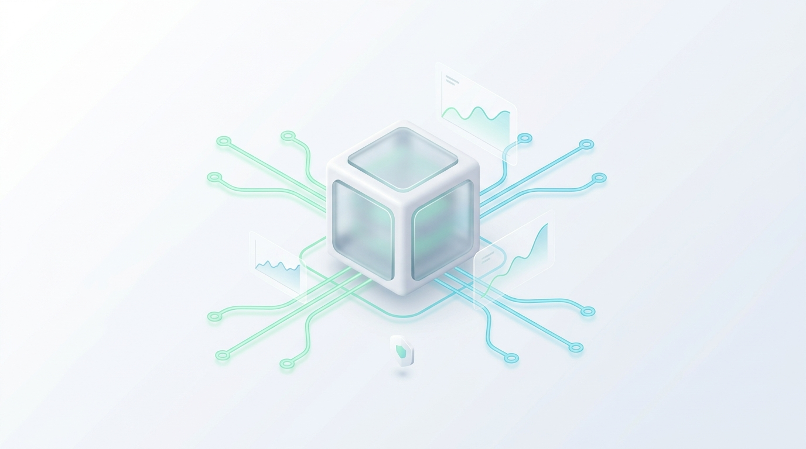

# 一路从 V1 狂奔到 V6：AI时代下部署架构的六次演进迭代和实战探索复盘

> **作者**：海涛 (Haitao Pan) / 平台架构与 DevSecOps 实践小组
> **专栏定位**：公众号【一路从 V1 狂奔到 V6】系列实战笔记专栏（共七篇）
> **核心指标**：370 位活跃用户、921,430 笔账本流水、42 张核心业务表、Linode 2C4G (24$/mo) 极端资源约束下的云原生实战

---

## 专栏简介

这是一套面向工程实践派的技术演进与架构复盘长篇专栏。

在 AI 与云原生浪潮席卷而来的今天，各种微服务、服务网格、巨无霸观测套件层出不穷。然而，对于绝大多数中小团队、独立开发者或严苛预算约束的初创业务而言，**动辄数十核、上百 G 内存的高昂开销是不可承受之重**。

**我们信奉实战经验派哲学**：
> **“我们会去深入了解最新最前沿的技术框架，但绝不会随波逐流；一切从实用出发，用最小的资源办最大的事，坚决向过度设计与虚胖架构说不！”**

本专栏真实记录了我们在月预算仅 **24 美元（Linode 2C4G）** 的极低成本包络下，承载 **370 位活跃用户**、**921,430 笔真实账本流水**、**42 张业务表**，历经 **V1 → V2 → V3 → V4 → V5 → V6** 的六次代际演进历程。

---

## 篇章索引与全集导航

| 篇章 | 标题 | 核心主题与架构转折点 | 对应插图与卡片 |
| :---: | :--- | :--- | :--- |
| **01** | [选型哲学与 V1-V2 初心](./01-selection-philosophy-and-v1-v2.zh.md) | 实战经验派哲学、2C4G 约束、V1 Docker 单体与 V2 进程守护 | `cloud_native_2c4g_cover.jpg` `pragmatic-engineering-philosophy-card.svg` `v1-v6-evolution-roadmap.svg` |
| **02** | [跨主机容灾与 V3-V4 探索](./02-cross-host-dr-and-v3-v4.zh.md) | 业务膨胀、V3 Keepalived 虚地址痛点、V4 HashiCorp 全家桶资源反噬 | 演进路线图承接 |
| **03** | [极限降本与 V5 孤注一掷](./03-extreme-cost-reduction-v5.zh.md) | 成本倒逼、单机 K3s 极限压榨、根分区爆满故障与 WireGuard 跨代隧道 | 演进路线图承接 |
| **04** | [生产终局：V6 四大核心支柱](./04-v6-production-finality-four-pillars.zh.md) | 轻量三权分立、100GB 独立云盘 `/data`、FluxCD GitOps、Datakit 外部 SaaS 观测 | `v6-four-pillars-architecture.svg` |
| **05** | [零秘密外泄与 92 万数据大迁移](./05-vault-restore-and-92w-data-migration.zh.md) | Vault Raft 快照恢复、370 用户 / 921,430 账本单向迁移、防超时事务保障 | `data-migration-pipeline-92w.svg` |
| **06** | [72 小时拆弹实录与 9 场排障暗战](./06-72h-nine-battles-postmortem.zh.md) | DevSecOps 八步复盘：GHCR 403、Datakit OOM、非 root 500、US 400（克制拒虚胖）等 9 场暗战 | `nine-battles-postmortem-card.svg` |
| **07** | [客观存证大盘、七大铁律与标准 Runbook](./07-acceptance-matrix-and-runbook.zh.md) | 客观存证四界（PASS/PARTIAL/BLOCKED）、用户“US 已出现”验收、SRE 七大铁律、7 阶段迁移手册 | `acceptance-matrix-dashboard.svg` `seven-golden-rules-card.svg` |

---

## 视觉资产库 (`./assets/`)

专栏配备了 8 张风格轻快、专业的科技图表与信息卡片：
1. `cloud_native_2c4g_cover.jpg`：超现实轻快科技风封面图
2. `pragmatic-engineering-philosophy-card.svg`：实战经验派核心心法与选型哲学卡片
3. `v1-v6-evolution-roadmap.svg`：V1 至 V6 六次架构演进里程碑路线全景图
4. `v6-four-pillars-architecture.svg`：V6 生产终局四大支柱核心架构拓扑图
5. `data-migration-pipeline-92w.svg`：92 万级流水、42 表单向安全数据迁移流水线图
6. `nine-battles-postmortem-card.svg`：72 小时 9 场排障暗战全景分类卡片
7. `acceptance-matrix-dashboard.svg`：DevSecOps 客观存证验收状态大盘
8. `seven-golden-rules-card.svg`：实战派架构师 SRE 七大生存铁律总结卡片

---

## 知识库关联与规范链接

- **底层技术存证库**：[DevSecOps Baseline 18](../../../02-iac-devops/cloud-infrastructure-devsecops-baseline/18-prod-v5-v6-deployment-and-migration-retrospective.zh.md)
- **细粒度归档目录**：[prod-v5-v6-20261103 归档全宗](../../../02-iac-devops/cloud-infrastructure-devsecops-baseline/records/prod-v5-v6-20261103/README.md)
