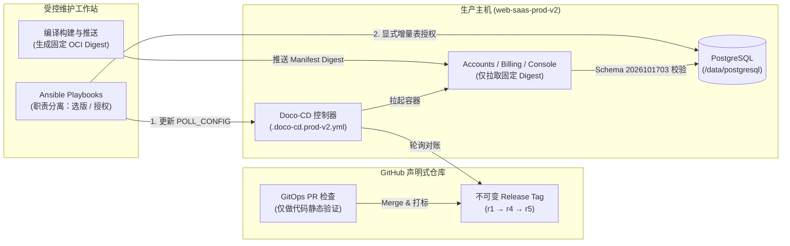
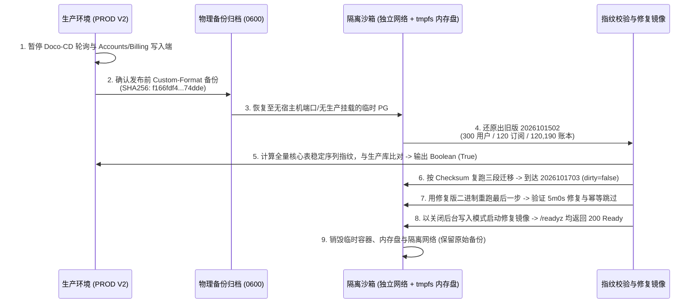
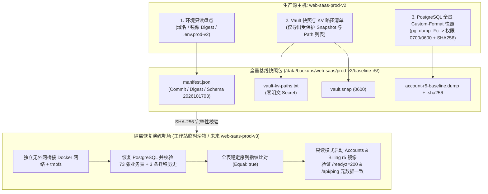

# 生产环境“带病升级”如何实现零数据丢失？一次基于不可变 GitOps 与受控增量迁移的恢复实战

> **摘要**：在云原生与持续交付高度普及的今天，“自动化部署”往往是一把双刃剑——当配置漂移、镜像元数据偏差与数据库 Schema 演进同时发生时，缺乏熔断机制的自动化流水线极易将一次普通发布演变为生产数据灾难。本文复盘了 `web-saas-prod-v2`（PROD V2）在 2026 年 10 月 18 日手工升级与恢复的全过程：面对镜像 Config Digest 误用、PostgreSQL 超时语法不兼容、内部迁移审计表识别冲突、新表 DML 权限缺失等 7 项连环故障，系统如何依靠 **不可变构件（Immutable Artifacts）**、**受控增量迁移状态机**、**内存沙箱隔离恢复校验** 以及 **最小权限对账** 实现“300 名核心用户、120 条订阅记录、12 万+ 用量数据表账本”零丢失，并在恢复后立即进入“特性冻结与全量基线快照”阶段。**尤为特别的是，本次从排障诊断、跨仓库代码修复、隔离沙箱演练到生产恢复与全量快照归档，全程均由 Code Agent 在既定工程技能（Skills）与安全护栏约束下自主执行完成。**

---

## 一、 背景：当单机容器化架构遇上高严苛生产升级

对于追求极致性价比与高吞吐的 SaaS 业务而言，在单台高配云主机上以 Docker Compose 容器编排完全自建（Full Self-Host）核心控制面是极为经典的技术选型：
* **业务控制面组件**：由 **Caddy**（反向代理与自动化 TLS 边缘网关）+ **Next.js**（控制台 Console 前端）+ **Node.js / Go**（Accounts 鉴权与 Billing 计费核心微服务）+ **PostgreSQL**（核心持久化主库，挂载物理盘 `/data/postgresql`）组成；
* **声明式运维工具套件**：确立了 **SSH（维护工作站通道） → Playbooks（Ansible 精准选版与授权） → GitOps（声明式仓库锁定不可变 Tag/Digest） → Doco-CD（主机端轻量持续对账控制器）** 的四段式发布闭环。

然而，与拥有多副本跨机滚动升级能力的 Kubernetes 集群不同，单机持久化架构在升级时面临两个天然脆弱点：

1. **状态与计算紧耦合**：PostgreSQL 生产数据盘（如 `/data/postgresql`）直接挂载于宿主机，任何激进的初始化或 `down` 回滚脚本一旦触发，都会直接作用于唯一生产源。
2. **控制器轮询与写入竞争**：当 GitOps 控制器（Doco-CD）检测到目标状态变更但新容器启动失败时，持续的重试（Retry Loop）若与半完成状态的数据库迁移交织，很容易造成脏写或账本计量中断。

在本次 `web-saas-prod-v2` 的升级窗口中，团队确立了严格的 **“SSH → Playbooks → GitOps → Doco-CD”** 四段式发布链路：

> [!IMPORTANT]
> **架构铁律**：GitHub PR 检查仅承担代码与配置静态验证，**严禁通过 CI 直接 Dispatch 生产部署**。应用镜像在受控工作站完成构建后，主机侧只允许拉取带 `sha256` 的固定 OCI Manifest Digest，彻底杜绝浮动 Tag（如 `latest`）带来的不可控变更。

---

## 二、 惊魂连环障：从 r1 到 r5 的七重拦路虎

本次升级的目标是将数据库 Schema 从 `2026101502`（`dirty=false`）平滑演进至 `2026101703`，并同步上线新版 Accounts、Billing 与 Console 服务。然而，从首次推进（`r1`-`r3`）到业务恢复（`r4`），再到元数据完全闭环（`r5`），系统连续遭遇了 7 个极具代表性的工程故障。

### 故障全景与修复对照表

| 编号 | 故障域 | 现象与触发根因 | 工程修复方案 | 关联变更 |
| :--- | :--- | :--- | :--- | :--- |
| **01** | **OCI 镜像分发** | 将镜像的 **Config Digest** 误填入配置，当作可拉取的 Manifest Digest，导致主机向 GHCR 拉取时返回 `404 Not Found`。 | 严格区分 OCI Image Index / Manifest Digest 与底层 Config Blob，修正为可拉取的 Manifest Digest 并在主机侧实测验证。 | [GitOps #456](https://github.com/ai-workspace-infra/gitops/pull/456) |
| **02** | **迁移超时语法** | 迁移器向 PostgreSQL 传递了 Go 语言原生时长格式 `5m0s`（如 `SET statement_timeout = '5m0s'`），被 PG 语法解析器直接拒绝。 | 将迁移器超时参数统一转换为**数值毫秒（ms）**；补充集成测试覆盖真实 5 分钟配置与超时自动回滚验证。 | [Accounts #234](https://github.com/ai-workspace-services/accounts/pull/234) |
| **03** | **Schema 审计冲突** | Accounts 启动自检时，将迁移器自身的内部审计表 `accounts_controlled_migration_history` 误判为“未知业务表”并拒绝启动。 | 在 Schema 白名单校验器中**仅精确排除该固定内部审计表**，原样保留对未知业务关系、列定义与权限的严格校验。（注：原计划改名为 `system_release_checkpoints` 因保持历史兼容性未执行，保留原名与 3 条 checksum 记录）。 | [Accounts #234](https://github.com/ai-workspace-services/accounts/pull/234) |
| **04** | **Billing 门禁滞后** | Billing 服务的 Runtime Checkpoint 仅硬编码接受旧版 Schema，面对已升级至 `2026101703` 的数据库拒绝就绪。 | 新增对 `2026101703` 的精确准入检查，锁定业务表总数为 **73 张**（迁移审计表不计入业务范围），对未知版本依然保持 Fail-Closed 拒绝策略。 | [Billing #50](https://github.com/ai-workspace-services/billing-service/pull/50) |
| **05** | **新表 DML 权限缺失** | 增量迁移由高权限维护角色执行，新建的 9 张邮件相关表默认缺少应用运行角色的读写权限。 | 编写专用 Ansible Role `web_saas_migration_grants`，在验证 Clean Checkpoint 后，**仅对 9 张已审核新表显式授予 `SELECT/INSERT/UPDATE/DELETE`**，不改动表属主、角色等级或全局 Default Privileges。 | [Playbooks #673](https://github.com/ai-workspace-infra/playbooks/pull/673) |
| **06** | **旧环境配置误触** | 早期排障过程中误修改了属于旧环境的 `.env.prod` 配置文件。 | 立即通过独立 PR 将 `.env.prod` 恢复至发布前状态，确保不触发旧 PROD 环境的任何部署动作。 | [GitOps #457](https://github.com/ai-workspace-infra/gitops/pull/457) |
| **07** | **复合镜像 Tag 解析** | `r4` 恢复业务后，发现 Billing 在解析形如 `:sha-<commit>@sha256:<digest>` 的镜像引用时，错误地将 `@sha256:...` 识别为 Tag 的一部分。 | `r5` 修复解析逻辑：先剥离 `@sha256:<digest>` 后缀再提取语义化 Tag，同时在元数据接口中完整保留原始 `IMAGE` 字符串。 | [Billing #51](https://github.com/ai-workspace-services/billing-service/pull/51) [GitOps #458](https://github.com/ai-workspace-infra/gitops/pull/458) |

> [!TIP]
> **细节洞察：同名 Docker Volume 的“障眼法”**
> 在排查数据库挂载时，团队发现宿主机上存在与 PostgreSQL 同名的历史 Docker Volume。如果仅凭 `docker volume ls` 盲目操作，极易误判数据源。**唯一可信的标准是通过 `docker inspect` 核对容器运行时的实际 Bind Mount**——确认 `/data/postgresql` 才是真实承载业务的物理路径。

---

## 三、 为什么连续中断下“数据零丢失”？八道防线的闭环拆解

在许多缺乏保护机制的系统中，上述任何一个故障（尤其是迁移中断与权限报错）都可能诱发工程师执行 `migrate force`、手动删改表结构或用旧备份盲目覆盖生产库。而本次事件最终交出了 **“300 个用户、120 条订阅记录分毫无损，用量账本从 120,019 条平滑增长至 120,700+ 条”** 的答卷，核心归功于以下八道工程防线的协同闭环：

### 1. 不可变构件与三维互锁校验
在 `prod-v2-2026.10.18-r5` 最终态中，代码的源码 Commit、OCI 镜像 Digest 与 GitOps 声明提交形成了严格的加密哈希锁：

* **GitOps 提交 (`r5`)**：`060dadeca933700254d9153632345f0fc8b402d7`（目标配置 `.doco-cd.prod-v2.yml` 与 `compose/web-saas/.env.prod-v2`）
* **Accounts 服务**：源码 `8c7ecd9cf4bb711b6ad491b2ac299f57b4d65184` ↔ 镜像 `sha256:6d70a8ff8319c0fc058fd8faaea212d74cd85a01bb7a00a1c1840be1e8fc5e7f`
* **Billing 服务**：源码 `8cdd4e95b83c96b7c4586c58eca22bcec821acf1` ↔ 镜像 `sha256:ae7b56e2e01011f9f32b93a4106f1897eab71e857c7c9f2ecf676c95fdb65bbb`
* **Console 服务**：源码 `bef82c807cf66cd6ad50036ba4fafaf33c33db32`

即便 Doco-CD 在故障期间发生轮询重试，也绝不可能拉取到未经验证的浮动代码；且失败的 Tag（`r1`–`r3`）作为历史证据链永久保留，严禁强行移动 Tag 指针（Force Tagging）。

### 2. 受控三段式增量 SQL 状态机
数据库从 `2026101502` 升级至 `2026101703` 严格遵循 **“先扩展、后切换、再收缩”** 的平滑演进原则，拆分为三段带有 SHA-256 签名锁的增量迁移：

| 迁移阶段 | 起始版本 | 目标版本 | SQL 脚本 SHA-256 校验值 | 状态机行为 |
| :--- | :--- | :--- | :--- | :--- |
| **Step 1** | `2026101502` | `2026101701` | `21da5da1f05a79707bac527147a07b58d84dcadeab96933935a03ca8f7e25a1b` | 校验通过，写入历史记录 #1 |
| **Step 2** | `2026101701` | `2026101702` | `6453608516d620773565b343d2397a0d3dc2415332a86f989a8952bcb044c5eb` | 校验通过，写入历史记录 #2 |
| **Step 3** | `2026101702` | `2026101703` | `28ca2c8673875ba6e13ffa0b8bf11828a0f5c2975f6a305de4fdacae9f3ff77e` | 校验通过，写入历史记录 #3 (`dirty=false`) |

**核心保护约束**：禁止重建表、禁止清空数据、禁止隐式初始化、**严禁手工 `force` 篡改版本号**。一旦检测到 `dirty=true` 或 Checksum 不匹配，流水线立即熔断停机。

### 3. 内存沙箱（tmpfs）隔离恢复与布尔指纹比对
为了验证备份有效性并测试新迁移二进制，工程师**没有在生产库上直接试错**，而是构建了完全隔离的验证闭环：

> [!NOTE]
> **隐私与安全合规设计**：在比对沙箱恢复库与真实生产库的“用户全行、两类订阅表、发票/付款/退款、用量账本和流量桶”时，验证脚本仅在内存中计算**稳定序列加密指纹（Stable Sequence Fingerprint）**，终端只输出布尔结论（`Equal: true`），全程不向日志或控制台打印任何一行真实用户数据或 PII（个人身份信息）。

### 4. 职责分离的 Ansible Playbooks 与启动保护开关
* **精准选版（`select-doco-cd-release.yml`）**：仅更新已有 Doco-CD 容器的 `POLL_CONFIG`，显式锁定 `target=prod-v2`，验证 Compose 语法后仅重建控制器，绝不触碰 Docker 引擎、数据卷或现有凭据。
* **启动写保护**：应用层强制保持 `bootstrap_writes=false` 与 `proxy_uuid_rotator=false`，防止服务在恢复初期触发自动初始化写操作或重置用户代理 UUID。
* **单点无感热更**：在 `r4` 升 `r5`（仅修复 Billing 镜像元数据解析）时，北京时间 `2026-10-18 01:21:45` 对账成功后，**仅 Billing 容器被替换**，Accounts、Console 与 PostgreSQL 的启动时间戳保持 `r4` 原值不变，4 个核心容器重启计数（Restart Count）全线为 `0`。

---

## 四、 乘胜追击：特性冻结与全量可迁移基线快照（PROD V2 → V3 演练准备）

在 `r5` 完全恢复、Free 套餐配额（`included_quota_bytes=5368709120`，即 5 GiB）与当月累计用量验证无误后，团队迅速做出了关键工程决策：**立即停止合入任何新业务特性（Feature Freeze），全面盘点当前 PROD V2 环境状态，并制作一份具备跨机恢复能力的全量基线快照。**

### 1. 当前生产环境（PROD V2）黄金基线盘点清单

为了确保后续无论是在工作站沙箱，还是在未来的 `web-saas-prod-v3` 主机上都能实现 1:1 确定性重建，全量盘点收敛为以下六个维度：

| 盘点维度 | 生产基线事实 / 采集规范 | 安全与脱敏约束 |
| :--- | :--- | :--- |
| **主机与云拓扑** | GCP 现有实例 `web-saas-prod-v2`（经核查当前 GCP 项目内尚未创建 `web-saas-prod-v3`，严禁擅自新建未审批主机）。 | 不在公开文档记录公网 IP、SSH 端口与跳板机凭据。 |
| **域名与入口路由** | 主机直连 HTTPS 探针与公网域名路由：Accounts `/readyz` 返回 `200`，未登录访问 Console `/panel` 返回 `307 Temporary Redirect`。 | 域名映射与证书指纹归档于受控清单。 |
| **容器 Tag 与 Digest** | GitOps Release: `prod-v2-2026.10.18-r5` (`060dadec...`) Accounts: `sha-8c7ecd9c...` (`@sha256:6d70a8ff...`) Billing: `sha-8cdd4e95...` (`@sha256:ae7b56e2...`) Console: `sha-bef82c80...` | 全面锁定不可变 Digest，运行时通过 `/api/ping` 双向核验。 |
| **核心运行配置** | 部署声明：`.doco-cd.prod-v2.yml` 环境变量集：`compose/web-saas/.env.prod-v2` 关键保护开关：`role=primary`, `schema=2026101703`, `bootstrap_writes=false`, `proxy_uuid_rotator=false` | 配置文件仅记录非敏感键名与结构摘要，与密钥解耦。 |
| **敏感信息路径 (Vault KV)** | 全面梳理 Vault KV 路径清单（含数据库角色凭据、JWT/Session 密钥、SMTP 邮件凭据、支付网关 Webhook 密钥等）。 | **只记录 KV Path 树状清单与版本号**，严禁在终端或日志输出任何 Secret Value 明文。 |
| **持久化数据资产** | 历史发布前基准备份：`/data/backups/web-saas/prod-v2/prod-v2-2026.10.18-r3/20261017T163132Z/account.dump` (`f166fdf4...`) 当前实时基线：300 用户、120 订阅记录、120,700+ 用量账本、73 张业务表 + 1 张内部迁移审计表（3 条 Checksum 记录）。 | 目录权限强制 `0700`，备份文件强制 `0600`，附带独立 `.sha256` 校验文件。 |

### 2. 全量快照生成与异地/沙箱恢复演练架构

由于当前 GCP 项目中尚未预置 `web-saas-prod-v3` 实例，遵循 **“最小变更与防误触”** 原则，全量快照的存储与恢复演练采用 **“生产源本地加密落盘 + 受控工作站隔离沙箱演练（随时可平移至 V3）”** 的双轨方案：

### 3. 标准化沉淀：从“单点抢救”到“可复用容灾与 A/B 滚动更新”

很多团队在处理完单次紧急事故后，往往就鸣金收兵了，但这次 Code Agent 在完成集群恢复后的 13 分钟内，迅速在独立分支（`feat/web-saas-cold-dr-recovery-20261018`，Commit `ac50de63`）完成了标准化资产沉淀，**全程保持 main 分支未修改、未推送，未重启生产业务，未增加新特性，亦未修改生产数据**：

1. **产出《PROD V2 冷备/容灾/跨机恢复白皮书》**：
   将本次生产基线（域名解析、容器不可变 Digest、Vault 路径树、Schema Checksum、PostgreSQL 归档指纹与脱敏约束）固化为永久的技术白皮书，严守凭据与 PII 零泄露底线。
2. **抽象通用 Ansible 冷备与容灾 Role（`web_saas_cold_recovery`）**：
   将应急排障动作工程化，创建可复用的入口 Playbook `web-saas-cold-recovery.yml`。支持 `v2`、`v3` 乃至未来的 `vN` 弹性变体（`service_variant`），内置受控快照导出、跨机传输、tmpfs 内存沙箱还原与 Receipt 一致性自检闭环。
3. **架构演进路线图：告别传统 SIT/UAT/PROD，迈向“单机/跨机 A/B 安全滚动更新”**：
   * **痛点反思**：传统的“开发 → SIT → UAT → 生产”层级多、成本高，且各套环境的基础设施规格与历史脏数据往往极不一致，经常出现“UAT 测得好好的，一到生产就翻车”。
   * **全新范式**：依托可复用的 `web_saas_cold_recovery` Role，未来发布无需再在主库上“原地走钢丝”，而是采用 **安全 A/B 滚动蓝绿发布**：
     * **并行影子轨道**：在同主机或轻量对等节点拉起目标版本（如 `web-saas-prod-v3` 为 B 轨），原 `v2`（A 轨）持续对外服务；
     * **全量数据快速灌装与增量迁移预跑**：通过 Role 将生产快照无缝注入 B 轨，在沙箱环境中验证迁移脚本与数据指纹一致性；
     * **Caddy 边缘毫秒切流与零损回滚**：Caddy 反向代理网关直接切流至 B 轨。如遇到任何非预期指标，毫秒级无损切回 A 轨，彻底终结原地带病升级的风险。

---

## 五、 架构师复盘：坦诚面对不足与演进路线图

一次成功的故障恢复不仅要总结“做对了什么”，更要敢于把未闭环的风险摊在阳光下。复盘本次 `2026-10-18` 升级事件，我们在工程体系上识别出 5 个亟待补齐的短板：

1. **验证时序倒置（核心改进项）**
   * **现状**：本次隔离沙箱恢复验证是在生产数据库已经完成迁移之后，在续接阶段“事后补齐”的证据。
   * **改进**：后续发布流水线必须将时序强制扭转为 **“生成生产备份 → 隔离沙箱恢复与迁移演练通过 → 解锁生产库真实升级”** 的硬门禁。
2. **备份静态加密缺失**
   * **现状**：主机上的 `account.dump` 为 PostgreSQL 原生 `custom-format` 归档，虽有 `0700/0600` 文件系统权限保护，但文件本身未经过静态加密（Encryption at Rest）。
   * **改进**：引入基于外部 KMS 或 Age/GPG 公钥的流式加密备份管线，确保备份文件即使脱离宿主机也无法被裸读。
3. **回滚策略的单向性边界**
   * **现状**：当数据库升级至 `2026101703` 后，只接受 `2026101502` 的旧版应用将无法直接回退启动；且团队尚未在生产级环境进行过真实的数据库回滚演练。
   * **改进**：坚持“数据库修复优先前向（Forward-Only）处理，应用回滚只选择兼容当前 Schema 的已验证 Digest（如 `r5` 回退 `r4`）”，并定期在准生产环境开展全链路灾难恢复演练。
4. **故障期间写入端熔断的自动化程度不足**
   * **现状**：当 Doco-CD 处于失败重试循环时，暂停 Doco-CD 及 Accounts/Billing 写入端仍依赖工程师手工介入。
   * **改进**：在编排层引入自动熔断机制（Circuit Breaker），当迁移前置检查或容器健康检查连续失败达到阈值时，自动挂起轮询控制器并告警。
5. **端到端深层业务验收仍依赖人工**
   * **现状**：`/readyz` 与 `/api/ping` 探针仅能证明服务进程与数据库连接就绪，管理员登录、终端代理隧道连接以及真实扣款/退款仍需人工核验。
   * **改进**：构建无副作用的合成监控（Synthetic Monitoring）探针，在发布后自动执行拨测（不含真实资金扣减的沙箱通道验证）。

---

## 六、 结语

在复杂的软件工程实践中，**“零故障”往往是幸存者偏差，而“故障可收敛、数据零丢失”才是架构韧性的真正体现**。

回顾 PROD V2 从 `r1` 的受阻到 `r5` 的平稳着陆，**整个排障、跨仓库 PR 修复、内存沙箱恢复校验、Ansible 对账发布乃至最终的全量基线快照盘点，全程均由 Code Agent 独立操盘执行**。真正拯救生产数据、让 Code Agent 在复杂故障面前不越雷池一步的，并非某一个高深莫测的黑科技，而是深植于 Agent 技能规范（Skills）中的工程纪律：**不把 Config Digest 当 Manifest 的严谨、不强行 `force` 抹平数据库 `dirty` 状态的克制、不用生产库直接做试错实验的隔离意识，以及在恢复后第一时间冻结特性、固化全量基线快照的稳健。** 这套由“不可变构件 + 增量状态机 + 隔离恢复验证 + 职责分离编排”组成的防御体系，不仅守护了生产数据，更为 AI 时代下 **Code Agent 安全、可信地接管高风险生产演进** 提供了极具参考价值的工程范式。
