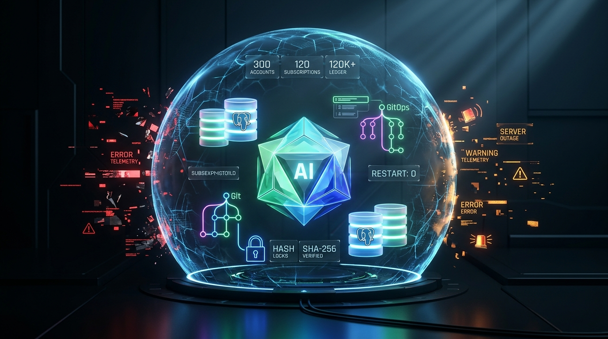

# 生产带病升级突发7重连环断门！AI如何做到300客户与12万账本零丢失？

> **导读**：面对生产升级的 7 项连环故障，依托不可变构件、增量迁移与沙箱内存校验，实现 300 用户、120 订阅及 12 万+ 账本零丢失。**全程均由 Code Agent 在既定工程技能（Skills）与安全护栏约束下自主执行完成。**

---

在很多人的认知里，让 AI 碰生产环境就像是“让新手开飞机”——稍微有点风吹草动，大概率会产生幻觉、乱敲命令，最终把一次小故障搞成不可逆的数据灾难。

然而在刚刚结束的生产环境（`PROD V2`）大版本升级中，我们做了一次极为硬核的实战：

在面对 **OCI 镜像 404、PostgreSQL 语法报错、Schema 审计冲突、新表权限缺失** 等整整 7 个连环深坑时，没有人类工程师熬夜敲命令救火，**全程由 Code Agent 在既定安全护栏下独立排障、提 PR 修复、做内存沙箱验证并完成平滑上线**。

最终成绩单：**300 名注册用户、120 条活跃订阅记录、12 万+ 用量账本数据分毫不差，容器重启计数全部为 0。**

---

### 背景与架构底座：典型的 Full Self-Host 生产环境

在进入复盘前，先交代本次升级的生产架构底座（`web-saas-prod-v2`）：

* **业务控制面技术栈**：标准的高性能现代 Web 架构，采用 **Caddy（反向代理/TLS网关） + Next.js（控制台前端） + Node.js / Go（Accounts & Billing 核心微服务） + PostgreSQL（持久化核心主库）**，以 Docker Compose 容器编排完全自建（Full Self-Host）部署于单一高配云主机；
* **声明式运维工具套件**：确立了 **SSH（维护工作站入口） → Playbooks（Ansible 精准编排/授权） → GitOps（声明式仓库锁定不可变 Tag/Digest） → Doco-CD（主机侧轻量化持续交付控制器）** 的四段式闭环发布链路。

这种架构兼顾了极致性价比与高吞吐，但在升级时极其凶险：**主机和 `/data/postgresql` 数据盘紧密耦合**，一旦自动化脚本失控或产生脏写，数据就会当场报废。

---

## 一、 惊魂现场：升级路上的 7 个连环深坑

本次升级目标非常明确：将底层**数据库 Schema 从旧版本 `2026101502` 平滑演进至 `2026101703`**，同步上线 Accounts、Billing 与 Console 新版本。

但单机容器化架构（宿主机直接挂载 `/data/postgresql` 数据盘）在升级时极其凶险：**计算和数据挨得太近**。一旦自动化脚本乱动，数据就当场报废。

从 `r1` 到 `r5` 版本推进过程中，系统接连撞上了 7 块铁板：

1. **镜像被判 404**：镜像构建时把底层的 Config Digest 当成了可拉取的 Manifest Digest 填进配置，GHCR 拒绝拉取。
2. **Postgres 拒收超时参数**：迁移器向数据库传递了 Go 原生格式的 `5m0s`，被 PG 语法解析器当场打回。
3. **自家人打自家人**：Accounts 启动自检时，把迁移器自己留下的审计表 `accounts_controlled_migration_history` 当成“未知恶意业务表”，直接罢工。
4. **Billing 门禁滞后**：Billing 服务的安全检查死板地认旧版本，看到新版数据库直接拒绝就绪（Fail-Closed）。
5. **新建表 DML 权限丢失**：维护角色跑完了增量 SQL，但新建的 9 张邮件表没有给应用角色授权，服务一写就崩。
6. **手抖误触旧环境**：排障中误动了旧 PROD 的 `.env.prod`，需要立刻幂等回退。
7. **复合 Tag 解析 Bug**：恢复业务后，Billing 解析 `:sha-xxx@sha256:xxx` 镜像引用时，把 digest 误当成了 tag。

换作经验稍浅的工程师，遇到这些报错可能早就顶不住压力执行 `migrate force`、手动改库甚至拿旧备份直接覆盖了。

但 Code Agent 稳住了。为什么？

---

## 二、 凭什么不翻车？锁死 AI 的 4 道硬核工程护栏

AI 能够在惊涛骇浪中把数据保下来，绝不是靠它有多“聪明”，而是**平台工程给它套上的确定性规则（Skills & Guardrails）在起决定性作用**：

### 1. 绝对的不可变构件（三维哈希互锁）
在最终成功的 `r5` 版本中，代码 Commit、镜像 Digest、GitOps 声明三者严格互锁：
* **GitOps**：`060dadeca933700254d9...`
* **Accounts 镜像**：固定为 `sha256:6d70a8ff...`（对应源码 `8c7ecd9c...`）
* **Billing 镜像**：固定为 `sha256:ae7b56e2...`（对应源码 `8cdd4e95...`）

**主机只拉取带 sha256 的固定 Digest，严禁使用 `latest` 浮动标签**。即使控制器疯狂重试，Agent 也绝不可能把未经验证的代码部署上去。

### 2. 内存沙箱（tmpfs）先演练，再碰生产
这是本次零数据丢失的最强杀手锏。Agent 没有直接在生产库上试错，而是建了一个**没有外网端口、不挂载生产目录、跑在临时内存盘上的 PostgreSQL 容器**：
1. 把生产旧备份（SHA-256 校验通过）灌进内存沙箱，还原出 300 用户、120 订阅和 12 万条账本；
2. 提取用户、账本、账单等全部关键表，计算**稳定序列加密指纹（Stable Hash）**，与生产库比对；
3. 控制台仅返回一个布尔值：`Equal: True`（全程不打任何明文用户数据，杜绝泄密）；
4. 在沙箱里验证修复后的迁移二进制，确认 5 分钟超时格式修复、三段 SQL 幂等跳过，全部跑通后直接销毁沙箱。

### 3. 受控增量状态机，严禁“掀桌子”
升级严格采用“先扩展、后切换、再收缩”原则：
* `2026101502` → `2026101701`（SQL 校验匹配）
* `2026101701` → `2026101702`（SQL 校验匹配）
* `2026101702` → `2026101703`（SQL 校验匹配，`dirty=false`）

**铁律：禁止重置表、禁止清空数据、禁止强抹 dirty 状态**。任何一步校验失败，流水线立即停机熔断，必须向前（Forward-Only）修复，绝不允许破坏性回滚。

### 4. 最小权限 Ansible 授权
对于第 5 个故障（新表缺权限），Playbook 被限定为仅对通过审计的 9 张新邮件表单独补齐 `SELECT/INSERT/UPDATE/DELETE`。不改表属主，不改角色等级，不开放全局默认权限，把影响半径锁死在最小范围。

---

## 三、 胜利收盘：无感热更与全量基线冻结

当 Code Agent 修复好全部代码与权限、发起最终的 `r5` 对账后，名场面出现了：

* **单点无感热更**：Doco-CD 控制器只精准替换了 Billing 容器，Accounts、Console、PostgreSQL 原地不动；
* **零宕机零抖动**：4 个核心服务的容器重启计数（Restart Count）全部维持在 **0**；
* **数据完全平滑**：用量账本在服务恢复后无缝从 120,019 条自动累加到 120,700+ 条，Free 套餐 5 GiB 配额及当月用量完好无损。

业务完全恢复后，团队与 Agent 达成共识：**立即冻结所有新特性开发（Feature Freeze），转入全量状态盘点**：
* 盘点全量域名、路由与 OCI 固定 Digest；
* 梳理 Vault KV 敏感路径清单（仅保存路径与版本，绝不落地 Secret 明文）；
* 产出受 `0700/0600` 权限保护的数据库与 Vault 全量快照，为未来跨机演练（如 V3 主机）锁死黄金基线。

---

## 四、 走向标准化：从“单点自愈”到“可复用容灾与 A/B 滚动更新”

很多团队在搞定生产危机后就鸣金收兵了，但这次 Code Agent 在完成恢复后，又往前走了一大步：**将本次抢救下来的黄金状态沉淀为资产，且全程“未增加新特性、未重启生产业务、未修改生产数据”**。

在随后的 13 分钟内，Agent 已经在独立工程分支（`feat/web-saas-cold-dr-recovery-20261018`）提交了不可变演进成果：

1. **落盘技术白皮书**：
   编写并归档了《PROD V2 冷备/容灾/跨机恢复白皮书》（零敏感值泄露），将域名路由、不可变 Digest、Vault 路径清单、Schema Checksum 与指纹校验固化为标准规范。
2. **抽象通用 Ansible 冷备与容灾 Role（`web_saas_cold_recovery`）**：
   将本次手工与沙箱演练的动作提炼为可复用的基础设施代码（Playbook `web-saas-cold-recovery.yml`）。支持 `v2`、`v3` 乃至未来的 `vN` 弹性变体（`service_variant`），具备受控快照导出、跨机分发、沙箱还原与 Receipt 一致性自检能力。
3. **架构演进路线：从传统 SIT/UAT/PROD 跨向“单机 A/B 安全滚动更新”**：
   传统互联网架构依赖臃肿的 SIT → UAT → PROD 多套重资产环境，成本高且环境差异极易诱发配置漂移。
   有了这套冷备与跨变体恢复能力后，我们正在探索全新的**单机/跨机 A/B 安全滚动蓝绿演进模型**：
   * **影子实例并行**：在同一主机或同规格节点拉起目标版本（如 `web-saas-prod-v3` 作为 B 轨），原 `v2` 保持只读/主流量（A 轨）；
   * **零停机数据预热**：通过可复用的 `web_saas_cold_recovery` 自动化完成快照灌装、增量迁移测试与稳定序列指纹布尔校验；
   * **Caddy 流量秒切与零损回滚**：仅需微调 Caddy 边缘反向代理权重或端口，即可完成 A/B 流量无缝切流；一旦遇阻，毫秒级切回 A 轨，彻底终结“单节点带病升级”的心惊肉跳。

---

## 五、 思考：AI 时代，我们到底需要什么样的平台工程？

这场有惊无险的“带病升级”，给正在探索 AI Agent 落地的团队提了个醒：

1. **别再让 AI “裸奔”进生产**：AI 的强大不在于给它多大的权限去自由发挥，而在于用成熟的平台工程规范（不可变构件、前置检查、状态机）把它的动作规范在安全范围内。
2. **能自我收敛的系统才是好系统**：生产环境不出故障是运气，出故障能靠防御体系逐层拦截、由 Agent 自主提 PR 修复并安全收敛，才是真正的架构韧性。

当平台工程的护栏足够坚固，**AI Agent 不再只是写写 Demo 的玩具，它已经可以成为生产线上最不知疲倦、最遵守纪律的 SRE 战友。**
