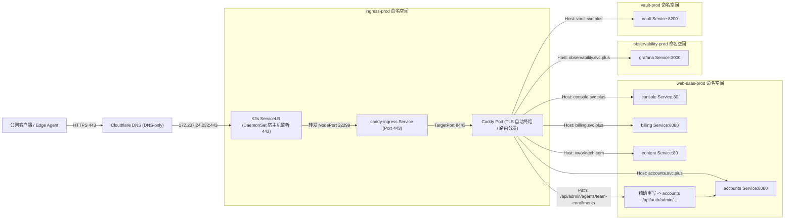

# PROD V5 → V6：部署架构演进、核心控制面迁移与故障复盘

> 记录日期：2026-11-03，Asia/Shanghai。
> 统一流程：[Selfhost 控制面部署与核心数据迁移](https://github.com/ai-workspace-services/.github/blob/main/docs/control-plane-deployment-and-migration.zh.md) · [V4→V5 复盘索引](17-prod-v4-v5-baseline-and-upgrade-retrospective.zh.md) · [跨代证据索引](records/generation-deployment-evidence-index-20261025.zh.md)。
> 本篇作为 DevSecOps 基线第 18 篇，负责 V5 → V6 迁移总体叙事、架构对照、三幅拓扑/数据流图、核心经验与归档导航。本任务是复盘及文档交付，不授权重新部署、迁移数据、切换 DNS、轮换凭据、调整权限或删除资源。

---

## 1. 代际演进脉络与环境边界

在 2026-10-19 至 2026-10-25 的前序演进中，控制面经历了从 V2 单机容器、V3 冷备跨机恢复、V4 品牌域与双链路 OTel，到 V5 净室部署及 K3s all-in-one（将 Web-SaaS、Vault Server 与观测栈汇聚到一台 Linode 2C4G VPS）的历程。

**严格区分历史环境**：
- **早期 V5 单机 VPS / Compose**（2026-10-23/24）：早期过渡验证环境，以 Docker Compose 承载，非本次迁移源。
- **本次迁移源端（V5 K3s）**：Linode 2C4G 实例（公网 IP `104.105.141.213`），运行 K3s v1.31，采用 Pod CIDR `10.42.0.0/16`、Service CIDR `10.43.0.0/16`，根磁盘承载 local-path 存储。
- **本次迁移目标端（V6 K3s）**：Linode `g6-standard-2` 2C4G 实例（公网 IP `172.237.24.232`，Debian 13），运行 K3s v1.37.1+k3s1。挂载独立 100GB 块存储（`/data`），采用 Pod CIDR `10.52.0.0/16`（节点分配 `10.52.0.0/24`）、Service CIDR `10.53.0.0/16`、CoreDNS ClusterIP `10.53.0.10`。

```
[V2/V3 单机容器] ──> [V4 品牌接流] ──> [V5 VPS 过渡] ──> [V5 K3s all-in-one (104.105.141.213)]
                                                                  │
                                                     WireGuard 点对点隧道
                                                     (10.254.250.0/30)
                                                                  ▼
                                                      [PROD-K3S-V6 (172.237.24.232)]
                                                      - K3s v1.37.1 / Debian 13
                                                      - 独立 100GB /data 卷
                                                      - 独立网段 / ServiceLB + Caddy
```

---

## 2. 交付主线与六层职责边界

规划方案中曾包含 Traefik Ingress、Flagger 渐进式金丝雀与全自动化 GitHub Actions 部署流水线；但在实际落地中，本轮严格遵循“不引入非必要复杂性、不破坏生产可用性”的工程纪律：
- **实际交付主线**：沿用 **Ansible Playbooks + GitOps (Kustomize/HelmRelease) + Flux v2** 声明式调谐。
- **实际网关架构**：沿用 **K3s ServiceLB (DaemonSet) + Caddy (Host/Path 路由与可信 TLS 终结)**，未引入 Traefik 或 Flagger。

### 六层职责矩阵与偏差治理

| 层次 | 权威工具 | 职责边界 | 实际落地与偏离补回 |
| :--- | :--- | :--- | :--- |
| **IaC** | Linode Provider, Cloudflare Provider | 云主机、数据盘、安全组、资源删除保护锁、公共 DNS 记录 | 严格声明式管理。2026-11-03 经授权解除 V5 实例删除锁以备退役，V6 删除锁保持激活。 |
| **Playbooks** | Ansible | 主机初始化、内核参数、OS 三类身份（admin/operator/auditor）、WireGuard 隧道、受控 DB 初始化 | 承载主机层基础建设。曾临时手工调整配置，已全部通过 Playbooks PR 固化合入。 |
| **GitOps** | Git 仓库 (Kustomize / HelmRelease) | 声明式资源规格、非敏感配置、镜像版本/digest 锁定 | 消除环境漂移的核心。多次线上热修（如 ConfigMap、探针、资源限制）均在验证后第一时间反向提交 PR 合并。 |
| **Flux / Helm** | Flux Operator | 集群内声明式自动对账与控制循环 | 所有线上变更最终均由 Flux reconcile 并达到 `Ready=True` 状态，严禁保留未受控的直接 kubectl 改动。 |
| **迁移协议** | Accounts / migratectl | 单向业务数据抽取、schema 验证、冲突决策、幂等重放 | 放弃宽权限直连 DSN，演进为专有 migration listener + migratectl HTTP API，确保源端只读与目标端事务安全。 |
| **Knowledge** | Markdown 知识库 | 运行基线、不可变证据索引、故障复盘与可复用 Runbook | 真实记录所有成功、失败、未决项与安全阻断，不掩盖问题，不把推断当实证。 |

---

## 3. 核心架构与数据流 Mermaid 图

### 拓扑图 1：交付管理与工作负载身份链

```mermaid
flowchart TD
    subgraph Repo[代码仓库与声明层]
        gitops["GitOps 仓库 (Kustomize / HelmRelease)"]
        playbooks["Playbooks 仓库 (主机 / 身份 / 脚本)"]
    end

    subgraph Host[PROD-K3S-V6 物理节点 (172.237.24.232)]
        flux["Flux CD (Kustomize / Helm Controller)"]
        eso["External Secrets Operator (ESO)"]

        subgraph K3sCluster[K3s 集群 (v1.37.1)]
            sa["ServiceAccount (TokenRequest API)"]
            sec["Kubernetes Secret (Target)"]
            deploy["业务工作负载 (Console / Accounts / Billing)"]
        end

        subgraph VaultPod[Vault 实例 (vault-prod)]
            vaultserver["Vault Server (v1.21.4 Raft)"]
            jwtAuth["JWT Auth Engine (jwt-prod-k3s-prod-k3s-v6)"]
            kvv2["KV v2 密钥引擎 (kv/prod/...)"]
        end
    end

    gitops -->|Git 轮询调谐| flux
    flux -->|应用清单| K3sCluster
    playbooks -->|受控执行| Host

    sa -->|TokenRequest 签发投影 Token| eso
    eso -->|JWT 登录携带 Audience| jwtAuth
    jwtAuth -->|验证 SA 公钥并换发 Vault Token| eso
    eso -->|读取受控 KV 路径| kvv2
    kvv2 -->|返回明文字段| eso
    eso -->|渲染并写入| sec
    sec -->|挂载 Volume / Env| deploy
```

### 拓扑图 2：公网入口与 Ingress 流量链



### 拓扑图 3：业务数据与 Vault 双迁移链路

```mermaid
flowchart TD
    subgraph V5Source[源端：V5 K3s 集群 (104.105.141.213)]
        v5pg[("V5 PostgreSQL (account 库)")]
        v5vault["V5 Vault Server (Raft Engine)"]
    end

    subgraph WireGuard[迁移网络通道]
        tunnel["WireGuard P2P 隧道 (10.254.250.0/30)"]
    end

    subgraph OperatorHost[操作端受控环境 (CLI / 内存流)]
        migratectl["migratectl CLI (transfer-api / catchup-api)"]
        vaultcli["Vault API Stream (HTTPS In-Memory)"]
        backups[("受限加密备份目录 (0700/0600)")]
    end

    subgraph V6Target[目标端：V6 K3s 集群 (172.237.24.232)]
        migrationListener["accounts-migration-listener (Pod)"]
        v6pg[("V6 PostgreSQL (account 库)")]
        v6vault["V6 Vault Server (Raft Engine)"]
    end

    v5vault -->|HTTPS Snapshot Export| vaultcli
    vaultcli -.->|前置检查 inspect SHA256| backups
    vaultcli -->|HTTPS Snapshot Stream POST| v6vault
    v6vault -->|异步恢复 post-unseal complete| v6vault

    v5pg -->|只读快照抽取 (42 表)| migratectl
    migratectl -->|加密 staging 校验 / 冲突检测| migratectl
    migratectl -->|WireGuard 隧道传输| migrationListener
    migrationListener -->|前置 pg_dump 加密存证| backups
    migrationListener -->|停写者 / 增量 DDL / 事务写入| v6pg
```

---

## 4. 关键演进对比：V5 vs V6

| 维度 | PROD-K3S-V5 (历史基线) | PROD-K3S-V6 (当前落地) | 改进与收益 |
| :--- | :--- | :--- | :--- |
| **物理节点与 OS** | Linode 2C4G, Debian 12 | Linode `g6-standard-2` 2C4G, Debian 13 | 内核及系统安全补丁升级，提升稳定性 |
| **存储架构** | 根文件系统 local-path (50GB 混用) | 独立 100GB 挂载块存储 (`/data`) | 核心数据物理隔离，避免根分区打满导致驱逐 |
| **K3s 版本** | v1.31 系列 | v1.37.1+k3s1 | 升级控制面核心与最新安全补丁 |
| **网络 CIDR** | Pod: `10.42.0.0/16`, Svc: `10.43.0.0/16` | Pod: `10.52.0.0/16` (节点 `/24`), Svc: `10.53.0.0/16` | 网段完全解耦，允许通过 WireGuard 平滑对等互通 |
| **Vault 架构** | Raft 单节点，直接公钥挂载 | 独立 Raft 实例，通用 SA TokenRequest JWT 契约 | 规范 ESO 身份注入，解耦版本硬编码 |
| **数据迁移协议** | 早期直连 DSN / CLI pg_dump 导入 | 独立 migration listener + `migratectl` API | 严格只读源端、加密缓存、幂等校验与 409 冲突控制 |
| **可观测性** | 基础日志采集，存在 OOM 风险 | Datakit 资源配额调整为 128Mi/512Mi，平稳运行 22h+ | 修复 OOMKilled 隐患，保障长期指标流稳定 |
| **Agent 注册模型** | 固定等级限制，未支持 custom 等级 | Accounts 镜像合入 custom 等级与白名单控制 | 恢复 US 等单节点 Agent 注册，修复 400 报错 |

---

## 5. 核心经验与代际演进法则

1. **模板优先级与环境变量覆盖陷阱**：
   - 现象：Accounts 启动时，配置模板中的示例空数组/凭据覆盖了系统注入的 `INTERNAL_SERVICE_TOKEN`，导致外部 JP Agent 鉴权报 401。
   - 法则：配置模板中绝不应当包含硬编码示例凭据；应用初始化应当严格遵守“环境变量与 Vault Secret 覆盖静态模板”的加载顺序。
2. **轻量网关 ConfigMap 动态重载约束**：
   - 现象：Caddy ConfigMap 经 Flux 更新后，Caddy 容器未感知变更，路由依然维持旧状态。
   - 法则：使用 Caddy 作为网关时，配置更新后必须显式调用 admin API 重载配置或执行 Pod 滚动重启。
3. **快照整体恢复与双向同步的边界**：
   - 事实：Vault Raft 快照恢复是全量替换行为（204 accepted 并在日志完成 post-unseal setup complete）。
   - 法则：严禁将快照恢复误称为“双向持续同步”；恢复前必须留存目标端前置快照（如 `v6-before.snap`），以便回退。
4. **单节点能力演进与架构膨胀控制**：
   - 实践：在处理 US 节点接入时，坚持复用已合并的代码单节点能力（支持 custom 资源等级与 free 策略），坚决不盲目引入多虚拟节点或复杂网格架构，将资源消耗与认知负载降至最低。
5. **DNS 切换与数据库协议验收边界**：
   - 事实：`postgresql.svc.plus` 虽切换了公网 A 记录，但 Kubernetes 内部 PostgreSQL 仅为 ClusterIP，外部 TCP connect 成功仅为端口或网关响应，`pg_isready` 原生协议探测仍未响应。
   - 法则：不能将 DNS 解析成功与 TCP 握手简单等同于数据库公网服务可用，保持未决状态并限制公网暴露。

---

## 6. 归档文档导航

本代际复盘的所有证据、时间线、根因分析、验收矩阵与操作手册归档于 `records/prod-v5-v6-20261103/` 目录：

1. [基线参数与全景时间线 (baseline-and-timeline.zh.md)](records/prod-v5-v6-20261103/baseline-and-timeline.zh.md)
   - V5/V6 机器规格、网络 CIDR、存储挂载对比；2026-11-01 至 2026-11-03 严格双时区执行时间线。
2. [证据索引与不可变构件清单 (evidence-and-pr-index.zh.md)](records/prod-v5-v6-20261103/evidence-and-pr-index.zh.md)
   - 跨仓库 PR 索引（GitOps #743-#773、Playbooks #956-#962、Accounts #289-#305）、容器镜像 digest、提交 SHA 矩阵。
3. [故障根因分析与纠正措施 (root-cause-and-corrective-actions.zh.md)](records/prod-v5-v6-20261103/root-cause-and-corrective-actions.zh.md)
   - 包含 GHCR 403、Datakit OOM、ServiceLB pending、Caddy reload、Accounts 凭据覆盖、Custom 等级拒绝等 9 项专项复盘。
4. [当前验收与未决事项矩阵 (acceptance-and-todo-matrix.zh.md)](records/prod-v5-v6-20261103/acceptance-and-todo-matrix.zh.md)
   - 23 项细粒度验收状态表（PASS / PARTIAL / BLOCKED / NOT_RUN），区分只读审计核验、脱敏回执与用户确认事实。
5. [代际迁移可复用运行手册 (migration-runbook.zh.md)](records/prod-v5-v6-20261103/migration-runbook.zh.md)
   - 提炼标准化、防差错的 7 阶段操作手册，供未来代际演进与容灾重建复用。
