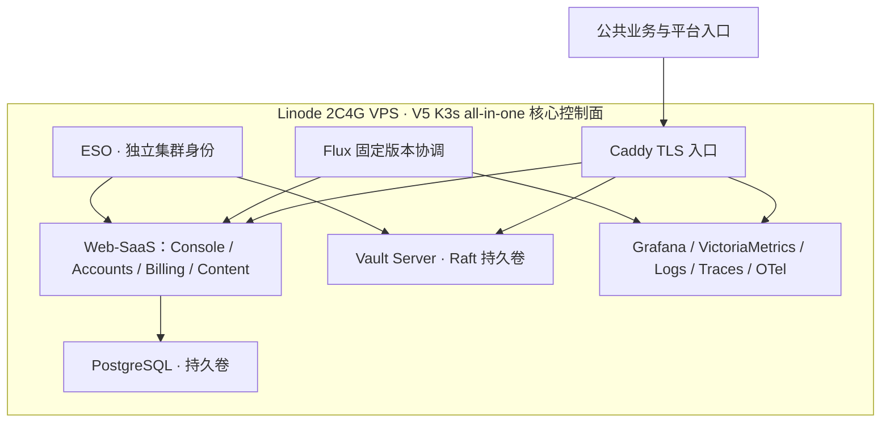

# V5 VPS → V5 K3s all-in-one：核心控制面汇聚、降本与验收待办

> 记录日期：2026-10-25，Asia/Shanghai。本文是配置与验收状态快照，不代表本轮新建了云快照或数据库备份。历史采样保留；全文 PASS 才能关闭验收，部分通过、BLOCKED 和 NOT_RUN 不放行。
>
> 最终承载目标：PROD K3s V5。旧 V5 VPS 为本次迁移来源，不再把早期 V4→V5 VPS 的通过次数当作 K3s 的本轮证据。旧主机、旧 Vault、备份及数据的删除不属于本文操作范围。

跨代回链：[基线 → 每轮回执 → 故障 → 固定源码 case → 重验](../generation-deployment-evidence-index-20261025.zh.md)。该索引补充三轮原始回执的精确起止，并显式标记未归档的 attempt/native checksum；本次没有重新执行协调、数据迁移或恢复。

[统一部署迁移流程](https://github.com/ai-workspace-services/.github/blob/main/docs/control-plane-deployment-and-migration.zh.md) · [V4→V5 复盘](../../17-prod-v4-v5-baseline-and-upgrade-retrospective.zh.md) · [V5 VPS 基线](../prod-v5-20261023/prod-v5-runtime-and-snapshot-baseline-20261023.zh.md) · [K3s 初始 UAT 历史基线](../uat-k3s-v5-20261024/web-saas-k3s-v5-runtime-and-snapshot-baseline-20261024.zh.md) · [可复用检查表](deployment-migration-acceptance-checklist.template.zh.md)

## 部署背景：一台 Linode 2C4G 承载核心控制面

本轮的目标是进一步压缩核心控制面成本：将原先分散部署的 **Web-SaaS、Vault Server、Grafana/观测栈** 汇聚到 **一台 Linode（Akamai Cloud）2 vCPU / 4 GB VPS**，采用 **V5 K3s 容器化 all-in-one** 运行形态。

这里的 all-in-one 指同一台 VPS 承载核心控制面。Web-SaaS、Vault、观测栈仍分别使用命名空间、工作负载、服务身份和持久卷，应用 Chart 与平台组件保持独立交付。它不表示把所有服务塞入同一个容器或 Pod，也不把旧源和外部代理节点一起合并进该主机。

降本路径是减少独立主机与重复控制面资源，继续以不可变交付、密钥隔离、真实业务验收和恢复能力维持运行边界。实际节省金额仍取决于旧资源回收及账单结果；本记录不将“已整合运行”写成“所有旧资源已删除或费用已降低”。

## 1. 本轮边界与固定版本

- 原有四层职责继续有效：Toolkit 选择目标、审批及证据；GitOps 声明；IaC 管理云资源/DNS/CMDB；Playbooks 管理主机、服务、身份配置及恢复。
- 已就绪主机采用 SSH → Playbooks/Flux；DNS 走 IaC provider owner。未为本次验收另建独立 Web-SaaS 测试流水线。
- 本轮采样分布在 2026-10-25；身份与初始状态复核为 15:09，完整业务/观测复核为 17:33 后，同版本三轮协调为 17:40:47–17:41:30。每项证据按自己的时间适用，不宣称同一瞬间的全系统事务快照。
- PROD GitOps：`v2026.10.25.3` → `78c49d92f2be6078b83f88097e9f4ea5295055ff`。
- 应用 Chart：`distributed-web-saas-fullstack@0.2.5`，OCI digest `sha256:6336235445e389958660cc344eead488ad3a50cf67afb1301fd35f6793720f27`。
- 观测 Chart：`observability-stack@1.1.1`，实际 revision `1.1.1+6c9edd8ad04a`。本记录未重新发布观测构件。
- Schema：`2026102002`，`dirty=false`。它是迁移版本，不替代原生 schema/迁移包校验和。

## 2. 按服务汇总配置与存储

下列均为 GitOps 仓库相对路径，不含秘密值、私钥、DSN 或运行时 state。

| 服务 | 目标部署 | 配置声明 | 持久化/说明 |
| --- | --- | --- | --- |
| Console | Web-SaaS namespace，单容器形态 | `services/distributed-web-saas-fullstack/prod/values.yaml` 中 `console` | 当前仍为 single-container；不据此宣称 SSR/Gateway 分布式形态已验收 |
| Accounts | 独立 Deployment | 同文件 `accounts`；`external-secret.yaml` | 核心身份、订阅、配额、账务连接目标 account 库；background writers=false |
| Billing | 独立 Deployment，push ingest | 同文件 `billing` | 真实 Exporter/Vector POST 进入目标；不构造生产账本样本 |
| Content | 独立 Deployment | 同文件 `content`；`content-runtime` ExternalSecret | 独立内部服务身份 |
| PostgreSQL | 单节点 StatefulSet，account 库 | 同文件 `postgresql` | 5Gi local-path PVC，Bound；当前 ClusterIP-only |
| Caddy | 独立 Deployment/LoadBalancer | 同文件 `caddy` | 品牌域名独立 TLS Secret；公共业务别名共存 |
| stunnel client/server | 当前均 disabled | 同文件 `stunnelClient` / `stunnelServer` | PostgreSQL DNS 已迁移不等于公网数据库隧道已开通 |
| Vault Server | `platform-vault` 独立 Raft 实例，v1.21.4 | `services/platform-vault/prod/vault-raft.yaml` | 10Gi local-path PVC；旧 File 实例及另一个 10Gi PVC 仍保留 |
| Grafana | v13.2.4 | `services/platform-observability/prod/values.yaml` | 共享观测栈 20Gi PVC；凭据由 ESO 注入 |
| VictoriaMetrics/Logs/Traces、OTel | 五容器观测 Pod | 同观测声明 | 不搬运源端历史指标、日志、trace；新遥测使用 cluster/environment 标签 |
| Flux / ESO | 独立集群组件 | `environments/clusters/prod-web-saas-k3s-v5/`；各服务 SecretStore/ExternalSecret | 生产固定 tag；秘密不进 Git |

节点保持现有名称，local-path PV 已依赖该节点身份；不原地重命名。

### 实际运行镜像（本轮读取）

| 组件 | 不可变运行引用 |
| --- | --- |
| platform-observability-observability-stack / victoria-metrics | `victoriametrics/victoria-metrics:v1.101.0@sha256:91d0456cc064e195869175074ced2a6849d72531613b320492698e5fe935d10a` |
| platform-observability-observability-stack / victoria-logs | `victoriametrics/victoria-logs:v1.52.0@sha256:47b820890d64c4575a2a0a46415dcd8a4fd59a0f1fcd6a377693d7aea639442e` |
| platform-observability-observability-stack / victoria-traces | `victoriametrics/victoria-traces:v0.1.0@sha256:b3204fd598b023b4726f38689791c707803b9f34733822dd053f22d64721b3d2` |
| platform-observability-observability-stack / otel-collector | `otel/opentelemetry-collector-contrib:0.114.0@sha256:37fa87091cfaaec7234a27e4e395a40c31c2bfaea97a349a4afef6d9e9681197` |
| platform-observability-observability-stack / grafana | `grafana/grafana:13.2.4@sha256:dbbc38ea21103cefb50396340cd88afec779c7e070b0a7bf5a75b4ce46651d3f` |
| vault-raft / vault | `hashicorp/vault@sha256:4e33b126a59c0c333b76fb4e894722462659a6bec7c48c9ee8cea56fccfd2569` |
| web-saas-accounts / accounts | `ghcr.io/ai-workspace-services/accounts:sha-3ef09c82f46152096bfc16edc9ba767f128a197f@sha256:b5bf111a64ca2f2ed5e74d2ab1f87e0e164d09869a32832368fb43e577fdf37b` |
| web-saas-billing / billing | `ghcr.io/ai-workspace-services/billing-service@sha256:14bbaee5ba37d85ddf243272ee2c3bed25603ee26ffd5c0b8d685cfe0e7a85a0` |
| web-saas-caddy / caddy | `ghcr.io/ai-workspace-infra/caddy-cloudflare:959d6c8@sha256:9895385033fea2bdb445841b45f37e6cd58b9e071a16e4c147e483abb74a0acf` |
| web-saas-console / console | `ghcr.io/ai-workspace-services/console@sha256:06775cfa5582fb83bae336c4c4befe1fbd4f7747d526653b80736e3e4862e666` |
| web-saas-content / content | `ghcr.io/ai-workspace-services/docs@sha256:e6e791437bd3b57a4dec0bc9dc2527b681dd52960b6f692be6ff16322018788e` |
| web-saas-postgresql / postgresql | `ghcr.io/ai-workspace-services/postgresql@sha256:56f4179bafafa52061ac21003dc80c1a0b7ceb63fffb2c7bd05f29237b62b85e` |

保留的旧 File Vault 仍使用版本标签；它不作为当前 Raft 入口或不可变候选的依据。Content Deployment 当前实际运行 Docs 镜像，未把它误记为 content-service 构件。

## 3. 当前公共入口

| 入口 | 已执行目标 | 验收边界 |
| --- | --- | --- |
| `xworktech.com` | 当前 K3s 主机 A 记录 | 品牌证书及 `/`、`/login` HTTPS 200 |
| `console.svc.plus` | CNAME → `console-k3s-v5.svc.plus` | 登录页、业务路由及账号持有者登录 |
| `accounts.svc.plus` | CNAME → `accounts-k3s-v5.svc.plus` | 健康、Session/MFA、Agent 入口 |
| `billing.svc.plus` | CNAME → `billing-k3s-v5.svc.plus` | readiness、真实采集 POST、鉴权拒绝 |
| `vault.svc.plus` | CNAME → `vault-k3s-v5.svc.plus` | 已按用户单独授权先切换；KV 双端一致性仍未验收 |
| `observability.svc.plus` | CNAME → `observability-k3s-v5.svc.plus` | 公网登录页 HTTPS 200；旧观测主机已退役，不作为回滚目标 |
| `postgresql.svc.plus` | CNAME → `postgresql-k3s-v5.svc.plus` | 专属 A 已由 provider、Cloudflare/Google DoH 核实；隧道未启用 |

本机 UDP DNS 曾返回专属数据库域名 NXDOMAIN，而 Cloudflare provider 与两家 DoH 返回正确 A 链；归为本地/递归解析路径差异，不能把 provider 保存成功直接当作所有客户端已刷新。

## 4. 数据范围与已批准例外

- 验收用户集合为 33 名，不叠加预置种子账号。
- UUID、用户名、邮箱、密码哈希、角色、等级、组、权限、MFA 核心字段及启用状态对照一致。未公开字段值、个人标识或身份散列。
- EX-01：仅默认 Sandbox 代理 UUID 保留目标值；其他用户代理 UUID 一致。
- EX-02：用户明确以 K3s 已迁入的 **80,130 个历史流量桶**作为最终历史基线。旧源在切换边界的计数高出 880，本轮不以该差额要求追齐；未完成逐稳定键定位，因此不声称已列出那 880 条具体对象。此为批准的迁移范围取舍，不是“源目标全量相等”或“零数据丢失”的证明。
- 80,130 不是目标总行数上限；目标后续真实流量继续增长，禁止为恢复该计数而删除新增记录。
- 17:33 采样目标：33 用户、18 套餐、7 订阅、33 配额、33 billing profiles；账本 80,288、流量桶 80,286；5 发票、5 付款、2 退款。行数随真实采集继续增长。
- 已对套餐、订阅、订阅记录、生命周期、发票、付款、退款执行全行聚合内容对照，源目标一致；不公开聚合摘要。额度、余额等可变状态不作无条件整行覆盖。
- 源/目标各有两条既存 NOT VALID CHECK 约束，位于任务 namespace/session 领域；本轮未验证约束，不将“无订阅孤儿”扩大为“全部约束已验证”。

## 5. 可执行 Markdown TODO 检查点表

勾选规则：只有完整满足本行准出条件才打勾。部分通过、批准例外及未执行必须保留说明。以下是本次执行检查点编组；关联自动化任务推进 23 组的实现，本文不把尚未合并的自动化能力写成已运行。

| 完成 | ID / 阶段 | 检查点 | 最新状态 | 证据/验收标准 | 下一步 |
| --- | --- | --- | --- | --- | --- |
| [ ] | C01 / S0 | 资源、CMDB、源/目标基线冻结 | 部分通过 | 目标已核实；未取得本轮全套 IaC/state/CMDB 严格回执 | 补齐资源 ID、state 版本、单次执行身份绑定的受控回执 |
| [x] | C02 / S0 | 固定生产版本 | PASS | tag、GitOps SHA、Chart digest 与运行 revision 对应 | 后续变更另建候选 |
| [x] | C03 / S1 | 主机、服务与持久卷 | PASS（运行检查） | Debian 13、K3s、服务 Running；PVC Bound | 不替代一次全新重建演练 |
| [x] | C04 / S2/S5 | 公共 Web/DNS/TLS | PASS | Web-SaaS、Vault、观测入口指向 K3s；品牌可信 TLS 200 | 继续观察客户端缓存 |
| [ ] | C05 / S2/S5 | PostgreSQL 外部入口 | DNS PASS / 隧道 NOT_RUN | 公共别名及专属 A 正确；stunnel disabled | 需要隧道时另按声明启用并以数据库协议验收 |
| [x] | C06 / S4 | Console/Accounts/Billing 健康 | PASS | `/login`、`/healthz`、`/readyz` 成功 | 不扩大为全部业务 PASS |
| [x] | C07 / S4 | 登录 POST 与 Session/MFA 路由 | PASS（路由层） | 空登录 400、无会话 401；MFA API 正常 | OAuth 回调另行验收 |
| [x] | C08 / S4 | Billing 拒绝空 200 吞请求 | PASS（鉴权层） | 实际 ingest 路径无凭据 POST 为 401 | Sandbox 重复事件测试另行运行 |
| [x] | C09 / S3 | Schema 版本/dirty | PASS | `2026102002` / false | 补结构及迁移包 checksum 回执 |
| [x] | C10 / S3 | 身份字段及批准例外 | PASS + EX-01 | 33 用户；核心身份字段一致，唯一 Sandbox 例外已确认 | 不迁移临时会话作为永久身份 |
| [x] | C11 / S3 | 套餐/订阅/账务范围 | PASS（已批准范围） | 7 类静态业务表全行内容对照一致；历史流量采用 EX-02 | 可变余额/配额继续按业务规则对账 |
| [x] | C12 / S3 | 订阅外键 | PASS（本项范围） | 无孤立订阅用户引用 | 两条历史 NOT VALID CHECK 单列跟踪 |
| [x] | C13 / S4/S6 | 新流量入库 | PASS（已观察节点） | 17:33 采样最近 15 分钟：15 个正流量桶、6,520,977 字节 | 全节点覆盖另行检查 |
| [ ] | C14 / S4/S6 | 全节点 Agent 心跳/配置下发 | 部分通过 | 5 条登记中 3 条近期心跳；可连接节点已重启，拒绝 SSH/无解析节点已跳过 | 补访问入口并逐节点重验 |
| [ ] | C15 / S6 | 区域池/客户端实际连接 | 部分通过 | 当前登录账号页面显示可用节点；源目标 nodes 表均空 | 全区域池和真实连接按节点验证 |
| [x] | C16 / S2/S4 | Flux/ESO 正式接管 | PASS | `v2026.10.25.3` Ready；品牌 ExternalSecret SecretSynced；移除不用的临时 TLS mount | 禁止退回浮动 main |
| [ ] | C17 / S2/S7 | Vault Raft 与恢复演练 | 健康 PASS / 恢复未关闭 | 1.21.4、initialized/unsealed、Raft；10Gi PVC | 本轮独立恢复、重新解封与重启持久化回执仍需补齐 |
| [ ] | C18 / S2/S3 | Vault KV 双端一致性 | BLOCKED | 当前实例健康不能替代 path/key/value 对照 | 使用受限双端审计身份核对；只归档计数和差异 |
| [ ] | C19 / S2/S4 | GitHub ↔ 新 Vault | 配置恢复 PASS / 分仓实测部分通过 | 30 个普通环境角色、11 个既有策略已恢复；精确 workflow allowlist；重跑 changed=0；GitOps SIT 实际 CI 成功 | 其他仓库逐项真实登录验证；不因角色存在判所有流水线通过 |
| [ ] | C20 / S4/S6 | Grafana/遥测/告警闭环 | 部分通过 | 13.2.4；3 数据源健康；17 仪表盘；3,900 条 PROD 标签指标序列 | 日志、trace、变量查询、内部测试告警回执；不启用生产通知 |
| [x] | C21 / S6 | 真实登录及页面对账 | PASS（已登录账号） | 用户手动登录确认；本月 1,179,786,283 字节、近期 0，与数据库一致 | 不推广为所有账号逐一登录 |
| [ ] | C22 / S7 | 三轮幂等及故障恢复 | 协调 3/3 PASS / 其余 NOT_RUN | 同版 Flux+Helm 三轮 exit 0，spec、Pod UID/restart 无变化 | 不是 IaC 三次重建、迁移重放或备份恢复证明 |
| [ ] | C23 / S5/S8 | 单写者交接与最终关闭 | BLOCKED | 公共 DNS 已迁移；未取得覆盖所有旧源写入路径的 fence/排空/最终边界回执 | 明确旧 API、Webhook、任务、消费者与直连脚本边界；新写入后禁止仅切回 DNS 启旧库 |

## 6. 修复原因、执行回执与历史 case

| 事件 | 原因/修复 | 真实回归及当前结果 |
| --- | --- | --- |
| 品牌 TLS 握手失败 | 新 Caddy 未加载品牌证书/Host；Chart 0.2.5 支持 Console serviceRole 与独立证书 | 可信 HTTPS `/`、`/login` 200；`/api/auth/session` 无会话 401 |
| Agent/Billing 切换后中断 | 新集群共享 Token 与既有生产节点不一致 | 运行时对齐、ESO 同步、仅滚动重启 Accounts/Billing；随后真实心跳和正流量恢复 |
| GitHub Vault 登录 403 | 新 Vault 未恢复 JWT 角色；隔离网络未允许 GitHub discovery/JWKS | GitHub HTTPS egress、精确 JWT 身份恢复后，GitOps 8 项检查全部通过；其他角色不借用这个成功 |
| 密钥同步重复运行 | 精确字段选择、保留目标无关字段、KV v2 CAS | Playbooks 已执行同输入重跑 changed=0、failed=0 |
| 本版本三轮协调 | 17:40:47–17:41:01；17:41:01–17:41:13；17:41:13–17:41:30 | 三轮 exit 0；应用 spec、运行 Pod 身份与 restart 均无差异；run_id `k3s-v5-reconcile-3rounds-hsr8rj9c` |
| 数据恢复与权限 | 历史恢复与当前 K3s 恢复为不同 gate | 本轮不因旧版本恢复报告给 K3s 当前候选判 PASS |

仓库真实回归目录：Playbooks `docs/cases/runbooks/2026-10-21-v4-p0-regression-cases.md`、`tests/data_operations/selfhost/v4_p0_regression_cases_test.py`；本轮目录契约 3 tests 通过，只证明 case 引用与门禁契约，不证明十个 live case 全部执行。迁移工具重复/冲突、Webhook Sandbox、客户端实连及故障注入仍按各 case 独立记录。

### GitHub OIDC 修复回执（17:58 追加）

- Toolkit 声明固定 `ccc5b992e4a23b59f2edeb27d045ed069e9d7c02`，Playbooks owner 固定 `447ac6270e6482c53506d9d6e76e4a8193f81046`。
- 10 个常规仓库/消费者的 SIT/UAT/PROD 共 30 个角色、11 个既有策略已恢复；不恢复 bootstrap、Raft operator、旧主机恢复等专项高权限角色。
- 工作流文件名从通配符收紧为已核实清单，生产仅接受稳定 v* 或 release/v*；保留 repository、audience、batch、1h TTL 和无默认策略约束。
- 17:58:02–17:58:19 完成最终 3 个角色对齐，exit 0；17:58:20–17:58:39 同输入重跑，exit 0、changed=0。
- 六个访问边界单元测试通过；GitOps SIT 实际 CI 已成功；UAT/PROD 及其余每仓登录/构建未取得逐项回执，不能由角色配置操作推导通过。

## 7. 资源整合与成本口径

- 单台 K3s 主机整合 Web-SaaS、Vault Server 与观测平台。实测为 x86_64、2 vCPU、约 4GiB 内存、Debian 13、K3s `v1.36.5+k3s1`。
- 本轮一次资源采样：CPU 222m（11%），节点内存约 2,948Mi（75%）；主机可用内存约 934Mi；根盘 79G、已用 12G（16%）。这些是瞬时样本，不是长期容量结论。
- PVC 声明：PostgreSQL 5Gi + Raft Vault 10Gi + Observability 20Gi；旧 File Vault 10Gi PVC 暂留。local-path 使用同一宿主磁盘，不能把 PVC 声明简单相加当作独立云卷账单。
- 方向是以容器整合减少独立 VPS 数量；旧观测主机已由用户说明退役。旧 V5 VPS、旧 Vault 及其备份尚未全部回收，因此**不填写已实现的月费节省、百分比或“全部成本优化完成”**。
- 进一步降本要先补齐恢复、资源观察、单写者与旧消费者清单，再分别审批旧资源回收。单节点整合也扩大故障影响范围，需保留异机加密备份和独立解封材料。

## 8. 交付、原始证据与索引

| 仓库 | PR | 作用 |
| --- | --- | --- |
| Artifacts | [#220](https://github.com/ai-workspace-infra/artifacts/pull/220) | 品牌 Console serviceRole 与独立 TLS；Chart 发布 |
| GitOps | [#554](https://github.com/ai-workspace-infra/gitops/pull/554)、[#555](https://github.com/ai-workspace-infra/gitops/pull/555) | 品牌声明、固定生产标签、GitHub issuer 受限 HTTPS egress |
| GitOps | [#556](https://github.com/ai-workspace-infra/gitops/pull/556) | PostgreSQL/观测 DNS 当前目标声明；检查通过并已合并 |
| Playbooks | [#763](https://github.com/ai-workspace-infra/playbooks/pull/763) | 运行字段同步与 CAS；已合并 |
| Playbooks | [#765](https://github.com/ai-workspace-infra/playbooks/pull/765) | 受限 GitHub OIDC 角色协调；已合并 `447ac6270e6482c53506d9d6e76e4a8193f81046` |
| Toolkit | [#1443](https://github.com/ai-workspace-infra/platform-ops-toolkit/pull/1443)、[#1444](https://github.com/ai-workspace-infra/platform-ops-toolkit/pull/1444) | 普通角色精确工作流身份与稳定生产 ref；分仓 CI 登录不借用 GitOps 成功；均已合并 |
| Knowledge | [#224](https://github.com/ai-workspace-services/knowledge/pull/224)、[#225](https://github.com/ai-workspace-services/knowledge/pull/225) | 本运行快照/TODO 与 GitHub↔Vault 角色策略矩阵归档；均已合并 |
| .github | [#48](https://github.com/ai-workspace-services/.github/pull/48) | 组织级流程索引与本次快照、矩阵、检查表导航；已合并 |

原始 provider 检查点、三轮回执、只读内容比对与资源采样留在受控证据目录。本文不提交 Token、密码、密钥、Cookie、个人身份、原始 SQL 导出、Terraform state、数据库备份或完整 Vault 快照。日志/trace/历史监控数据不因配置迁移而搬运。

## GitHub / Vault 身份矩阵

[30 个角色、11 个既有策略及分环境验证 TODO](github-vault-role-policy-matrix-20261025.zh.md)列出精确角色、策略消费者、权限动作、workflow/ref 限制、回读与未执行项。

## 历代记录（V4 → V3 → V2 → V1）

1. **V4**：[运行基线与快照清单](../prod-v3-v4-20261020/prod-v4-runtime-and-snapshot-baseline-20261021.zh.md)，配套 [V3→V4 复盘](../../16-prod-v3-v4-baseline-and-upgrade-retrospective.zh.md)。
2. **V3**：[实际快照与升级复盘](../prod-v2-v3-20261019/20261019-prod-v2-v3-snapshot-and-upgrade-retrospective.zh.md)、[快照刷新与恢复](../prod-v2-v3-20261019/v2-to-v3-snapshot-refresh-20261019.zh.md)；独立命名的 V3 运行基线文件仍未定位，不编造路径。
3. **V2**：[冷备、容灾与跨机恢复记录](../prod-v2-v3-20261019/web-saas-prod-v2-cold-backup-disaster-recovery-whitepaper.zh.md)。
4. **V1**：[组织仓库 V1→V2 真实历史交接](https://github.com/ai-workspace-services/.github/blob/main/docs/prod-v2-upgrade-cutover-20261016.md)可查；Knowledge 中独立 V1 原始运行基线仍缺失，不把交接记录冒充完整基线。
