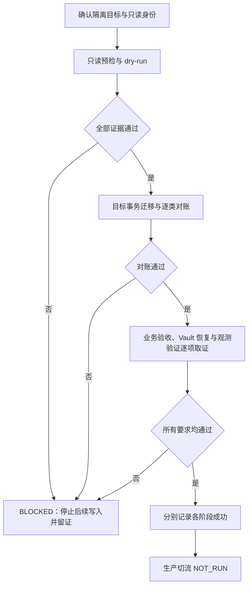

# Kubernetes UAT 数据迁移、Vault 隔离恢复及观测对接：增强安全与严格准入版

归档日期：2026-10-24（Asia/Shanghai）。来源：用户提供的同名增强版方案。**本文记录执行目标、准入规则及预期结果，不是已经完成的运行回执。** 用户材料中的“已核实”保留为来源声明，本次仅归档，未独立核验现场。

[上一版方案与待决项](k3s-v5-data-vault-observability-plan-20261024.zh.md) · [UAT 运行基线](web-saas-k3s-v5-runtime-and-snapshot-baseline-20261024.zh.md) · [基线索引](../../README.md) · [平台工程白皮书](../../../../../docs/reference/multi-cloud-platform-engineering-whitepaper.zh.md)

## 1. 执行指令与边界

仅在明确标记为 UAT 的隔离目标上执行。首先完成只读核验及 dry-run，保存 run_id、Asia/Shanghai 时间、受控源/目标身份引用、工具与迁移包校验和、退出码及脱敏证据。证明不会由迁移操作写源端、删除或重建目标数据、覆盖种子账号后，才进入目标端迁移。

迁移后核对 schema、用户、套餐、订阅、配额、账本、流量指标、外键和序列，并记录差异与获准例外。独立验证 Vault 快照恢复、PVC 持久性、ESO 权限、观测数据源、仪表盘和告警。

任何前置检查无法证明、发生非预期写入或核对不一致，立即停止后续写入并标记 BLOCKED，保留证据。分别报告迁移、业务验收、恢复及切换状态；未执行阶段标为 NOT_RUN。

### 1.1 运行标识与时间

| 字段 | 方案提供值 | 解释 |
| --- | --- | --- |
| run_id | `run-uat-k3s-v5-migration-20261024-201214` | 方案标识，不能单独证明已有对应执行 |
| 时间基准 | Asia/Shanghai（UTC+08:00） | 避免 CST 多义性 |
| 计划窗口 | 2026-10-24 20:00:00—23:59:59 | 计划窗口，不是实际起止回执 |
| 实际起止、退出码、执行者 | 未提供 | 后续回执补充 |

源为现有 V5 生产，目标为独立 K3s UAT。数据库为源 PostgreSQL 17、目标 PostgreSQL 16；目标实际库名须预检唯一确认，不能在两个备选名称间隐式选择。源使用既有只读身份，目标使用独立 DDL/DML 身份。源业务继续正常写入，“只读”仅限制迁移连接，不表示数据字节在整个窗口静止。

既有生产业务、Vault、观测服务和公共 DNS 保持原服务关系；本轮切流为 NOT_RUN。仅凭两个 VPS 的区域差异不能证明存储、身份、网络与控制面隔离，需分别取证。公开副本省略 IP、域名、数据库账号、凭据路径和完整 UUID，原始材料保留在受控位置。

## 2. 固定工件及来源声明

| 对象 | 版本 / SHA-256 | 来源声明与证据边界 |
| --- | --- | --- |
| migratectl | `93a0ca7d52dad8599188ab3bf80a947fc237899a32c857c08b5ce18e287bb12a` | 用户材料称已核实；release、commit 与迁移包摘要待回执 |
| Accounts Native Schema | 2026102002；`f45db2423f11d9dcc7f3cc58c72b52228a27d7b6ccfc717faf2bbb56fa0498b1` | 用户材料称已核实；需实际目标 schema 对账 |
| Billing Additive Schema | 2026101902；`a7133f3ef2ea9013a055cfd1442a7488d2b837f289e0f5d9b61624d4fde9bc53` | 用户材料称已核实；需确定摘要生成口径 |
| Vault Raft 快照 | `642a6e8ee8b286f3bf6589748490e338f66a9d2faaa9af5f28b402fd66dede32` | 用户材料称已核实；尚非恢复成功证据 |

原材料“阶段退出码与状态流转规则”仅有 Mermaid 占位文本，没有实际图或退出码。本记录补充下列**准入逻辑**，不补造执行结果：

## 3. 数据核对目标与例外

所有数量以同一一致性快照或明确增量窗口为准，核对行数与关键列的稳定摘要。生产继续写入时，79k 等历史采样不能充当最终实时相等门槛。

| 类别 | 方案核对目标 | 内容要求 |
| --- | --- | --- |
| 用户及核心身份 | 源用户 33；目标拟保留 3 个种子，共 36 | 源用户身份、代理身份、密码哈希、MFA、生命周期及权限字段按迁移合同保留；不输出敏感字段或个人数据 |
| 套餐 | 18 | slug、名称、配额及价格一致 |
| 订阅 | 7；记录 13；生命周期 5 | 用户引用存在，状态和有效时间一致 |
| 配额及结算 Profile | 各 33 条源端记录 | 与迁移用户一对一核对；种子账号自动派生记录另列 |
| 账本 | 历史采样 79,117+ | 按一致性窗口核对记录、金额、余额与外键 |
| 分钟流量及检查点 | 历史采样 79,115+；49 | 时间戳、范围和源端摘要一致 |
| 自增序列 | 按真实序列依赖校准 | 下次插入不冲突，明确空表、步长及 is_called 语义 |

EX-01 来源声明：增强版提出保留 3 个 UAT 种子身份；其中两个测试身份在源端不存在。它没有证明第 3 个身份亦无冲突，因此“总数 36”仍是附条件预期。执行前须按主键、业务唯一键和身份关联逐一验证；不得为达到固定数量覆盖源用户或重写身份。历史允许的 sandbox 代理 UUID 差异只适用于该明确对象，不可泛化。

不在公开档案记录邮箱或完整 UUID。不得直接执行原材料中未限定依赖的通用 setval 示例；应由固定版本工具按实际序列归属和下一值语义处理，并验证未来插入。

上一版中 PostgreSQL 17→16、目标已有 47 表但缺迁移元数据、工具真实命令能力、一致性快照、目标锁与回滚的待决项继续有效，增强准则本身不消除这些缺口。

## 4. Vault 完整恢复与权限验收

目标拟在独立命名空间采用 10Gi local-path PVC 与持久化 Raft，替代内存模式。恢复前证明版本、存储后端、seal 配置与解封材料兼容；Raft 快照通过受支持流程恢复，不把“解压载入”或筛选 KV 导入视为完整恢复。

用目标专属管理身份核对挂载、策略、认证配置及业务对象清单和摘要；ESO 身份仅访问 UAT 范围，生产凭据范围应拒绝。管理身份完整性核对与 ESO 越权拒绝是不同检查，不能使用同一宽权限身份代替。

完整恢复可能复制生产身份与外部集成，需先隔离网络和生产依赖，再在**目标实例**收敛凭据、身份与策略。目标拒绝生产管理凭据，且任何目标写入不反向影响源。原方案的 30 天可续期 Token 是拟采用参数，其寿命、轮换、撤销和续期方式仍需审查，不能仅因可续期就认定满足短期身份要求。

在目标写入受控探测对象，记录脱敏摘要；重建精确选定的目标 Pod 后重新认证并复核对象及 PVC。Pod 重建、宿主重启、异机恢复分别记录；仅做 Pod 重建不能宣称后两者通过。验证需在恢复解封完成后进行，避免将 sealed 状态误判数据丢失。

## 5. 观测真实对接

| 检查 | 准出证据 |
| --- | --- |
| 数据源 | Grafana 指标数据源连接通过，日志真实可检索；回环地址仅在同 Pod 共享网络时成立 |
| 指标 | 原材料期望总量大于 200，并包含节点、容器 CPU/内存、数据库连接池与 HTTP 请求；需说明计数口径、抓取窗口和覆盖范围 |
| 标签 | 统一使用 cluster 与 environment；原文 env/environment 两种写法需在声明中收敛，查询验证目标遥测标签 |
| 仪表盘 | 主机资源、Kubernetes 及业务服务吞吐显示真实样本，保留脱敏截图或查询证据 |
| 日志与追踪 | 同一受控请求可关联入库日志和 trace；仅指标存在不足以验证全栈 |
| 告警 | 规则评估、受控触发与独立 UAT 通知渠道通过；生产渠道无误发送 |

标签并不自动提供租户、网络、存储或告警规则隔离；这些边界需独立证明。

## 6. 期望状态与实际状态

| 阶段 | 成功时状态 | 本次归档实际状态 |
| --- | --- | --- |
| 只读核查与 dry-run | DRY_RUN_PASSED | NOT_RUN；无执行回执 |
| 数据迁移与结构对账 | MIGRATION_SUCCESS | NOT_RUN；兼容性等准入缺口未关闭 |
| 真实账号业务验收 | ACCEPTANCE_SUCCESS | NOT_RUN；HTTPS 200 仅为部分证据 |
| Vault 隔离恢复 | RECOVERY_VERIFIED | NOT_RUN；无恢复及持久性回执 |
| 观测遥测 | OBSERVABILITY_VERIFIED | NOT_RUN；无本轮全链路回执 |
| 生产切流 | 本轮固定 NOT_RUN | NOT_RUN |
| 准入判断 | 缺条件即 BLOCKED | BLOCKED；详见上一版及本版待决项 |

成功必须有对应退出码及验收证据，不能用期望状态替代实际状态。源端关系数量应按对象类型和定义核对，不能把“76 表/关系”直接当作“76 张业务表”。

## 7. 后续证据归档

每轮追加实际起止时间（Asia/Shanghai）、run_id、执行者、源/目标受控身份引用、固定 commit/tag/digest、工具及迁移包校验和、阶段、退出码、问题原因、修复 PR、重验结果与脱敏证据索引。原始日志、凭据审计和快照留在受控存储，不上传公开仓库。执行回执以独立记录回链本方案，不覆盖历史计划窗口或过去失败。
