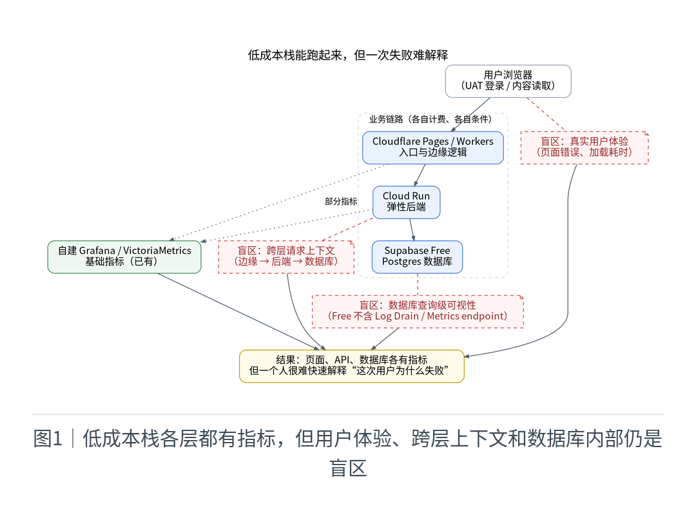
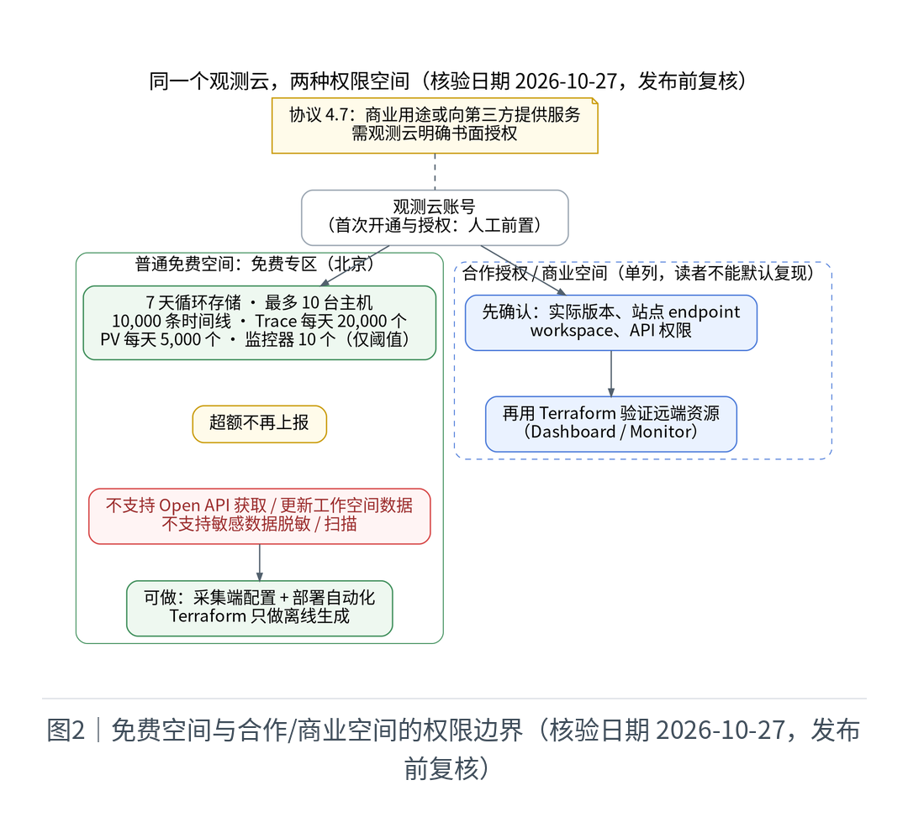
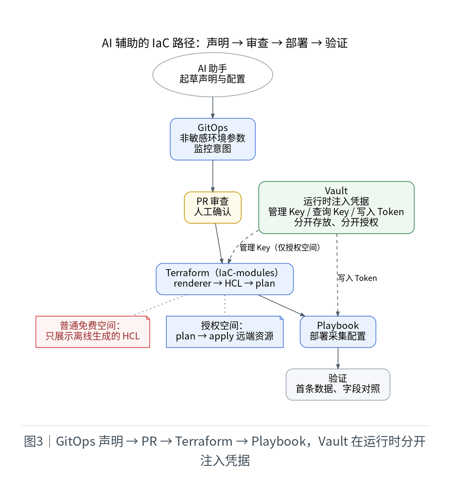
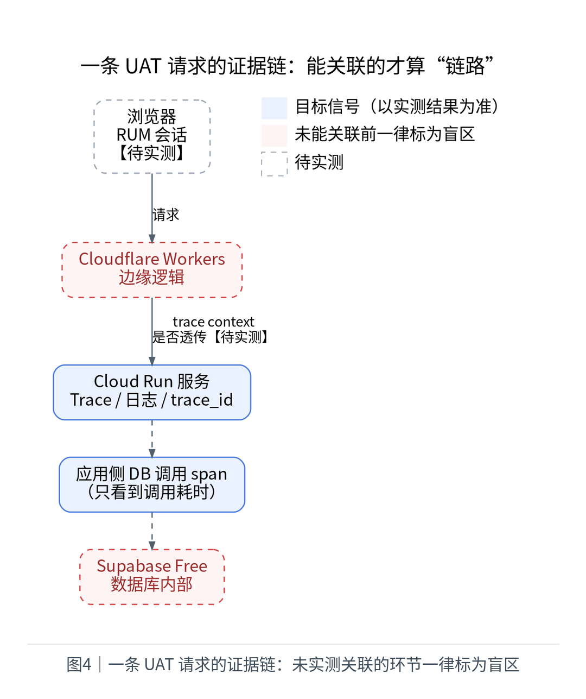
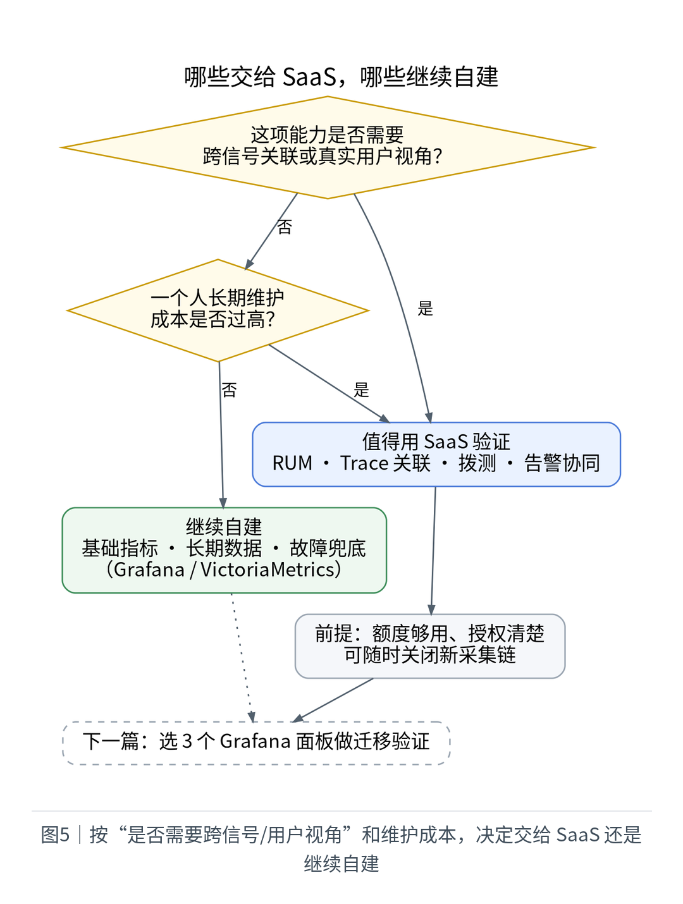

# Cloudflare + Cloud Run + Supabase 之后，我给个人 SaaS 补上了观测云免费专区

作者：Haitao Pan ｜ XWork Technologies LLC 服务支持

> 披露：本文为观测云内容合作。“北京”仅指观测云免费专区（北京）；合作授权权益单列，读者不能默认复现。

想薅“北京免费专区的羊毛”，先算清账：羊毛只在观测云，其余各层各有免费条件，全栈并不永久免费。

## 一、低成本栈：能跑，但要按条件付费

| 层 | 角色 | 免费条件（核验日期 2026-10-27，发布前复核） |
| --- | --- | --- |
| Cloudflare Pages / Workers | 入口、边缘逻辑 | Workers Free 每天 10 万请求、单次 10 ms CPU；静态资源请求免费；Paid 每月最低 5 美元 |
| Cloud Run | 弹性后端 | 请求计费模式每月前 18 万 vCPU 秒、36 万 GiB 秒、200 万请求免费（按结算账号汇总）；超出按地区计费，构建与镜像存储另计 |
| Supabase Free | 数据库 | 500 MB 数据库、5 GB 出口流量；闲置 1 周暂停，最多 2 个活跃项目 |

部署地区：Cloudflare 为全球边缘；Cloud Run 在【待实测：实际 region】；Supabase 在【待实测：实际 region】。

## 二、缺口：指标都有，却解释不了一次失败

基础监控已有：自建 Grafana / VictoriaMetrics（observability-k3s-v5.svc.plus）。但用户说“登录失败”时，我得分别翻边缘、后端、数据库，还缺前端视角。外部 SaaS 值得验证的是跨信号上下文与用户体验，不是再建一套基础监控。

## 三、免费专区的条件与边界

版本区分页（核验日期 2026-10-27，发布前复核）：7 天循环存储；最多 10 台主机；10,000 条时间线；Trace 每天 20,000 个；用户访问 PV 每天 5,000 个；监控器最多 10 个且仅阈值检测；仪表板最多 10 个；超额不再上报。注册需审核，每账号只能创建 1 个工作空间、最多 5 人。

两条硬边界：

- 不支持通过 Open API 获取和更新工作空间数据，不支持敏感数据脱敏。
- 协议 4.7：未经观测云书面授权，不得用于商业用途或向第三方提供服务。xworktech.com 是商业项目，授权情况：【待确认：书面授权范围】。

## 四、核心实践：AI 辅助的 IaC / GitOps / Playbook

- GitOps：只放非敏感环境参数与监控意图；
- IaC-modules：renderer 把声明生成显式 HCL，Terraform 做 plan；
- Playbook：部署 DataKit 与 OTel Collector 的采集配置；
- Vault：运行时注入凭据。管理 API Key、查询 Key、写入 Token 分开存放、分开授权，不进仓库和 CI 日志。

AI 起草声明、配置和 PR 说明，我审 PR 与 plan。首次开通与授权为人工前置。

按空间分两条路径：

1. 普通免费空间：验证采集端配置与部署自动化；远端面板管理 API 视为不可用，Terraform 只展示离线生成的 HCL。
2. 合作授权或商业空间（单列）：先确认实际版本、站点 endpoint、workspace 与 API 权限，再用 Terraform 验证 Dashboard / Monitor。

隐私：采集前过滤与 RUM SDK 遮罩需独立验证【待实测】。Supabase Free 不含 Log Drain、日志留 1 天，不预设能看全数据库查询。

## 五、最小结果

目标：一条 UAT 登录 / 内容读取链路、一个 Dashboard、一个测试告警。

| 项 | 结果 |
| --- | --- |
| 首条数据到达时间 | 【待实测】 |
| 字段对照（env / service / route / trace_id） | 【待实测】 |
| 一条真实请求的关联证据 | 【待实测】 |
| 一次故障定位 | 【待实测】 |
| 7 天额度比例（时间线 / Trace / PV） | 【待实测】 |
| 接入工时 | 【待实测】 |
| 发布前后比较 | 【待实测】 |
| 关闭新采集链后的恢复 | 【待实测】 |

只有实际关联上的信号才叫“全链路”；Cloudflare 边缘与 Supabase 内部未关联前标为盲区。现有 3 个监控器放进 IaC 后续批次。

## 六、怎么选

交给 SaaS：用户体验、跨信号关联、拨测与告警协同。继续自建：基础指标、长期数据、故障兜底。免费版适合 POC，不是生产承诺：协议允许观测云提前 15 天通知后终止服务。商业版成本待 7 天用量出来再按官方单价估算【待实测】。

下一篇：用 AI 把 3 个 Grafana 面板搬过去，保留回退。

## 来源（核验日期 2026-10-27，发布前复核）

- 观测云版本区分：https://docs.guance.com/plans/differences/
- 观测云注册免费版：https://docs.guance.com/plans/free/
- 观测云免费版订阅协议（4.7、10.3.2）：https://docs.guance.com/agreements/free-agreement/
- Cloudflare Workers 定价：https://developers.cloudflare.com/workers/platform/pricing/
- Cloud Run 定价：https://cloud.google.com/run/pricing
- Supabase 定价：https://supabase.com/pricing
