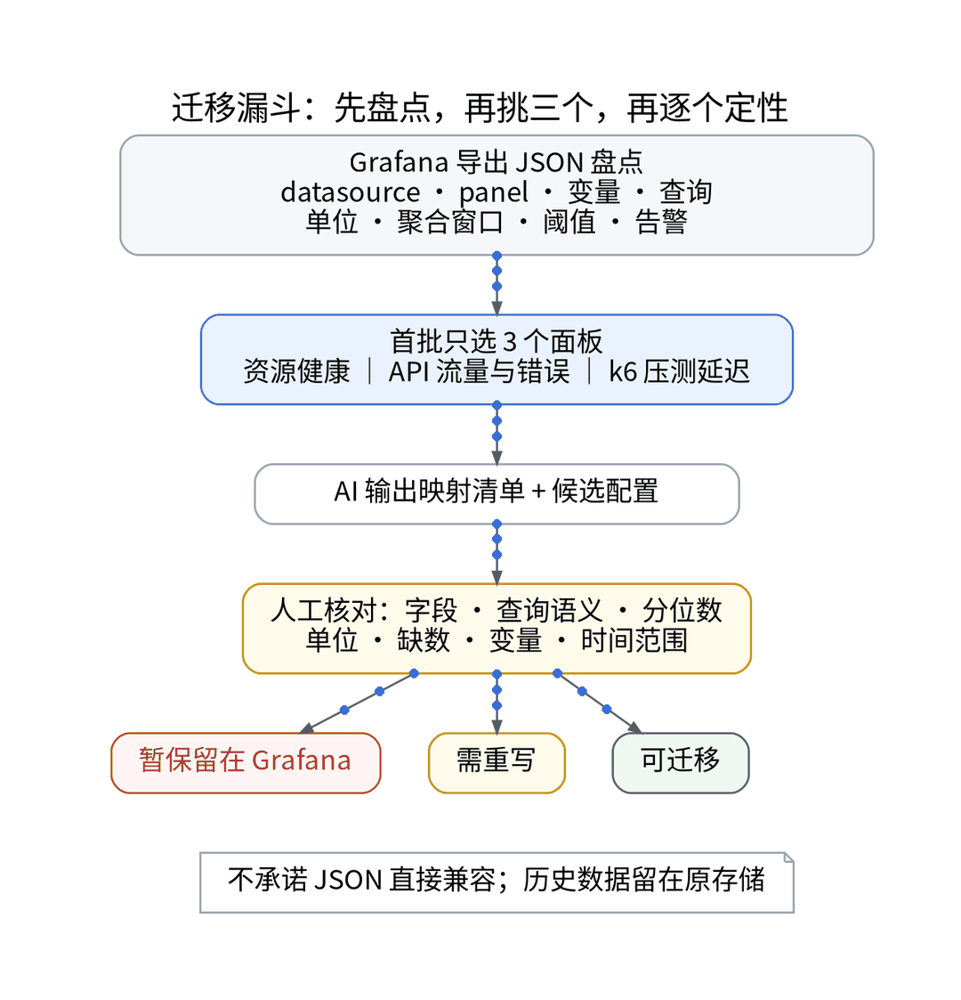
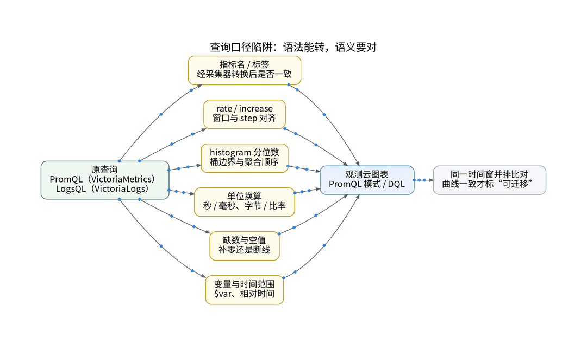
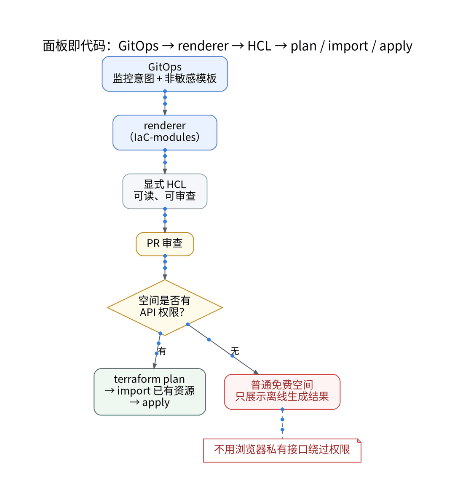

# AI 辅助 Grafana 面板搬家：从 JSON 到观测云配置，保留回退

> 披露：本文为观测云内容合作。沿用上一篇已核验的同一观测云空间（免费专区，北京）和同一条 UAT 链路；合作授权权益单列，读者不能默认复现。

继续薅“北京专区的羊毛”。这次不接新信号，而是搬面板。结论先放前面：迁移最怕的不是麻烦，是回不去；最难的不是语法，是查询口径对上。

## 一、先盘点，不先搬

从自建 Grafana 导出仪表板 JSON，逐项盘点：datasource、panel、变量、查询、单位、聚合窗口、阈值和告警。现有数据源是 VictoriaMetrics（PromQL）和 VictoriaLogs（LogsQL），没有 Loki。盘点规模：【待作者确认是否公开】。

## 二、首批只选三个面板

| 面板 | 原数据 | 判定 |
| --- | --- | --- |
| 资源健康 | 主机指标 | 【待实测】 |
| API 流量与错误 | 服务指标 / 日志 | 【待实测】 |
| k6 压测延迟 | k6 Remote Write 指标 | 【待实测】 |

判定只有三种：可迁移 / 需重写 / 暂保留。对照用同一数据时间窗；历史数据留在原存储，不搬。免费版仪表板上限 10 个（核验日期 2026-10-27，发布前复核）。

## 三、AI 出清单，人对口径

AI 读 JSON，输出映射清单和候选配置；我逐条核对：

- 指标名、标签经采集器转换后是否一致；
- rate / increase 的窗口与 step；
- histogram 分位数的桶与聚合顺序；
- 单位（秒 / 毫秒、字节 / 比率）；
- 缺数时补零还是断线；
- 变量与时间范围。

观测云支持在界面导入 Grafana JSON，但官方提示部分高级特性可能无法显示或需手动重配；图表支持 PromQL 查询。所以本文不承诺 JSON 直接兼容。

## 四、配置即代码：GitOps → renderer → HCL

GitOps 保存监控意图和非敏感模板；IaC-modules 的 renderer 生成显式 HCL，PR 审查后再执行。

- 有 API 权限的空间：terraform plan → import 已有资源 → apply。观测云 Terraform Provider 基于 Open API，需工作空间 API Key；文档中 Monitor 资源写明支持 import，Dashboard 未写明，需实测。
- 普通免费空间：不支持 Open API 读写工作空间数据，只展示离线生成的 HCL；平台配置导入能力另行核验，不用浏览器私有接口绕过权限。

凭据仍由 Vault 运行时注入，管理 Key、查询 Key、写入 Token 分开授权。

## 五、并排对照，随时能退

- 新增 SaaS 写入由开关控制，默认关；写入失败不阻断原采集。
- Grafana 与观测云同屏对照，用真实请求和 k6 压测验证同一时间窗。
- 配置回退：回到 Git 上一版本，经审查的 plan / apply 落地。
- 数据回退：依赖原始存储；免费空间数据 7 天循环。
- 回退演练耗时：【待实测】。

切换前至少满足：同窗偏差在门槛内、额度占比可控、测试告警触发、无敏感字段、完成一次回退演练、授权清楚。

## 六、结果与剩余盲区

| 项 | 结果 |
| --- | --- |
| 三个面板最终判定 | 【待实测】 |
| 失败映射及原因 | 【待实测】 |
| 修改工时（AI 生成 vs 人工修正） | 【待实测】 |
| 剩余盲区 | 【待实测】 |

原 Grafana 排障入口保留，验证通过一个面板，切换一个面板。迁走的是排障入口，不是数据主权。

## 来源（核验日期 2026-10-27，发布前复核）

- 观测云版本区分：https://docs.guance.com/plans/differences/
- 观测云免费版订阅协议：https://docs.guance.com/agreements/free-agreement/
- 观测云仪表板入门（Grafana 导入）：https://docs.guance.com/getting-started/get-started-with-dashboards/
- 观测云 PromQL 查询：https://docs.guance.com/scene/visual-chart/chart-promql-query/
- 观测云 Open API：https://docs.guance.com/open-api/
- 观测云 Terraform Provider：https://registry.terraform.io/providers/GuanceCloud/guance/latest/docs
