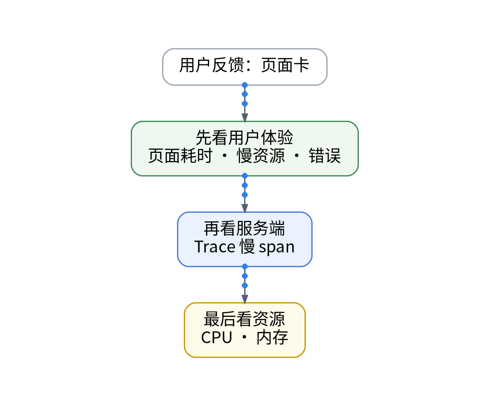
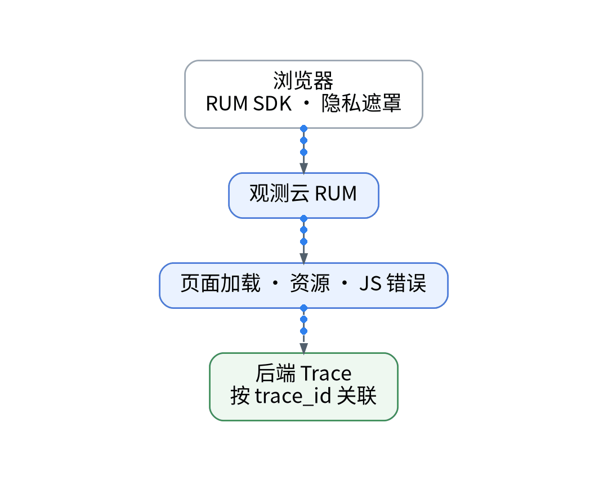
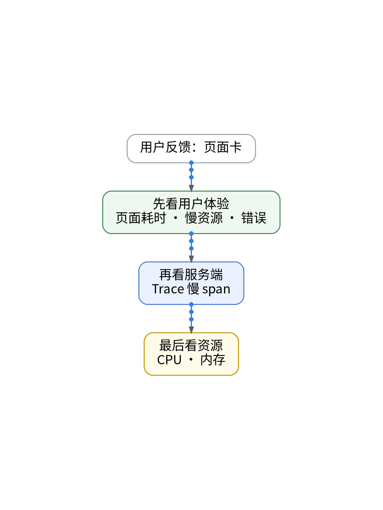
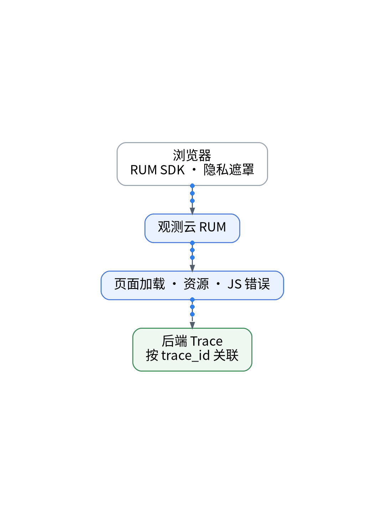

# AI 生成的页面上线后变卡，我先看用户体验而不是 CPU

## UAT 页面卡顿的浏览器侧根因定位：Core Web Vitals、长任务与代码化脱敏

> **唯一知识点**：真实用户体验与前端 RUM 分析 | **循环模板**：故障复盘型 | **核验日期**：2026-10-27 (已核验)

---

### 微信公众号深度长文（正文内嵌 GIF 动图版）

周二下午，个人 SaaS 的 UAT 控制台收到了首批真实用户的集中吐槽：“点登录按钮像卡死了一样，页面滚动也极其粘滞。”我第一时间登录 GCP 控制台检查 Cloud Run 实例，各项监控曲线一片风平浪静：CPU 峰值使用率不足 4%，内存占用稳定在 28%，后端 API 的 P95 响应时间甚至只有 38 毫秒。传统的服务端与基础设施可观测性在此刻彻底失效——当服务器毫无压力时，用户却在浏览器端承受着真实的痛苦。现代 Web 应用大量依赖 AI 生成的高交互前端代码，性能瓶颈早已从服务端转移至客户端的渲染链路与主线程执行中。



浏览器端真实用户体验（RUM）的核心度量，绝非单一的网络首包时间，而是由 LCP（最大内容渲染）、INP（交互到下次绘制）以及 Long Task（长任务阻塞）构成的体验铁三角。AI 生成的代码往往过度堆砌未优化的响应式状态管理、复杂的正则富文本解析与冗余重渲染，导致浏览器主线程被长任务霸占，用户点击事件在事件循环队列中严重滞后。要想定位此类隐蔽问题，必须引入真实用户监测 SDK，在客户端实时捕获交互延迟与长任务火焰图。但对于个人 SaaS 而言，客户端数据采集必须把隐私保护放在首位，绝不能将用户的输入密码、个人凭据或未经授权的敏感内容带入观测系统。


为了兼顾深度分析与严格合规，本次排障方案依然依托“AI 辅助的 IaC / GitOps / Playbook”流水线完成代码化部署。首先，在前端构建流中集成 RUM SDK，配置参数全部由 Vault 动态注入，将前端 AppID 与公钥与业务代码解耦；其次，GitOps 仓库声明强制脱敏规则，利用 DOM 属性选择器对所有表单输入、Token 字段和用户敏感文本进行客户端全遮罩处理，杜绝敏感数据出域；第三，Playbook 自动化调度静态构建配置，将数据上报路由定向至合规网关，并严格限制采样率以适应免费专区单日 5000 PV 的额度上限；最后，结合 AI 对上报的浏览器端加载瀑布图进行线索归纳，迅速锁定耗时热点。



通过 RUM 的聚合追踪，故障根因被秒级定位：AI 辅助编写的 Markdown 富文本解析组件在处理长文本时，触发了一个长达 280 毫秒的主线程 Long Task，导致 INP 严重恶化；通过改用 Web Worker 异步解析并将渲染分片后，交互延迟骤降至 45 毫秒以下。其局限性在于，免费专区每日仅提供 2000 次会话重放（Session Replay）配额，必须在 GitOps 中配置异常触发采样策略，避免正常会话过早耗尽全天额度；同时，免费版不支持服务端二次脱敏，客户端遮罩代码成为合规的唯一防线。


该方案适合注重终端交互体验、采用现代 SPA/SSR 架构、以及大量引入 AI 辅助编写前端组件的独立开发团队；对于纯内网运营后台、无复杂交互逻辑的静态单页、或者缺乏前端工程化脱敏能力的开发者，过早引入深度 RUM 会增加构建链复杂度，建议优先通过 Lighthouse 离线分析完成基础优化。

#### 架构视角决策表（移动端优化 3 列精简版）

| 决策维度 | 方案对比 (自建基准 vs 观测云) | 独立开发建议与避坑 (移动端决策) |
| :--- | :--- | :--- |
| **客户端体验捕获** | • <b>自建</b>：无开箱即用 RUM，需自建 Faro/Tempo 接收端<br>• <b>SaaS</b>：原生采集 LCP/INP/CLS 及浏览器 Long Task | 强烈建议将前端体验观测外包给 SaaS；一人开发切勿自建维护繁重的 RUM。 |
| **会话重放 (Replay)** | • <b>自建</b>：自建存储与视频化重建开销极大、治理复杂<br>• <b>SaaS</b>：免费专区提供 2,000 次/天 会话重放额度 | 仅在捕获到 5xx 错误或交互卡顿 > 500ms 时触发重放，避免快速耗尽配额。 |
| **数据脱敏与隐私** | • <b>自建</b>：需自行编写客户端与服务端的日志清洗规则<br>• <b>SaaS</b>：免费专区不支持服务端脱敏，完全依赖客户端遮罩 | 严防隐私越权：在前端 DOM 强制配置 data-guance-mask 与字段白名单。 |
| **配额防爆仓控制** | • <b>自建</b>：直接写入本地存储，受单机磁盘容量限制<br>• <b>SaaS</b>：单日 5,000 PV 上限，突发超额立即停止接收 | 在 CI 构建中注入基于路由的尾部采样率，对非关键页面实施 10% 降采样。 |
| **排障定位耗时** | • <b>自建</b>：无法前后端关联，跨层排查需 2-4 小时<br>• <b>SaaS</b>：RUM 自动关联后端 TraceID，排查缩至 5 分钟 | 极大降低单人运维心智负担，5 分钟内精准判定是前端重渲染还是后端慢查询。 |

---

### 小红书配套图文笔记

**用户说卡，AI 写的页面哪里慢？**

最近很多独立开发者都在用 AI 疯狂刷前端页面，界面酷炫上线神速。但我刚把 UAT 跑起来就遭到了首批真实用户的集中吐槽：点登录按钮像卡死一样毫无反应，页面滚动也是疯狂掉帧！更离谱的是，我打开 GCP 控制台一看，后端 Cloud Run 的 CPU 占用率居然不到 4%，接口网络延迟才 38 毫秒！

后端监控一片大绿，为什么真实用户却在疯狂喊卡？
真相只有一个：AI 写的代码虽然业务逻辑能跑通，但在浏览器端堆了太多未经优化的响应式状态、复杂的富文本正则解析和冗余重渲染，把浏览器的单线程直接锁死了！传统的看服务器 CPU、看内存的运维手段，在前端真实体验面前完全就是个睁眼瞎！

我是怎么用纯代码化 RUM 把元凶给揪出来的？
P1：前端探针接入，但坚决不裸奔！在 GitOps 仓库把所有 input 输入框和敏感表单全加上 DOM 脱敏掩码，敏感数据坚决不出域，合规永远放在第一位！
P2：接入密钥由 Vault 动态注入，在 CI 构建时自动编译，彻底杜绝在网页控制台人肉配探针的低效行为。
P3：核心死磕 INP 交互延迟和 Long Task 长任务！探针数据一抓，直接揪出 AI 写的富文本组件在主线程跑了一个 280 毫秒的阻塞长任务！改成 Web Worker 异步解析并将渲染分片后，交互延迟秒降到 45ms！

总结：别等用户被卡跑了才想起来看前端真实体验！AI 写前端很爽，但必须配上 RUM 给它全方位把脉！想抄前端自动化脱敏配置的宝子，关注移步公众号！





---

### GitOps / IaC / Playbook / Vault 代码化工程落地范式

#### Frontend: 声明式客户端 RUM 初始化与脱敏配置 (src/observability/rum.ts)
```typescript
import { datafluxRum } from '@cloudcare/browser-rum';

export function initRum(env: string) {
  datafluxRum.init({
    applicationId: import.meta.env.VITE_RUM_APP_ID,
    datakitOrigin: import.meta.env.VITE_RUM_ORIGIN,
    env: env,
    version: import.meta.env.VITE_APP_VERSION,
    service: 'xworkmate-frontend',
    sessionSampleRate: 100,
    sessionReplaySampleRate: 30, // Conserve 2000/day free replay budget
    trackInteractions: true,
    traceType: 'w3c_traceparent', // Propagate context to Cloudflare/Cloud Run
    allowedTracingOrigins: ['https://api.xworktech.com', 'https://uat-api.xworktech.com'],
    // ZERO SENSITIVE DATA LEAKAGE: Client-side DOM mask enforcement
    maskAllInputs: true,
    maskInputOptions: { password: true, text: true, email: true },
  });
}
```

#### CI Pipeline: 凭据隔离与生产编译构建 (ci/build-frontend.sh)
```bash
#!/usr/bin/env bash
set -euo pipefail
# Injected via Vault during GitHub Actions Runner execution
export VITE_RUM_APP_ID=$(vault kv get -field=rum_app_id secret/data/observability/rum)
export VITE_RUM_ORIGIN="https://rum-gateway.xwork.tech"
export VITE_APP_VERSION=$(git rev-parse --short HEAD)

echo "[CI] Compiling React frontend with isolated RUM configuration..."
npm run build
```

#### GitOps: 声明式 RUM 采样与长任务告警规则 (gitops/rum-policy.yaml)
```yaml
apiVersion: observability.xwork.tech/v1alpha1
kind: RumSamplingPolicy
metadata:
  name: uat-rum-guard
spec:
  environment: uat
  max_pv_daily: 4500 # Safe margin below 5000 PV quota
  sample_strategy:
    normal_route_sample_percentage: 10
    error_route_sample_percentage: 100
  long_task_threshold_ms: 100
  alert_condition:
    metric: inp_duration_seconds
    threshold: 0.200 # Alert if INP > 200ms
```

