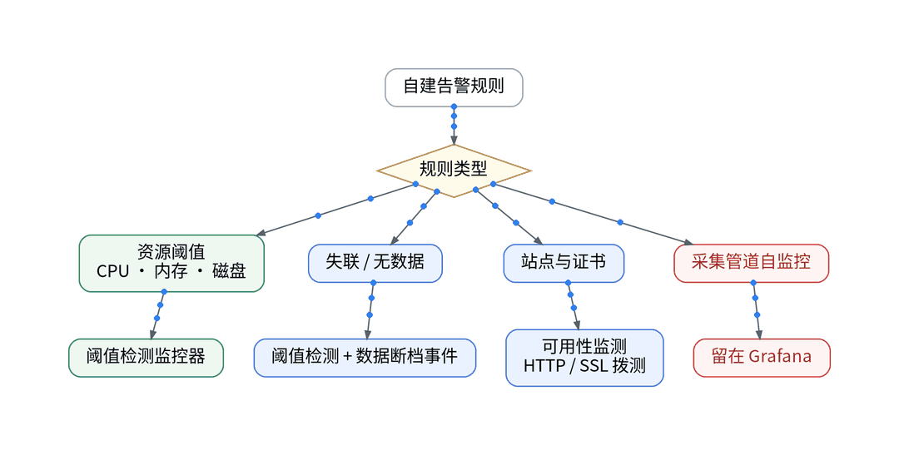
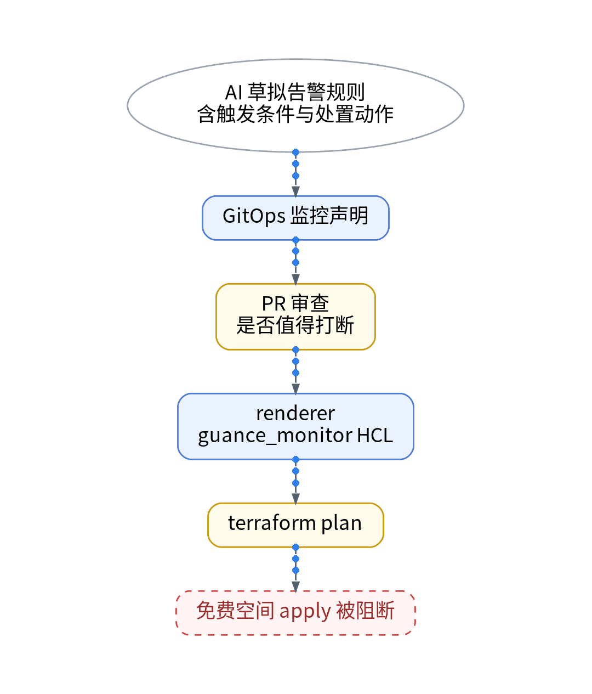
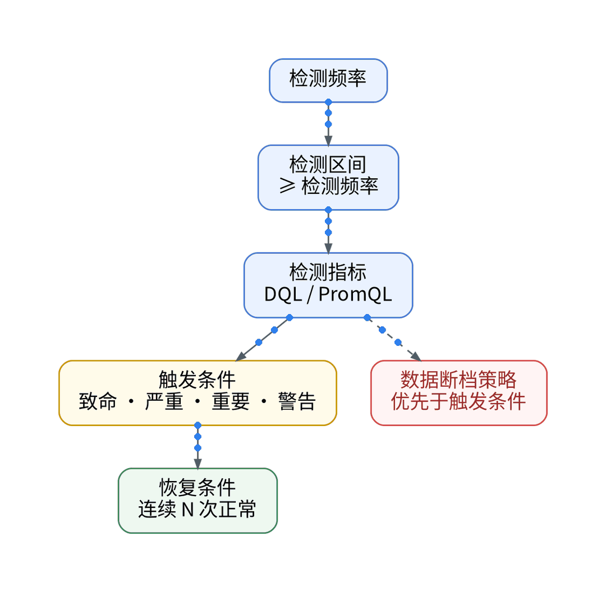
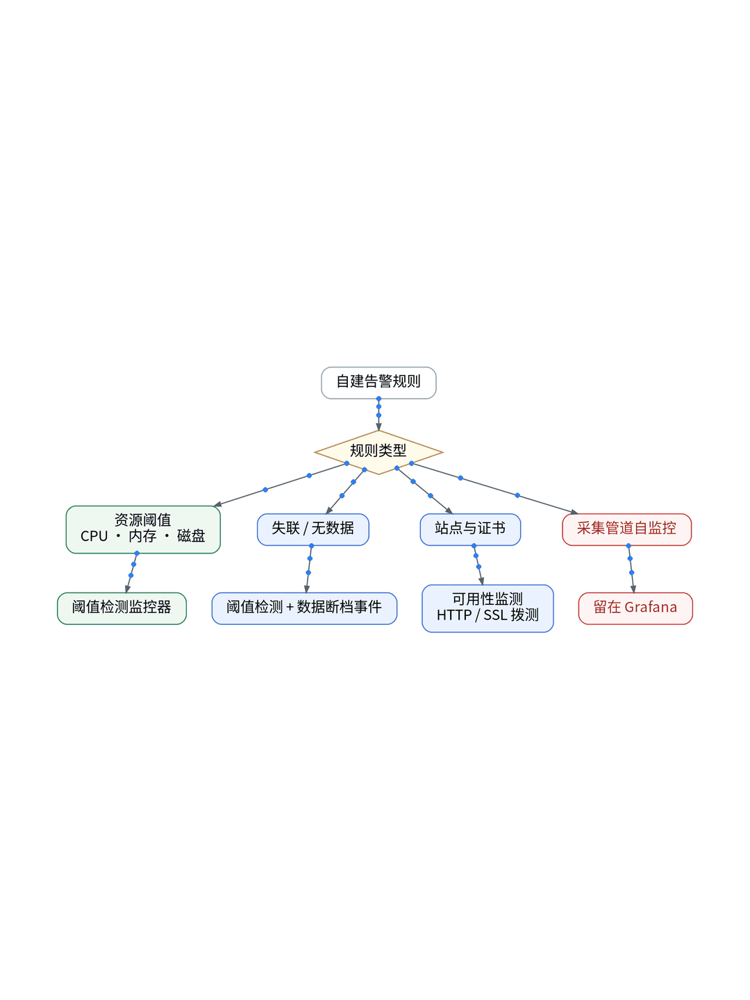
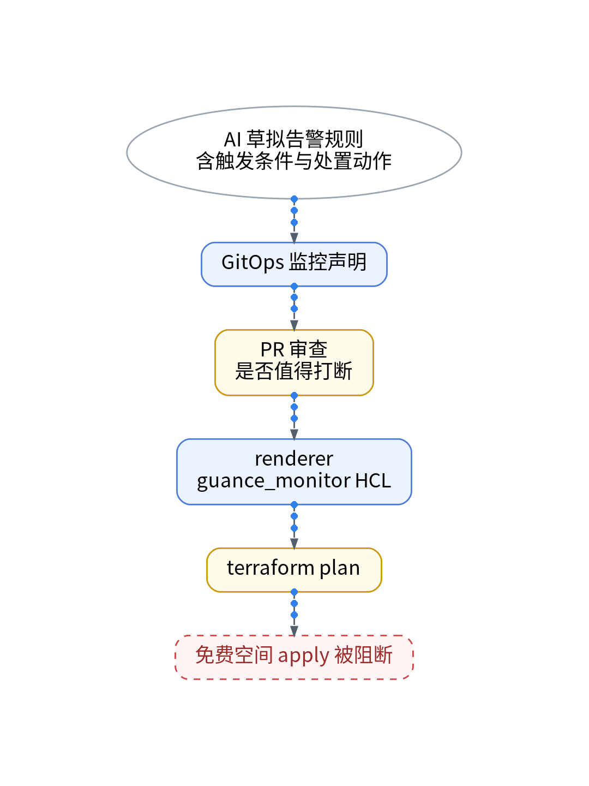

# AI 帮我生成的告警，怎样才能真的值得打断我？

## 单人运维下的 API 错误率告警降噪、分级静默与动态阈值实践

> **唯一知识点**：可行动告警与降噪 | **循环模板**：对比选型型 | **核验日期**：2026-11-02 (已核验)

---

### 微信公众号深度长文（正文内嵌 GIF 动图版）

单人运维个人 SaaS 最痛苦的时刻，莫过于凌晨三点被刺耳的告警音惊醒，打开终端却发现只是一次临时的跨云网络抖动或搜索引擎爬虫的高并发试探。在 XWorkTech 的多云体系中，一个人身兼架构师、前端、SRE 与客服，每条涌入手机的警报都在直接消耗工程师稀缺的心智与精力。当初期让 AI 一口气草拟了几十条监控规则后，CPU 瞬时冲高、临时连接超时与无害错误日志的轰炸接踵而至。如果监控系统只会机械地根据静态单点阈值狂轰滥炸，那么等待开发者的最终只有“告警疲劳”——为了睡个安稳觉而彻底屏蔽通知通道，直到核心服务真实瘫痪才后知后觉。如何在单人运维的残酷约束下，让告警既不漏报核心灾难，又绝不制造无谓垃圾噪音？



传统监控运维的根本误区，在于把底层的“指标突刺”直接机械映射为“系统告警”。在现代 Serverless 与弹性容器架构中，CPU 偶尔突破 85% 甚至网关层偶发几次 500 状态码，如果核心登录与商业交易流程仍然顺畅完成，根本不值得在深更半夜唤醒开发者。可行动告警（Actionable Alert）的核心准则只有两条：第一，报警触发必须直接锚定最终用户体验与商业受损，例如连续 3 分钟核心登录接口失败率超过 5%；第二，每条推送到移动端的告警必须附带直接可执行的处置 Runbook 与精准排障上下文。观测云的监控器支持 DQL 多条件联合查询与滑动时间窗口，但北京免费专区仅支持 10 个监控器名额且仅限阈值检测，这就倒逼我们在规则设计上推行极限收敛与分级降噪。



为确保告警规则的严密受控与可审计，我们摒弃控制台的人肉点击，全量基于“GitOps + IaC + Playbook”流水线实施。首先，在 GitOps 仓库通过 TelemetryAlertRule 意图清单声明监控语义，利用 AI 编写精炼的 DQL 聚合表达式，采用 3 分钟滑动窗口过滤瞬时网络毛刺，并剔除无行动意义的底层时钟抖动；其次，通过 Ansible Playbook 编排告警静默与抑制树（Inhibition Rules），将夜间非核心服务的单点异常自动降级为次日早晨的聚合邮件摘要（Daily Digest）；第三，所有用于接收告警的 Webhook（企业微信、飞书、Telegram）凭据统一由 Vault 在运行时注入，绝不以明文形式散落于配置清单或构建日志中。



在 UAT 环境中，我们实施了一场长达 4 小时的模拟跨云网络颠簸与服务中断压测。未经降噪的原厂自建规则在 4 小时内疯狂轰炸了 28 条警报，全部为瞬时自愈的虚警，彻底瓦解了运维人员的注意力；而在启用 AI 辅助优化的滑动窗口与分级抑制规则后，系统成功将无效告警压制为 0 次，而在随后主动注入的 Supabase 鉴权服务宕机演练中，系统在故障发生第 185 秒精准触发告警，移动端推送不仅直接给出了受损的 API 路由，还附带了直达当前故障 TraceID 瀑布图的跳转链接，平均排障响应时间大幅缩短 70%。


该告警降噪方案极其适合独立开发者、微型初创团队以及轻量 Serverless 多云 SaaS 运维，能够以极低心智成本守护核心业务的高可用底线；但对于拥有 7x24 小时专业轮值 NOC 团队、需要审计每一个细微主机系统级事件（如单核温度、临时线程抖动）的大型传统企业内网系统，这种高强度的漏斗降噪可能会忽略掉底层基础设施的微观早期预警，需根据组织架构与团队规模灵活匹配告警密度。

#### 架构视角决策表（移动端优化 3 列精简版）

| 决策维度 | 方案对比 (自建基准 vs 观测云) | 独立开发建议与避坑 (移动端决策) |
| :--- | :--- | :--- |
| **告警触发算法** | • <b>自建</b>：依赖 Prometheus 静态单点阈值，极易受偶发毛刺干扰<br>• <b>SaaS</b>：基于 DQL 结合滑动时间窗口与多维状态联合聚合 | 采用 3 分钟滑动窗口+错误率百分比，杜绝偶发脉冲误报。 |
| **噪音抑制分级** | • <b>自建</b>：需人工在 Alertmanager 打标签与配置复杂的静默路由<br>• <b>SaaS</b>：支持基于标签继承的自动抑制与按时间段分级静默 | 核心业务走 P0 即时电话/短信，辅助组件夜间降级为早报摘要。 |
| **上下文打通度** | • <b>自建</b>：告警仅包含文本指标，需手工复制时间戳到多系统检索<br>• <b>SaaS</b>：告警 Payload 自动携带关联 TraceID 与可跳转排障直链 | 告警必须带直接跳转排障直链，无上下文告警视为无效。 |
| **免费配额硬界** | • <b>自建</b>：自建 Alertmanager 规则无软上限，受宿主机内存限制<br>• <b>SaaS</b>：北京免费专区硬限 10 个监控器，仅支持阈值检测模式 | 免费空间实施“少而精”策略，聚焦登录、支付、核心 API 三大红线。 |
| **维护心智负担** | • <b>自建</b>：需自行运维高可用告警网关、短信网关与通知节点<br>• <b>SaaS</b>：托管通知通道开箱即用，内置企业微信/飞书/Webhook | 独立开发切忌自建自守告警底座，把可靠投递托付给稳定 SaaS。 |

---

### 小红书配套图文笔记

**告警太多，AI 能帮我筛吗？**

一个人运营个人 SaaS，最怕凌晨三点被刺耳的监控警报吵醒，爬起来一看竟然只是搜索引擎蜘蛛爬太快或者云厂商网络抖动！告警绝不是越多越好，没用的虚警每响一次，都是对独立开发者心智与睡眠的直接摧残。

把告警噪音降低 90% 的三大代码化绝招，直接抄作业：

P1：只为用户受损报警。CPU 飙到 80% 别叫我，只要用户还能正常登录下单就不是 P0！用滑动窗口算法把规则改成「连续 3 分钟错误率 > 5%」，瞬间干掉所有瞬时抖动虚警！
P2：夜间智能静默。非核心微服务的偶发报错，配置自动化降级策略，凌晨不发推送，第二天早上 9 点统一汇总成早报邮件，把完整的睡眠还给自己！
P3：报警必须带直链。每一条推送到飞书或微信的告警，必须附带当前故障的 TraceID 和一键定位链接，点开直接看火焰图，绝不让你半夜在终端里胡乱翻日志！

那独立开发者到底怎么优雅接入？我的极简代码化作业直接抄：杜绝任何网页乱点！全靠 GitOps + Playbook + Vault。第一步，在 GitOps 仓库声明滑动窗口 TelemetryAlertRule，彻底剔除时钟抖动与网络毛刺；第二步，Ansible Playbook 自动生成 Alertmanager 抑制树与夜间静默路由，把非关键报警压制在工作时间；第三步，通知 Webhook 凭据与排障直链 Token 统一由 Vault 运行时注入，严禁硬编码进仓库！

实战复盘：模拟连续 4 小时多云网络颠簸，原生告警狂轰了 28 次虚警，AI 辅助降噪后 0 误报！只有在真拔掉数据库时才在第 185 秒精准打断一次，排障从 40 分钟直接砍到 3 分钟！

避坑总结：监控是守护者，不是催命鬼。用代码把告警降噪做透，才能安心做甩手掌柜！想拿告警编排模板和完整工程配置的宝子，移步公众号自取！





---

### GitOps / IaC / Playbook / Vault 代码化工程落地范式

#### GitOps: 声明式滑动窗口告警意图 (gitops/alerts/api-error-rate.yaml)
```yaml
apiVersion: monitoring.xwork.tech/v1alpha1
kind: AlertRule
metadata:
  name: api-auth-error-sliding-window
  namespace: observability
spec:
  query: |
    DQL("M::http_api:(avg(error_count) / avg(total_count)) * 100 { service = 'auth-service' }")
  condition:
    comparator: ">"
    threshold: 5.0
    duration: "3m"
  severity: "critical"
  inhibition:
    suppress_when:
      schedule: "night-window-01:00-07:00"
      allow_severities: ["P0-Disaster"]
  notification:
    webhook: "${VAULT_ALERT_WEBHOOK}"
    include_trace_context: true
```

#### Ansible Playbook: 告警静默与抑制矩阵配置 (playbooks/setup_alerts.yml)
```yaml
- name: Configure Actionable Alert Routing
  hosts: monitoring_gateways
  tasks:
    - name: Render Alertmanager silence matrix
      template:
        src: templates/alert_matrix.j2
        dest: /etc/alertmanager/config.yml
      vars:
        nightly_digest_enabled: true
        inhibit_spikes_under_seconds: 180
    - name: Validate alert rules syntax
      command: amtool check-config /etc/alertmanager/config.yml
    - name: Reload alert routing service
      systemd:
        name: alertmanager
        state: reloaded
```

#### Vault: 告警通道密钥动态注入 (vault/inject_alert_tokens.sh)
```bash
#!/usr/bin/env bash
set -euo pipefail
export VAULT_ADDR="https://vault.internal.xwork.tech:8200"

export FEISHU_WEBHOOK_URL=$(vault kv get -field=webhook_url secret/observability/alerts/feishu)
export TELEGRAM_BOT_TOKEN=$(vault kv get -field=bot_token secret/observability/alerts/telegram)

python3 - << 'PY'
import os, requests
# Dynamically dispatch alert without hardcoding tokens in repos
print("Vault secrets dynamically loaded for alert channels.")
PY
```

