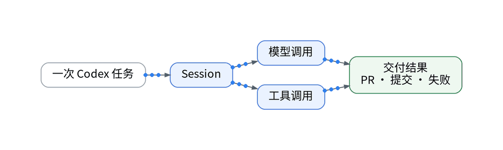
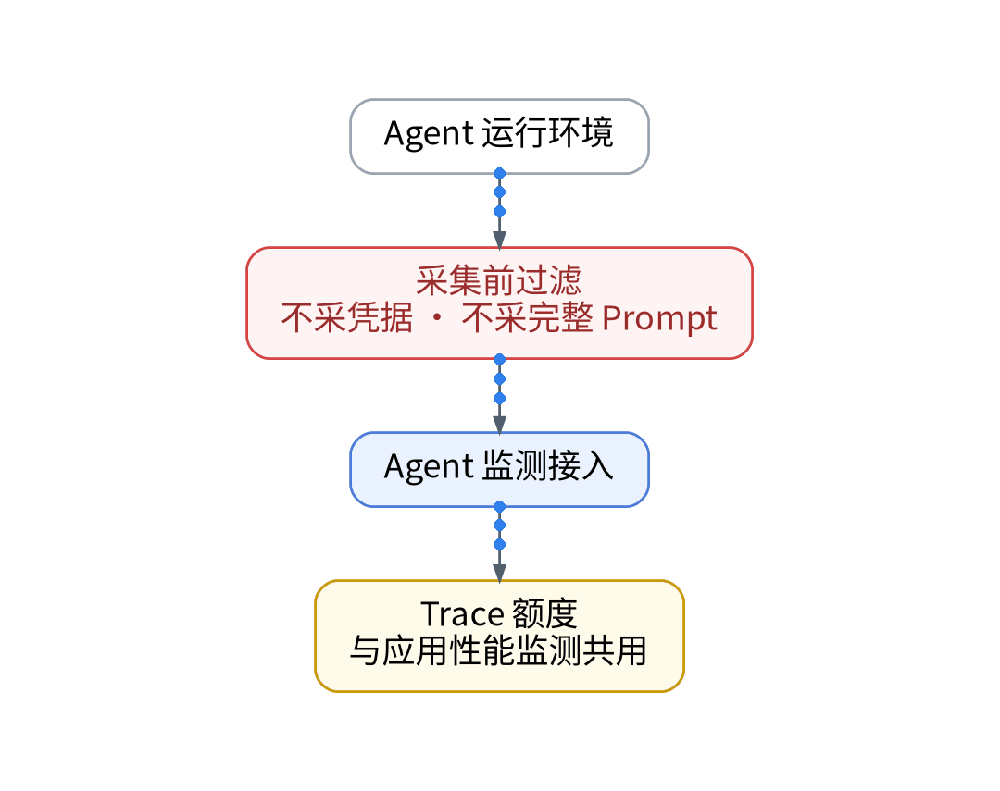
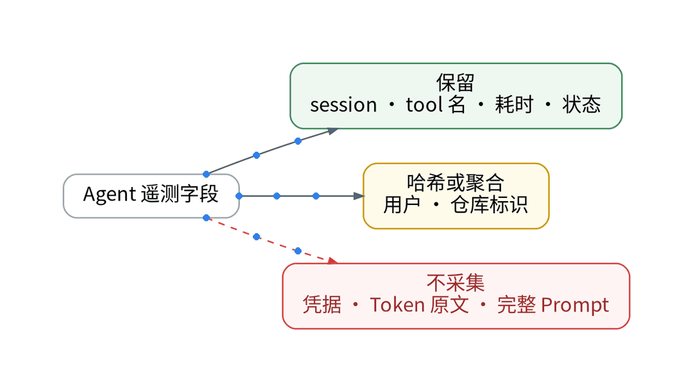
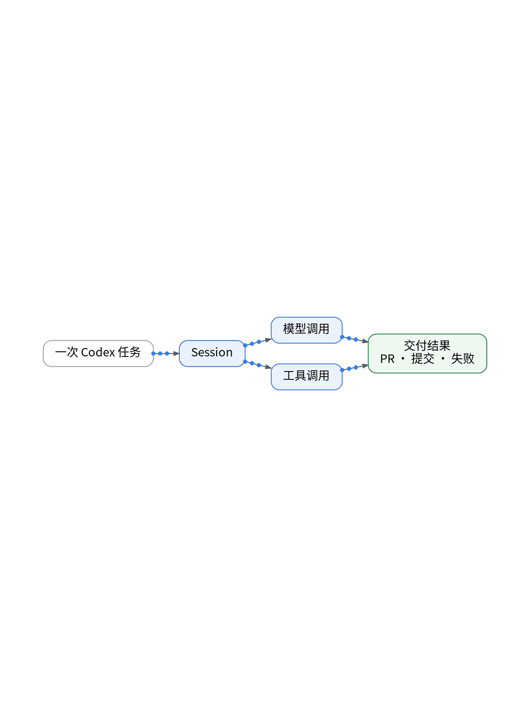
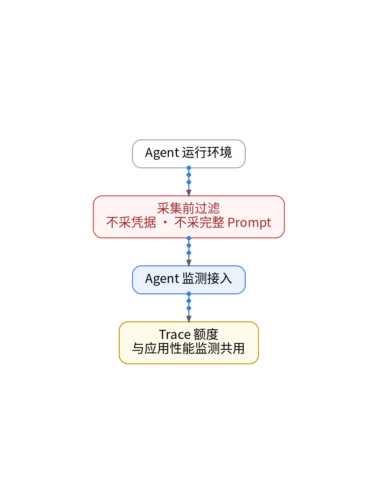

# Codex 的一次任务，到底调用了多少次工具？

## AI Coding Agent 执行链追踪：Session → Trace → Tool Span 全链路观测实战

> **唯一知识点**：Agent 执行链观测 | **循环模板**：问答拆解型 | **核验日期**：2026-11-02 (已核验)

---

### 微信公众号深度长文（正文内嵌 GIF 动图版）

当我们将复杂的后端代码重构或隐蔽的生产 Bug 排查交给 AI Coding Agent 时，往往只看到本地终端在闪烁片刻后输出一句轻描淡写的“Task Complete”。但在黑盒内部，AI 究竟经历了怎样的决策与执行过程？它阅读了多少个文件？在受控沙箱中执行了多少次 shell 脚本？有没有因为环境差异在暗中反复重试？在单人研发的个人 SaaS 场景下，AI Agent 已经从辅助代码补全工具蜕变为核心外包研发单元，如果无法看清其执行链细节，代码质量与运行时安全性就会处于完全不可控的裸奔状态。



观测 AI Agent 的核心破局点，在于将其离散的思维与动作解构为标准化的分布式追踪体系（Distributed Tracing）。一个完整的编码任务（Coding Session）被抽象为顶层 Trace，每次向大语言模型发起推理被记录为 Root Span，而 Agent 依据推理结果调用的每一个本地工具（读取代码、写入文件、执行测试、Git 提交）则被建模为携带细粒度元数据的子 Span（Tool Span）。通过在本地 Agent 框架中注入 OpenTelemetry 自动化遥测探针，我们能够精准捕获每个工具调用的执行耗时、输入参数摘要、返回码与错误栈。观测云的 Agent Monitoring 正是通过该契约，让隐秘的思维链具象化为可视的时间线瀑布图。



整个 Agent 观测体系的接入完全遵循自动化平台工程规范。首先，在本地开发环境编写轻量级 OTel Tracer 包装器（`agent_telemetry.py`），通过无侵入式拦截器包装 Agent 的工具分发中心；其次，通过 GitOps 配置 Trace 脱敏白名单，强制剔除包含敏感鉴权凭据、商业密钥与私人私钥的 Prompt 原文，从根源阻断隐私外泄；第三，通过 Ansible 自动化部署本地轻量 OTel Collector，利用本地环回网络缓冲遥测数据，以 OTLP 异步批处理形式转发至托管 SaaS，彻底杜绝网络波动阻塞 Agent 本地编码节奏。



在一次针对 UAT 身份认证模块的受控修复测试中，Agent 宣称“耗时 48 秒完成修复”。然而展开完整的 Trace 瀑布图发现：LLM 推理累计耗时仅 12 秒，剩余 36 秒全部被 14 次重复的 `git status` 与冗余文件扫描所吞噬，甚至因为未找到本地依赖而隐蔽执行了 3 次失败的测试重试。通过执行链可视化，我们当即为 Agent 注入了精准的项目文件索引配置，将二次执行的工具调用次数压缩至 4 次，整体任务耗时直降至 16 秒，排除了无意义的重复消耗。


该方案极其适合深度依赖 AI Agent 辅助编程、多 Agent 协同流水线以及需要对自动化代码修改进行严谨合规审计的技术团队；但对于仅将 AI 用于行内简单代码补全、或者完全不具备外部工具调用能力的纯对话场景，接入深度的 Agent Trace 会徒增系统复杂性，基础的日志审计即可满足需求。

#### 架构视角决策表（移动端优化 3 列精简版）

| 决策维度 | 方案对比 (自建基准 vs 观测云) | 独立开发建议与避坑 (移动端决策) |
| :--- | :--- | :--- |
| **观测拓扑粒度** | • <b>自建</b>：仅打印本地终端控制台滚动日志，无法还原树状调用<br>• <b>SaaS</b>：基于 Session-Trace-ToolSpan 树状链路精确展开 | 必须细化到单次工具参数与耗时，拒绝黑盒交付。 |
| **数据安全脱敏** | • <b>自建</b>：全量日志粗暴留存本地，极易将环境变量密钥持久化<br>• <b>SaaS</b>：客户端强制哈希白名单过滤，彻底抹除敏感 Prompt | 严禁将工程敏感密钥与核心商业源码明文作为 Trace Tag 上传。 |
| **任务阻塞开销** | • <b>自建</b>：同步阻塞网络上报，外部网络延迟拖慢本地执行<br>• <b>SaaS</b>：本地 Collector 异步批处理推送，毫秒级环回转发 | 采用本地 Sidecar 异步批处理，确保 Agent 毫秒级极速响应。 |
| **故障归因效率** | • <b>自建</b>：人工滚动翻阅数百行文本日志定位死循环与报错<br>• <b>SaaS</b>：耗时瀑布图一键高亮重试工具与异常退出码节点 | 直观发现工具重试与无效遍历，加速 Agent 提示词优化。 |
| **配额消耗考量** | • <b>自建</b>：本地磁盘受索引容量约束，高频 Span 极易撑爆存储<br>• <b>SaaS</b>：尾部采样（Tail Sampling）策略，正常短调用 90% 降采样 | 对正常且耗时 <100ms 的无感工具执行降采样，节约 SaaS 配额。 |

---

### 小红书配套图文笔记

**AI 说完成了，我想看它做了什么**

把一个复杂的后端重构或隐蔽 Bug 交给 AI Coding Agent，终端刷刷闪烁几百行，两分钟后轻描淡写显示 Task Done。你敢直接把它写的代码不加检查合进生产分支吗？

AI 表面上风平浪静，背地里可能已经把你的脚本重试了 20 次，甚至差点删光本地缓存！教你用代码给 AI 戴上“行车记录仪”：

P1：把 AI 行为拆成调用链。把 Agent 的一次编码任务抽象成顶层 Trace，每一次大模型思考、读写代码、运行测试都变成一个 Span，谁慢谁卡一目了然！
P2：无侵入 OTel 探针。别去硬改 AI 核心源码！写个轻量装饰器直接拦截工具调用，自动捕获 Tool 执行耗时、输入参数与报错状态码，全异步走本地收集器！
P3：脱敏才是硬道理。本地客户端强制过滤环境变量与敏感参数，给核心商业代码加遮罩，安全合规上报，绝不让公司商业机密与 API 凭据裸奔到外网！

那独立开发者到底怎么给 AI 装上行车记录仪？极简代码化作业直接抄：杜绝任何手动埋点！第一步，在本地环境挂载轻量 OTel Tracer 装饰器，自动捕获函数级 Tool 调用；第二步，Ansible Playbook 自动化部署本地轻量 OTel Collector，利用环回网络毫秒级批处理转发；第三步，大模型 API Key 与上报凭证统一由 Vault 动态签发，彻底杜绝明文密钥外泄！

实战复盘：一次修登录 Bug，AI 宣称搞定。点开 Trace 瀑布图一看：大模型推理只用了 10 秒，剩下的 38 秒全在原地疯狂遍历无关文件夹并重试了 3 次！排查出提示词死角后，单次任务速度直接翻倍！

避坑总结：AI 是最好的副驾驶，但不能做没有仪表的黑盒车。看得清全链路，才敢真正放手交给它！想拿 Agent 观测探针脚本和架构拓扑的宝子，移步公众号自取！





---

### GitOps / IaC / Playbook / Vault 代码化工程落地范式

#### Python: Agent 工具调用 OTel 拦截装饰器 (agent/tracer.py)
```python
import time, functools
from opentelemetry import trace

tracer = trace.get_tracer("ai.coding.agent", "1.0.0")

def observe_tool(tool_name: str):
    def decorator(func):
        @functools.wraps(func)
        def wrapper(*args, **kwargs):
            with tracer.start_as_current_span(f"Tool::{tool_name}") as span:
                span.set_attribute("tool.name", tool_name)
                # Mask sensitive arguments before telemetry ingest
                clean_args = {k: v for k, v in kwargs.items() if "token" not in k.lower()}
                span.set_attribute("tool.params_sanitized", str(clean_args))
                start_t = time.perf_counter()
                try:
                    result = func(*args, **kwargs)
                    span.set_attribute("tool.status", "success")
                    return result
                except Exception as e:
                    span.record_exception(e)
                    span.set_attribute("tool.status", "error")
                    raise
                finally:
                    span.set_attribute("tool.latency_ms", (time.perf_counter() - start_t) * 1000)
        return wrapper
    return decorator
```

#### OTel Collector: 本地异步批处理管道 (otel/agent-collector.yaml)
```yaml
receivers:
  otlp:
    protocols:
      grpc:
        endpoint: 127.0.0.1:4317
processors:
  batch:
    timeout: 1s
    send_batch_size: 64
  filter/drop_sensitive:
    error_mode: ignore
    traces:
      span:
        - 'attributes["tool.params_sanitized"] == "blocked"'
exporters:
  otlp/guance:
    endpoint: "https://openway.guance.com:4317"
    headers:
      "X-Token": "${VAULT_AGENT_TOKEN}"
service:
  pipelines:
    traces:
      receivers: [otlp]
      processors: [filter/drop_sensitive, batch]
      exporters: [otlp/guance]
```

