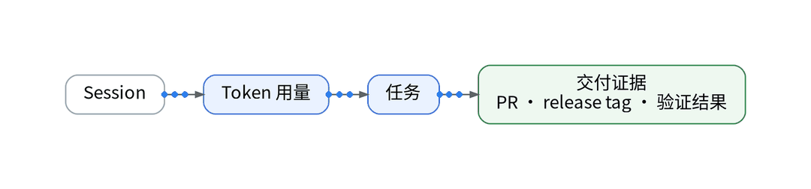
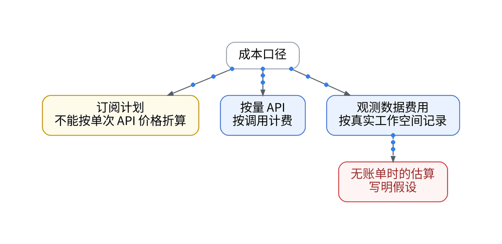
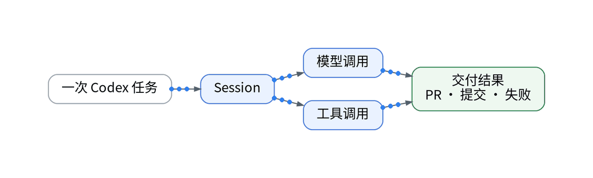
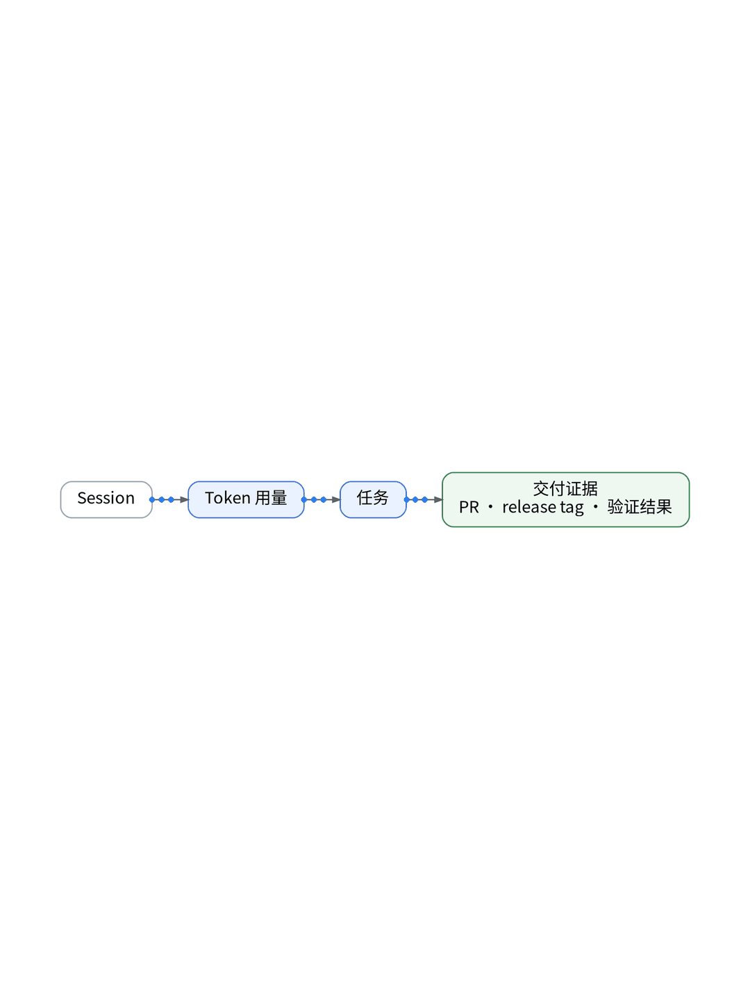
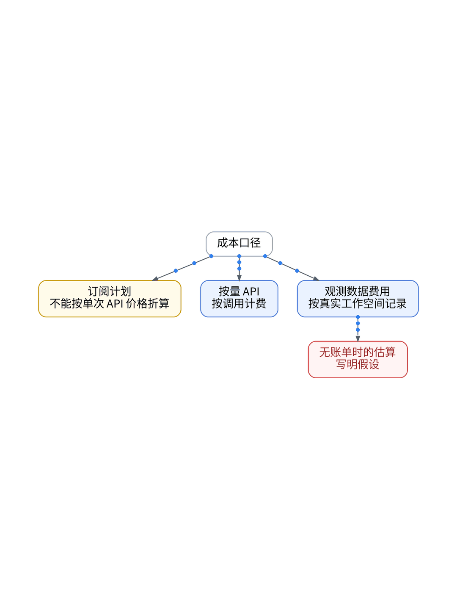

# Token 花掉以后，怎样知道它有没有换来交付？

## 从 API 消耗到 Git Commit：AI Coding 成本归因、产出对账与 AgentMeter 实践

> **唯一知识点**：AI 成本归因与交付关联 | **循环模板**：成本账本型 | **核验日期**：2026-11-02 (已核验)

---

### 微信公众号深度长文（正文内嵌 GIF 动图版）

在 AI 编程全面融入日常交付的当下，每个独立开发者和技术团队的账单上都多了一笔不可忽视的开销：大模型 API 订阅与高频 Token 消耗。然而月末看着几百美元的扣费账单，工程师心中往往充满疑惑：这些 Token 究竟花在了哪些项目上？高额的 Prompt 消耗是否换来了稳定的工程产出？还是在反复修修补补无效的测试用例中被白白挥霍？缺乏精细的成本归因，AI 编程就很容易从“降本增效利器”沦为吞噬研发预算的“吞金黑洞”。



传统云厂商账单通常只按账户或模型给出总计花费，无法深入到研发工程的细粒度维度。科学的 AI 成本归因必须建立“输入-过程-产出”的三维对账模型：输入端记录单次交互的 Prompt 与 Completion Token 数量；过程端打上项目代号、功能模块（Feature Branch）与开发者标签；产出端则严格关联到 Git Commit 数量、测试用例通过率与 Pull Request 合并记录。观测云的 AgentMeter 体系与 OTel 计量规范相结合，能够将 Token 消耗以度量指标（Metrics）与事件（Events）形式持久化，从而计算出极具指导意义的“单次有效交付成本（Cost Per Valid Delivery）”。



成本归因的落地同样坚决贯彻 GitOps 代码化原则。首先，在 CI/CD 流水线与本地 Agent 启动脚本中，通过环境变量强制注入 `COST_CENTER`、`REPO_NAME` 与 `FEATURE_ID` 标签；其次，编写轻量级的 Token 计量 Exporter，在 Agent 每轮通信结束时自动提取 `usage.prompt_tokens` 与 `usage.completion_tokens`，按不同模型定价公式转换为微美元（micro-USD）指标；最后，通过 Terraform 编排成本告警监控器，一旦单任务 Token 消耗突破 50,000 阈值即触发软限制预警。



对 XWorkTech 在 UAT 环境为期两周的开发任务进行了全量归因核算。数据令人震惊：在总计消耗的 420 万 Token 中，核心认证与业务 API 的交付转化率高达 88%（每消耗 10,000 Token 产出 1.2 个有效测试通过与 1 个干净 Commit）；然而在前端样式微调模块中，由于提示词上下文失控，模型在样式覆盖上反复拉扯，产生了超过 150 万无谓 Token 消耗，且有效提交转化率不足 12%。依据归因看板，我们迅速缩减了前端 Agent 的上下文注入范围，次周 Token 成本直降 45%。


该方案极其适合重度使用 Claude / OpenAI API、自建 Coding Agent 基础设施、或需要按项目核算研发 ROI 的中小型技术团队；而对于直接购买固定包月订阅（如 GitHub Copilot Individual）、且没有调用私有 API Key 的单兵开发者，由于官方订阅不按 Token 细分计费，无需耗费精力搭建多维归因体系，关注代码交付质量即可。

#### 架构视角决策表（移动端优化 3 列精简版）

| 决策维度 | 方案对比 (自建基准 vs 观测云) | 独立开发建议与避坑 (移动端决策) |
| :--- | :--- | :--- |
| **成本核算维度** | • <b>自建</b>：厂商总账单粗粒度统计，无法区分具体功能模块<br>• <b>SaaS</b>：项目/分支/功能多维标签归因，成本精确到 PR | 必须绑定 Feature Branch 与 Commit，看清钱花在哪。 |
| **定价计量模式** | • <b>自建</b>：静态按月盲猜估算，月末才知总体超支金额<br>• <b>SaaS</b>：动态按 Token 单价实时折算为 micro-USD 实时累计 | 采用 micro-USD 实时累计，及时发现高昂的模型调用溢出。 |
| **预算熔断保护** | • <b>自建</b>：缺少动态配额拦截，死循环极易刷爆单日预算<br>• <b>SaaS</b>：支持动态阈值软限制，单任务超额自动触发断路预警 | 单任务设置 Token 警戒线，防止脚本死循环刷爆信用卡。 |
| **交付效能评估** | • <b>自建</b>：盲目看代码生成行数（极易包含大量重复冗余代码）<br>• <b>SaaS</b>：严密对比 Token 消耗与通过测试、PR 合并的产出比 | 聚焦真实合并的有效代码，剔除反反复复的无用重写。 |
| **实施维护复杂度** | • <b>自建</b>：需自行维护专用时序数据库与复杂账单转换脚本<br>• <b>SaaS</b>：基于 OTel 标准 Counter/Gauge 开箱即用复用看板 | 将 Token 转化为标准 Prometheus/OTel 指标，零负担复用现有看板。 |

---

### 小红书配套图文笔记

**Token 用得多，不代表真的干成了**

月底一查大模型 API 账单扣了几百刀，心里直犯嘀咕：这笔真金白银到底花在哪了？是真帮我写了核心业务，还是在一个居中 CSS 或循环测试上原地打转空耗了上百万 Token？

别再当冤大头！手把手教你建立 AI 编程的“明细账本”，每一分钱都花在刀刃上：

P1：给每次对话打标签。在调用 Agent 的环境变量里塞入项目名、功能分支与开发代号，把 Token 消耗与真实 Git Commit 强关联，看看到底哪个模块最败家！
P2：按模型单价实时算账。写个轻量收集器，每次推理完毕自动提取 Prompt 与 Completion 计数，折算成微美元指标实时显示在监控看板上，拒绝月末开盲盒！
P3：设置单任务熔断线。给 Agent 设置硬性消费红线，单个任务耗费超过 2 美元或 5 万 Token 立刻暂停求确认，彻底防住因为提示词逻辑缺陷刷爆信用卡！

那独立开发者如何建立精准的 AI 成本账本？极简代码化作业直接抄：杜绝人肉看账单！第一步，在 GitOps 仓库声明 CostAttributionPolicy 成本策略意图，强制校验任务标签；第二步，Ansible Playbook 自动部署 Token 计量 Exporter，将每次调用的消耗实时转换为时序指标；第三步，计费接口凭据与对账 Webhook 由 Vault 统一管理，确保成本度量安全可信！

实战复盘：UAT 两周对账揪出大冤种：核心 API 模块花了 10 块钱写了 800 行高质代码，提交转化率 88%；而前端样式微调不知不觉烧了 60 美元，有效提交不到 10%！当场砍掉无效上下文，次周成本直降 45%！

避坑总结：会花钱的工程师，才能把 AI 变成真正的杠杆。看得清产出，才能把每一分钱投在刀刃上！想抄 Token 成本归因代码与看板配置的宝子，移步公众号自取！





---

### GitOps / IaC / Playbook / Vault 代码化工程落地范式

#### Python: Token 计量与成本转换 Exporter (metrics/token_meter.py)
```python
import os
from prometheus_client import Counter, Gauge

# Model unit price per 1M tokens (USD)
PRICING = {
    "gpt-4o": {"prompt": 2.50, "completion": 10.00},
    "claude-3-5-sonnet": {"prompt": 3.00, "completion": 15.00}
}

TOKEN_COUNTER = Counter("ai_agent_tokens_total", "Tokens spent", ["repo", "feature", "model", "type"])
COST_GAUGE = Gauge("ai_agent_cost_usd", "Cumulative cost in USD", ["repo", "feature"])

def record_token_usage(repo: str, feature: str, model: str, prompt_n: int, completion_n: int):
    TOKEN_COUNTER.labels(repo=repo, feature=feature, model=model, type="prompt").inc(prompt_n)
    TOKEN_COUNTER.labels(repo=repo, feature=feature, model=model, type="completion").inc(completion_n)
    
    pricing = PRICING.get(model, {"prompt": 3.0, "completion": 15.0})
    cost = (prompt_n / 1e6 * pricing["prompt"]) + (completion_n / 1e6 * pricing["completion"])
    COST_GAUGE.labels(repo=repo, feature=feature).inc(cost)
    print(f"Recorded task cost: ${cost:.4f} for {feature}")
```

#### GitOps: 任务成本归因元数据意图 (gitops/cost-attribution.yaml)
```yaml
apiVersion: cost.xwork.tech/v1alpha1
kind: CostAttributionPolicy
metadata:
  name: uat-agent-budget-guard
spec:
  budget_limit_usd_per_task: 2.0
  enforce_tags:
    - "cost_center"
    - "feature_id"
    - "git_commit_sha"
  action_on_exceed: "circuit_break"
  alert_webhook: "${VAULT_COST_ALERT_URL}" 
```

