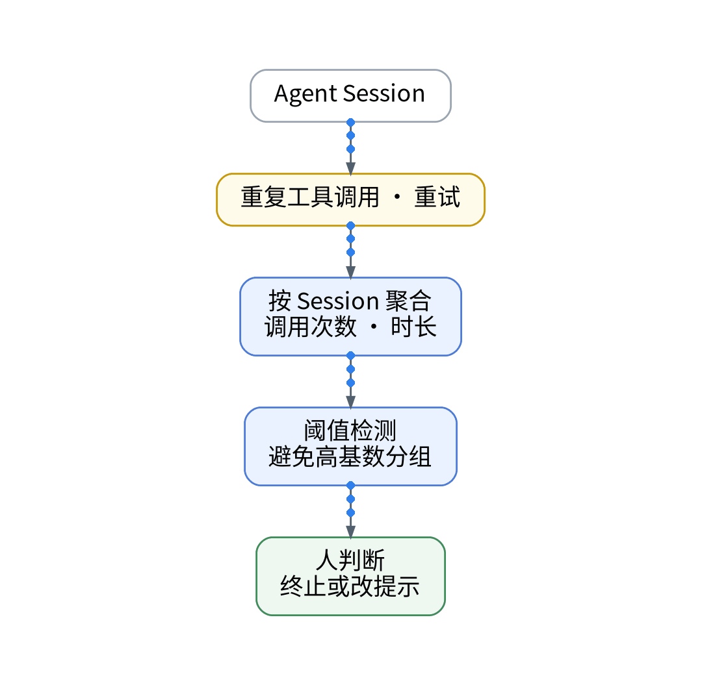
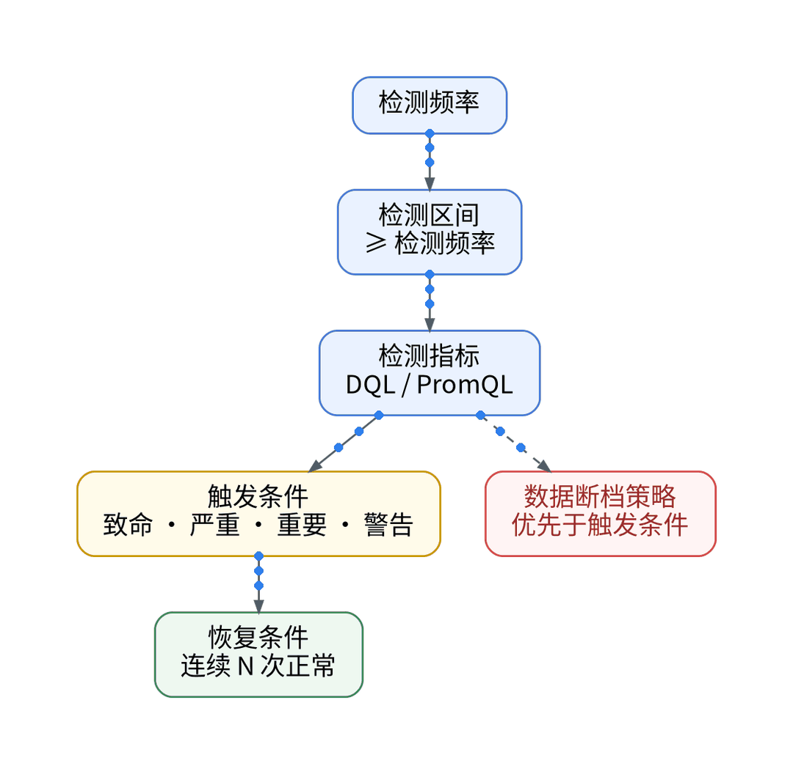
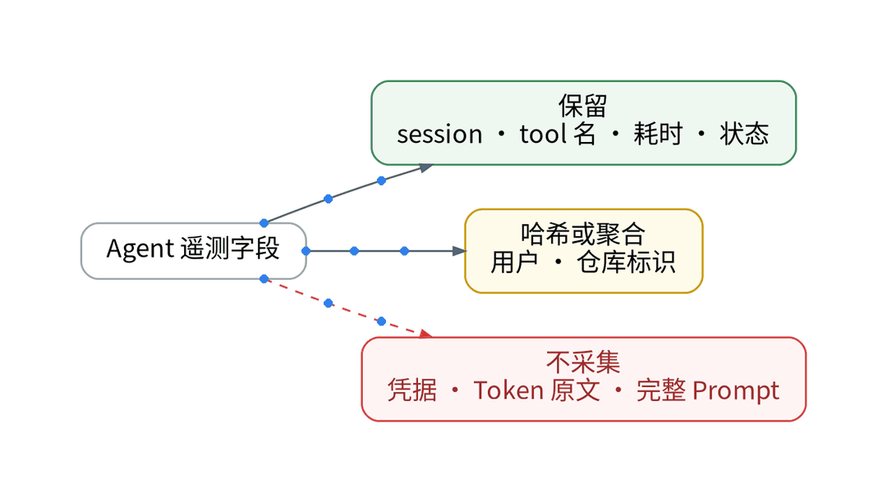
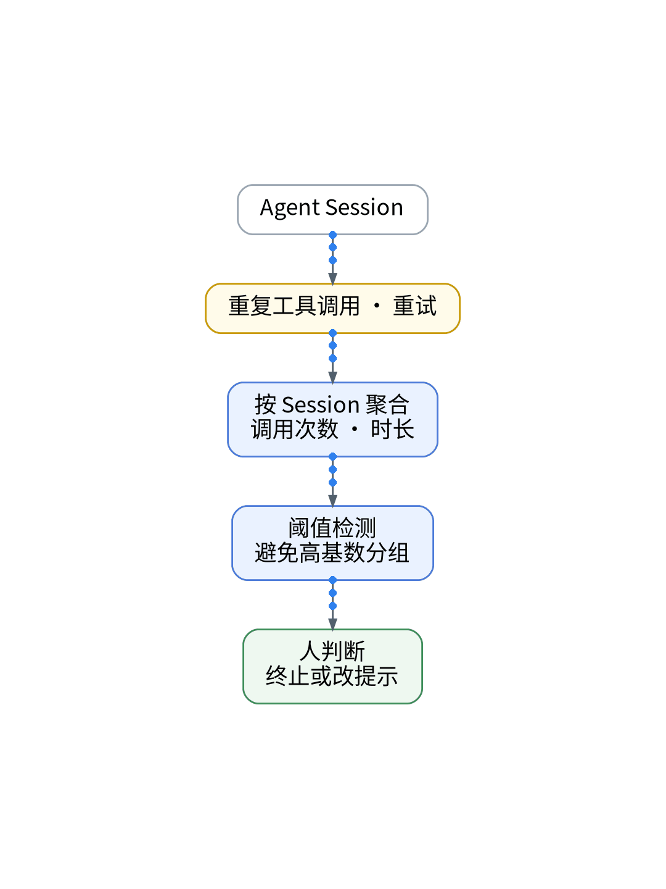
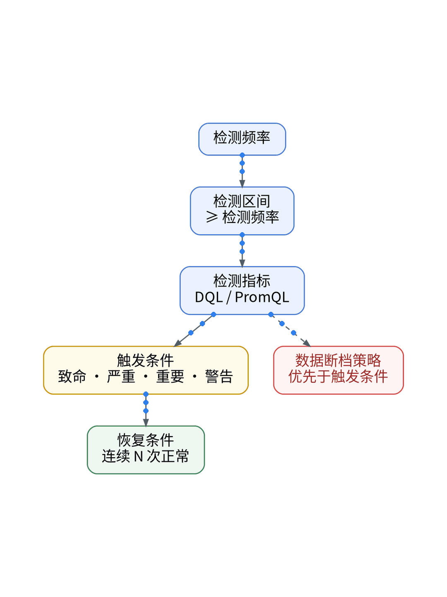

# Agent 没有报错，为什么我的任务一直跑不完？

## UAT 环境工具调用卡死排查：死循环识别、Span 耗时膨胀与代码化熔断

> **唯一知识点**：死循环与异常重试 | **循环模板**：故障复盘型 | **核验日期**：2026-11-02 (已核验)

---

### 微信公众号深度长文（正文内嵌 GIF 动图版）

在使用自主 Agent 解决复杂工程难题时，最让人焦虑的往往不是报错崩溃，而是“岁月静好”般的持续运行。终端光标不停闪烁，CPU 占用居高不下，API 费用蹭蹭上涨，但原本 1 分钟就能结束的任务却跑了整整半个小时。既没有抛出 Exception，也没有触发超时退出，Agent 究竟卡在了哪一步？在缺乏状态可见性的情况下，开发者只能被迫按下 Ctrl+C，前功尽弃的同时，也彻底失去了排查根本原因的宝贵线索。



Agent 卡死的本质，通常是进入了“非收敛的工具调用死循环”。典型场景包括：Agent 尝试修复代码中的语法错误，运行测试发现新错误，进而尝试回滚，回滚后又再次触发初版错误；或者在解析接口返回时，由于正则匹配逻辑与外部环境微小差异，陷入“读文件-失败-修改正则-再次读文件”的逻辑死胡同。由于每次工具调用的底层退出码都是正常的（Exit Code 0），传统基于进程状态的监控完全失明。只有将连续调用中的工具参数相似度、Span 产生频率与时延膨胀趋势纳入遥测流，才能识别出这种“伪装成繁忙的死循环”。



为了给 Agent 套上严密的“看门狗（Watchdog）”，我们构建了一套纯代码化的熔断与治理机制。首先，在 Agent 运行时注入循环检测拦截器（`loop_interceptor.py`），通过滑窗算法计算连续 5 次工具调用的指纹哈希（Fingerprint Hash）；其次，在 Ansible Playbook 中配置本地 Collector 过滤规则，实时计算特定会话的 Span 衍生速率（Span Velocity），一旦发现相同工具调用频次超过硬阈值，立即向 Agent 进程发送软中断；最后，熔断策略与状态机完全由 GitOps 清单统一托管，实现开发与预发环境的一致性。



在 UAT 环境受控复现了一个经典的“依赖版本冲突”循环 Case：Agent 试图安装 `package-a`，触发 `package-b` 不兼容，随即卸载重新安装，循环往复。未经治理前，任务僵死持续 24 分钟，消耗超 80 万 Token；引入循环检测与熔断后，拦截器在检测到第 4 次相同模式的 `pip install` 颠簸时（第 48 秒）果断触发熔断，不仅主动终止任务保存了现场代码快照，还在 Trace 瀑布图上清晰标记了 `ERR_LOOP_DETECTED` 诊断标签，为提示词的针对性修正提供了无可辩驳的事实证据。


该方案极其适合拥有自治执行权、能够自主调用 Shell 和编辑文件的高级自主 Agent 场景；而对于受限的人机结对补全、单轮函数调用（Single-turn Function Calling）、或具有严格预设最大步骤数（Max Steps Hard-limit）的框架，由于框架本身已具备简单防循环逻辑，无需额外引入复杂的哈希滑动窗口熔断器。

#### 架构视角决策表（移动端优化 3 列精简版）

| 决策维度 | 方案对比 (自建基准 vs 观测云) | 独立开发建议与避坑 (移动端决策) |
| :--- | :--- | :--- |
| **循环检测依据** | • <b>自建</b>：依赖人工肉眼盯屏，无法提前感知逻辑颠簸<br>• <b>SaaS</b>：自动化工具指纹哈希与滑窗调用频率智能识别 | 必须基于连续调用特征自动判别，严禁人工值守。 |
| **拦截响应方式** | • <b>自建</b>：粗暴 kill -9 强杀，丢失全部未提交中间工作区<br>• <b>SaaS</b>：优雅发送软中断信号，自动暂存 stash 快照 | 触发熔断时保存中间 Git 差异，避免工作成果彻底损毁。 |
| **遥测指标覆盖** | • <b>自建</b>：仅监测系统级 CPU/内存占用，无法洞察内部动作<br>• <b>SaaS</b>：深度追踪 Span 衍生速率与时延膨胀发散系数 | 监控工具调用加速度，提前在死循环萌芽期精准介入。 |
| **资源防爆保障** | • <b>自建</b>：无 API 成本联动，极易刷爆单日预算造成经济损失<br>• <b>SaaS</b>：设置最大步骤数与 Token 消费双重硬熔断阈值 | 配合预算控制，防止深夜无人值守时刷爆额度。 |
| **策略版本演进** | • <b>自建</b>：硬编码写死在脚本内部，调整策略需重新发版<br>• <b>SaaS</b>：GitOps 声明式管理环境级看门狗策略与超时基准 | 预发与生产解耦，根据任务复杂度声明式配置容忍度。 |

---

### 小红书配套图文笔记

**AI 没崩，但一直在原地打转**

让自主 Agent 帮我修个工程难题，出去泡了杯咖啡，半小时回来它居然还在跑！终端一直在打印日志，CPU 居高不下，钱哗哗地扣，但代码却一行没推。既没报错也没退出，到底卡在哪了？

AI 为什么会卡在原地“鬼打墙”？教你三招给它装上“防死循环雷达”：

P1：看透假忙碌。AI 卡死从来不是死机，而是陷入了“修 A 坏 B-修 B 坏 A”的逻辑死胡同！底层工具返回码全正常（Exit 0），传统基于进程状态的监控根本发现不了！
P2：工具指纹哈希检测。给每次工具调用生成特征指纹，用滑动窗口计算调用相似度与衍生速率。只要连续 4 次执行相同模式的修补操作，立刻判定为死循环！
P3：优雅熔断留现场。千万别直接 kill -9！触发看门狗时发送软中断信号，让 Agent 停手并自动 git stash 备份现场，同时在调用链上打上高亮警告标！

那独立开发者怎么给 Agent 套上防死循环看门狗？极简代码化作业直接抄：杜绝人工盯屏！第一步，在 Agent 运行时挂载 LoopDetector 滑窗拦截器，毫秒级比对工具指纹；第二步，Ansible Playbook 配置本地 Collector 过滤管道，实时计算 Span 衍生速率并执行断路规则；第三步，看门狗超时基准与环境策略由 GitOps 统一纳管，密钥由 Vault 动态分发！

实战复盘：模拟依赖冲突死循环，原本能空转半小时烧掉数十美元；看门狗在第 48 秒检测到重复颠簸，果断触发优雅熔断，暂存代码快照并高亮错误原因，省下 90% 冤枉钱！

避坑总结：自主 Agent 的力量在于放权，安全的前提在于刹车。装好看门狗，才能放心让 AI 通宵跑任务！想拿防死循环拦截脚本与配置清单的宝子，移步公众号自取！





---

### GitOps / IaC / Playbook / Vault 代码化工程落地范式

#### Python: 循环调用检测与指纹滑窗看门狗 (agent/watchdog.py)
```python
import hashlib
from collections import deque

class LoopDetector:
    def __init__(self, window_size=5, max_identical=3):
        self.window = deque(maxlen=window_size)
        self.max_identical = max_identical

    def get_fingerprint(self, tool_name: str, args: dict) -> str:
        # Create deterministic hash for tool call signature
        sorted_k = sorted(args.items())
        raw = f"{tool_name}:{sorted_k}"
        return hashlib.sha256(raw.encode()).hexdigest()[:12]

    def record_and_check(self, tool_name: str, args: dict) -> bool:
        fp = self.get_fingerprint(tool_name, args)
        self.window.append(fp)
        count = self.window.count(fp)
        if count >= self.max_identical:
            print(f"[CRITICAL] Loop detected: Tool {tool_name} executed {count} times identically.")
            return True # Trigger circuit breaker
        return False
```

#### GitOps: Agent 看门狗熔断意图 (gitops/agent-watchdog.yaml)
```yaml
apiVersion: agent.xwork.tech/v1alpha1
kind: AgentWatchdogPolicy
metadata:
  name: coding-agent-loop-guard
spec:
  max_session_duration: "10m"
  max_repeated_tool_calls: 3
  circuit_break_action: "graceful_interrupt"
  snapshot_workspace: true
```

