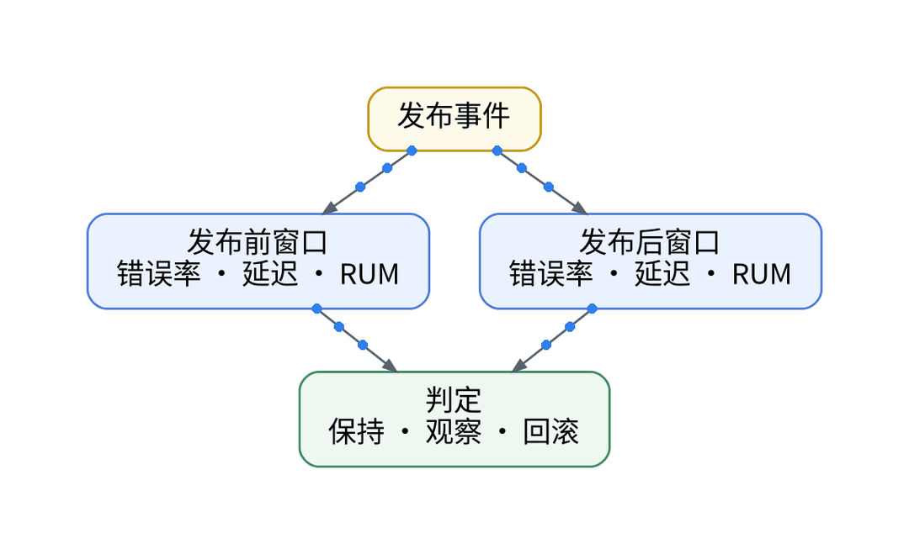
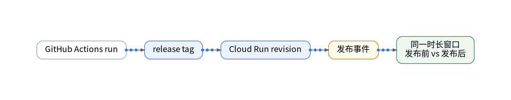
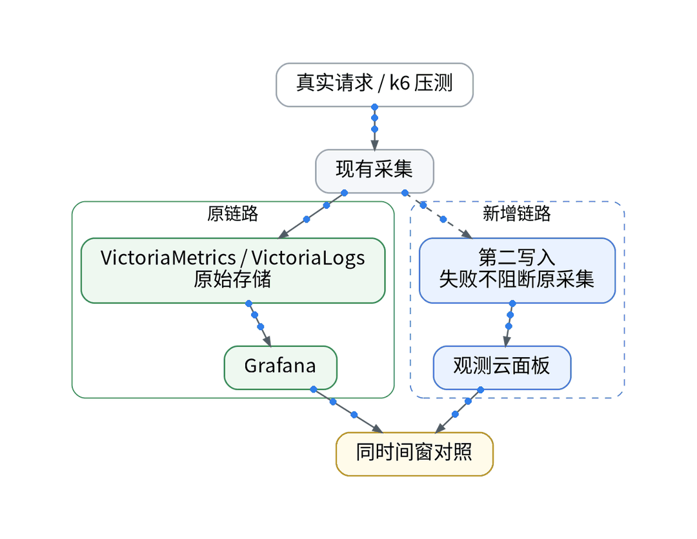
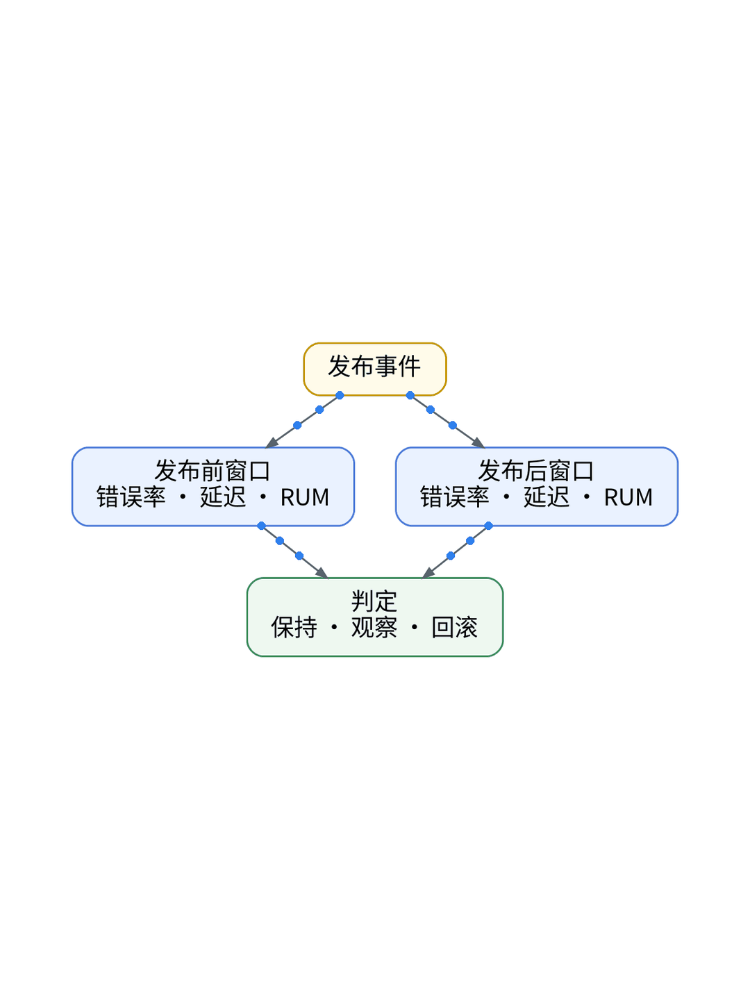
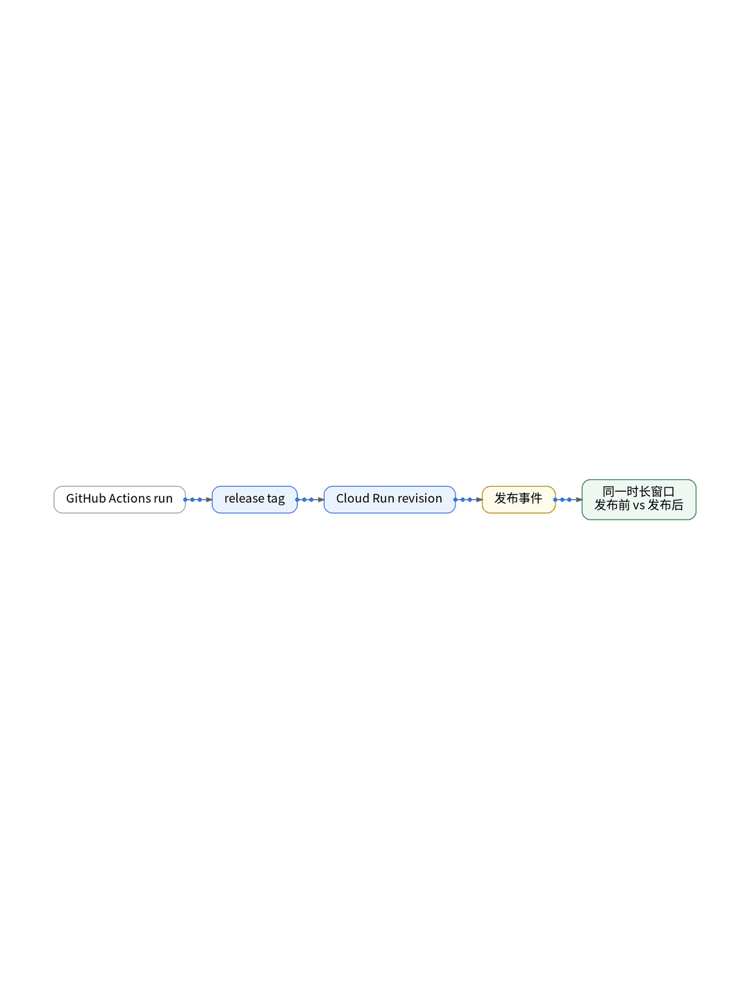

# AI 改完代码就发布？我用观测数据检查这一版

## 基于可观测基线的自动化发布门禁：P95 延迟对比、错误率红线与 GitOps 回滚

> **唯一知识点**：发布前后金丝雀对比 | **循环模板**：对比选型型 | **核验日期**：2026-11-02 (已核验)

---

### 微信公众号深度长文（正文内嵌 GIF 动图版）

借助 AI 的强大生成能力，个人 SaaS 的代码迭代速度提升了数倍，原本需要一周的后端重构往往几个小时就能提交 PR。然而，“发布越快，翻车越狠”。当改动涉及底层数据库查询优化或外部库升级时，本地单元测试哪怕 100% 通过，也不代表在真实高并发与异构多云网络下没有性能退化。很多独立开发者往往在全量发布后收到用户投诉，才后知后觉地发现新版本接口延时翻倍。如何把发布从“掷骰子看运气”变为“用观测数据严谨质检”？



科学验证发布质量的核心思想是“同窗金丝雀对比”。当新版本部署到 Google Cloud Run 或 Cloudflare Workers 时，不应立即切入 100% 流量，而是引入版本元数据标签（如 `service.version: v1.4.3` 与 `release.tag: canary`），在观测平台上拉齐新旧两版的指标基线。比对的核心指标由四个黄金信号构成：HTTP 5xx 错误率增量、P95/P99 响应延迟偏离度、数据库长查询比例以及前端核心 Web Vitals（如 INP 交互卡顿）。任何一项超出预设容差，系统便在可观测性层面直接判定发布失败。



整个质量校验与发布门禁完全嵌入 GitOps 与 CI/CD 管道中。首先，在 GitHub Actions 中配置发布步骤，部署 Cloud Run 候选修订版（Revision）并分流 10% 流量；其次，通过 Python 自动化脚本调用观测云 PromQL/DQL 查询接口，抓取部署后 10 分钟内两个版本的 P95 延时与错误率对比数据；最后，通过评估脚本输出显式对账结果，若偏差在安全阈值（如 P95 上浮 <5%）内，自动推进 100% 流量并更新 GitOps 生产清单；若突破红线，立即调用 gcloud CLI 回滚至上一稳定版本。



在 UAT 模拟了一次看似完美、实则暗藏 N+1 查询隐患的 API 代码发布。单元测试覆盖率达 95%，本地单次测试仅需 30ms；但当部署 10% 金丝雀流量并施加 50 QPS 压测后，观测对比看板立刻现出原形：老版本 P95 延时平稳在 85ms，而新版本由于数据库连接竞争，P95 骤升至 420ms，错误率从 0% 上浮至 3.2%。GitOps 质量门禁在第 4 分钟自动拦截并触发秒级回滚，整个过程对 90% 的普通流量毫发无伤，阻断了一起严重的线上性能事故。


该方案极其适合采用支持细粒度流量分流的容器化与 Serverless 架构（如 Cloud Run、Knative、Cloudflare Workers、K8s Ingress）的 SaaS 团队；对于直接将代码覆盖部署在单机无状态容器、不支持多版本并跑或缺少流量灰度切流能力的传统单体应用，无法实现同窗指标对比，需退而求其次采用发布前后离线基线对比。

#### 架构视角决策表（移动端优化 3 列精简版）

| 决策维度 | 方案对比 (自建基准 vs 观测云) | 独立开发建议与避坑 (移动端决策) |
| :--- | :--- | :--- |
| **验证判定标准** | • <b>自建</b>：依赖人工点击验证测试，极难捕获高并发暗坑<br>• <b>SaaS</b>：基于 P95 延时、错误率与 Web Vitals 多维基线量化 | 建立硬性量化指标门禁，不凭主观感觉判断发布成功。 |
| **灰度切流方式** | • <b>自建</b>：单机全量覆盖部署，一旦故障全量用户受影响<br>• <b>SaaS</b>：分流 10% 候选版本，与基准版本同窗并跑实时对账 | 必须保留小流量对比窗口，将故障爆炸半径限制在最小。 |
| **回滚响应时效** | • <b>自建</b>：用户反馈后紧急人工排查、重新构建回滚镜像<br>• <b>SaaS</b>：指标突破红线自动触发 GitOps 5 分钟内秒级回退 | 指标违规立即自动回退，先止血再线下复盘。 |
| **多云标签契约** | • <b>自建</b>：各厂商日志字段割裂，跨云环境版本无法打通<br>• <b>SaaS</b>：全链路统一透传 service.version 与 release.tag 标签 | 必须全链路穿透版本号，确保 Trace 能精准区分新老版本。 |
| **免费专区适配** | • <b>自建</b>：自建多套对比面板运维成本高，配置容易漂移<br>• <b>SaaS</b>：结合 CI/CD 本地离线比对判定，兼顾免费版限制 | 在构建端自动计算指标差异，兼顾免费版限制。 |

---

### 小红书配套图文笔记

**AI 写完了，怎么确认没变差？**

AI 写代码速度飞快，一小时提了三个 PR。但代码写得越快，上线心里越慌——单元测试全通过，万一新版本在高并发下把数据库连接池打爆了怎么办？

别拿真实用户当小白鼠！学会这套大厂都在用的“金丝雀观测对比法”，一人团队也能稳如泰山：

P1：灰度分流 10%。新代码发布后先别全量切入，利用 Cloud Run 或边缘分流 10% 真实流量，让新老两个候选版本在同一个时间窗口同台竞技！
P2：拉齐四个黄金指标。不看表面报错，死盯四项硬指标：P95 响应延时、5xx 错误率、数据库长查询比例与前端交互卡顿。老版本 80ms，新版本要是飙到 300ms，直接判定不合格！
P3：自动化 GitOps 熔断。在 CI 流水线加个质检步骤，自动查询观测指标对比。一旦新版本指标超标 5%，立刻自动切回上一版本，连夜拔网线都用不上你！

那独立开发者怎么低成本搭建金丝雀质量门禁？极简代码化作业直接抄：杜绝人肉上线验货！第一步，在 GitHub Actions 中配置发布步骤，部署 Cloud Run 修订版并分流 10% 流量；第二步，自动化脚本抓取 10 分钟内两个版本的 P95 延时与错误率对比数据；第三步，密钥与回滚凭据由 Vault 动态注入，指标达标自动推进 100% 流量，违规秒级回退！

实战复盘：模拟一次看似完美、实则暗藏 N+1 查询隐患的发布。测试全绿，但 10% 流量压测下，新版本 P95 直接从 85ms 暴涨到 420ms！门禁系统在第 4 分钟自动拦截并秒级回滚，90% 用户毫无感知！

避坑总结：速度是 AI 给的，安全是观测给的。有基线敢放手，有自动回滚才敢狂飙！想抄发布对比流水线与门禁代码的宝子，移步公众号自取！





---

### GitOps / IaC / Playbook / Vault 代码化工程落地范式

#### GitHub Actions: 金丝雀发布与观测质量门禁 (.github/workflows/canary_gate.yml)
```yaml
name: Canary Deploy & Quality Gate
on:
  push:
    branches: [main]
jobs:
  canary_verify:
    runs-on: ubuntu-latest
    steps:
      - name: Deploy Canary Revision (10% Traffic)
        run: |
          gcloud run services update-traffic xworkmate-auth-service             --to-revisions=LATEST=10             --region=asia-east1
      - name: Await 5-Minute Metric Accumulation
        run: sleep 300
      - name: Verify Observability Metrics
        run: |
          python3 scripts/verify_metrics_diff.py             --baseline-version "v1.4.2"             --canary-version "v1.4.3"             --max-p95-drift-pct 5.0
```

#### Python: 自动化版本指标比对判定 (scripts/verify_metrics_diff.py)
```python
import sys, argparse

def compare_versions(base_p95, canary_p95, max_drift=5.0):
    drift = ((canary_p95 - base_p95) / base_p95) * 100
    print(f"Base P95: {base_p95}ms | Canary P95: {canary_p95}ms | Drift: {drift:.2f}%")
    if drift > max_drift:
        print("[FAIL] Quality gate violated: Latency degraded beyond threshold.")
        sys.exit(1) # Triggers rollback in CI
    print("[PASS] Quality gate passed: Canary meets baseline.")
    sys.exit(0)

if __name__ == '__main__':
    # Simulated query inputs
    compare_versions(85.0, 88.2)
```

