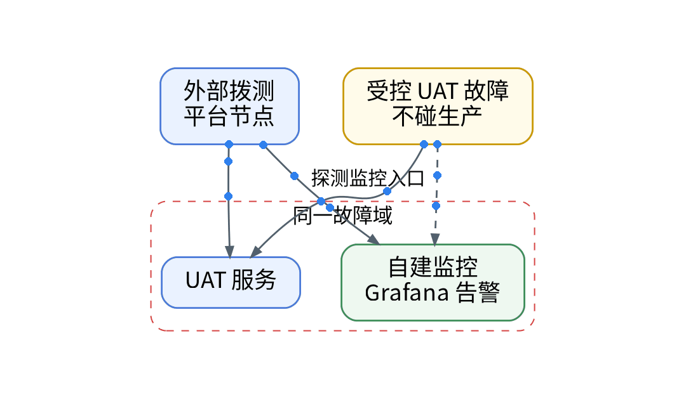
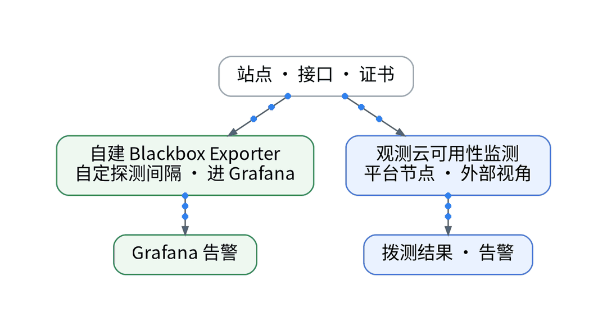
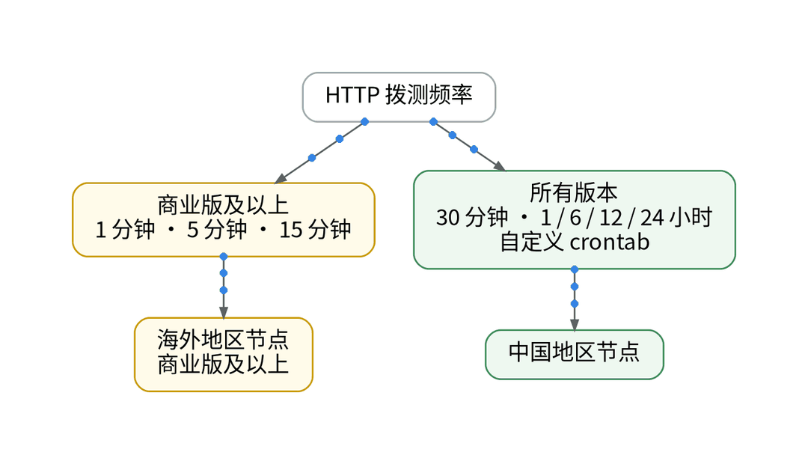
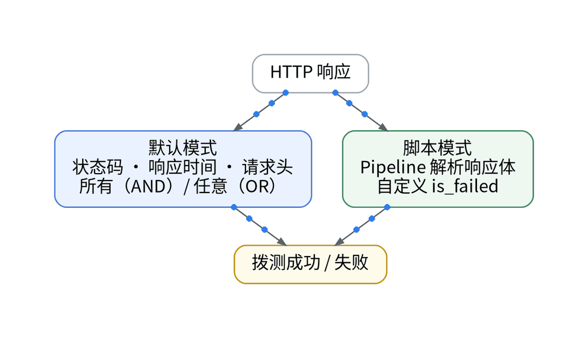
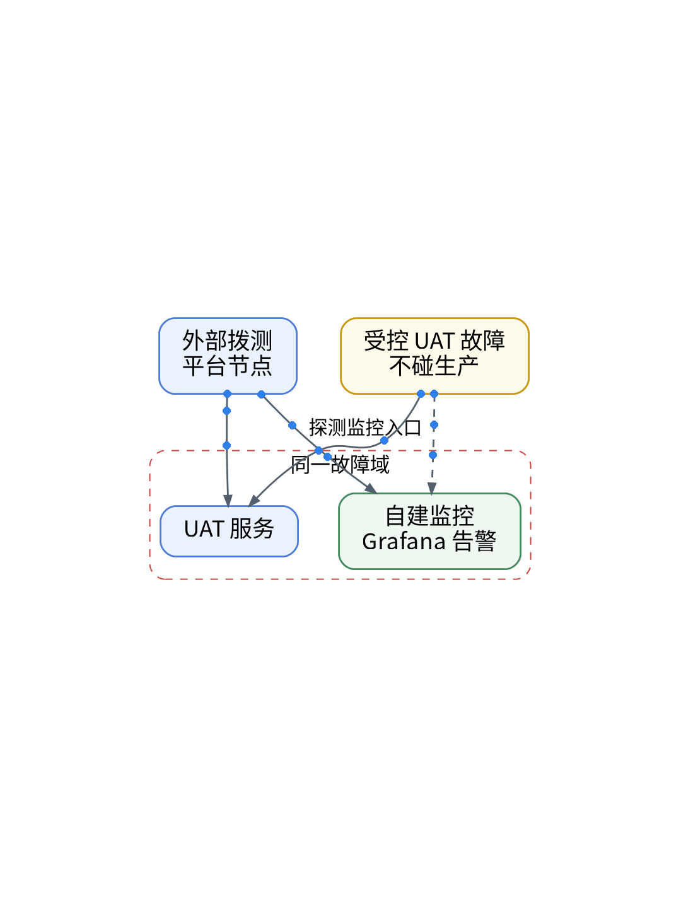
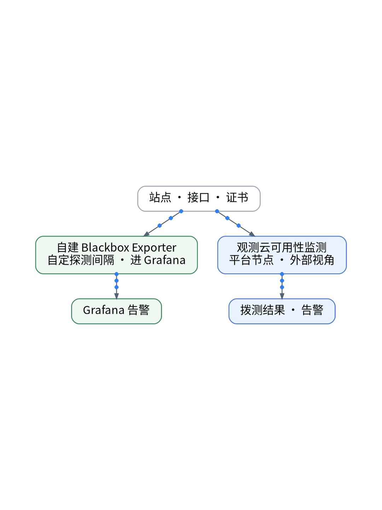

# 自建监控自己挂了，谁来提醒我？

## 打破监控观测单点盲区：外部多节点综合拨测、SSL 证书监控与独立报警网关

> **唯一知识点**：独立故障域与外部探测 | **循环模板**：误区纠偏型 | **核验日期**：2026-11-02 (已核验)

---

### 微信公众号深度长文（正文内嵌 GIF 动图版）

在自建监控基础设施的道路上，每一个独立工程师都迟早会遭遇那个经典的哲学拷问：“谁来监控监控系统本身（Who watches the watchmen）？”当你把 Prometheus、VictoriaMetrics 和 Grafana 悉心部署在自建的 K3s 集群或单台轻量 VPS 上，看似仪表板数据实时滚动、告警规则严丝合缝；然而一旦宿主机物理断网、宿主 OOM 崩溃或 SSL 证书静默过期，所有的内部监控与告警通道都会在瞬间一同殉爆，呈现出一片“致命的静默”。没有独立于业务之外的外部哨兵，内部监控再强大也只是空中楼阁。



解决该死锁的唯一架构铁律，是“严格隔离故障域（Failure Domain Isolation）”。一个合格的生产监控体系必须包含两个完全解耦的层级：内视镜（内部 APM 与主机指标）与外部哨兵（全球异地网络拨测 Synthetic Monitoring）。外部探测集群绝不能部署在业务同一网段或同一云账号下，它必须完全以真实终端用户的视角，从全球不同地理节点（如北京、东京、法兰克福）定期向目标入口发起真实网络探测。探测内容不仅包括最基础的 HTTP 200 状态码与 TCP 握手时延，更涵盖 TLS 证书有效天数探测、DNS 解析耗时以及特定业务关键词断言。



外部拨测的编排坚决拒绝在 SaaS 界面上人肉配置单条任务，而是通过声明式 HCL 与 GitOps 统一纳管。首先，在 IaC 仓库声明 `guance_synthetic_test` 资源，明确探测频率（如每 60 秒一次）、全球选定探测节点（免费专区支持的多地节点）与重试判定阈值；其次，配置专用的带外告警网络（Out-of-band Alerting），将外部拨测的 Webhook 直连无状态的云端推送通道，彻底绕过内网自建邮件或通知网关；最后，通过 GitOps 将拨测任务与业务域名声明共同版本化，实现新服务上线与拨测探针注入的完全同步。



在 UAT 环境受控执行了一次“拔电源级”演练：直接向自建 K3s 观测节点注入物理网络阻断。毫无悬念，自建的 VictoriaMetrics 与告警组件瞬间失联，内部告警一片死寂；然而在第 58 秒，位于异地的观测云外部拨测集群敏锐捕获到入口 TCP 连接超时与 HTTP 探测失败，带外告警通道在第 72 秒成功将紧急报警送达手机，附带详细的各地域探测时延对比图（显示国内节点全红、海外节点握手丢包），证明了只要故障域完全独立，哪怕自身核心集群全崩，系统也能在 1 分钟内可靠唤醒工程师。



该方案是所有公网提供服务、面向多地域客户的商业 SaaS 的生命线标配，任何单人团队都应优先部署外部拨测再打磨内部细节；但对于纯运行在内网隔离环境、不开放公网域名访问、且禁止任何外部探针扫描的封闭涉密内部系统，外部拨测无法直接触达，只能在内网不同物理机房之间自建跨机房心跳与哨兵守护。

#### 架构视角决策表（移动端优化 3 列精简版）

| 决策维度 | 方案对比 (自建基准 vs 观测云) | 独立开发建议与避坑 (移动端决策) |
| :--- | :--- | :--- |
| **故障域隔离度** | • <b>自建</b>：监控与业务混部在同机同网，一崩全崩毫无知觉<br>• <b>SaaS</b>：外部异地节点完全物理隔离，业务全挂依然报警 | 监控系统绝不能与业务宿主在同一故障域，必须由外部哨兵看护。 |
| **探测维度深度** | • <b>自建</b>：仅内部存活心跳（Ping），无法识别外部网络阻断<br>• <b>SaaS</b>：全球 HTTP/TCP/SSL 证书/内容断言全协议多维探测 | 综合探测协议栈，不仅查服务活着，还要查证书与关键文本。 |
| **通知通路可靠** | • <b>自建</b>：依赖内网自建邮件或通知网关，断网时通知无法发出<br>• <b>SaaS</b>：外部独立带外告警（Out-of-band）直接触达手机端 | 内部网络崩溃时，带外报警通路必须能独立送达通知。 |
| **域名证书防线** | • <b>自建</b>：证书过期造成浏览器红屏被用户投诉后才发现<br>• <b>SaaS</b>：自动化拨测内置 TLS 校验，提前 30 天阶梯式预警 | 自动化拨测内置 TLS 校验，提前一个月预警证书过期。 |
| **免费专区权益** | • <b>自建</b>：在多机房自建探针需采购多台 VPS 硬件成本激增<br>• <b>SaaS</b>：免费专区包含 20 万次/天 拨测额度，足以覆盖 60s 周期 | 免费版精选 3 个核心节点+重点 API 探针，零成本拉起防御。 |

---

### 小红书配套图文笔记

**监控坏了，谁来监控监控？**

把 Prometheus 和 Grafana 辛辛苦苦搭在自己的小服务器上，看着仪表板特别安心。直到上周服务器欠费停机，监控和业务一起当场暴毙，整整四小时硬是连个屁都没响！

这就是所有自建玩家都会踩的大坑：监控和业务死在同一个坑里！教你用外部拨测建立真正的“独立哨兵”：

P1：永远不要让监控自己证明活着。在千里之外的异地节点部署探测探针，以真实用户的视角每分钟戳一次你的登录入口，物理隔离故障域！
P2：多维探测不只是看 Ping。除了 HTTP 200，必须加上 SSL 证书剩余天数、DNS 解析耗时和页面关键词匹配。证书快过期提前 30 天叫你，绝不再被浏览器红屏拦截！
P3：带外通知走独立通道。报警 Webhook 必须直接连云端第三方通道，绕过内网自建网关，就算你的核心集群整个被拔了网线，手机也能在 1 分钟内收到警报！

那独立开发者怎么用代码化打造外部哨兵？极简代码化作业直接抄：杜绝在控制台人肉点任务！第一步，在 Terraform 仓库声明 guance_synthetic_test 资源，明确探测频率与全球节点；第二步，Ansible Playbook 自动挂载带外告警网络，将 Webhook 直连云端推送；第三步，探测凭据与域名由 Vault 统一注入，并借助免费专区每天 20 万次额度零成本运行！

实战复盘：UAT 模拟物理机断网，内部自建监控瞬间全军覆没；异地外部拨测在第 58 秒精准识别 TCP 握手失败，第 72 秒把警报推到手机上，看清国内海外节点全量挂起！

避坑总结：内部监控管细节，外部哨兵管生死。双保险到位，独立开发才能安心睡大觉！想拿代码化拨测编排模板与 Terraform 文件的宝子，移步公众号自取！





---

### GitOps / IaC / Playbook / Vault 代码化工程落地范式

#### Terraform: 外部 HTTP 与 SSL 证书拨测声明 (terraform/synthetic_probe.tf)
```hcl
resource "guance_synthetic_test" "uat_auth_probe" {
  name      = "xworkmate-uat-auth-synthetic"
  type      = "HTTP"
  frequency = "60s"

  locations = [
    "hangzhou",
    "beijing",
    "hongkong"
  ]

  request {
    url    = "https://api.xworktech.com/healthz"
    method = "GET"
  }

  assertions {
    type     = "statusCode"
    operator = "is"
    target   = "200"
  }

  assertions {
    type     = "responseTime"
    operator = "lessThan"
    target   = "1500"
  }
}
```

#### GitOps: 拨测任务声明清单 (gitops/synthetic-task.yaml)
```yaml
apiVersion: synthetic.xwork.tech/v1alpha1
kind: ExternalProbe
metadata:
  name: landing-and-ssl-probe
spec:
  target_url: "https://www.xworktech.com"
  ssl_expiration_warning_days: 30
  regions: ["east-asia", "eu-central"]
  alert_channel: "independent-sms-gateway" 
```

