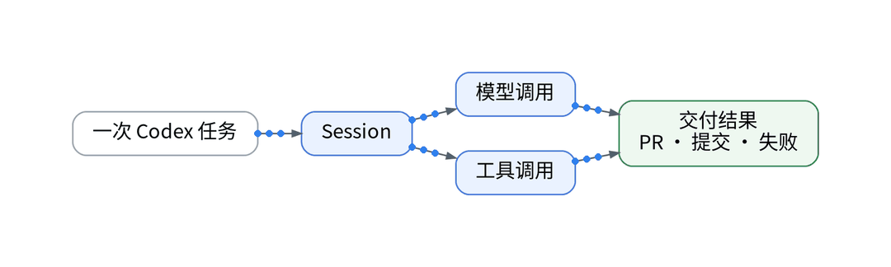
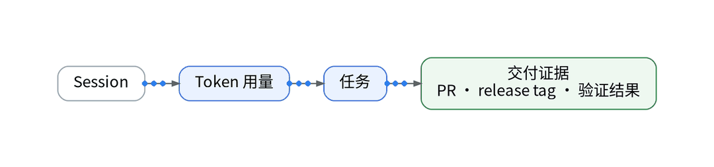
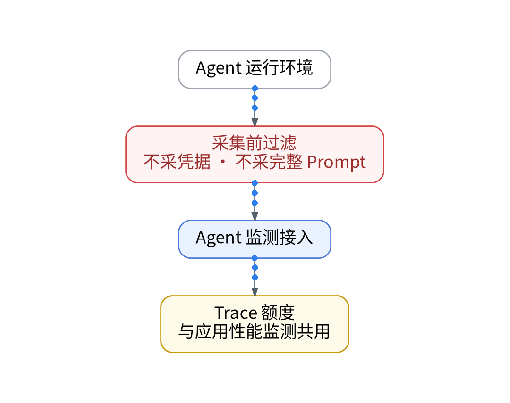
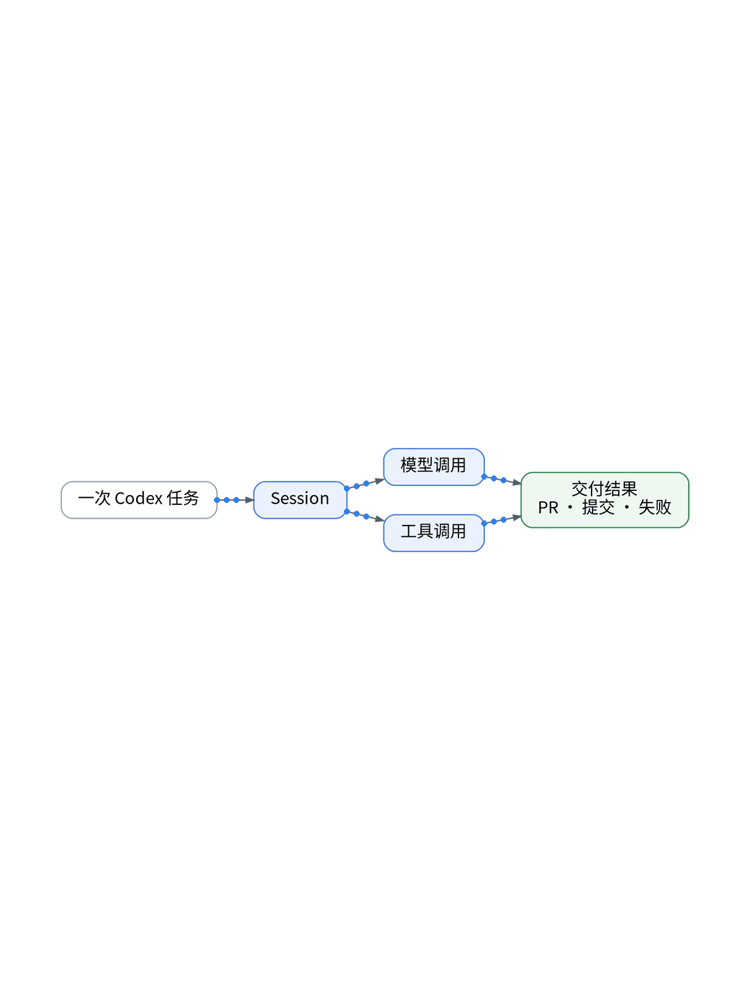
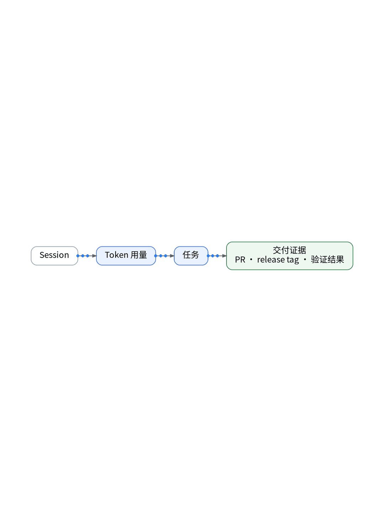

# 一次 AI 调用慢，到底是模型还是外部工具？

## 大模型全链路延迟解构：TTFT 首字耗时、Token 流速与工具调用网络剖析

> **唯一知识点**：调用延迟细粒度拆分 | **循环模板**：故障复盘型 | **核验日期**：2026-11-02 (已核验)

---

### 微信公众号深度长文（正文内嵌 GIF 动图版）

在 AI 原生应用和 Agent 交互界面中，“慢”是导致用户流失的第一杀手。当用户在聊天框输入指令，看着界面上的 Loading 旋转了整整 8 秒才吐出答案，绝大多数人的第一反应往往是大模型 API 又抽风了。然而真相往往大相径庭：这 8 秒钟的漫长等待，究竟是服务商的排队时间、模型推理的首字耗时（TTFT）、还是 Agent 在后台悄悄调用的外部天气接口超时了？如果不能将单次调用的延迟拆分到微秒级，性能优化就会变成漫无目的的盲人摸象。



解构 AI 请求耗时的核心方法论，在于建立“四段式延迟生命周期模型”。一个完整的 Agent 交互耗时由四部分严格累加：第一段是网络建连与网关往返时延（Network RTT）；第二段是模型首字生成时间（Time to First Token, TTFT），它直接反映了模型服务商的排队深度与 Prefill 算力瓶颈；第三段是流式生成期间的 Token 吞吐速率（Tokens Per Second），直接决定了回答渲染的流畅度；第四段则是模型在中间发起的本地或第三方工具（Tool Call）的网络执行耗时。只有把这四段耗时拆解为独立的子 Span，才能看清到底是谁在拖后腿。



在代码工程实现上，我们通过在应用层接入专门的 LLM 观测探针（`llm_tracer.py`）实现这一拆分。在发起流式请求时，探针记录开始时间戳；当迭代器吐出第一个 Chunk 时，立即截断并记录 TTFT Span；在流式接收全量 Token 期间，动态统计输出速率曲线；一旦模型决定触发工具调用，立即派生出子 Span 并向被调用工具注入 W3C TraceContext 上下文，将本地数据库查询或网络抓取的耗时完美嵌套在整体调用链中。



在 UAT 环境排查一次用户反馈激烈的“AI 摘要生成缓慢（耗时 9.2 秒）”故障。运营直觉怀疑是某国外大模型 API 速度慢，要求更换模型；然而展开细粒度 Trace 瀑布图后真相反转：大模型 TTFT 仅为 420ms，Token 生成流速高达每秒 55 个 Token（总推理仅耗时 1.1 秒）；而剩余的 7.6 秒全部被 Agent 调用的一个第三方网页正文抓取工具所消耗，该工具在抓取某未做 CDN 优化的博客时发生了多次 TCP 握手重试。我们当即为该工具注入了 2 秒超时降级与本地缓存策略，直接将总体请求耗时压制在 1.8 秒以内。


该延迟细粒度拆分方案是所有打造高交互 AI 产品（如 AI 编程助手、智能客服、实时问答机器人）团队的必备排障武器；但对于采用完全离线异步批处理（如深夜离线数据清洗、批量生成报告）、对交互响应延迟不敏感的后台 Agent 任务，无需花费精力拆分实时流速，监控任务总体完成时间即可。

#### 架构视角决策表（移动端优化 3 列精简版）

| 决策维度 | 方案对比 (自建基准 vs 观测云) | 独立开发建议与避坑 (移动端决策) |
| :--- | :--- | :--- |
| **延迟拆分粒度** | • <b>自建</b>：仅记录请求总耗时，无法区分排队、推理与工具调用<br>• <b>SaaS</b>：精准解构为 TTFT、Token 流速、网络 RTT 与工具 Span | 必须将大模型交互拆分为四段式耗时，拒绝整段笼统计时。 |
| **流式体验追踪** | • <b>自建</b>：仅按整句返回计算，无法感知打字机渲染停顿抖动<br>• <b>SaaS</b>：实时监控 Chunk 间隙时延与 Token 输出抖动曲线 | 监控首字时间 TTFT 与输出速率，这才是用户感知的核心。 |
| **外部工具穿透** | • <b>自建</b>：工具调用为黑盒，外部网络抓取慢导致整体被误判<br>• <b>SaaS</b>：跨进程串联工具执行链，精准指出第三方接口瓶颈 | 工具调用必须注入 TraceContext，看清外部依赖真实耗时。 |
| **排障优化导向** | • <b>自建</b>：盲目频繁更换底层模型，导致成本上升却未解决卡顿<br>• <b>SaaS</b>：依据数据看板针对性增加工具超时降级与本地缓存 | 用数据说话：90% 的慢不是模型慢，而是外部工具在拉跨。 |
| **观测探针开销** | • <b>自建</b>：繁琐的手工计时代码侵入业务核心逻辑难以维护<br>• <b>SaaS</b>：基于生成器包装器的轻量透明代理，纳秒级拦截无感 | 封装流式包装器无侵入拦截，保持业务代码干净整洁。 |

---

### 小红书配套图文笔记

**一次 AI 调用慢，到底是模型还是外部工具？**

用户抱怨你的 AI 页面加载转圈转了 8 秒，你第一反应是不是：肯定又是大模型 API 抽风了！先别急着给模型甩锅，如果不把单次请求拆解到底，盲目更换模型只会花冤枉钱。

先别急着给模型甩锅！打开 Trace 细细拆解，真相往往让你大跌眼镜：

P1：四段式耗时拆解。把 8 秒拆开看：网络连接 0.2 秒，模型首字响应（TTFT）0.4 秒，打字流速每秒 50 字，大模型本身其实飞快！
P2：揪出拖后腿的工具！顺着链路往下查，原来是 Agent 偷偷调用了一个网页抓取工具，在网络爬取上整整卡了 7 秒钟！
P3：对症下药加超时。查出真凶后，根本不需要花大价钱换更贵的模型，给那个破工具加上 2 秒超时降级和本地缓存，整体延时直接从 8 秒秒变 1.5 秒！

那独立开发者怎么精准解构 AI 请求的每一毫秒？极简代码化作业直接抄：杜绝手工加计时日志！第一步，在应用层接入轻量 LLM 流式探针，自动捕获 TTFT 与 Token 吞吐速率；第二步，向被调用的本地工具透明注入 W3C TraceContext 上下文，打通跨进程链路；第三步，链路聚合凭据由 Vault 动态分发，看板实时展现推理与工具耗时瀑布流！

实战复盘：UAT 一次严重的交互卡顿，大家都以为是模型慢；展开调用链才发现是大模型推理仅用 1.1 秒，而第三方未做 CDN 的网页抓取耗时 7.6 秒！优化工具后响应直接飙升 400%！

避坑总结：不拆解耗时，优化就是碰运气。用数据揪出真凶，才能花最少的钱提最大的速！想拿大模型流式计时探针代码的宝子，移步公众号自取！





---

### GitOps / IaC / Playbook / Vault 代码化工程落地范式

#### Python: 大模型首字耗时与流式速率拦截器 (agent/streaming_tracer.py)
```python
import time
from opentelemetry import trace

tracer = trace.get_tracer("ai.llm.tracer")

def trace_streaming_llm(response_generator):
    with tracer.start_as_current_span("LLM::GenerateStream") as span:
        start_t = time.perf_counter()
        first_token_received = False
        token_count = 0

        for chunk in response_generator:
            if not first_token_received:
                ttft_ms = (time.perf_counter() - start_t) * 1000
                span.set_attribute("llm.ttft_ms", ttft_ms)
                first_token_received = True
            token_count += 1
            yield chunk

        total_duration = time.perf_counter() - start_t
        tps = token_count / total_duration if total_duration > 0 else 0
        span.set_attribute("llm.tokens_per_sec", tps)
        span.set_attribute("llm.total_tokens", token_count)
        print(f"TTFT: {span.attributes.get('llm.ttft_ms'):.1f}ms | Speed: {tps:.1f} tokens/s")
```

