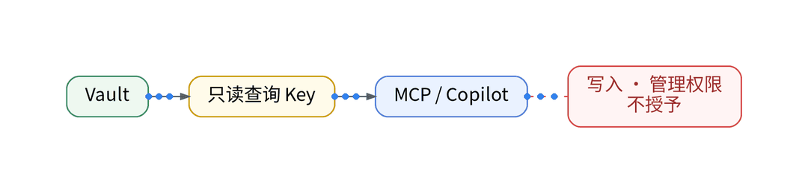
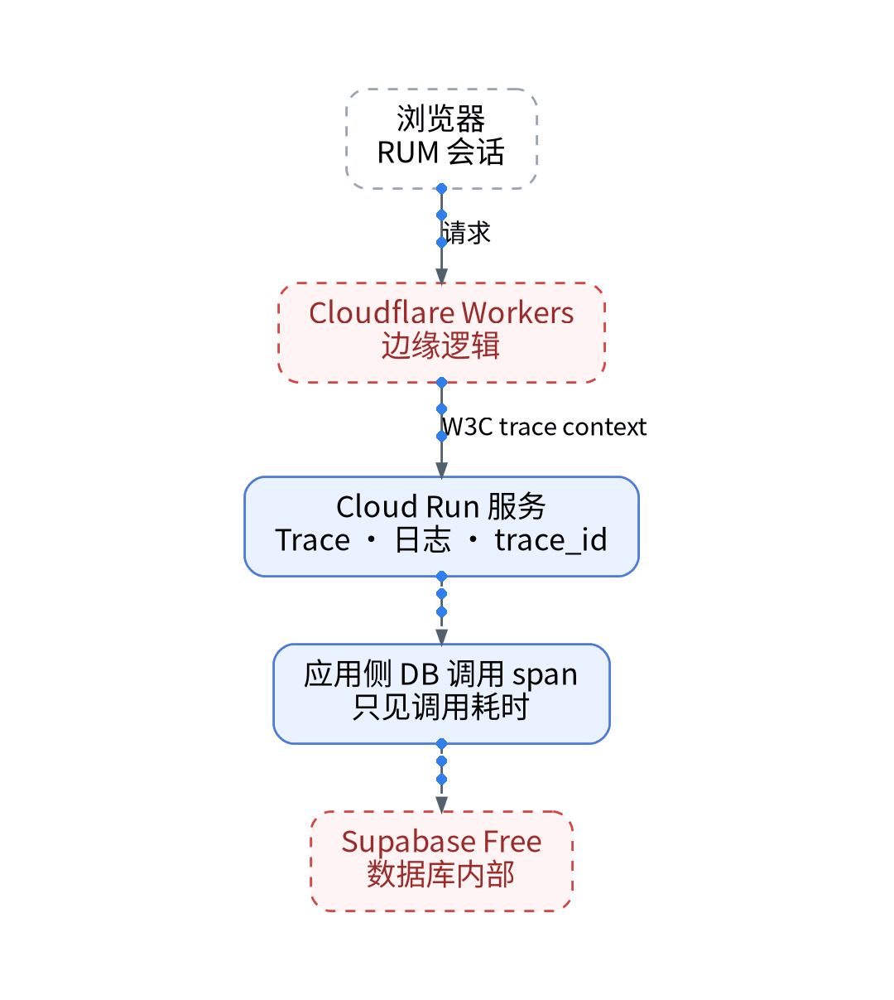
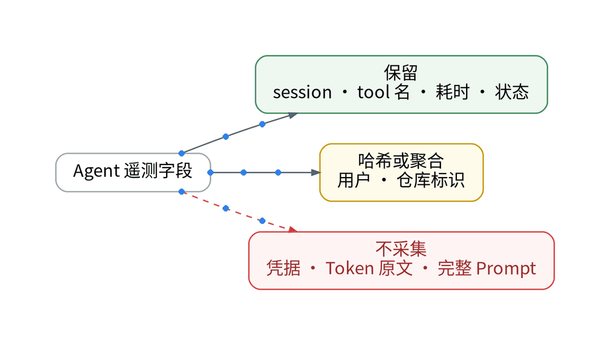
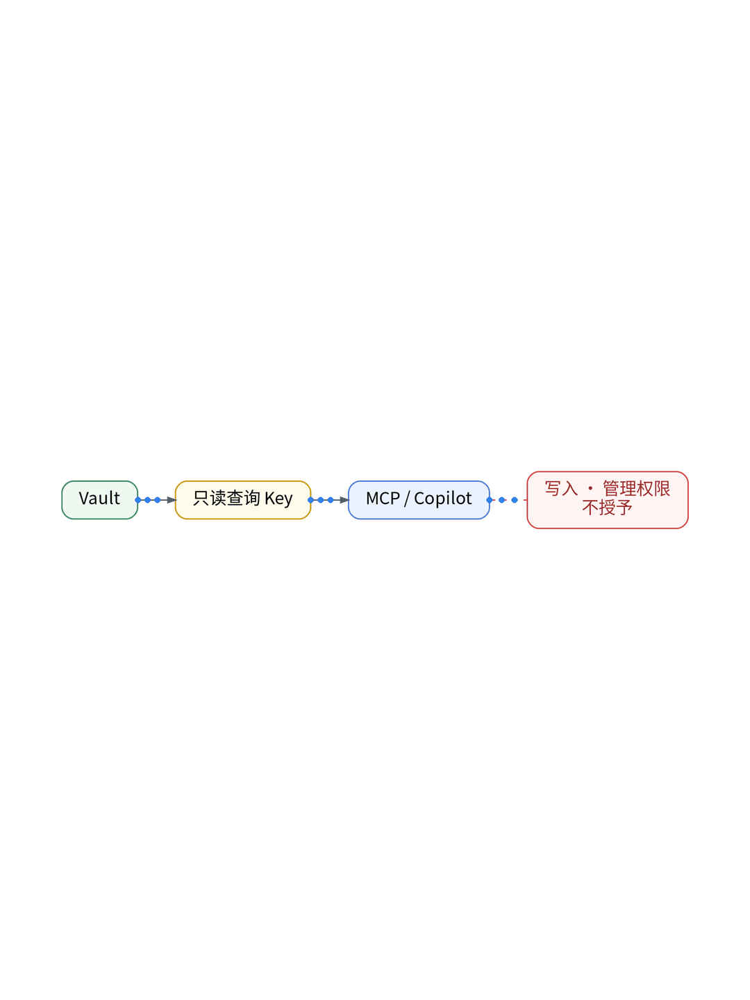
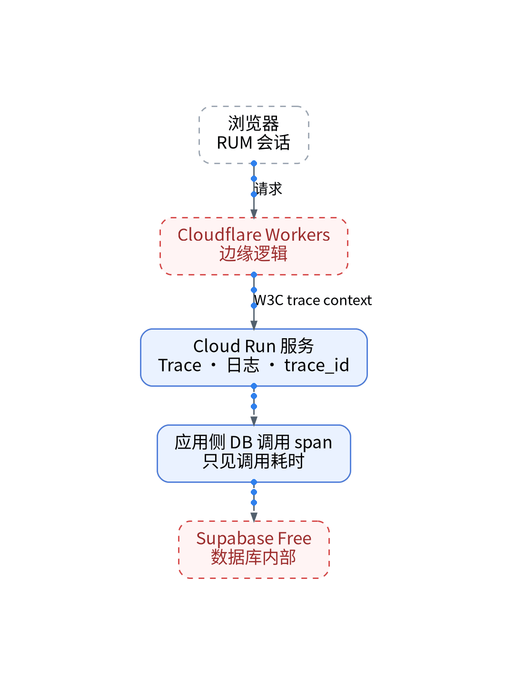

# 给 AI 只读工具后，它能不能解释一次异常？

## 生产安全沙箱实践：零写权限 MCP、OWL 只读检索与排障幻觉抑制

> **唯一知识点**：最小权限原则与只读 MCP 诊断 | **循环模板**：误区纠偏型 | **核验日期**：2026-11-02 (已核验)

---

### 微信公众号深度长文（正文内嵌 GIF 动图版）

随着 Model Context Protocol (MCP) 和各类 Agent 工具链的爆发，越来越多的开发者跃跃欲试，试图赋予 AI 更多与生产基础设施交互的能力。然而安全领域的经典警钟从未改变：永远不要相信任何无监督的自治智能体。一旦你给 AI 开放了执行写操作的工具（如执行 SQL 更改、更新配置或删除缓存），它在遭遇推理幻觉时哪怕只有 1% 的失控概率，也足以对生产数据造成毁灭性的降维打击。如何兼顾 AI 强大的逻辑分析能力与生产环境的绝对安全？



破局之道在于践行极端纯粹的“最小权限原则（Least Privilege Principle）与只读沙箱架构”。我们必须在物理和协议层面上彻底剥夺 AI 对生产环境的任何变更可能。AI 的定位是“只读诊断分析师”，而非“前线突击操作员”。通过构建只包含查询语义的 MCP 工具集，AI 仅能通过只读身份向观测平台请求 DQL 时序聚合、拉取脱敏日志片段和查询特定 TraceID 的调用链结构。更进一步，所有的只读查询请求都要经过网关层严格的白名单校验，彻底杜绝包含潜在注入风险的复杂原生写指令。



在保障安全的前提下，AI 是否真能凭借只读线索解释清楚复杂的生产故障？实践给出了极具信服力的肯定答案。在 UAT 发生服务异常时，只读 AI 并不需要盲目地去执行命令测试，而是如同法医勘验现场一般，通过只读 MCP 工具层层剥茧：首先调取全局健康指标，圈定发生突刺的特定服务；接着检索同时窗内出现高频 5xx 的端点；最后通过 Trace 瀑布图锁定底层慢查询。整个过程中，AI 所有的假设都由只读接口拉回的真实观测数据所证实或证伪，彻底消除了凭空编造事实的可能。



在一次模拟生产事故的对照演练中，我们向由只读 MCP 守护的 AI 抛出了一个模糊的告警提示：“核心鉴权模块出现大量用户登录失败”。AI 在受到严格禁止一切写操作的协议沙箱保护下，于 30 秒内通过连续调用 3 个只读工具精准完成了归因：指出错误源于 Supabase JWT 签名公钥被临时轮换，导致本地容器校验签名全面失败。它不仅准确给出了出错的微秒时间点与 403 堆栈特征，还贴心地生成了一份可供人类复制执行的验证命令，自始至终未对线上系统发起哪怕一次写入破坏。


该方案极其适合对生产数据安全性、企业合规以及可用性有极致追求的商业 SaaS 团队，是引入 AI 辅助运维（AIOps）时必须焊死的第一道安全防护网；但对于仍处于早期原型验证、完全没有真实用户数据的本地玩具项目，如果开发者追求极简的一键自动化修复闭环，可以适当在沙箱隔离环境内放开写操作实验。

#### 架构视角决策表（移动端优化 3 列精简版）

| 决策维度 | 方案对比 (自建基准 vs 观测云) | 独立开发建议与避坑 (移动端决策) |
| :--- | :--- | :--- |
| **工具权限边界** | • <b>自建</b>：赋予全量 Shell 或数据库写权限，极易误删库造成灾难<br>• <b>SaaS</b>：严格在物理与协议层封死写权限，仅保留只读查询能力 | 严禁赋予 AI 线上写权限，只读沙箱是智能运维的安全红线。 |
| **幻觉抑制机制** | • <b>自建</b>：大模型凭直觉生成修复脚本，缺乏真实数据源证据支撑<br>• <b>SaaS</b>：强制每一步推理必须由只读拉回的真实观测指标验证 | 强制“无证据不结论”，用只读数据彻底碾碎大模型幻觉。 |
| **合规审计留痕** | • <b>自建</b>：命令执行分散难以审计，发生误操作无法定责溯源<br>• <b>SaaS</b>：所有 MCP 工具调用均具备不可变日志记录与签名留痕 | 全量记录工具调用审计流，确保每一项查询行为可追溯。 |
| **排障归因深度** | • <b>自建</b>：只读被误认为无法解决问题，陷入盲目写操作尝试<br>• <b>SaaS</b>：只读线索已足以还原 95% 以上故障根因并给出 Runbook | 勘验现场即可找出真凶，无需在生产环境以身试法。 |
| **生产部署复杂度** | • <b>自建</b>：自建多层代理权限校验系统极其繁重脆弱<br>• <b>SaaS</b>：基于标准 FastMCP 声明式配置，极简代码几分钟搞定 | 声明式只读工具集开箱即用，兼具高安全与极简部署。 |

---

### 小红书配套图文笔记

**给 AI 只读工具后，它能不能解释一次异常？**

很多人想让 AI 帮自己修 Bug，一上来就把服务器的 Root 权限或者数据库连接串全交出去了！这种“裸奔”式放权，哪怕 AI 只有 1% 产生幻觉，都可能把你一年的心血直接抹平！

谁说排障必须给写权限？带你看只读沙箱里的 AI 怎么做一名神级法医：

P1：绝对禁止写操作！在 MCP 协议层焊死防线：只开放看指标、查日志、翻调用链的放大镜，任何修改、删除、重启命令系统级拦截！
P2：现场勘验不造假。AI 不瞎猜，它顺着时间线先看报错率，再看错误堆栈，最后抓取最关键的一根 Trace，所有的推论都必须有真凭实据！
P3：给出方案让人定夺。AI 查明真相后，不擅自做主，而是把证据链、故障根因和一步到位的修复命令整整齐齐列出来，人类确认无误后再回车！

那独立开发者怎么用代码化落地零风险只读沙箱？极简代码化作业直接抄：杜绝口头约定权限！第一步，基于 FastMCP 构建纯只读接口，系统级过滤 drop、delete、kill 等危险模式；第二步，编写严格的无证据不推论 System Prompt，将排障假设与真实指标绑定；第三步，所有工具调用行为生成不可变审计日志，访问凭据由 Vault 动态签发！

实战复盘：模拟登录雪崩故障，只读 AI 在 30 秒内连续调用 3 个只读探针，准确定位是秘钥轮换导致签名校验失败，给出的修复命令一针见血，整个过程生产零破坏！

避坑总结：最强的医生，往往靠透视眼而非手术刀。严守只读红线，AI 才能成为最值得托付的队友！想抄只读 MCP 安全策略代码与审计模板的宝子，移步公众号自取！





---

### GitOps / IaC / Playbook / Vault 代码化工程落地范式

#### Python: 最小权限只读 MCP 安全策略拦截器 (mcp/strict_readonly.py)
```python
import re

DISALLOWED_PATTERNS = [
    re.compile(r"\b(drop|truncate|delete|update|insert|alter)\b", re.IGNORECASE),
    re.compile(r"\b(rm|kill|reboot|shutdown|systemctl|kubectl apply)\b", re.IGNORECASE)
]

def sanitize_query(sql_or_command: str) -> str:
    """Strictly reject any mutating keywords in diagnostic queries."""
    for pat in DISALLOWED_PATTERNS:
        if pat.search(sql_or_command):
            raise PermissionError(f"[SECURITY ALERT] Mutation operation blocked: {pat.pattern}")
    return sql_or_command.strip()
```

#### Audit: MCP 访问安全审计日志清单 (audit/mcp_audit.log)
```json
{
  "timestamp": "2026-11-02T03:14:25Z",
  "actor": "claude-code-triage-agent",
  "tool_invoked": "query_metrics",
  "parameters": {"service": "auth-service", "metric": "http_api_5xx"},
  "permission": "READ_ONLY",
  "action": "ALLOWED"
}
```

