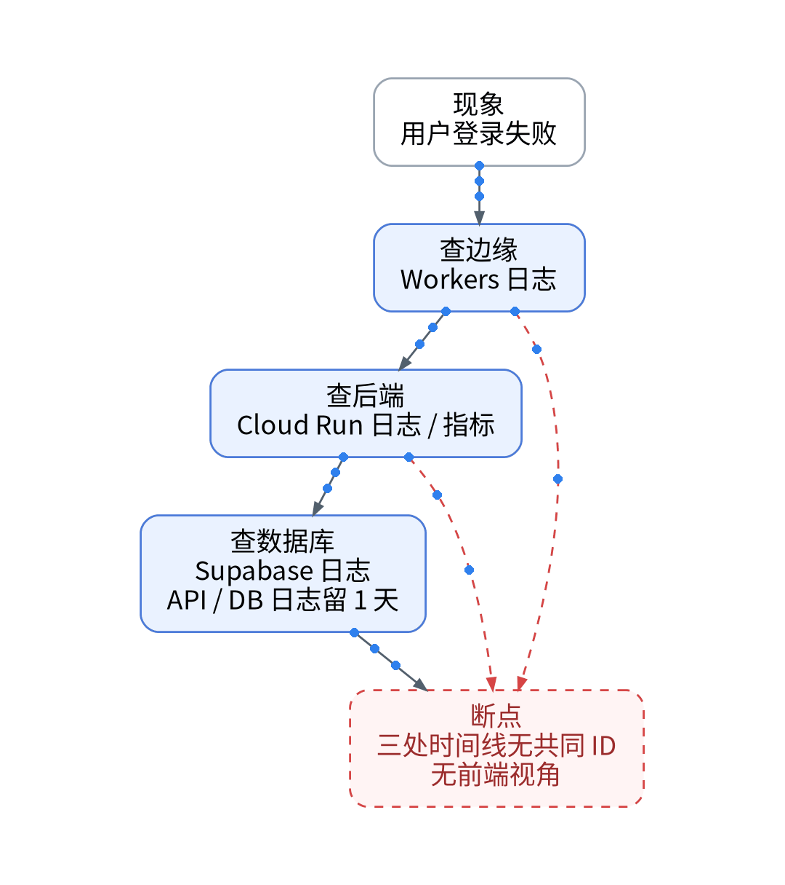
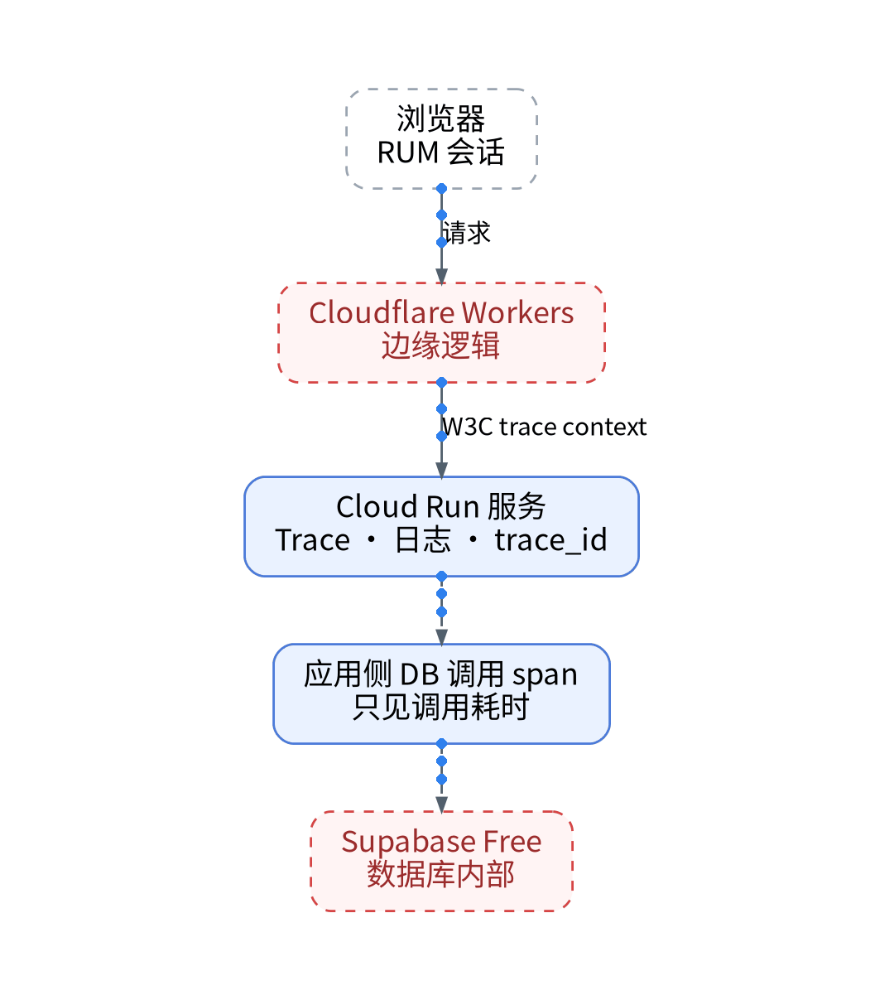

# 一次登录失败翻了三个后台：低成本 SaaS 栈的可观测盲区复盘

## 一、背景：栈很省，基础监控也在

样本系统是一套低成本栈：Cloudflare Pages / Workers 做入口，Cloud Run 跑后端，Supabase Free 存数据；基础指标由自建 Grafana + VictoriaMetrics承担。各层免费条件不同：Workers Free 每天 10 万请求、单次 10 ms CPU；Cloud Run 请求计费模式每月前 18 万 vCPU 秒、200 万请求免费；Supabase Free 500 MB 数据库，闲置 1 周暂停。

## 二、排查时间线：三处后台，没有共同 ID

以一次 UAT 登录失败为样本复盘排查路径：先翻 Workers 日志，再看 Cloud Run 日志与指标，最后查 Supabase 日志。问题出在衔接处：三处日志没有共同的请求 ID，只能靠时间戳人工对齐；用户浏览器里发生了什么，没有任何记录。Supabase Free 不含 Log Drain 与 Metrics endpoint，API 与数据库日志只保留 1 天，第二天复查时证据已不完整。定位耗时：【待实测】。

## 三、根因：缺的不是指标，是一次请求的前因后果

Grafana 能回答“服务健不健康”，回答不了“这个用户为什么失败”。根因是三类盲区：真实用户体验、跨层请求上下文、数据库查询级可视性。

## 四、改进：只为一条链路建证据链

方案是选一条链路（登录或内容读取），在外部 SaaS 补齐跨信号上下文，本系列用观测云免费版做 POC：前端接 RUM，后端接 Trace，边缘到后端传递 W3C trace context，各层统一 env / service / route / revision / release_tag / trace_id 字段。只有真正关联上的环节才算“链路”；Workers 与 Supabase 内部在实测关联前标为盲区。基础指标继续留在自建 Grafana。

## 五、决策表

| 功能 | 特性 | 成本 | 客观事实依据 | 适用场景 |
| --- | --- | --- | --- | --- |
| 自建 Grafana | 基础指标、长期数据 | 自有主机运维【待实测】 | 现有栈已运行 | 资源健康、兜底 |
| Supabase Free 自带日志 | 日志留 1 天 | 0 元 | 定价页：无 Log Drain | 当天排查 |
| RUM + Trace 关联 | 跨层同一 trace_id | 免费版额度内 0 元 | 版本区分页：PV 每天 5,000、Trace 每天 20,000 | 单链路 POC |
| 边缘 / 数据库内部关联 | 依赖上下文传播 | 【待实测】 | 未实测前标盲区 | 定位边界问题 |

参考：观测云《版本区分》、《Cloudflare Workers 定价》、《Cloud Run 定价》、《Supabase 定价》。

上一篇：[《迁移监控最怕回不去：双写、开关与回退实操》](../12-dual-write-rollback/wechat.md)｜下一篇：[《观测云免费版的账本：10 台主机、1 万时间线够不够》](../02-free-zone-quota-ledger/wechat.md)
