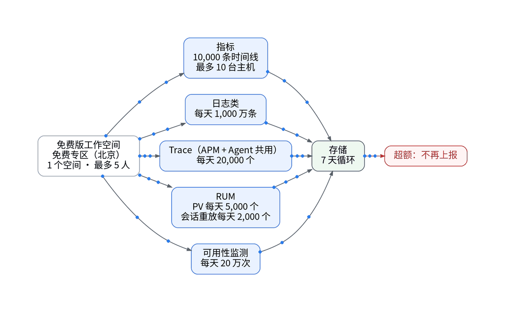
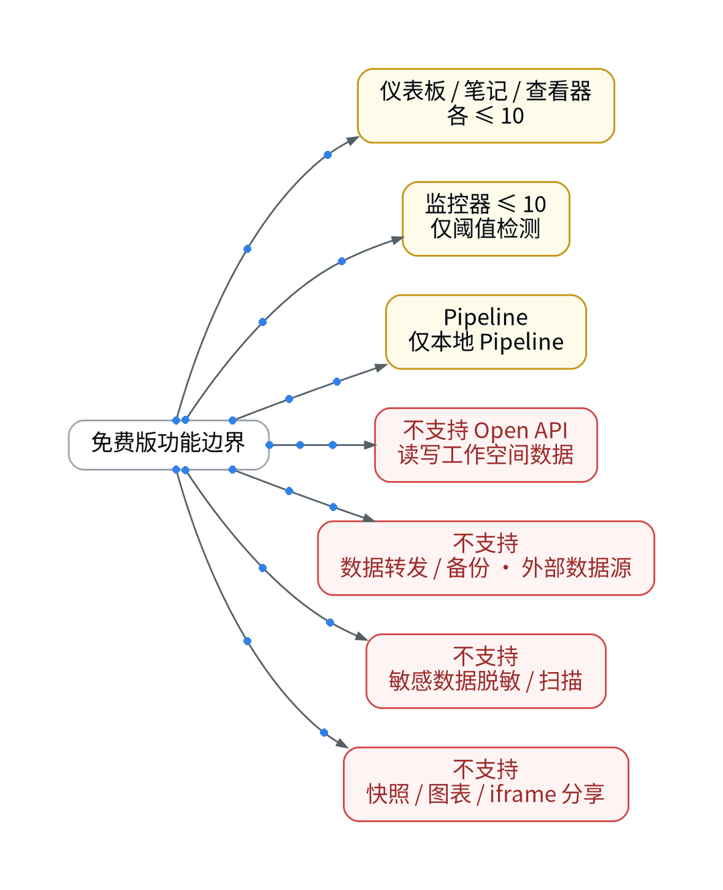
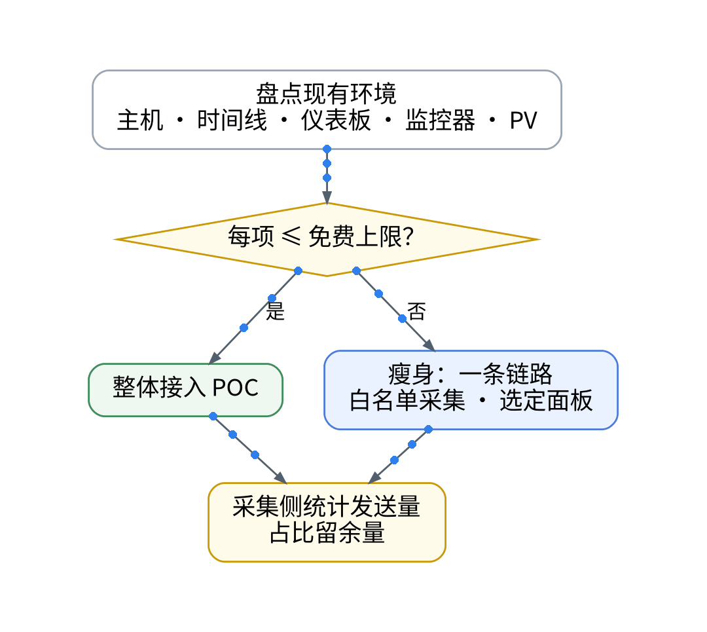

# 观测云免费版的账本：10 台主机、1 万时间线够不够

## 一、背景：先记账，再接入

上一篇的结论是只为一条链路补证据链。要在观测云免费版上做这个 POC，第一件事不是装 Agent，而是把额度当账本逐项记清。免费版只能在“免费专区（北京）”注册，提交后 12 小时内审核；每个账号只能创建 1 个工作空间、最多 5 人，空间不支持解散。

## 二、收入栏：免费额度逐项入账

按官方版本区分页：时间线 10,000 条（页面未写“每天”）；最多 10 台主机；日志类每天 1,000 万条；Trace 每天 20,000 个（应用性能监测与 Agent 监测共用）；用户访问 PV 每天 5,000 个；会话重放每天 2,000 个；可用性监测每天 20 万次；数据 7 天循环存储。

## 三、支出栏：超额与功能边界

痛点在于账本是多维的：任何一项超额，页面写明“超额不再上报”，订阅协议 3.2 另称观测云有权暂停或限制服务使用权限。功能侧同样有上限：仪表板、笔记、查看器各最多 10 个；监控器最多 10 个且仅阈值检测；Pipeline 仅本地；不支持 Open API 读写工作空间数据、数据转发、外部数据源、敏感数据脱敏和各类分享。协议 4.7 还要求：未经书面授权，不得用于商业用途或向第三方提供服务。

## 四、结余：按账本裁剪 POC 范围

做法是先盘点现有环境的主机、时间线、仪表板、监控器和 PV，逐项与上限比对；任一项超出，就只接一条链路，用白名单控制采集，面板只选首批几个。接入后在 Vector / DataKit 侧统计发送量【待实测】；免费版不支持经 Open API 获取工作空间数据，空间侧用量对账【待授权空间实测】。商业版按量付费，全量迁移成本应在 7 天用量出来后按官方单价估算：【待实测】。

## 五、决策表

| 功能 | 特性 | 成本 | 客观事实依据 | 适用场景 |
| --- | --- | --- | --- | --- |
| 免费版 | 7 天循环、超额不再上报 | 0 元，不开票 | 版本区分页、协议 3.1/3.3 | 单链路 POC |
| 商业版 | 按量付费、不限用户 | 【待实测】 | 版本区分页 | 生产、团队协作 |
| 瘦身接入 | 一条链路 + 白名单 | 工时【待实测】 | 时间线上限 10,000 | 现有规模超上限 |
| 继续自建 | 长期数据自持 | 运维工时【待实测】 | 免费版不保证永久（协议 10.4） | 基础指标兜底 |

参考：观测云《版本区分》、观测云《注册免费版》、观测云《免费版订阅协议》。

上一篇：[《一次登录失败翻了三个后台：低成本 SaaS 栈的可观测盲区复盘》](../01-low-cost-stack-blindspots/wechat.md)｜下一篇：[《免费版没有平台脱敏：敏感字段该在哪一层拦》](../03-privacy-before-ingest/wechat.md)
