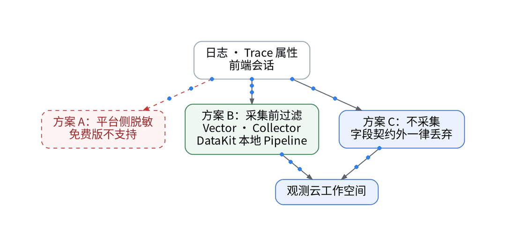
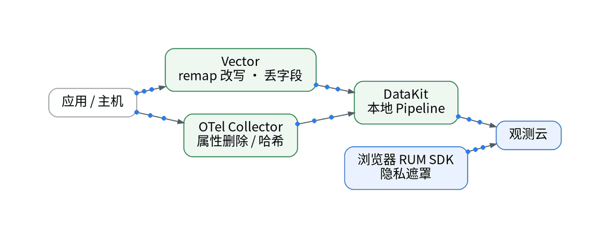
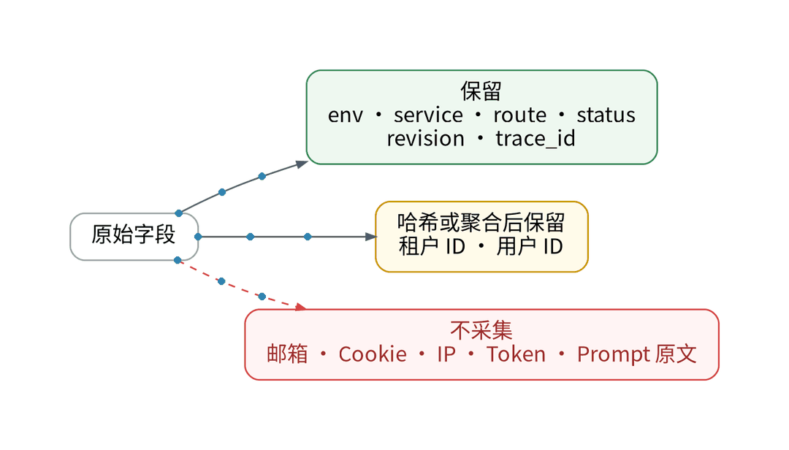

# 免费版没有平台脱敏：敏感字段该在哪一层拦

## 一、背景：日志、Trace、会话要出门了

上一篇把额度记成了账本。接入一条链路后，应用日志、Trace 属性和前端会话会离开自建环境，写入 SaaS 工作空间。现有栈的采集链是 exporter / 应用 → Vector 或 OTel Collector → 存储，凭据由 Vault 运行时注入。

## 二、痛点：平台侧没有兜底

观测云版本区分页写明，免费版不支持“敏感数据脱敏”“敏感数据扫描”，Pipeline 仅支持“本地 Pipeline”。免费版订阅协议 6.2.2 另有约定：观测云可在非商业目的下，以聚合或匿名化方式使用用户业务数据。也就是说，字段一旦上报，免费空间里没有平台功能替你遮盖。

## 三、三种方案对比

- 方案 A，平台侧脱敏：商业版能力，免费版不可用。
- 方案 B，采集前过滤：在 Vector 用 remap 改写或删除字段，在 OTel Collector 删除或哈希 span 属性，在 DataKit 用本地 Pipeline 处理；Log Streaming 接口支持通过 URL 参数 pipeline 指定脚本。
- 方案 C，不采集：用字段契约做白名单，契约外字段一律丢弃。

注意 DataKit 的 OpenTelemetry 采集器默认会把每个 Span 的 Resource、Scope、Span 和 Event 属性合计最多 500 个不同的键提取为字段，不加过滤，属性里的敏感值会原样进入工作空间。

## 四、选型：B + C 组合

本系列的方案是 B 与 C 组合：保留 env、service、route、status、revision、trace_id；租户与用户 ID 只留哈希或聚合值；邮箱、Cookie、IP、Token、Prompt 原文不采集。前端 RUM SDK 的隐私遮罩单独验证。抽查 7 天数据是否命中敏感字段：【待实测】。

## 五、决策表

| 功能 | 特性 | 成本 | 客观事实依据 | 适用场景 |
| --- | --- | --- | --- | --- |
| 平台脱敏 / 扫描 | 上报后处理 | 商业版按量【待实测】 | 版本区分页：免费版不支持 | 商业版空间 |
| Vector / Collector 过滤 | 出网前改写 | 配置工时【待实测】 | 现有采集链组件 | 日志、Trace 属性 |
| DataKit 本地 Pipeline | 接收端改写 | 免费版可用 | 版本区分页；Log Streaming 文档 | 日志切分、清洗 |
| 字段白名单 | 不采即不泄 | 最低 | Span 属性默认最多提取 500 个键 | 所有信号 |
| RUM 隐私遮罩 | 前端侧遮盖 | 【待实测】 | 【待实测】 | 会话与页面数据 |

参考：观测云《版本区分》、观测云《免费版订阅协议》、观测云《OpenTelemetry 采集器》、观测云《Log Streaming 采集器》。

上一篇：[《观测云免费版的账本：10 台主机、1 万时间线够不够》](../02-free-zone-quota-ledger/wechat.md)｜下一篇：[《观测云能 Terraform 吗？面板即代码的 5 个问答》](../04-terraform-provider-qa/wechat.md)
