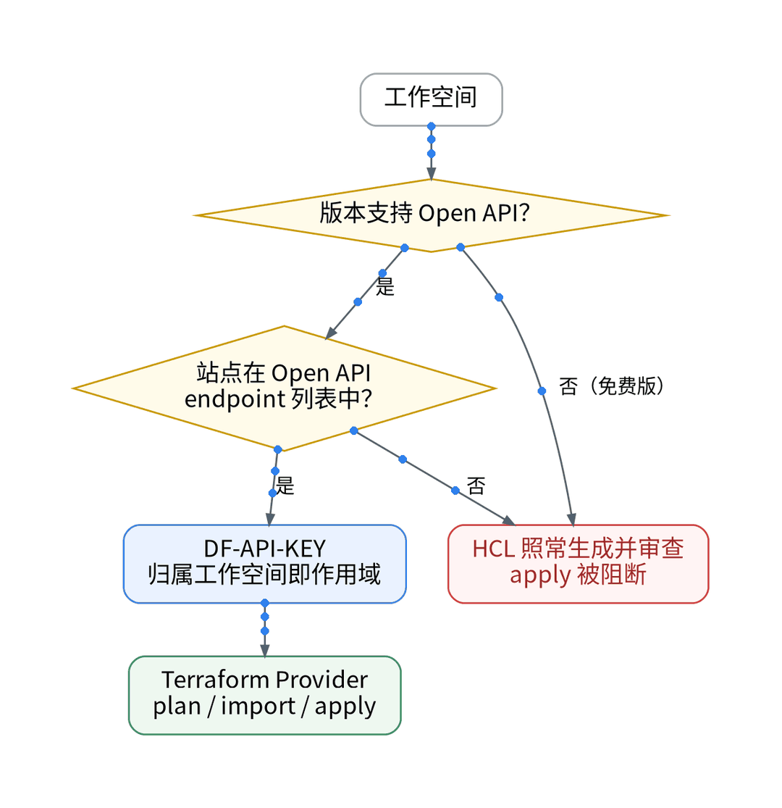
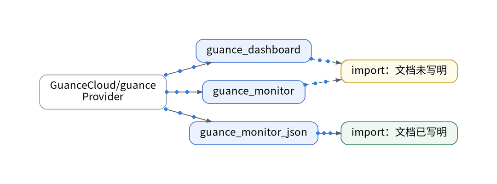
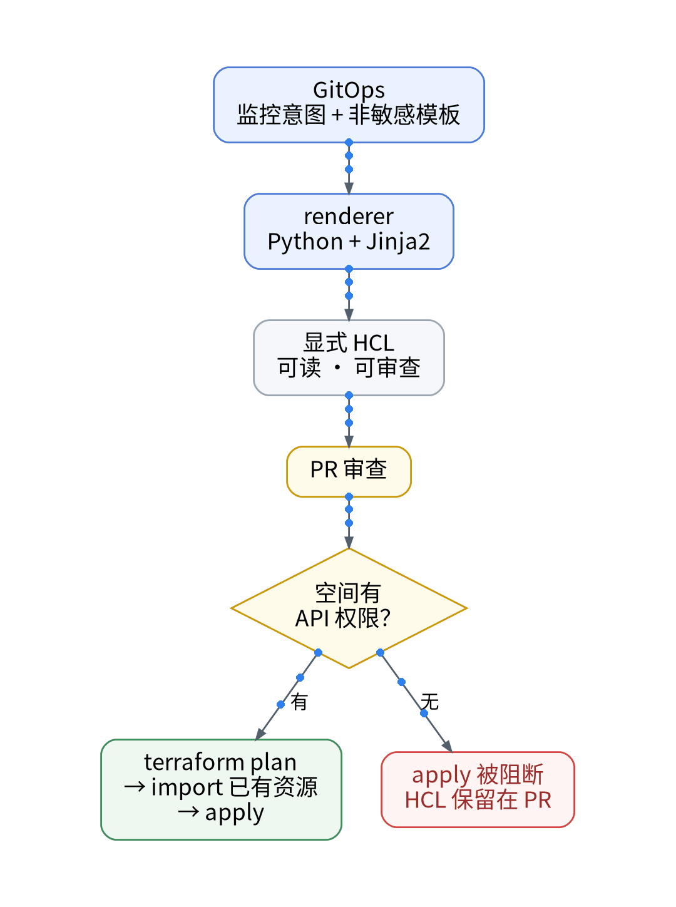

# 观测云能 Terraform 吗？面板即代码的 5 个问答

## 背景

上一篇把敏感字段挡在了采集之前。下一个问题是配置：现有 IaC 链路是 GitOps 声明 → Python + Jinja2 renderer 生成显式 HCL → 按环境 plan / apply，凭据由 Vault 运行时注入。希望观测云的仪表板和监控器也走这条链路。痛点是：远端资源的增删改依赖 Open API，而免费版恰好不支持。下面拆成 5 个问题。

## Q1–Q2：能不能接？

**Q1：免费版能用 Terraform 管远端资源吗？**不能。版本区分页写明，免费版“不支持通过调用 Open API 接口获取和更新工作空间数据”。另外，Open API 页列出的 SaaS endpoint 有杭州、宁夏、广州、香港、俄勒冈、法兰克福、新加坡（两个）、南非、雅加达，没有免费专区（北京）。

**Q2：有权限的空间怎么认证？**Open API 只有 GET / POST，每次请求在 Header 带 DF-API-KEY；该 Key 所属的工作空间就是本次请求的作用范围。管理 Key 只在 plan / apply 时由 Vault 注入，不进仓库和 CI 日志。

## Q3–Q4：能管什么？

**Q3：Provider 能管什么？**Terraform Registry 上的 GuanceCloud/guance Provider 属 community 层，最新版本 0.1.0，提供 guance_dashboard、guance_monitor、guance_monitor_json 等资源，基于 Open API 与工作空间 API Key。

**Q4：已有面板能 import 吗？**文档只为 guance_monitor_json 写明了 terraform import，Dashboard 未写明。Dashboard import 是否可行：【待实测】。

## Q5：免费空间里 IaC 还能做什么？

方案是按空间分流：有 API 权限的空间走 plan → import → apply；免费空间里 renderer 照常生成 HCL 并进 PR 审查，但 Provider 依赖 Open API，apply 被阻断，plan 能否完成【待授权空间实测】；不用浏览器私有接口绕过权限。还要注意，现有 IaC 仓库的 Terraform 范围限于计算、网络、存储、身份，观测云资源属于新增范围。

## 决策表

| 功能 | 特性 | 成本 | 客观事实依据 | 适用场景 |
| --- | --- | --- | --- | --- |
| 免费空间 apply | 被 Open API 限制阻断 | — | 版本区分页：不支持 Open API | 【待授权空间实测】 |
| 离线 HCL 生成 | 可审查、不落地 | 0 元 | renderer 只生成文件 | 免费空间预演 |
| Terraform Provider | plan / import / apply | 商业版按量【待实测】 | Registry：community 层 0.1.0 | 有 API 权限的空间 |
| Monitor import | 纳管存量 | 同上 | 文档写明 monitor_json 可 import | 存量监控器 |
| Dashboard import | 纳管存量 | 同上 | 文档未写明【待实测】 | 存量面板 |

参考：观测云《版本区分》、观测云《Open API》、Terraform Registry《GuanceCloud/guance》。

上一篇：[《免费版没有平台脱敏：敏感字段该在哪一层拦》](../03-privacy-before-ingest/wechat.md)｜下一篇：[《采集端照样 GitOps：DataKit 接入的 Playbook 实操》](../05-collector-gitops-handson/wechat.md)
