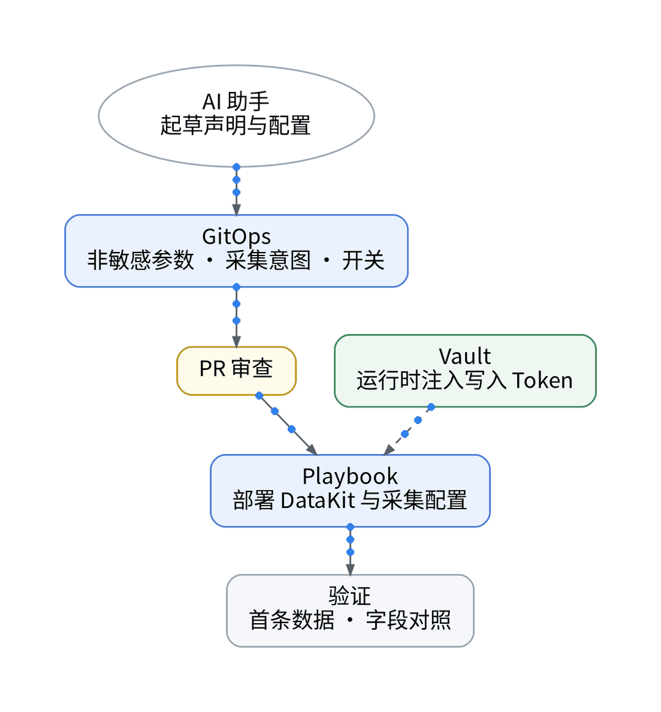
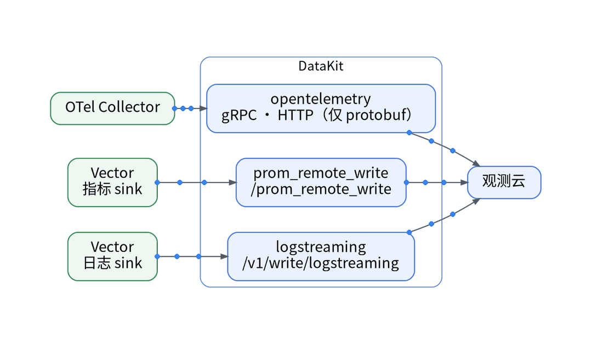

# 采集端照样 GitOps：DataKit 接入的 Playbook 实操

## 背景：远端管不了，采集端可以

上一篇确认免费空间的远端资源无法经 Open API 写入，apply 被阻断。但采集端在自己机器上，部署、配置和凭据仍可全部代码化。现有栈：主机侧 Vector 抓取 exporter，以 Prometheus Remote Write 推指标、以 HTTP 推日志；应用 OTLP 进入 OTel Collector；部署由 Playbook 完成。痛点是：新增一条写往 SaaS 的通道，最容易出事的是写入 Token 进了仓库或 CI 日志，以及新通道拖垮原采集。

## 步骤 1：声明进 Git，开关默认关

在 GitOps 中只放非敏感参数：采集目标、白名单、开关。开关默认关，关闭时生成的配置应与现状一致。AI 起草声明、配置和 PR 说明，人审 PR 与 plan。首次开通与授权是人工前置。

## 步骤 2：Playbook 部署 DataKit 三个接入口

- OTel Collector 增加 exporter → DataKit opentelemetry 采集器。官方推荐 gRPC；HTTP 只接受 application/x-protobuf，默认路由 /otel/v1/traces。
- Vector 指标 sink → prom_remote_write，路径 /prom_remote_write。
- Vector 日志 sink → logstreaming，路径 /v1/write/logstreaming，可带 source、service、pipeline 参数。

## 步骤 3：凭据三分，开关验证

写入 Token 只在 Playbook 部署时注入 DataKit；查询 Key 给只读对账脚本；管理 API Key 仅在有 API 权限的空间、仅在 plan / apply 时注入。三者分开存放、分开授权，不进仓库、CI 日志和截图。

打开开关，检查首条数据到达时间【待实测】、字段对照（env / service / route / trace_id）【待实测】、原采集是否不受影响【待实测】。

## 决策表

| 功能 | 特性 | 成本 | 客观事实依据 | 适用场景 |
| --- | --- | --- | --- | --- |
| OTLP gRPC → DataKit | 压缩率高、开销低 | 免费版额度内 0 元 | OpenTelemetry 采集器文档 | 应用 Trace |
| OTLP HTTP → DataKit | 仅 protobuf | 同上 | 同上 | gRPC 端口受限时 |
| Remote Write → DataKit | Vector 第二 sink | 计入 10,000 条时间线 | prom_remote_write 文档；版本区分页 | 主机指标 |
| Log Streaming | URL 参数打标 | 计入每天 1,000 万条 | logstreaming 文档 | 日志 |
| Vault 注入 | 凭据不落盘 | 现有组件 | 现有 Playbook 机制 | 所有凭据 |

参考：观测云《OpenTelemetry 采集器》、观测云《Prometheus Remote Write 采集器》、观测云《Log Streaming 采集器》。

上一篇：[《观测云能 Terraform 吗？面板即代码的 5 个问答》](../04-terraform-provider-qa/wechat.md)｜下一篇：[《1 万条时间线≠1 万个指标：采集前的三道闸》](../06-timeseries-budget/wechat.md)
