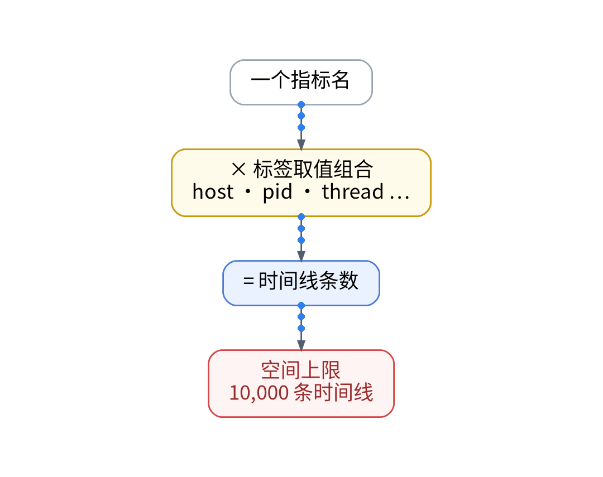
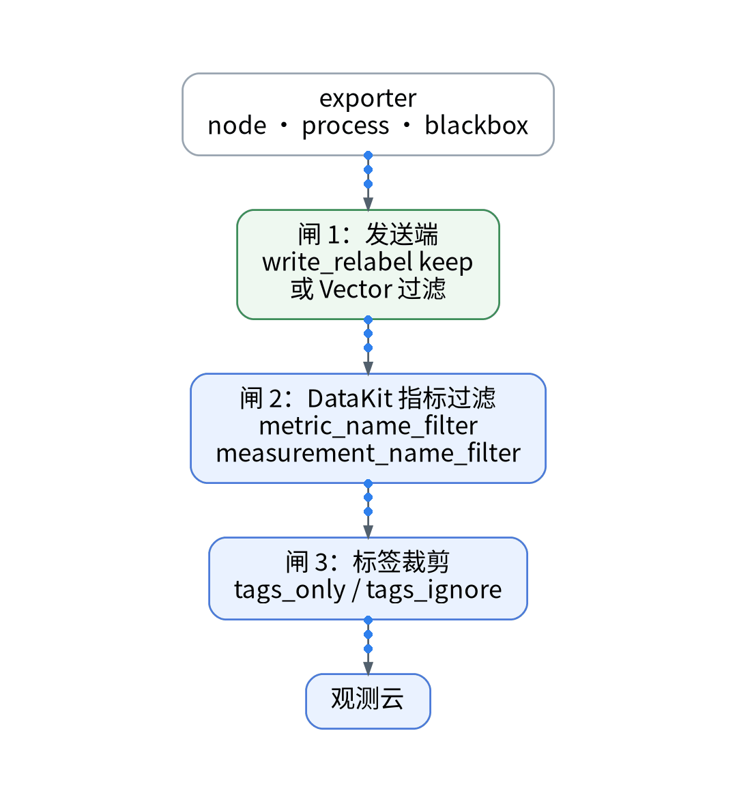
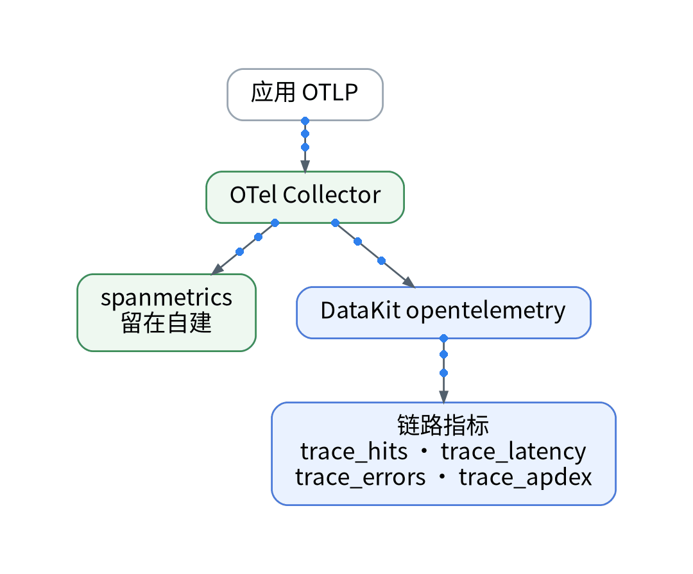

# 1 万条时间线≠1 万个指标：采集前的三道闸

## 误区一：时间线 = 指标数

你以为免费版的 10,000 条时间线就是 1 万个指标，其实时间线是“指标名 × 标签取值组合”：同一个指标带上 host、pid 等标签，会裂变成多条。背景是：上一篇把 DataKit 接入口用 Playbook 部署好了，主机侧 Vector 抓取 node / process / blackbox exporter 并以 Remote Write 推指标，现在要多一个 sink 写往观测云免费空间。痛点在于版本区分页写明超额不再上报；高基数标签一多，额度会先于预期耗尽，后续数据直接缺失。

## 误区二：只在接收端过滤就够

其实应该层层设闸。方案是三道闸：

- 闸 1，发送端：DataKit 文档给出的做法是在 Prometheus remote_write 中用 write_relabel_configs 按 __name__ 做 keep；Vector 侧同理在 sink 前过滤，只发白名单指标。
- 闸 2，DataKit 指标过滤：prom_remote_write 支持 metric_name_filter 与 measurement_name_filter，均可用正则，不匹配的不放行。
- 闸 3，标签裁剪：tags_only / tags_only_regex 做白名单，tags_ignore / tags_ignore_regex 做黑名单。

## 误区三：黑白名单一起配更保险

其实会全部失效。prom_remote_write 文档明确：黑名单和白名单同时配置，黑白名单会全部失效。只选一种。

## 误区四：链路指标也要双写

其实可以不写。现有 OTel Collector 用 spanmetrics 生成 RED 指标。DataKit 的 OpenTelemetry 采集器可从链路中提取 trace_hits、trace_latency、trace_errors、trace_apdex 等指标，因此 spanmetrics 留在自建，不再写入观测云，避免重复占用时间线。白名单前后时间线数量：【待实测】。

## 决策表

| 功能 | 特性 | 成本 | 客观事实依据 | 适用场景 |
| --- | --- | --- | --- | --- |
| 发送端 keep | 不出网即不计量 | 配置工时【待实测】 | DataKit 文档 write_relabel 示例 | 指标白名单 |
| metric / measurement 过滤 | 正则放行 | 0 元 | prom_remote_write 配置项 | 接收端兜底 |
| tags_only / tags_ignore | 裁剪高基数标签 | 0 元 | 同上；二者不可同配 | 控制时间线 |
| DataKit 链路指标 | 由 Trace 派生 | 计入 Trace 额度 | OpenTelemetry 采集器文档 | 替代 spanmetrics 双写 |
| 全量双写 | 无需筛选 | 可能超 10,000 条 | 版本区分页 | 仅商业版评估 |

参考：观测云《版本区分》、观测云《Prometheus Remote Write 采集器》、观测云《OpenTelemetry 采集器》。

上一篇：[《采集端照样 GitOps：DataKit 接入的 Playbook 实操》](../05-collector-gitops-handson/wechat.md)｜下一篇：[《日志双写不丢 trace_id：Vector 接 Log Streaming 实操》](../07-log-streaming-handson/wechat.md)
