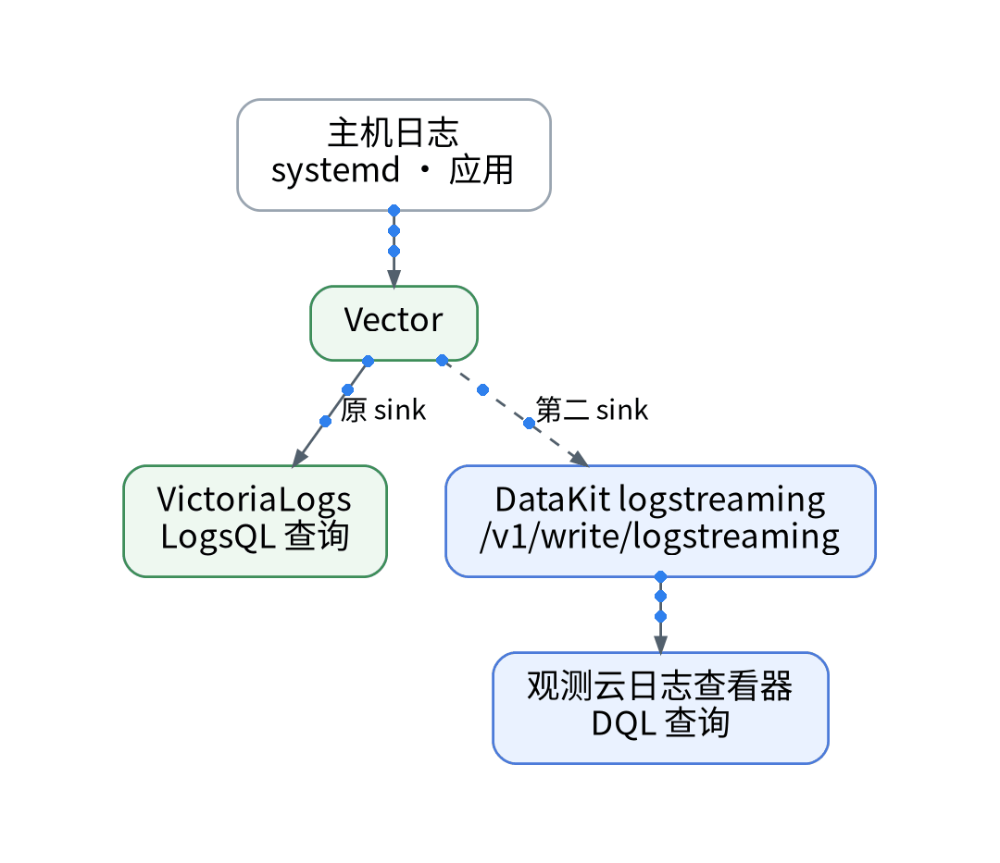
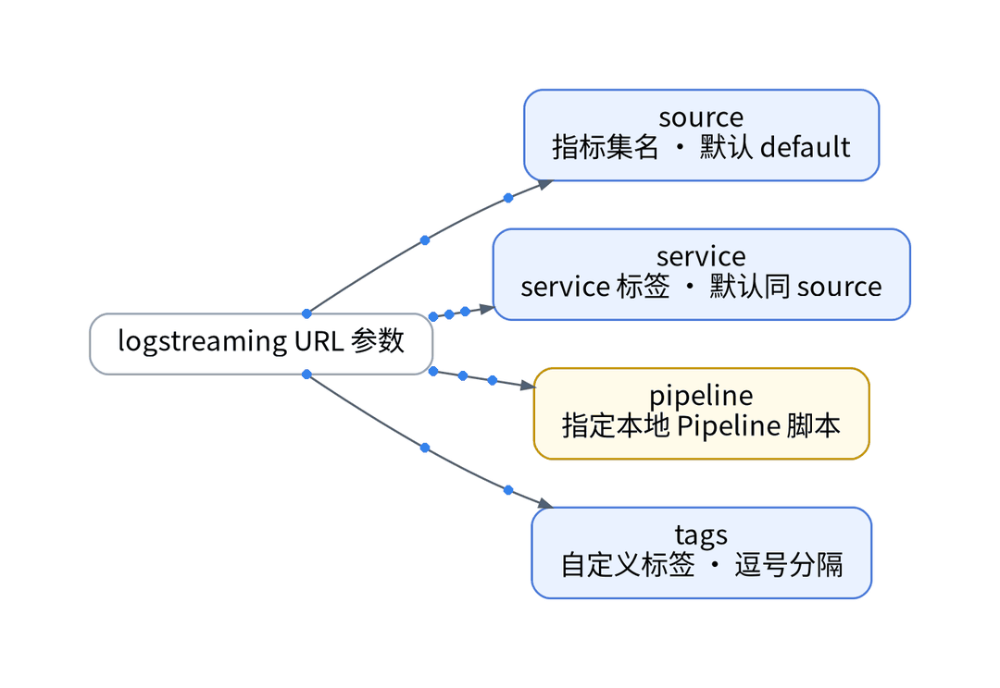
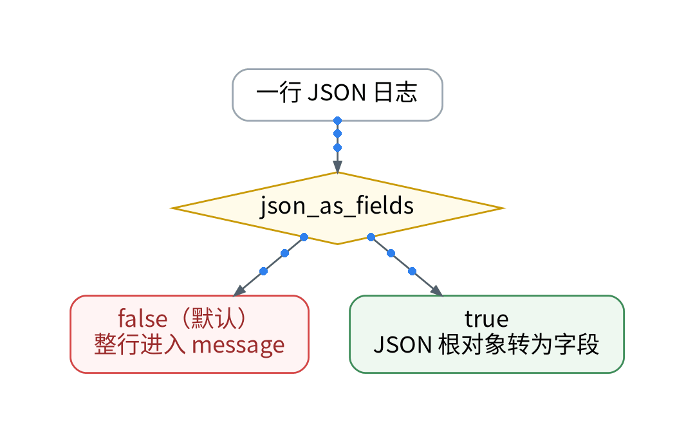
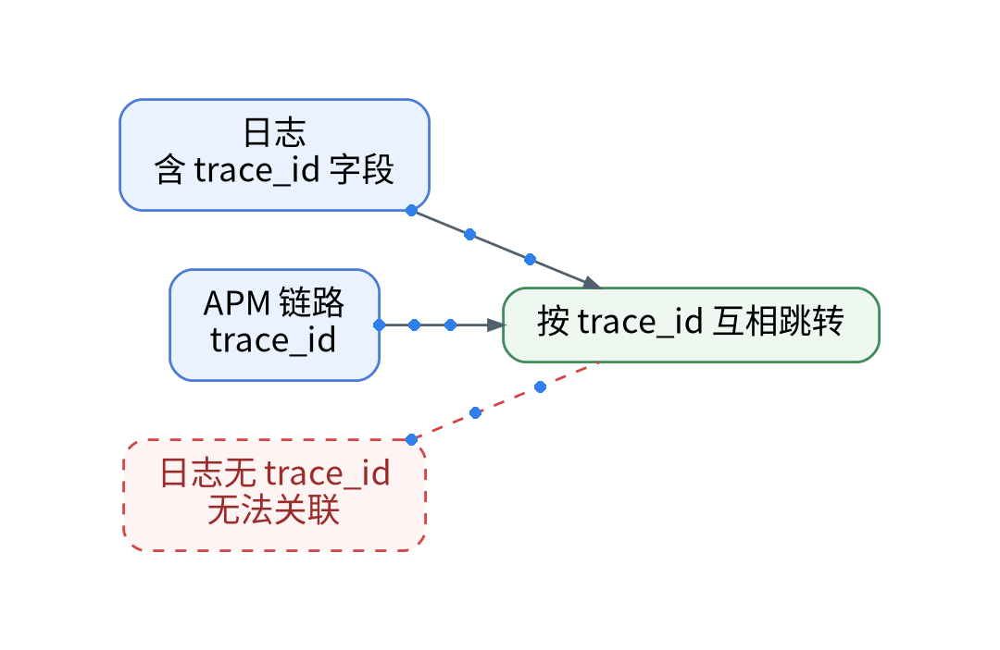

# 日志双写不丢 trace_id：Vector 接 Log Streaming 实操

## 背景：指标控住了，日志还没进来

上一篇用三道闸把时间线控制在额度内。日志侧的现状是：主机上的 Vector 采集 systemd 与应用日志，经 HTTP 推入 VictoriaLogs，用 LogsQL 查询。痛点是：日志写进观测云后，如果整行只是一段文本、又没有 trace_id，就既不能按字段检索，也无法和上一阶段接入的 Trace 关联；免费版日志类数据每天上限 1,000 万条，Pipeline 只支持本地 Pipeline。

## 步骤 1：Vector 加第二个 sink

原 sink 不动，新增一个 HTTP sink 指向 DataKit logstreaming，路径固定为 /v1/write/logstreaming，由开关控制，默认关。URL 参数决定落库形态：source 是指标集名，默认 default；service 添加 service 标签，默认取 source 值；pipeline 指定本地 Pipeline 脚本；tags 以逗号分隔添加自定义标签。DataKit 还会自动带上 collector_source_ip、ip_or_hostname 等标签。

## 步骤 2：让 JSON 变成字段

由 Playbook 下发的 DataKit [inputs.logstreaming] 配置中设置 json_as_fields = true，可把每行日志的 JSON 根对象转换为字段；默认 false 时整行进入 message。该配置不作用于 influxdb、firelens、firehose 类型，也不是 URL 参数。敏感字段在 Vector 侧先删除或哈希，本地 Pipeline 只做切分与清洗。

## 步骤 3：带上 trace_id 并对账

方案的关键一步：应用日志输出 trace_id 字段，观测云才能在日志与 APM 链路之间按 trace_id 互相跳转。验证三项：同一时间窗 VictoriaLogs 与观测云的条数差【待实测】；trace_id 是否成为可查询字段【待实测】；原 sink 写入是否不受影响【待实测】。LogsQL 查询需改写为 DQL，并随面板声明一起进 PR。

## 决策表

| 功能 | 特性 | 成本 | 客观事实依据 | 适用场景 |
| --- | --- | --- | --- | --- |
| Vector 第二 sink | 原链路不动 | 配置工时【待实测】 | 现有 Vector HTTP 日志推送 | 日志双写 |
| logstreaming URL 参数 | source / service / pipeline / tags | 计入每天 1,000 万条 | Log Streaming 采集器文档 | 按服务分流 |
| json_as_fields | JSON 根对象转字段 | 0 元 | 同上 | 结构化日志 |
| 本地 Pipeline | 接收端切分清洗 | 免费版可用 | 版本区分页 | 非 JSON 日志 |
| trace_id 关联 | 日志 ↔ 链路跳转 | 应用改造工时【待实测】 | 迁移矩阵：前提为日志带 trace_id | 跨信号排障 |

参考：观测云《Log Streaming 采集器》、观测云《版本区分》。

上一篇：[《1 万条时间线≠1 万个指标：采集前的三道闸》](../06-timeseries-budget/wechat.md)｜下一篇：[《Grafana 面板搬家不点控制台：JSON 转声明，再 plan》](../08-grafana-dashboard-import/wechat.md)
