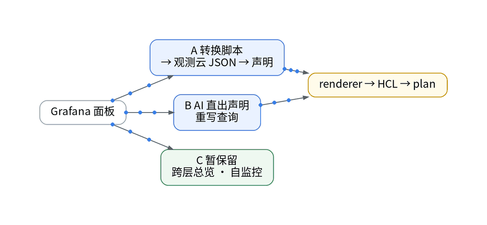
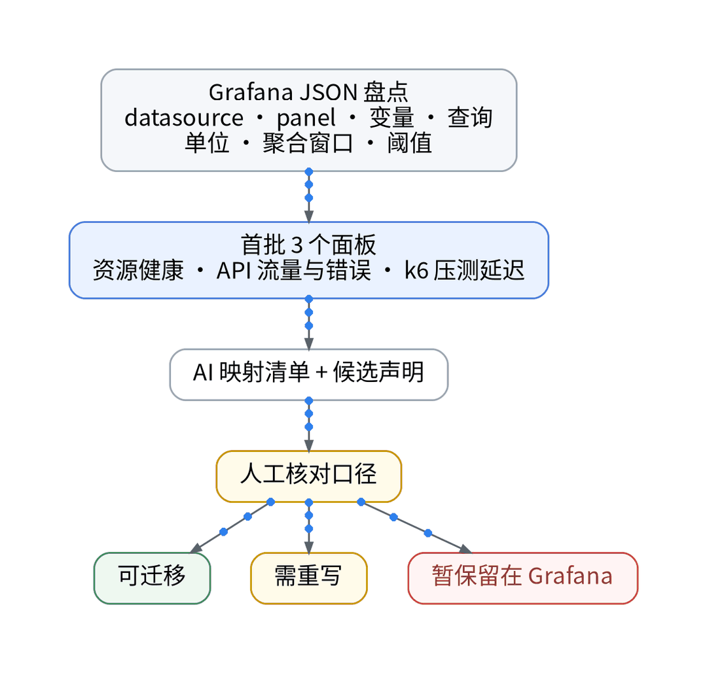

# Grafana 面板搬家不点控制台：JSON 转声明，再 plan

## 背景：数据进来了，面板还在 Grafana

上一篇把日志也接进了双写。现在指标与日志都已并行写入，下一步是排障入口：自建 Grafana 的数据源是 VictoriaMetrics（PromQL）与 VictoriaLogs（LogsQL），没有 Loki。痛点是：Grafana JSON 不等于观测云 JSON，官方文档也提示 Grafana 部分高级特性导入后可能无法正常显示或需重新配置；免费版仪表板最多 10 个，且不支持 Open API，面板无法经 Terraform 写入免费空间。

## 三条路径对比（都不碰控制台）

- 路径 A，转换脚本：场景 FAQ 提供 npm 包 @cloudcare/guance-front-tools，命令 grafanaCovertToGuance -d grafana.json -o guance.json 离线转换；AI 再把 guance.json 拆成 GitOps 声明。
- 路径 B，AI 直出声明：AI 读 Grafana JSON，直接输出面板声明与映射清单，适合查询需要重写的面板。
- 路径 C，暂保留：跨层总览、管道自监控等，留在 Grafana。

A、B 的产物都进同一条线：声明 → PR 审查 → iac_modules renderer 生成 guance_dashboard 的 HCL → Terraform plan → 人审 plan。免费空间不支持 Open API，apply 被阻断，plan 能否完成与 Dashboard 能否 import：【待授权空间实测】。

## 选型：三个面板走漏斗

方案是不整库迁移，首批只选三个：资源健康、API 流量与错误、k6 压测延迟。AI 输出映射清单和候选声明，人审口径与 plan，每个面板只给三种判定：可迁移 / 需重写 / 暂保留。历史数据留在原存储，不搬。三个面板的判定与 AI 生成 vs 人工修正工时：【待实测】。

## 决策表

| 功能 | 特性 | 成本 | 客观事实依据 | 适用场景 |
| --- | --- | --- | --- | --- |
| grafanaCovertToGuance | 离线转换、可入 Git | 修复工时【待实测】 | 场景 FAQ | 简单图表面板 |
| AI 直出声明 | 查询可重写 | 审查工时【待实测】 | Grafana 高级特性兼容性提示 | 需重写的面板 |
| renderer + plan | HCL 可审查 | 0 元 | guance_dashboard 资源 | 所有迁移面板 |
| apply 到工作空间 | 需 Open API | 商业版按量【待实测】 | 免费版不支持 Open API | 【待授权空间实测】 |
| 暂保留 Grafana | 不迁移 | 现有组件 | 免费版仪表板 ≤10 个 | 跨层总览、自监控 |

参考：观测云《场景 FAQ》、观测云《仪表板入门》、观测云《版本区分》、Terraform Registry《GuanceCloud/guance》。

上一篇：[《日志双写不丢 trace_id：Vector 接 Log Streaming 实操》](../07-log-streaming-handson/wechat.md)｜下一篇：[《PromQL 搬过去还能跑吗？查询口径的 5 个问答》](../09-query-semantics-qa/wechat.md)
