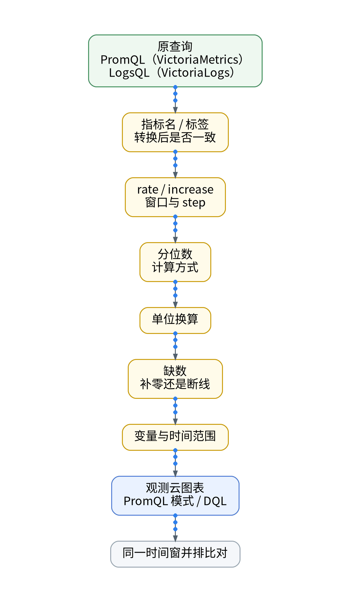
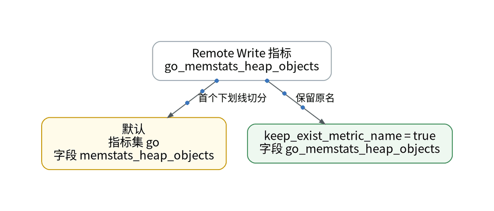
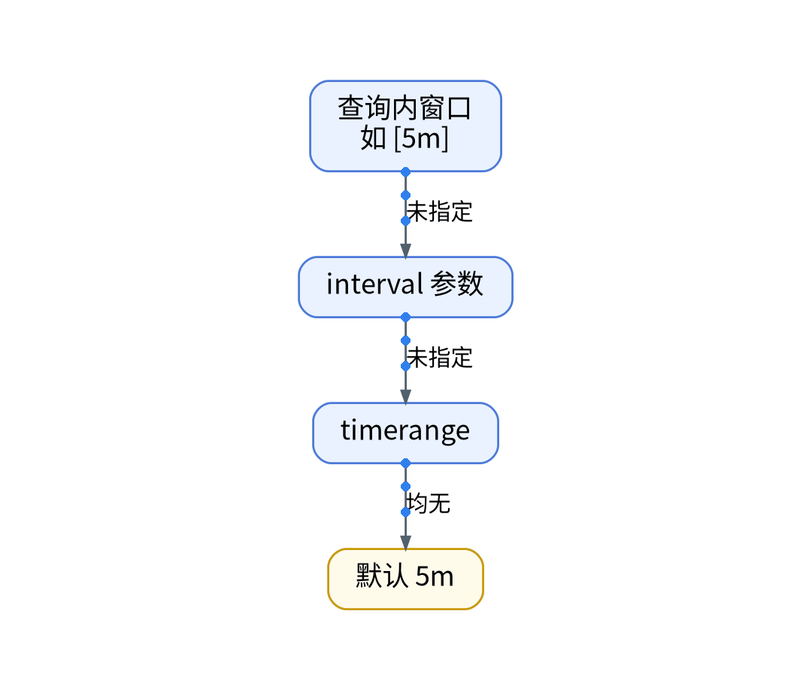
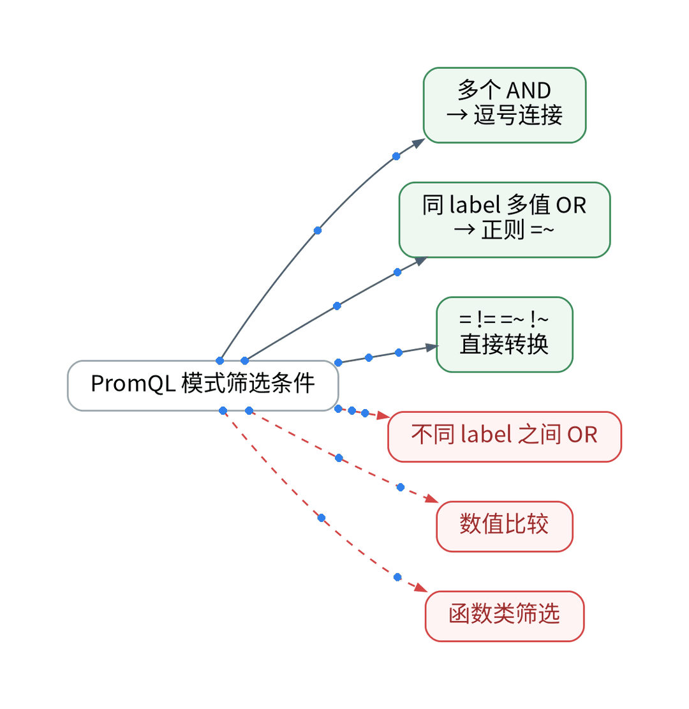

# PromQL 搬过去还能跑吗？查询口径的 5 个问答

## 背景

上一篇选出了首批三个面板。面板背后是查询：自建侧是 VictoriaMetrics 的 PromQL 与 VictoriaLogs 的 LogsQL；观测云图表支持 PromQL 查询，也有自己的 DQL。痛点是：语法能转，语义未必一致，曲线“看起来差不多”最危险。拆成 5 个问题。

## Q1–Q2：名字和时间会变吗？

**Q1：指标名还是原来的吗？**不一定。prom_remote_write 默认以指标名第一个下划线前的部分作指标集、其余作字段：go_memstats_heap_objects 会变成指标集 go、字段 memstats_heap_objects。设置 keep_exist_metric_name = true 才保留完整字段名。迁移前先定这一项，否则查询要全部改写。

**Q2：step 怎么定？**即时查询的 step 优先级：查询内窗口（如 [5m]）→ interval → timerange → 默认 5m。范围查询的 step 默认取 interval 与 max-point-window 中较大者。rate / increase 的窗口必须与原面板对齐。

## Q3–Q4：筛选和分位数一致吗？

**Q3：筛选条件都能转吗？**PromQL 模式下只支持 label 字符串匹配：多个 AND 转逗号、同 label 多值 OR 转正则、= != =~ !~ 直接转换；不同 label 之间的 OR、数值比较、函数类筛选暂不支持。

**Q4：P99 算法一样吗？**观测云场景 FAQ 说明：对原始数据点排序，取“数据点数 × 99%”位置的值；数据库不支持百分位时由代码拉取后计算。Prometheus 的 histogram_quantile 则在桶内插值，两者结果可能不同，需逐项比对。

## Q5：LogsQL 怎么办？

LogsQL 没有直接对应，需改写为 DQL，写进面板声明后随 PR 审查。方案统一：口径清单逐项核对，同一时间窗并排比对，曲线一致才判“可迁移”。偏差结果：【待实测】。

## 决策表

| 功能 | 特性 | 成本 | 客观事实依据 | 适用场景 |
| --- | --- | --- | --- | --- |
| PromQL 模式 | 复用原查询 | 改写工时【待实测】 | PromQL 查询文档 | 指标面板 |
| keep_exist_metric_name | 保留原指标名 | 0 元 | prom_remote_write 文档 | 减少改写 |
| DQL 重写 | 原生语义 | 工时【待实测】 | 观测云查询语言 | LogsQL、复杂筛选 |
| P99 比对 | 算法可能不同 | 对账工时【待实测】 | 场景 FAQ | 延迟面板 |
| 同窗并排 | 判定依据 | 双写期间 | 系列验收规则 | 所有迁移面板 |

参考：观测云《PromQL 查询》、观测云《Prometheus Remote Write 采集器》、观测云《场景 FAQ》。

上一篇：[《Grafana 面板搬家不点控制台：JSON 转声明，再 plan》](../08-grafana-dashboard-import/wechat.md)｜下一篇：[《只有 10 个阈值监控器：告警迁移的预算账》](../10-alert-monitor-ledger/wechat.md)
