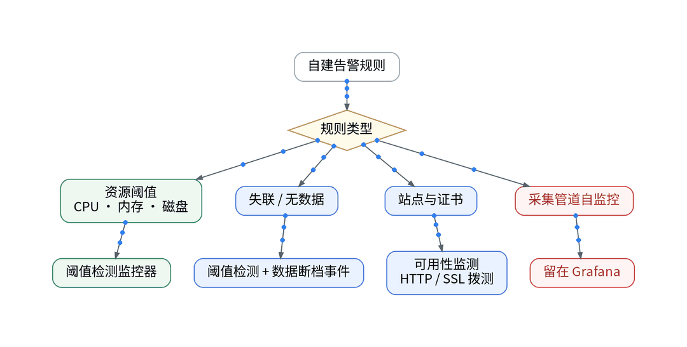
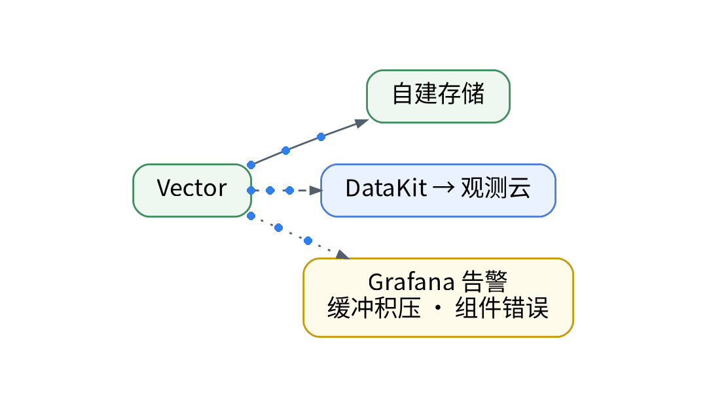

# 只有 10 个阈值监控器：告警迁移的预算账

## 一、背景：面板对上了，告警还在 Grafana

上一篇对齐了查询口径。自建侧告警跑在 Grafana，规则覆盖主机资源、失联、站点与证书探测，以及 Vector 管道自身。痛点是预算：免费版监控器最多 10 个，且仅支持“阈值检测”；可用性监测每天 20 万次，海外拨测节点仅限商业版及以上。

## 二、预算科目：每条规则先归类

- 资源阈值（CPU、内存、磁盘）：阈值检测监控器，占监控器名额。
- 失联 / 无数据：阈值检测自带“数据断档”策略，可配置为触发数据断档事件或指定等级事件，且数据断档优先于触发条件判断。
- 站点与证书：走可用性监测，HTTP 拨测与 SSL 拨测；SSL 拨测可按证书剩余天数判定，官方建议检测频率 1 小时及以上。消耗拨测次数，不占监控器名额。
- 采集管道自监控（缓冲积压、组件错误）：留在 Grafana，它监控的正是双写管道本身。

## 三、隐性成本：配置不当会被暂停

阈值检测的检测区间应大于等于检测频率；检测维度若选 trace_id 这类高基数字段，可能引发告警爆炸，导致监控器被系统自动暂停；单次查询最多返回 10 万条记录；连续触发判断最多 10 次。

## 四、结余：留出余量

方案是按科目分流后，监控器只承接资源阈值与失联两类，证书与站点交给拨测，管道自监控不迁，10 个名额留出余量给后续链路。监控器以声明进 GitOps，renderer 生成 guance_monitor / guance_monitor_json 的 HCL 后 plan；免费空间不支持 Open API，apply 被阻断，【待授权空间实测】。实际占用名额与演练触发情况：【待实测】。

## 五、决策表

| 功能 | 特性 | 成本 | 客观事实依据 | 适用场景 |
| --- | --- | --- | --- | --- |
| 阈值检测监控器 | 四级阈值 + 恢复 | 占 10 个名额之一 | 版本区分页；阈值检测文档 | 资源阈值 |
| 数据断档事件 | 无数据即告警 | 同上 | 阈值检测文档 | 失联 |
| SSL / HTTP 拨测 | 证书剩余天数判定 | 计入每天 20 万次 | SSL 拨测文档 | 证书、站点 |
| Grafana 告警 | 监控管道本身 | 现有组件 | 现有栈 | Vector 自监控 |
| 商业版监控 | 不限数量 | 按量【待实测】 | 版本区分页 | 规则超 10 条 |

参考：观测云《版本区分》、观测云《阈值检测》、观测云《SSL 拨测》。

上一篇：[《PromQL 搬过去还能跑吗？查询口径的 5 个问答》](../09-query-semantics-qa/wechat.md)｜下一篇：[《拨测≠blackbox：免费版 HTTP 拨测最快 30 分钟一次》](../11-synthetic-vs-blackbox/wechat.md)
