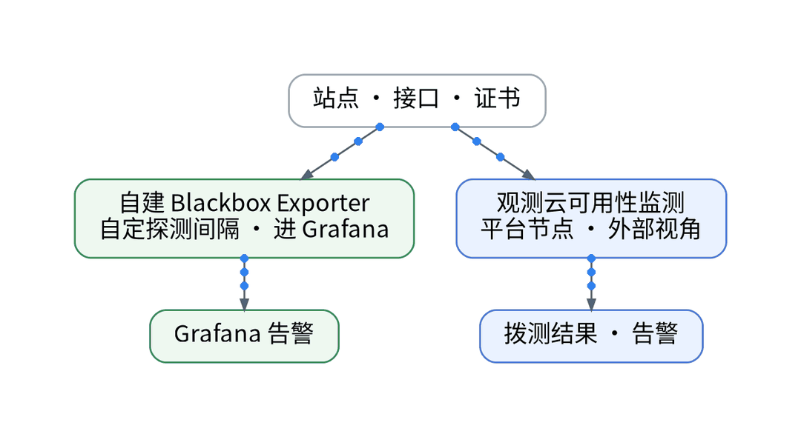
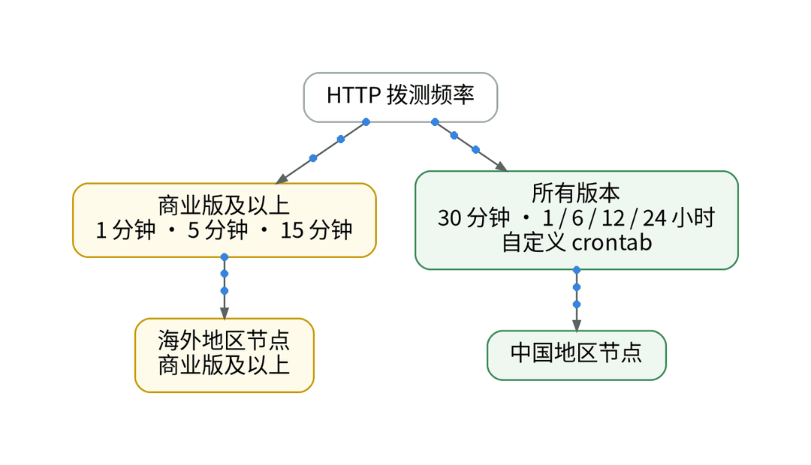

# 拨测≠blackbox：免费版 HTTP 拨测最快 30 分钟一次

## 误区一：拨测只是换个地方跑 blackbox

你以为把自建 Blackbox Exporter 的站点探测搬到观测云拨测，只是换个地方跑，其实频率档位不同。背景是：上一篇把站点与证书类告警划给了可用性监测；自建侧由 Blackbox Exporter 探测并进 Grafana，探测间隔由自己配置。痛点在于：HTTP 拨测文档写明，1 分钟、5 分钟、15 分钟三档仅限商业版及以上，其余为 30 分钟、1 / 6 / 12 / 24 小时和自定义 crontab；海外地区节点同样仅限商业版及以上。免费版可用性监测每天 20 万次。

## 误区二：证书也要高频测

SSL 拨测按“证书剩余天数”和“响应时间”判断，当前仅支持“满足以下所有条件”；官方建议证书检测频率 1 小时及以上。注意 SSL 拨测页列出了 1 分钟起的频率选项，但未写版本限制，免费版实际可选档位【待实测】。

## 误区三：状态码 200 就算可用

HTTP 拨测默认模式可按状态码、响应时间、请求头等组合判断，条件之间选“所有”或“任意”。业务接口常常 200 包着错误码，这时用脚本模式：写 Pipeline 脚本解析响应体，自定义 is_failed 与 error_message。

## 误区四：拨测结果不涉敏

拨测可配置请求头、Cookie 和 HTTP 认证，响应体默认会保存。任务配置启用“不保存响应内容”可避免敏感数据出现在测试结果中，代价是排查更难。方案因此是分工：Blackbox 保留自建侧探测与 Grafana 告警，观测云拨测承担平台节点视角、证书剩余天数和业务断言。拨测任务同样以声明维护；Provider 是否覆盖拨测任务、能否 apply：【待授权空间实测】。两者结论差异：【待实测】。

## 决策表

| 功能 | 特性 | 成本 | 客观事实依据 | 适用场景 |
| --- | --- | --- | --- | --- |
| Blackbox Exporter | 自定间隔、进 Grafana | 自建运维【待实测】 | 现有采集栈 | 内部探测 |
| HTTP 拨测（免费） | 最快 30 分钟、中国节点 | 计入每天 20 万次 | HTTP 拨测文档；版本区分页 | 外部视角兜底 |
| HTTP 拨测（商业） | 1 分钟起、海外节点 | 按量【待实测】 | HTTP 拨测文档 | 分钟级外部探测 |
| SSL 拨测 | 证书剩余天数 | 计入每天 20 万次 | SSL 拨测文档 | 证书到期预警 |
| 脚本模式 | Pipeline 断言响应体 | 编写工时【待实测】 | HTTP 拨测文档 | 业务错误码 |

参考：观测云《HTTP 拨测》、观测云《SSL 拨测》、观测云《版本区分》。

上一篇：[《只有 10 个阈值监控器：告警迁移的预算账》](../10-alert-monitor-ledger/wechat.md)｜下一篇：[《迁移监控最怕回不去：双写、开关与回退实操》](../12-dual-write-rollback/wechat.md)
