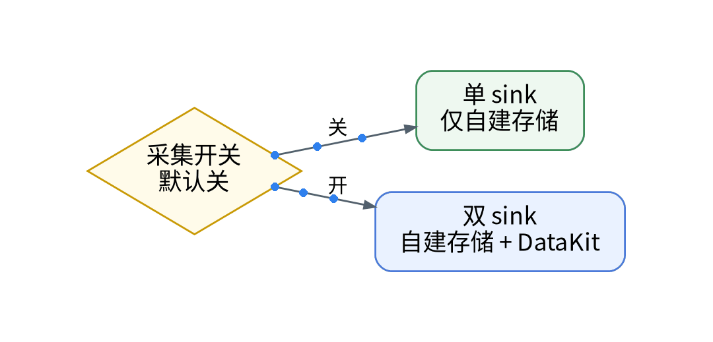
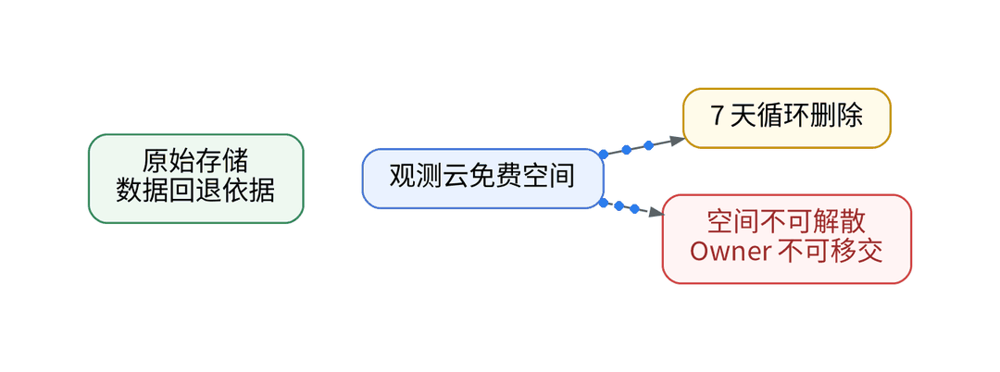

# 迁移监控最怕回不去：双写、开关与回退实操

## 背景：入口、查询、告警都试过了

上一篇厘清了拨测与 blackbox 的分工。至此，系列已完成接入、控量、日志、搬面板、对口径、迁告警与拨测。最后一步决定能否长期演进：自建栈（VictoriaMetrics、VictoriaLogs、Grafana）一直在工作，观测云只是并行的新链路。痛点是：新链路失败或要退出时回不去。免费空间数据 7 天循环，空间不支持解散，Owner 权限不支持移交；协议 10.3.2 允许观测云提前 15 天通知终止服务。

## 步骤 1：开关 + 双写

新写入由开关控制，默认关；关时只有一个 sink，开时 Vector / Collector 增加第二个 sink 写往 DataKit，写入失败不阻断原采集。

## 步骤 2：并排对照

Grafana 与观测云同屏，用真实请求和 k6 压测看同一时间窗。切换前至少满足：同窗偏差在门槛内、额度占比可控、测试告警触发、无敏感字段、完成一次回退演练。偏差与额度结果：【待实测】。

## 步骤 3：回退与退出

触发条件是偏差超门槛、额度告急或敏感字段命中。顺序：排障入口切回 Grafana → 开关置关、Playbook 重跑 → 停用 DataKit、移除 RUM SDK → Git 回退监控器与拨测声明并 plan / apply（免费空间 apply 受 Open API 限制，【待授权空间实测】）→ 轮换写入 Token 与管理 Key → 校验 Grafana 面板与告警。配置回退靠 Git 上一版本加审查后的 plan / apply；数据回退依赖原始存储，需保留的证据在 7 天内导出。回退演练耗时：【待实测】。

迁走的是排障入口，不是数据主权。验证通过一个面板，切换一个面板；回到第 1 篇，下一条链路再走一轮。

## 决策表

| 功能 | 特性 | 成本 | 客观事实依据 | 适用场景 |
| --- | --- | --- | --- | --- |
| 采集开关 | 默认关、一键回退 | 配置工时【待实测】 | Playbook 部署机制 | 所有新链路 |
| 双 sink 双写 | 失败不阻断原链路 | 出网与额度翻倍 | 版本区分页额度 | 并行期 |
| Git 配置回退 | 审查后 plan / apply | 0 元 | GitOps 流程 | 配置错误 |
| 原始存储回退 | 数据自持 | 自建存储成本 | 免费空间 7 天循环 | 数据回溯 |
| 凭据轮换 | 退出即失效 | 0 元 | 空间不可解散 | 完全退出 |

参考：观测云《版本区分》、观测云《注册免费版》、观测云《免费版订阅协议》。

上一篇：[《拨测≠blackbox：免费版 HTTP 拨测最快 30 分钟一次》](../11-synthetic-vs-blackbox/wechat.md)｜下一篇：[《一次登录失败翻了三个后台：低成本 SaaS 栈的可观测盲区复盘》](../01-low-cost-stack-blindspots/wechat.md)
