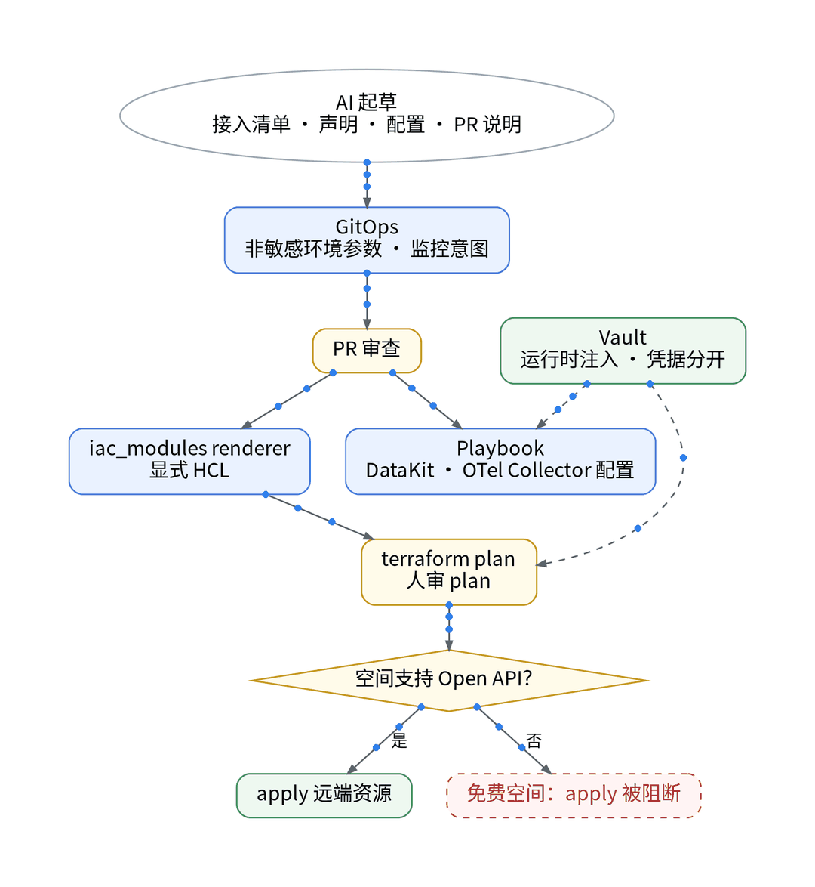
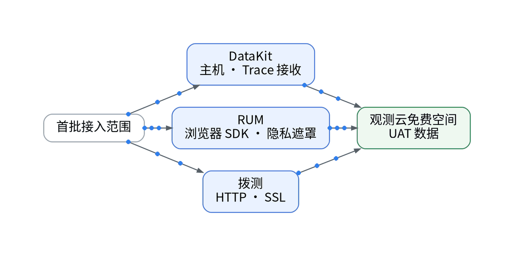
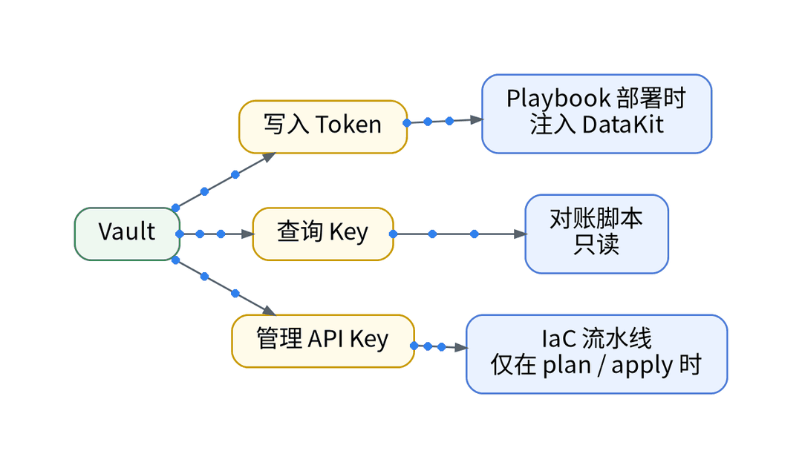

# Cloudflare + Cloud Run + Supabase 之后，我给个人 SaaS 补上了观测云免费专区

## 一、场景：栈很省，眼睛不够

想薅北京免费专区的羊毛，先把账算清。个人 SaaS 跑在 Cloudflare Pages / Workers、Cloud Run 和 Supabase Free 上，基础指标由自建 Grafana / VictoriaMetrics（observability-k3s-v5.svc.plus）承担。各层都有免费条件：Workers Free 每天 10 万请求；Cloud Run 请求计费模式每月前 200 万请求免费；Supabase Free 闲置 1 周暂停，不含 Log Drain，日志留 1 天。缺的是用户视角和跨层关联。

## 二、知识点：免费专区的准入、额度与成本

- 准入：只能在“免费专区（北京）”注册，12 小时内审核；每个账号只能创建 1 个工作空间，最多 5 人，空间不可解散。协议 4.7：未经书面授权不得用于商业用途。
- 额度：10,000 条时间线、最多 10 台主机；Trace 每天 20,000 个；PV 每天 5,000 个；拨测每天 20 万次；监控器 10 个且仅阈值检测；7 天循环存储；超额不再上报。
- 成本：免费版无需付费、不开票；观测云可提前 15 天通知终止服务，它不是生产承诺。

## 三、最小实践：AI 起草，人审 PR 与 plan

首次开通与审核是人工前置。之后 AI 起草接入清单、声明、配置和 PR 说明：GitOps 只放非敏感参数与监控意图；iac_modules renderer 生成显式 HCL，terraform plan 后人审；Playbook 部署 DataKit 与 OTel Collector 配置；RUM SDK 随前端发布接入；拨测任务写成声明。管理 API Key、查询 Key、写入 Token 由 Vault 运行时分开注入，不进仓库与 CI 日志。

注意：免费版不支持 Open API 读写工作空间数据。公开的 Terraform Provider 不等于免费空间有控制面 API，远端资源 apply 被阻断：【待授权空间实测】。

## 四、结果和局限

首条数据到达时间、7 天额度占比、接入工时：【待实测】。Supabase 内部与 Cloudflare 边缘在关联前标为盲区；成本按真实工作空间记录，没有账单前不做估算。

## 五、适合 / 不适合

适合：已有基础监控、想补用户体验与请求关联的独立开发者，用一条 UAT 链路做 POC。不适合：未取得书面授权的商业生产全量接入。

## 决策表

| 功能 | 特性 | 成本 | 客观事实依据 | 适用场景 |
| --- | --- | --- | --- | --- |
| 免费专区 | 7 天循环、超额不再上报 | 0 元，不开票 | 版本区分页；协议 3.1/3.3 | UAT POC |
| DataKit + OTel | Playbook 部署 | 计入 Trace 额度 | OpenTelemetry 采集器文档 | 后端链路 |
| RUM | 前端视角 | 计入 PV 额度 | 版本区分页 | 用户体验 |
| 拨测 | 外部探测 | 计入每天 20 万次 | 版本区分页 | 可用性 |
| Terraform apply | 需 Open API | 【待授权空间实测】 | 免费版不支持 Open API | 授权或商业空间 |

参考：观测云《版本区分》《注册免费版》《免费版订阅协议》；Cloudflare、Cloud Run、Supabase 定价页。

上一篇：[《和AI一起运营个人SaaS一季，我还会继续用观测SaaS吗？》](../12-season-review-exit/wechat.md)｜下一篇：[《AI 辅助 Grafana 面板搬家：从 JSON 到观测云配置，保留回退》](../02-dashboard-semantic-reconcile/wechat.md)
