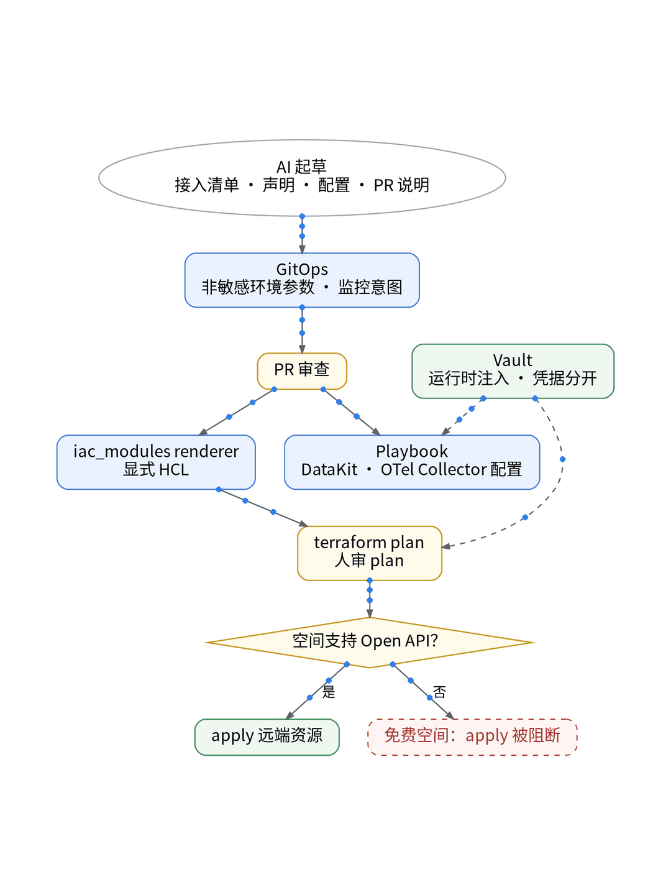

# 低成本 SaaS 拼好了，还差一双眼睛👀

## P1 省钱栈很香
Cloudflare Pages/Workers 做入口，Cloud Run 跑后端，Supabase Free 存数据，自建 Grafana 看基础指标。可用户一句“登录失败”，我还是看不到他浏览器里发生了什么。

## P2 薅羊毛前先看门槛 🐑
观测云免费版只在“免费专区（北京）”注册，12 小时内审核；1 个账号 1 个工作空间，最多 5 人，空间不能解散。商用要书面授权（协议 4.7）。

## P3 额度账本 📒
✅ 时间线 10,000 条，主机最多 10 台
✅ Trace 每天 2 万，PV 每天 5,000
✅ 拨测每天 20 万次
✅ 监控器 10 个，只有阈值检测
✅ 数据 7 天循环，超额不再上报
免费、不开票，但不保证永久提供。

## P4 怎么接 🛠️
不点控制台：AI 起草接入清单和声明 → GitOps → renderer 生成 HCL → plan，人审。Playbook 部署 DataKit 和 OTel Collector，RUM 随前端发布，拨测写成声明。三把钥匙分开放 Vault。免费空间没有 Open API，apply 被阻断【待授权空间实测】。

## P5 适合谁 🙋
已有基础监控、想补用户体验和请求关联的独立开发者。

【待实测截图】：UAT 一条登录链路接入后的脱敏数据截图，放这里；没有真实截图就不发。

结论：免费专区是个接近零成本、随时能退的 POC 场地，不是生产承诺。首条数据到达和额度占比【待实测】。

上一篇：AI、监控、账单：这一季到底值不值｜下一篇：面板搬家，最难的是查询口径对上

#独立开发 #可观测性 #观测云 #Cloudflare #SaaS
