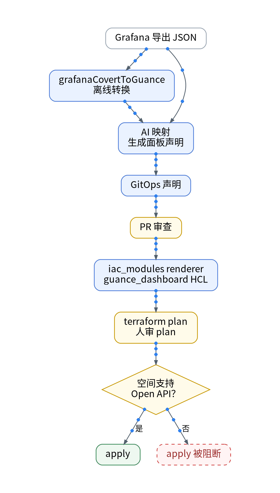

# AI 辅助 Grafana 面板搬家：从 JSON 到观测云配置，保留回退

## 一、场景：数据进来了，面板还在 Grafana

沿用上一篇的同一个观测云空间和同一条 IaC 流水线。自建 Grafana 的数据源是 VictoriaMetrics（PromQL）和 VictoriaLogs（LogsQL），首批要搬三个面板：资源健康、API 流量与错误、k6 压测延迟。真正的难点不是语法，而是口径：曲线“看起来差不多”最危险。

## 二、知识点：三处口径最容易错

- 变量：观测云的视图变量要在图表查询中被引用（如 host::tag）才会生效，Grafana 的 $var 不会自动对上。
- 单位与指标名：prom_remote_write 默认按第一个下划线切分，go_memstats_heap_objects 变成指标集 go、字段 memstats_heap_objects；设 keep_exist_metric_name = true 才保留原名。秒与毫秒、字节与比率要逐项核。
- 分位数：观测云 FAQ 以 P99 为例说明，对原始数据点排序后取“点数 × 99%”位置的值；Prometheus 的 histogram_quantile 在桶内插值。P95 面板需同窗比对。

## 三、最小实践：JSON → 声明 → plan，全程不碰控制台

1. 转换：场景 FAQ 提供 grafanaCovertToGuance（npm 包 @cloudcare/guance-front-tools）离线转换；官方提示 Grafana 部分高级特性可能无法正常显示，因此 AI 再把结果拆成 GitOps 声明，并输出映射清单。
2. 渲染：iac_modules renderer 生成 guance_dashboard 的 HCL，terraform plan 后人审。免费空间不支持 Open API，apply 与 Dashboard import：【待授权空间实测】。
3. 对照：新写入由开关控制、默认关；Grafana 与观测云同屏，用真实请求和 k6 压测看同一时间窗。
4. 回退：配置回到 Git 上一版本并重新 plan；数据回退依赖原始存储，免费空间数据 7 天循环。

## 四、结果和局限

三个面板的判定（可迁移 / 需重写 / 暂保留）、变量与单位修正项、P95 同窗偏差、回退演练耗时：【待实测】。LogsQL 无直接对应，需改写为 DQL。

## 五、适合 / 不适合

适合：面板数量少、愿意逐个对口径的独立开发者。不适合：期待整库一键迁移，或面板超过免费版 10 个上限的场景。

## 决策表

| 功能 | 特性 | 成本 | 客观事实依据 | 适用场景 |
| --- | --- | --- | --- | --- |
| grafanaCovertToGuance | 离线转换、可入 Git | 修复工时【待实测】 | 场景 FAQ | 简单图表 |
| AI 拆成声明 | 映射清单可审查 | 审查工时【待实测】 | 高级特性兼容性提示 | 需重写面板 |
| keep_exist_metric_name | 保留原指标名 | 0 元 | prom_remote_write 文档 | 减少改写 |
| plan / apply | 需 Open API | 【待授权空间实测】 | 免费版不支持 Open API | 授权空间 |
| 开关 + Git 回退 | 随时退回 | 0 元 | GitOps 流程 | 所有迁移面板 |

参考：观测云《场景 FAQ》《仪表板入门》《PromQL 查询》《Prometheus Remote Write 采集器》《版本区分》。

上一篇：[《Cloudflare + Cloud Run + Supabase 之后，我给个人 SaaS 补上了观测云免费专区》](../01-free-zone-onboarding/wechat.md)｜下一篇：[《AI生成的页面上线后变卡，我先看用户体验而不是CPU》](../03-rum-ai-page-slow/wechat.md)
