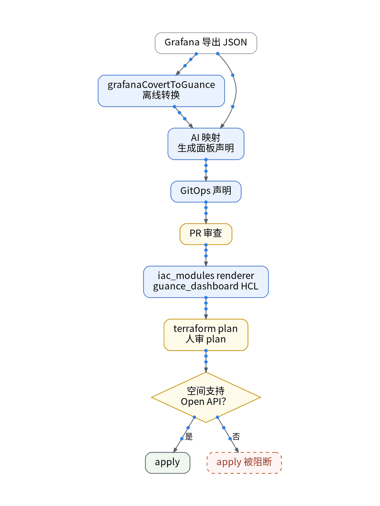

# 面板搬家，最难的是查询口径对上🧐

## P1 背景
沿用上一篇同一个观测云空间、同一条 IaC 流水线。Grafana 里的数据源是 VictoriaMetrics（PromQL）和 VictoriaLogs（LogsQL），首批只搬 3 个面板：资源健康、API 流量与错误、k6 压测延迟。

## P2 三个口径坑 ⚠️
① 变量：观测云视图变量要在查询里被引用才生效，Grafana 的 $var 不会自动对上
② 单位和名字：Remote Write 默认按第一个下划线切，go_memstats_heap_objects 变成指标集 go；设 keep_exist_metric_name = true 才保留原名
③ 分位数：观测云按原始点排序取位置值，histogram_quantile 是桶内插值，P95 要同窗比

## P3 怎么搬 🏭
grafanaCovertToGuance 离线转换 → AI 拆成声明 → renderer 生成 HCL → plan，人审。免费空间 apply 被阻断【待授权空间实测】。新写入有开关，默认关。

## P4 怎么退 🔙
配置回 Git 上一版再 plan；数据靠原始存储。演练耗时【待实测】。

## P5 适合谁 🙋
面板不多、愿意逐个对口径的人；想整库一键迁移的，先别来。

【待实测截图】：Grafana 与观测云同一时间窗的脱敏对照截图，放这里；没有真实截图就不发。

结论：语法能转，语义要人核；曲线对上一个，才切一个。

上一篇：低成本 SaaS 拼好了，还差一双眼睛｜下一篇：用户说卡，AI写的页面哪里慢？

#Grafana #可观测性 #观测云 #GitOps #独立开发
