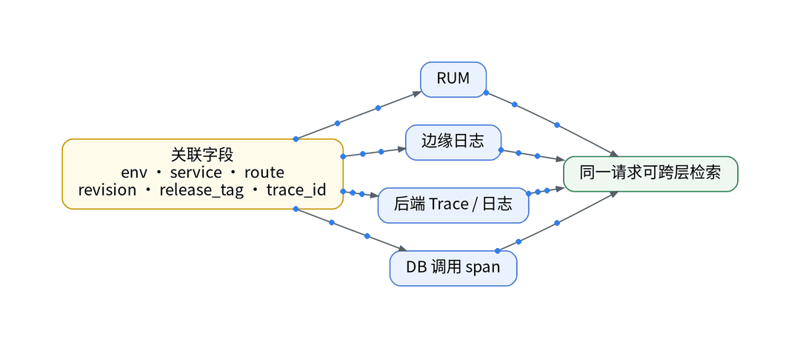

# 一个登录请求经过几朵云？用Trace把它接起来

## 一、场景：一次登录失败的复盘

以一次 UAT 登录失败为样本复盘：先翻 Cloudflare Workers 日志，再看 Cloud Run 日志与指标，最后查 Supabase 日志。三处没有共同的请求 ID，只能按时间戳人工对齐；Supabase Free 不含 Log Drain 与 Metrics endpoint，API 与数据库日志只留 1 天，第二天复查证据已不完整。定位耗时：【待实测】。根因不是缺指标，而是一个请求跨了三朵云，却没有一条线把它串起来。

## 二、知识点：上下文传播决定链路长度

Trace 能串多远，取决于每一跳是否把 W3C trace context 传下去：浏览器 → Worker → Cloud Run → 数据库调用。任何一跳不传，链路就在那里断开。数据库内部在 Supabase Free 上不可见，应用侧只能看到 DB 调用 span 的耗时。DataKit 的 OpenTelemetry 采集器接收 OTLP，官方推荐 gRPC；HTTP 只接受 application/x-protobuf。

## 三、最小实践：一条链路、一份字段契约

AI 起草 OTel SDK 配置、Collector exporter 声明和 PR 说明；Playbook 部署 Collector 的新增 exporter 指向 DataKit，开关默认关；写入 Token 由 Vault 运行时注入。字段契约统一 env、service、route、revision、release_tag、trace_id，契约外字段不采集。Workers 侧能否透传 trace context：【待实测】。

## 四、结果和局限

一条真实登录请求能否从浏览器跳到 Cloud Run span、再到 DB 调用 span：【待实测】。只有实际关联上的环节才叫“链路”；Workers 与 Supabase 内部在实测前标为盲区。Trace 计入免费版每天 20,000 个额度，与 Agent 监测共用。

## 五、适合 / 不适合

适合：请求跨多个托管平台、排障靠翻多个后台的独立开发者。不适合：期望看到托管数据库内部执行计划的场景，Supabase Free 不提供这类出口。

## 决策表

| 功能 | 特性 | 成本 | 客观事实依据 | 适用场景 |
| --- | --- | --- | --- | --- |
| 各平台自带日志 | 无共同 ID | 0 元 | Supabase Free 日志留 1 天 | 单层排查 |
| OTLP gRPC → DataKit | 开销低 | 计入 Trace 额度 | OpenTelemetry 采集器文档 | 后端链路 |
| W3C trace context | 跨层串联 | 改造工时【待实测】 | 每跳须透传 | 多云请求 |
| 应用侧 DB span | 只见调用耗时 | 0 元 | 无 Log Drain | 数据库盲区兜底 |
| 字段契约 | 跨信号检索 | 0 元 | 契约外不采集 | 所有信号 |

参考：观测云《OpenTelemetry 采集器》《版本区分》；Supabase 定价页。

上一篇：[《同一场线上排障：Coding Agent 和观测 Agent 谁更适合独立开发者？》](../03-code-agent-vs-obsy-agent-teams/outline.md)｜下一篇：[《AI帮我生成的告警，怎样才能真的值得打断我？》](../05-actionable-alerts/wechat.md)
