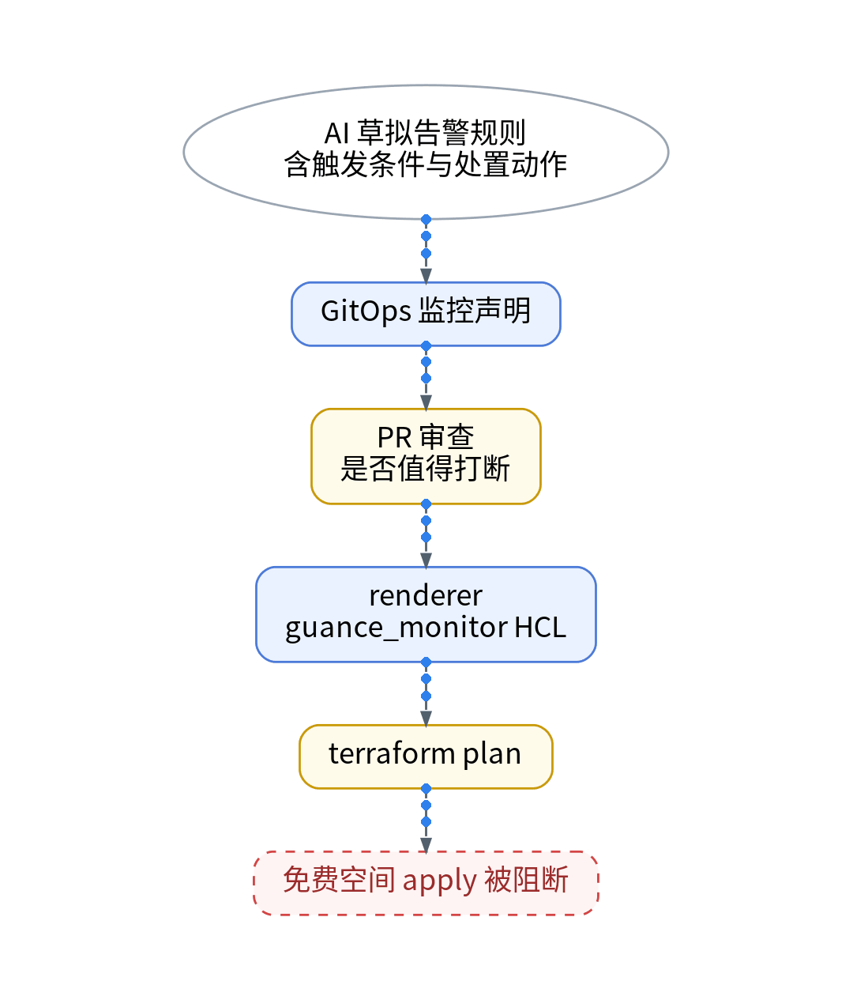
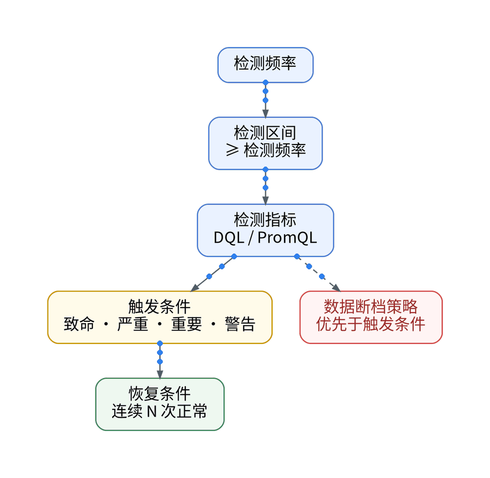

# AI帮我生成的告警，怎样才能真的值得打断我？

## 一、场景：AI 一口气写了一堆规则

让 AI 按现有指标草拟告警，它会给出 CPU、内存、磁盘、错误率、延迟、证书、失联……每条都“合理”，加起来却会把一个人的夜晚切碎。自建 Grafana 里原有规则覆盖主机资源、失联、站点证书和 Vector 管道自监控。

## 二、知识点：用问答筛规则

**Q1：免费版能放多少条？**监控器最多 10 个，且仅支持阈值检测。

**Q2：失联怎么告？**阈值检测自带“数据断档”策略，可触发数据断档事件或指定等级事件，且优先于触发条件判断。

**Q3：什么规则会被系统暂停？**按 trace_id 这类高基数字段分组可能引发告警爆炸，导致监控器被自动暂停；单次查询最多返回 10 万条；连续触发判断最多 10 次。

**Q4：证书和站点要占名额吗？**交给可用性监测，消耗每天 20 万次拨测额度，不占监控器名额。

**Q5：怎样才值得打断我？**每条规则必须写明触发后人要做的第一个动作；写不出动作的，降级为看板或日报。

## 三、最小实践：规则即声明

AI 起草规则声明，附触发条件、检测区间（≥ 检测频率）和处置动作；人审 PR 时逐条问“是否值得打断”。renderer 生成 guance_monitor / guance_monitor_json 的 HCL，terraform plan 后人审。免费空间不支持 Open API，apply：【待授权空间实测】。管道自监控留在 Grafana。

## 四、结果和局限

最终占用名额、两次演练的触发与误报情况：【待实测】。仅阈值检测意味着没有异常检测类规则可用。

## 五、适合 / 不适合

适合：一个人值守、规则不多的个人 SaaS。不适合：需要超过 10 个监控器或非阈值类检测的团队，应评估商业版。

## 决策表

| 功能 | 特性 | 成本 | 客观事实依据 | 适用场景 |
| --- | --- | --- | --- | --- |
| 阈值监控器 | 四级阈值 + 恢复 | 占 10 个名额之一 | 版本区分页；阈值检测文档 | 资源、错误率 |
| 数据断档 | 无数据即告警 | 同上 | 阈值检测文档 | 失联 |
| SSL / HTTP 拨测 | 不占监控器名额 | 计入每天 20 万次 | 版本区分页 | 证书、站点 |
| Grafana 告警 | 监控管道本身 | 现有组件 | 现有栈 | Vector 自监控 |
| 声明 + plan | 规则可审查 | apply【待授权空间实测】 | 免费版不支持 Open API | 所有规则 |

参考：观测云《版本区分》《阈值检测》《SSL 拨测》。

上一篇：[《一个登录请求经过几朵云？用Trace把它接起来》](../04-login-trace-across-clouds/wechat.md)｜下一篇：[《Codex的一次任务，到底调用了多少次工具？》](../06-codex-tool-calls/wechat.md)
