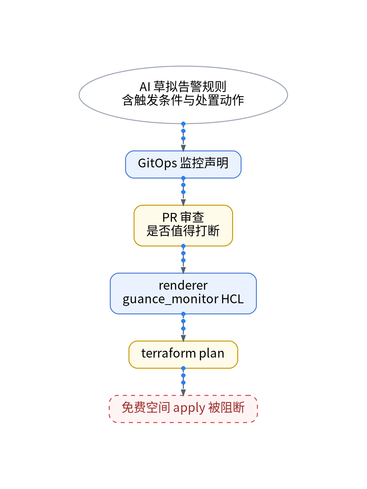

# 告警太多，AI能帮我筛吗？🔔

## P1 场景
让 AI 按指标草拟告警：CPU、内存、磁盘、错误率、延迟、证书、失联……每条都合理，加起来能把一个人的夜晚切碎。

## P2 5 个问题筛一遍 🧾
Q1 免费版能放几条？监控器最多 10 个，只有阈值检测
Q2 失联怎么告？阈值检测自带“数据断档”，还优先于触发条件
Q3 什么会被暂停？按 trace_id 这种高基数字段分组，可能告警爆炸，监控器被自动暂停
Q4 证书站点占名额吗？交给拨测，用每天 20 万次额度
Q5 值不值得打断？写不出“触发后第一个动作”的，降级成看板

## P3 规则即声明 🛠️
AI 起草规则声明，带条件、检测区间和处置动作；人审 PR 时逐条问“值得吵醒我吗”。renderer 生成 HCL，plan 后人审；免费空间 apply 被阻断【待授权空间实测】。管道自监控留在 Grafana。

## P4 还要注意 📝
检测区间要大于等于检测频率，不然会漏检或误报；连续触发判断最多配 10 次，用来压掉瞬时抖动。只有阈值检测，意味着没有异常检测类规则可用。

## P5 适合谁 🙋
一个人值守、规则不多的个人 SaaS。规则超过 10 条、又需要非阈值检测的团队，该认真评估商业版了，费用【待实测】。

【待实测截图】：一次告警演练的脱敏事件截图，放这里；没有真实截图就不发。

结论：AI 负责多写，人负责删；每一条留下的规则都要经得起“半夜被吵醒”这个问题。能叫醒你的，必须附带下一步动作。名额占用和误报【待实测】。

上一篇：一个登录请求到底去了哪里？｜下一篇：AI说完成了，我想看它做了什么

#告警 #可观测性 #观测云 #AI #独立开发
