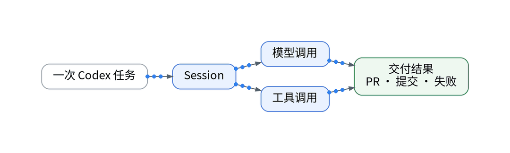
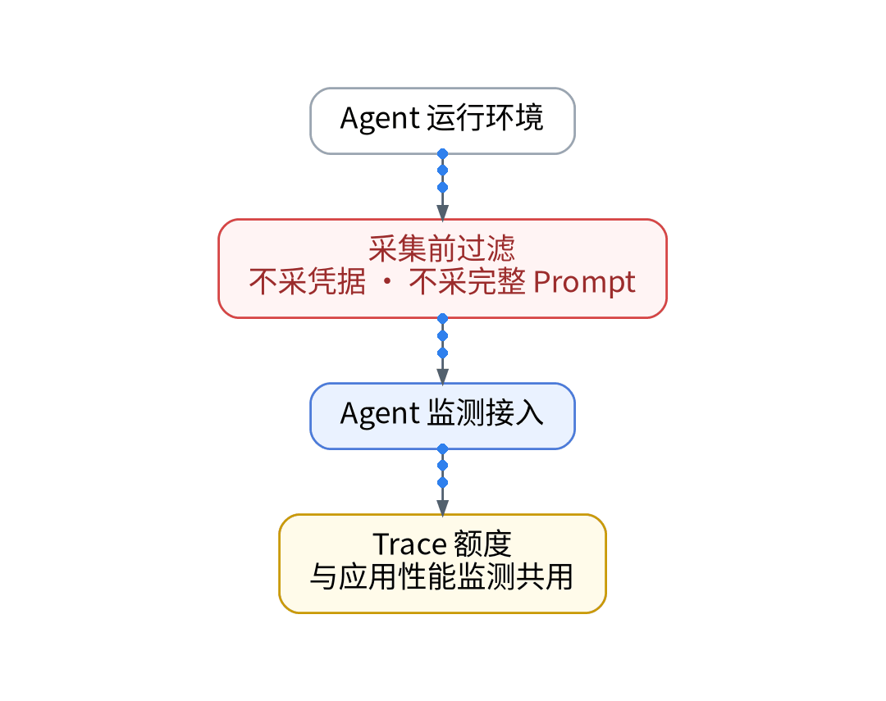

# Codex的一次任务，到底调用了多少次工具？

> 状态：大纲（证据未就绪，暂不成稿）｜模板：动手实操型

## 一、场景

Codex 回复“已完成”，但这次任务调用了哪些工具、重试了几次、哪一步最慢，事后无从复查。

## 二、知识点

- Agent 执行链：Session → 模型调用 / 工具调用 → 交付结果
- 版本区分页：Trace 额度含应用性能监测与 Agent 监测，每天 20,000 个，二者共用
- Agent Monitoring 是否覆盖 Codex、是否在免费版可用，须单独核验权益

## 三、最小实践（AI 辅助 IaC / GitOps / Playbook）

- AI 起草 Agent 遥测接入声明；采集前过滤凭据与完整 Prompt
- Playbook 部署接收端配置，Vault 注入写入 Token
- 只记录 session、工具名、耗时、状态

## 四、结果和局限

- 单次任务的工具调用次数与耗时分布：【待实测】
- Agent 监测在免费空间的可用性：【待授权空间实测】

## 五、适合 / 不适合

适合：主要靠 Codex 交付代码、想复盘 AI 行为的独立开发者。不适合：不能接受任何 Agent 元数据出境的场景。

## 决策表（草案）

| 功能 | 特性 | 成本 | 客观事实依据 | 适用场景 |
| --- | --- | --- | --- | --- |
| Agent 监测 | Session / 工具调用 | 计入 Trace 额度 | 版本区分页 | AI 任务复盘 |
| 采集前过滤 | 不采凭据与 Prompt | 0 元 | 免费版无平台脱敏 | 所有 Agent 数据 |
| 权益核验 | 逐项确认 | 【待授权空间实测】 | Agent Monitoring 为独立权益 | 接入前 |

## 成稿前须补的证据

- 观测云 Agent 监测文档与更新日志中 Codex 集成说明（需复核）
- 一次 Codex 任务的脱敏执行链截图

上一篇：[《AI帮我生成的告警，怎样才能真的值得打断我？》](../05-actionable-alerts/wechat.md)｜下一篇：[《Token花掉以后，怎样知道它有没有换来交付？》](../07-token-to-delivery/wechat.md)
