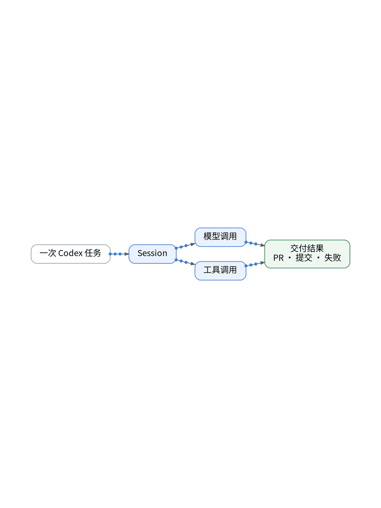

# AI说完成了，我想看它做了什么

> 状态：大纲（证据未就绪，暂不成稿）

AI 说完成了，可它到底做了什么？一次 Codex 任务拆开看：Session、模型调用、工具调用、最后的交付结果。观测云的 Agent 监测和 APM 共用每天 2 万 Trace 额度。凭据和完整 Prompt 一律不采，只记工具名、耗时、状态。

【待实测截图】：一次 Codex 任务的脱敏执行链截图，脱敏后放这里；没有真实截图就不发。

结论：先看执行链，再信“已完成”。

上一篇：告警太多，AI能帮我筛吗？｜下一篇：Token用得多，不代表真的干成了

#独立开发 #可观测性 #观测云 #AI
