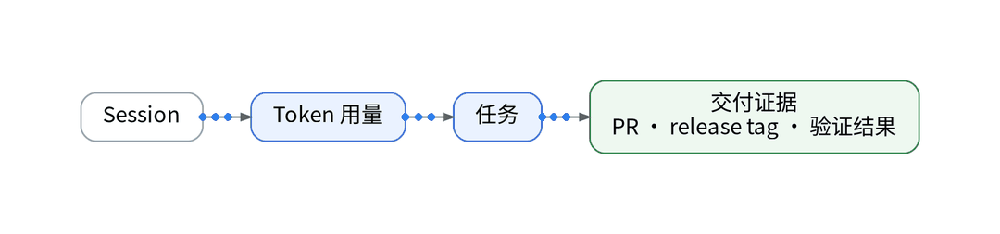

# Token花掉以后，怎样知道它有没有换来交付？

> 状态：大纲（证据未就绪，暂不成稿）｜模板：成本账本型

## 一、场景

这一周 Token 用量很高，但哪几次任务真的变成了合并的 PR 或发布，没有对应关系。

## 二、知识点

- 成本归因链：Session → Token 用量 → 任务 → 交付证据（PR、release tag、验证结果）
- 订阅计划不能简单按单次 API 价格折算；只有按量 API 才按调用计费
- AgentMeter 等计量能力为独立权益，须单独核验

## 三、最小实践（AI 辅助 IaC / GitOps / Playbook）

- AI 起草归因字段声明：session、task、release_tag
- 交付证据从 GitHub run 与 release tag 关联
- 成本按真实账单口径记录，无账单时估算写明假设

## 四、结果和局限

- Token 与交付的对应比例：【待实测】
- 计量权益在当前空间是否可用：【待授权空间实测】

## 五、适合 / 不适合

适合：同时使用订阅制与按量 API、想看投入产出的独立开发者。不适合：只用单一订阅、无需归因的个人。

## 决策表（草案）

| 功能 | 特性 | 成本 | 客观事实依据 | 适用场景 |
| --- | --- | --- | --- | --- |
| Token 归因 | 任务级 | 【待实测】 | 订阅与按量口径不同 | 投入产出复盘 |
| 交付证据 | PR / release tag | 0 元 | GitHub 记录 | 验证是否交付 |
| 计量权益 | 独立开通 | 【待授权空间实测】 | AgentMeter 为独立权益 | 接入前核验 |

## 成稿前须补的证据

- AgentMeter / Agent 监测 Token 字段文档（需核验）
- 一周账单与交付记录（脱敏）

上一篇：[《Codex的一次任务，到底调用了多少次工具？》](../06-codex-tool-calls/wechat.md)｜下一篇：[《Agent没有报错，为什么我的任务一直跑不完？》](../08-agent-loops/wechat.md)
