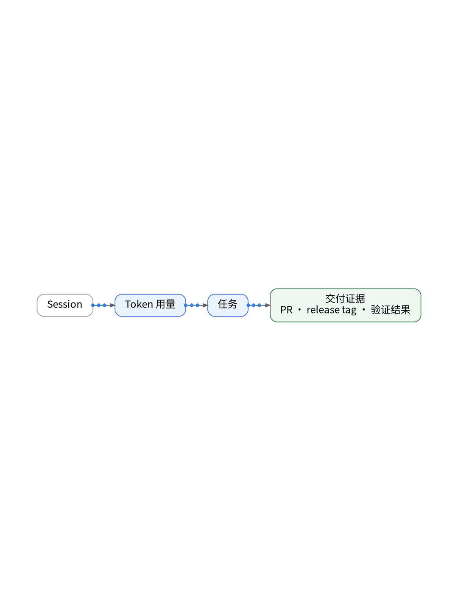

# Token用得多，不代表真的干成了

> 状态：大纲（证据未就绪，暂不成稿）

Token 用得多，不代表干成了。把 Session、Token、任务、交付证据串成一条线，才知道钱花在哪。订阅计划别按单次 API 价格去折算；没有账单的估算，必须写明假设。

【待实测截图】：一周账单与交付记录（脱敏），脱敏后放这里；没有真实截图就不发。

结论：按交付记账，不按 Token 记账。

上一篇：AI说完成了，我想看它做了什么｜下一篇：AI没崩，但一直在原地打转

#独立开发 #可观测性 #观测云 #AI
