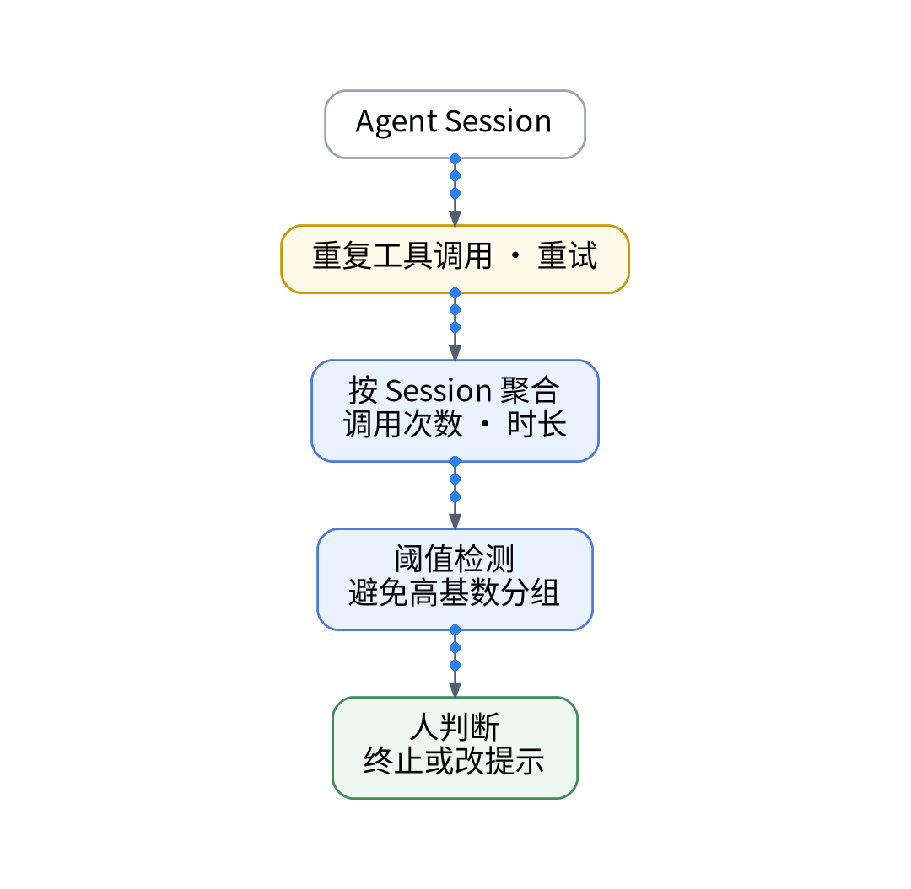
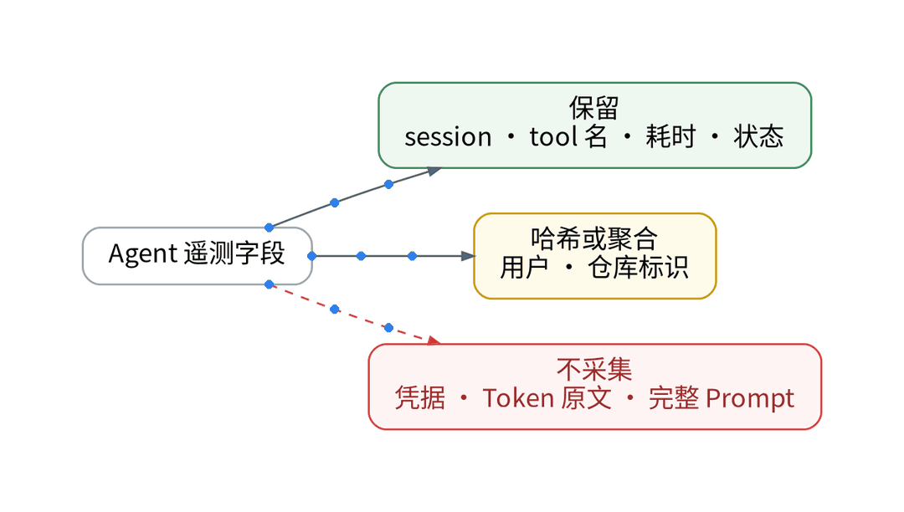

# Agent没有报错，为什么我的任务一直跑不完？

> 状态：大纲（证据未就绪，暂不成稿）｜模板：故障复盘型

## 一、场景

Agent 没有抛出任何错误，任务却一直在跑：同一个工具被反复调用，重试一轮接一轮。

## 二、知识点

- 循环与重试的信号：同一 Session 内重复工具调用次数、总时长
- 检测用阈值规则；按 session 这类高基数字段分组可能导致监控器被自动暂停（阈值检测文档）
- 禁采边界：凭据、Token 原文、完整 Prompt 不采集

## 三、最小实践（AI 辅助 IaC / GitOps / Playbook）

- AI 起草聚合规则声明，按工具名与状态聚合，不按 session 分组告警
- renderer → HCL → plan，人审；免费空间 apply 被阻断
- 采集前在发送端删除敏感字段

## 四、结果和局限

- 循环识别的准确率与误报：【待实测】
- 规则 apply：【待授权空间实测】

## 五、适合 / 不适合

适合：长任务多、经常“卡住不报错”的 Agent 使用者。不适合：任务都很短、无需聚合的场景。

## 决策表（草案）

| 功能 | 特性 | 成本 | 客观事实依据 | 适用场景 |
| --- | --- | --- | --- | --- |
| 重复调用聚合 | 按工具名与状态 | 计入 Trace 额度 | 版本区分页 | 循环识别 |
| 阈值规则 | 避免高基数分组 | 占监控器名额 | 阈值检测文档 | 超时提醒 |
| 禁采清单 | 凭据与 Prompt 不采 | 0 元 | 免费版无平台脱敏 | 所有 Agent 数据 |

## 成稿前须补的证据

- 一次真实循环任务的脱敏执行链
- Agent 监测重试字段文档（需核验）

上一篇：[《Token花掉以后，怎样知道它有没有换来交付？》](../07-token-to-delivery/wechat.md)｜下一篇：[《AI改完代码就发布？我用观测数据检查这一版》](../09-release-before-after/wechat.md)
