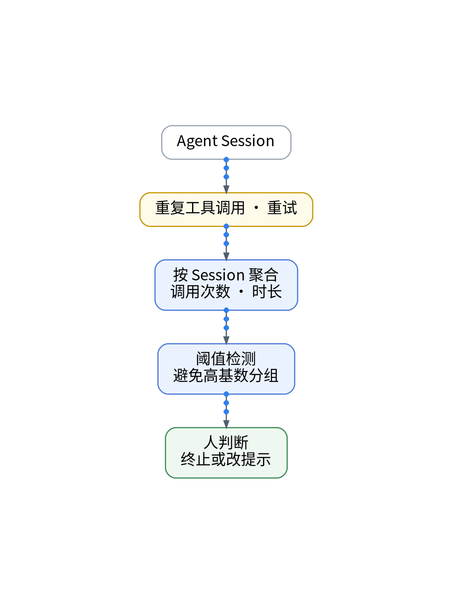

# AI没崩，但一直在原地打转

> 状态：大纲（证据未就绪，暂不成稿）

AI 没崩，却一直在原地打转。看同一 Session 里重复的工具调用和重试次数，就能发现循环。告警别按 session 分组，高基数会让监控器被自动暂停。凭据和完整 Prompt 永远不采。

【待实测截图】：Agent 监测重试字段文档（需核验），脱敏后放这里；没有真实截图就不发。

结论：不报错不等于在前进。

上一篇：Token用得多，不代表真的干成了｜下一篇：AI写完了，怎么确认没变差？

#独立开发 #可观测性 #观测云 #AI
