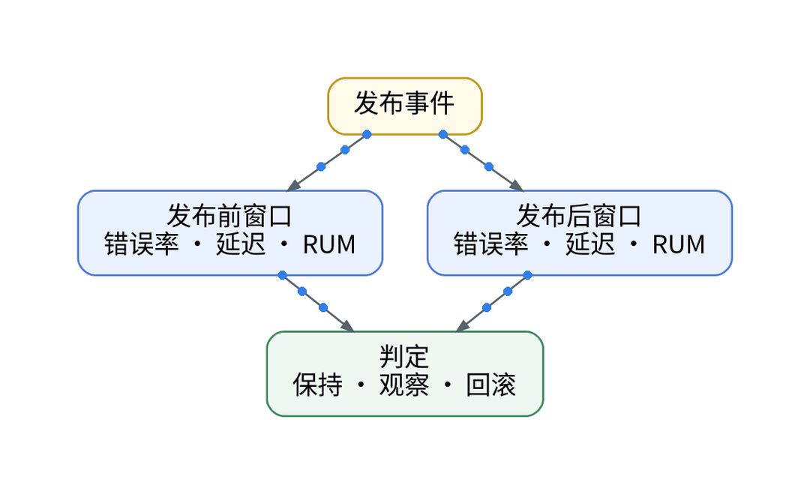
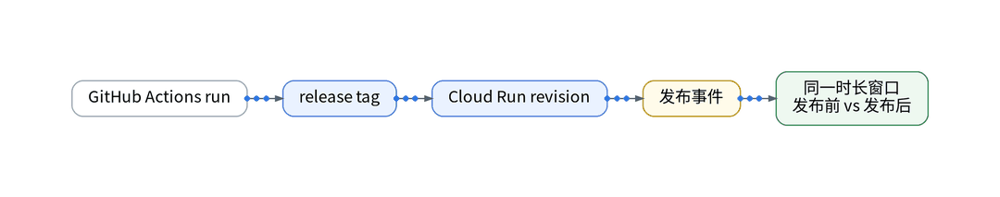
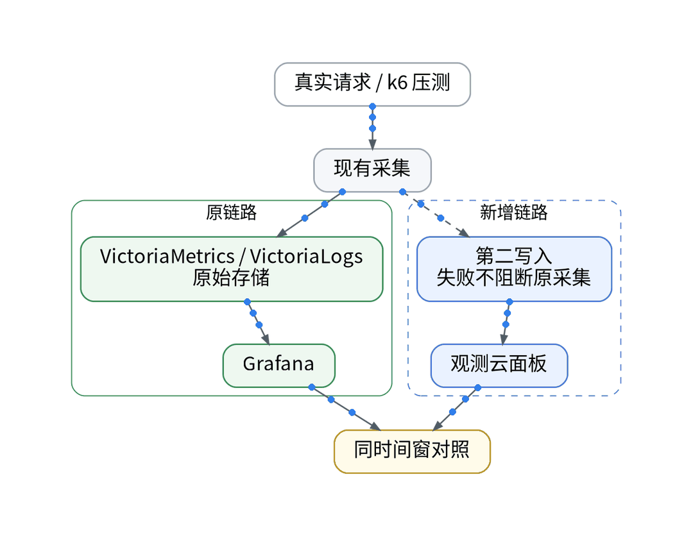

# AI改完代码就发布？我用观测数据检查这一版

> 状态：大纲（证据未就绪，暂不成稿）｜模板：对比选型型

## 一、场景

AI 改完代码，CI 通过就发布了；这一版是变好还是变差，只能等用户反馈。

## 二、知识点

- 发布证据链：GitHub Actions run → release tag → Cloud Run revision → 发布事件
- 对比方法：发布前后取同一时长窗口，比较错误率、延迟与 RUM 指标
- 对比方案：只看 CI / 发布后人工抽查 / 发布前后同窗对比

## 三、最小实践（AI 辅助 IaC / GitOps / Playbook）

- AI 在 workflow 声明中加入发布事件标记，不把密钥写进日志
- 发布事件写入观测云，携带 release tag 与 revision
- 对比规则写成声明，人审 PR 与 plan

## 四、结果和局限

- 发布前后同窗差异：【待实测】
- 发布事件写入方式与字段：【待实测】

## 五、适合 / 不适合

适合：依赖 AI 改代码、发布频繁的独立开发者。不适合：发布间隔很长、流量太低无法比较的服务。

## 决策表（草案）

| 功能 | 特性 | 成本 | 客观事实依据 | 适用场景 |
| --- | --- | --- | --- | --- |
| 只看 CI | 测试通过即发布 | 0 元 | 现有 workflow | 低风险改动 |
| 同窗对比 | 发布前后同时长 | 计入采集额度 | 版本区分页 | 常规发布 |
| 回滚判定 | 保持 / 观察 / 回滚 | 【待实测】 | 原始存储与 Git | 回归明显时 |

## 成稿前须补的证据

- 一次真实发布的前后对比截图（脱敏）
- 发布事件写入接口文档（需核验）

上一篇：[《Agent没有报错，为什么我的任务一直跑不完？》](../08-agent-loops/wechat.md)｜下一篇：[《凌晨收到告警，让AI先帮我整理排障线索》](../10-ai-triage-clues/wechat.md)
